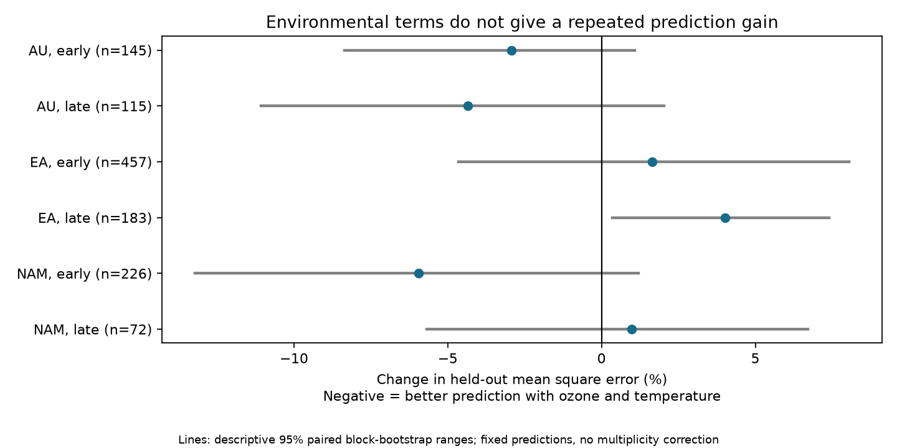

# Ozone and temperature gave mixed held-out floral pigment prediction gains in three regions in 1941-2017

Added ozone and temperature terms gave small prediction gains in both Australian samples, higher error in both Eurasian samples, and opposite changes in the two North American samples. These results describe a fixed model and one herbarium archive. They do not establish a common gain or the absence of a biological response.



## Question and prior work

Floral UV pigment can affect pollen protection, heat absorption and pollinator signals. Koski, MacQueen and Ashman (2020; DOI 10.1016/j.cub.2020.08.077) linked changes in this trait to ozone and temperature. Robson and colleagues questioned the ozone explanation (DOI 10.1016/j.cub.2021.06.019). The authors replied (10.1016/j.cub.2021.06.020). An erratum exists (10.1016/j.cub.2021.05.022). We checked these bibliographic records and the reply abstract, but did not obtain the full erratum or commentary. We cannot assume that the archived workbook includes corrections.

We searched the campaign for phenology, insect weather, butterfly, pigmentation, and pigment prediction before selecting this question. We read signed SCI study 36178688e78db08bef21ac27e18a4d981a7c7998960b892f05ce9d18e9d9c996. It tested an ozone-temperature interaction in exposed-anther records. We reuse its archive choice and its three regions and two periods. We wrote new code and include both anther types. This is a predictive check on overlapping records, not a new independent biological dataset. We found no prior campaign prediction study for these pigment records. This search does not establish global novelty.

Question: Do ozone and temperature add prediction value after controls for species, collection season, location and time, when whole five-year blocks are held out? A model that explains within-sample variation need not predict held-out records. This distinction can help assess environmental explanations before new field work.

## Source and sample

We reused the completed shared dataset in place. The file is
`/mnt/dell-data/shared_datasets/koski2020-floral-pigmentation-zenodo4002484-v1/Koski_Data.xlsx`.
It contains 204,378 bytes. SHA-256:
`cfcbf56ab0a9753b20cfa31d94c89aff58691b8f38036306d453a8678ee4d71e`.

The source is Dryad DOI 10.5061/dryad.ttdz08kw1, mirrored in Zenodo record 4002484, dated 2020-08-26. The Zenodo API marks it CC0. Its version field is absent; the local name says v1. The exact URL and rights are in external_data_notice.md. Raw data remain outside the publication.

We use the sheet `Spatiotemp and Clim Mod Data`. We remove 14 of 1,238 records that lack a required value. The 1,224 complete records have unique project IDs and UV proportions in [0,1]. Genus plus species defines a taxon. We preserve the workbook labels, which differ in count from the species count in the article abstract. The regions are Australia (AU), Eurasia (EA) and North America (NAM). The periods are 1941-1985 and 1986-2017. The split follows prior campaign work; it is not an estimated change point or a universal ozone recovery date.

## Method

The design in files/design.txt was written before model output. We fit each region-period sample separately. The response is UVP, the proportion of petal area that absorbs UV. Baseline predictors are taxon and collection-month indicator variables, latitude, longitude, altitude and linear year. The extended model adds monthly ozone, monthly temperature, and each exposure times an exposed-anther indicator (Symmetry A). Species controls absorb the anther-group main effect. There is no ozone-times-temperature term. These four added terms permit different linear environmental slopes for the two anther groups.

We use ridge regression with alpha=1, an unpenalized intercept, and all other coefficients penalized. Numerical predictors are centered and scaled using training records only. Category indicators are unscaled. Thus alpha is tied to this exact feature encoding. No penalty is tuned to test outcomes. Both model predictions are clipped to [0,1]. This is a fixed predictive comparison, not a test of a fitted causal coefficient.

Calendar blocks start in 1941 and contain five years, except the final block, which ends in 2017. We train on every other block within the same region and period. Thus training can include years before and after the held-out block. This is blocked reconstruction, not a future forecast. We score only test records whose taxon and month occur in that fold's training set. A total of 1,198 records qualify. This support rule uses predictor labels only. No test response is used to fit encoders, scaling or models.

For each block, we calculate the mean squared prediction error. Each scored block has equal weight in the final mean, so sparse blocks can have large influence. The main metric is 100 times (extended mean error / baseline mean error - 1). A negative value means improvement. Root mean square errors below are square roots of these equal-block mean errors. They are in percentage points of petal area.

We resample paired block errors with replacement 30,000 times, with seed 8841. The 2.5 and 97.5 percentiles give descriptive ranges conditional on the fitted predictions. They omit model-fitting variation. Training sets overlap, blocks may remain dependent, and there are only six to nine scored blocks per sample. These ranges are not calibrated significance tests, equivalence bounds or simultaneous confidence intervals. We make no claim from whether one range excludes zero.

Fixed sensitivity checks use alpha=0.1, alpha=10, omit linear year, or omit prediction clipping. We report all results and do not choose the best model after scoring.

## Results

| Region | Period | Scored/complete | Blocks | Baseline RMSE | Extended RMSE | MSE change | Descriptive range |
|---|---|---:|---:|---:|---:|---:|---|
| AU | early | 145/150 | 8 | 13.40 | 13.20 | -2.94% | -8.37 to +1.08% |
| AU | late | 115/124 | 7 | 13.33 | 13.04 | -4.36% | -11.07 to +2.03% |
| EA | early | 457/459 | 9 | 24.55 | 24.75 | +1.64% | -4.64 to +8.06% |
| EA | late | 183/184 | 7 | 23.18 | 23.64 | +4.03% | +0.35 to +7.40% |
| NAM | early | 226/230 | 8 | 36.38 | 35.29 | -5.94% | -13.22 to +1.19% |
| NAM | late | 72/77 | 6 | 34.94 | 35.11 | +0.97% | -5.68 to +6.71% |

The early period means 1941-1985; the late period means 1986-2017. Actual occupied blocks vary with source coverage. All counts and fold errors are in support.csv and block_losses.csv.

Environmental terms lowered error in three of six primary samples. Five descriptive ranges included zero. Later Eurasia had a positive range, but this is not a multiplicity-adjusted inferential result. Early Eurasia improved in seven of nine blocks, yet its overall error rose. Larger error costs in the other blocks outweighed those gains. This shows why counts of favorable blocks do not replace loss magnitudes.

Australian error changes stayed negative in all four sensitivity checks. Both Eurasian changes stayed positive. Later North America was sensitive to ridge strength: the change was -7.52% at alpha=0.1 and +10.76% at alpha=10. Omitting year gave -0.03%. Early North America improved under every check. No specification gave gains in all six samples. These patterns do not support a common prediction benefit across all regions and periods for this model family.

## Limits and meaning

The analysis offers a reproducible blocked benchmark for environmental trait models. It does not refute the original biological mechanism. A model can fail to predict because exposure values are noisy, samples are small, responses are nonlinear, species slopes differ, or collection practices change. Our environmental terms are simple, and ridge penalties change their contribution.

Species, month, location and year controls reduce some collection differences. They do not recover collection effort or sampling probabilities. We have no random sample, repeated population protocol, flower age, preservation measure or measured surface UV. Month may itself respond to climate; conditioning on it can remove a real biological path. Species labels may pool populations with different responses. We did not group spatially close sites into held-out units, so performance can benefit from location overlap. Few records in late North America make that test weak.

Regions have separate specimens but share one source archive, methods and exposure products. Species repeat across periods. These are regional and temporal checks, not six fully independent replications. The uncertainty ranges do not capture all sources of uncertainty.

Total-column ozone concerns atmospheric UV shielding. It is not surface ozone pollution. We test no surface pollutant, extreme event, species distribution shift, abundance loss or bloom date. The study addresses the environmental trait part of the broad biodiversity objective. It cannot assign changes to human-caused warming. A useful next test would measure UV, flower temperature and traits repeatedly in the same populations, with independent validation sites and recorded effort.

## Reproduce and inspect

Use Python 3.12 with numpy, pandas, scipy, scikit-learn, openpyxl, matplotlib, Pillow and threadpoolctl. Exact core versions are in files/run.json. Extract the publication and run:

```sh
python files/analyze.py --raw /mnt/dell-data/shared_datasets/koski2020-floral-pigmentation-zenodo4002484-v1/Koski_Data.xlsx --out /absolute/path/to/new-scratch
python files/validate.py /absolute/path/to/new-scratch
```

If the shared source is unavailable, run `python files/retrieve.py /absolute/path/to/raw-scratch/Koski_Data.xlsx`, then pass that path to --raw. Retrieval refuses existing files and paths inside the publication. Analysis verifies the source hash and writes outside the publication. It limits its own numerical library threads to one for small-matrix efficiency.

The code checks ridge predictions against an independent centered normal-equation solution for every primary fold, to within 1e-8. The aggregate validator checks all 30 model results against block errors, sample counts and RMSE identities. The initial run passed these checks. This checks implementation, not the validity of the sampling assumptions.

The package contains original code, this report, a design note, aggregate counts and errors, a figure and source provenance. There are no raw or record-level external tables. External source terms and attribution are separate from the unchanged SCI baseline license.

## Job provenance

Campaign: 11_07_2026. Job: sci-1107-dell-climate-pollution-biodiversity-fb85afc8907b. Topic: climate-pollution-biodiversity. Machine: dell. Account: codex-andrii. Model: gpt-6.1-sol with high reasoning effort through T3 Code and the Codex harness. Date: 2026-11-09. One finite worker completed the work without child agents. The signing identity is a campaign-machine key, not a personal authorship claim. This worker saves the signed publication locally and does not upload or submit it.
