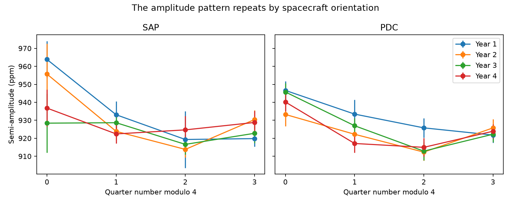
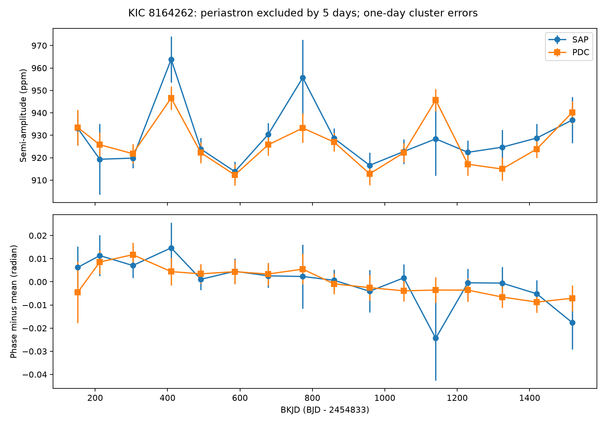

# A detector-season model reduces held-year amplitude error for KIC 8164262 in Kepler release 25

The measured amplitude of the main oscillation of KIC 8164262 repeats with detector season. A four-season model predicts quarters in a year left out of the fit better than a constant-amplitude model. This result applies to release 25 long-cadence flux, quarters 1 to 16, and the signal model below. It is evidence for a seasonal measurement effect. It does not identify its cause or establish a new stellar phenomenon.



## Question and prior work

Can changes in the measured amplitude of the known main oscillation be described by detector season, rather than a steady change with time?

Hambleton et al. (2018; DOI 10.1093/mnras/stx2673) found a large oscillation at 229 times the orbital frequency. They noted close unresolved peaks and possible amplitude or phase changes. Fuller et al. (2017; DOI 10.1093/mnrasl/slx130) studied resonance locking as a physical cause for the large mode. This study tests a measurement confound in that known system. It does not claim discovery of the mode, variation, or resonance locking.

The initial campaign search showed that many exocomet repeat tests were already published. We changed the target. A read of metadata from 633 then-present public campaign ZIPs found no match for `heartbeat`, `8164262`, or `tidal oscill`. Full SCI searches were stopped during whole-bundle verification; they did not give a complete result set. The saved search record states this limit. The metadata search did not search all main texts. There is no claim that this test has no prior use.

## Data

We use the public NASA Kepler release 25 long-cadence archive for KIC 8164262. The shared input is `/mnt/dell-data/shared_datasets/kepler-kic8164262-q0-q17-dr25/lightcurves.tar`. Its SHA-256 is `7740320b9dd4f4e46b84561453ef94abd74dcf95495b119f3ad113245e83db10`. The download helper created this immutable shared dataset. The source URL, archive hash, hash of each used FITS file, resolved shared path, and software versions are in `files/provenance.json`. FITS headers confirm DATA_REL=25. The code does not modify raw files.

SAP is aperture flux. PDC is flux after pipeline correction. Both products use the same exposures and are not independent observations. Later quarters supply tests in different years. No second instrument is used.

## Method

1. Keep exposures with zero SAP_QUALITY and finite time, SAP flux, and PDC flux. Divide each quarter and product by its own median. Express relative flux in parts per million (ppm).
2. Use orbital period 87.4549 days and reference minimum BKJD 835.82920 from Hambleton et al. BKJD is BJD minus 2454833. Remove samples within 3, 5, or 8 days of each reference minimum. This reduces the direct periastron pulse, the bright pulse near closest approach.
3. Split the retained times of each quarter into five-day segments. Fit and remove an offset and a slope in each segment. Apply the same linear projection to the sine and cosine columns. This treats the baseline and the oscillation in the same fit.
4. Fit one common frequency per flux product and mask. Minimize total squared residuals within 0.00015 per day of 229 divided by the orbital period. Then fit sine and cosine coefficients in each quarter. The reported amplitude is the semi-amplitude. There is no correction for finite exposure time.
5. Estimate coefficient errors with a cluster sandwich covariance. Each one-day block is one cluster. This permits correlated residuals within a block. It assumes no residual correlation between blocks. Use the delta method for amplitude and phase errors.
6. Use quarters 1 to 16 for the season test. Quarters 0 and 17 enter only the common-frequency fit and the saved quarter tables. Compare a constant, a linear time trend, four season means, and four season means plus a time trend. Use inverse amplitude variance as weight. The season index is quarter number modulo four. FITS headers map indices 0, 1, 2, 3 to channels 44, 41, 42, 43 and SEASON values 2, 3, 0, 1.
7. Leave out each group of four quarters (1-4, 5-8, 9-12, 13-16). Fit the other three groups. Sum squared prediction errors divided by the measured amplitude variances in the left-out group. These groups are called years in the figures. They are not calendar years. Frequency and error estimates still use all quarters. This is conditional prediction, not a fully blind end-to-end test.

## Results

For the five-day mask, PDC gives a common frequency of 2.618494926 per day. The nominal harmonic is 2.618492503 per day. The difference is small relative to that implied by the published orbital-period error. It is not evidence for a frequency offset from a tidal harmonic.

| Flux | Constant fit chi-square (15 degrees of freedom) | Season fit chi-square (12 degrees of freedom) | Constant held-year error | Season held-year error |
| --- | ---: | ---: | ---: | ---: |
| PDC | 66.94 | 11.94 | 71.24 | 19.97 |
| SAP | 32.93 | 11.64 | 34.18 | 23.36 |

The seasonal model reduces held-year error by 72 percent for PDC and 32 percent for SAP. A linear time trend gives larger held-year errors: 87.99 and 39.18. Adding a time trend to the seasonal model also makes prediction worse: 21.17 and 24.04.

The four PDC season means are 942.35, 923.81, 916.04, and 923.35 ppm, in index order. Their conditional standard errors are 2.68, 2.52, 2.53, and 2.15 ppm. Channel 44 exceeds channel 42 by 26.31 ppm, or 2.84 percent of the mean amplitude. This contrast is descriptive and was selected after inspection. It is not a pre-registered significance test. Channel 44 is also the channel with the lowest recorded aperture flux fraction, about 0.8625. A scalar loss of target light alone cancels in relative flux; this association does not prove an aperture-loss explanation. Reported crowding differs by at most 0.002, too little to explain the full relative contrast by simple constant dilution alone.

The PDC quarter phase range after a fitted linear phase trend is 0.0183 radian for the five-day mask. Its chi-square is 2.88 for 14 degrees of freedom with the stated cluster errors. We do not detect extra phase scatter with these errors. This null result does not prove exact phase stability.



## Checks and physical interpretation

All three periastron masks give lower seasonal prediction error in both products. PDC error falls from 72.57 to 19.62 for the three-day mask and from 62.36 to 21.61 for the eight-day mask. Thus the result does not require samples close to the bright pulse.

Two extra configurations use 2.5-day and 10-day baseline segments and three-day error clusters. Their full fit tables and prediction scores are in `files/short_segments` and `files/long_segments`. The accompanying sensitivity table gives the results. These are tests of the same observations, not independent confirmations.

| Baseline segment (days) | Error cluster (days) | Mask (days) | Flux | Constant error | Season error | Reduction (percent) |
| --- | --- | --- | --- | ---: | ---: | ---: |
| 5 | 1 | 3 | PDC | 72.57 | 19.62 | 73.0 |
| 5 | 1 | 3 | SAP | 39.04 | 28.97 | 25.8 |
| 5 | 1 | 5 | PDC | 71.24 | 19.97 | 72.0 |
| 5 | 1 | 5 | SAP | 34.18 | 23.36 | 31.7 |
| 5 | 1 | 8 | PDC | 62.36 | 21.61 | 65.3 |
| 5 | 1 | 8 | SAP | 29.18 | 22.21 | 23.9 |
| 2.5 | 3 | 3 | PDC | 56.88 | 14.74 | 74.1 |
| 2.5 | 3 | 3 | SAP | 45.84 | 20.68 | 54.9 |
| 2.5 | 3 | 5 | PDC | 58.10 | 14.23 | 75.5 |
| 2.5 | 3 | 5 | SAP | 41.26 | 19.44 | 52.9 |
| 2.5 | 3 | 8 | PDC | 48.90 | 14.79 | 69.8 |
| 2.5 | 3 | 8 | SAP | 36.84 | 18.94 | 48.6 |
| 10 | 3 | 3 | PDC | 53.47 | 14.21 | 73.4 |
| 10 | 3 | 3 | SAP | 33.22 | 30.16 | 9.2 |
| 10 | 3 | 5 | PDC | 56.67 | 15.30 | 73.0 |
| 10 | 3 | 5 | SAP | 33.09 | 33.41 | -1.0 |
| 10 | 3 | 8 | PDC | 45.48 | 14.70 | 67.7 |
| 10 | 3 | 8 | SAP | 30.74 | 27.27 | 11.3 |

A repeat run with one BLAS thread matched all main amplitude fits to better than 0.01 ppm. The saved validation record gives the exact difference. All 108 quarter-fit rows were present, all input headers gave release 25, and 17 of 18 season comparisons reduced prediction error. All nine PDC comparisons improved. The SAP test with ten-day baseline segments and a five-day mask was an exception: error rose from 33.09 to 33.41. Thus the SAP result is less robust to baseline choice.

A season-dependent transfer of flux or pipeline response is a useful explanation to test before attributing the full variation to the star. The pattern repeats when the star returns to the same channel. The instrument handbook and the Kepler artifact primer describe effects from pointing, focus, and differential velocity aberration. This analysis does not separate those causes. It does not show that the main oscillation is an artifact. The mode remains strong after removal of the periastron intervals.

An intrinsic variation with a similar annual period could also produce a repeating pattern. Only four returns to each channel are available. SAP and PDC have common instrumental inputs. The result therefore supports a confound, not a unique physical cause. It neither proves nor rejects resonance locking. Tests with new photometry, pixel-level flux recovery, and other oscillation modes would be needed to distinguish causes.

## Limits

Season was tested after we saw the pattern. The prediction test reduces the effect of extra parameters, but it is not independent of this model choice. The frequency and the errors were not refitted using only the training years. The error model is approximate. Correlations across blocks or errors in median normalization can alter its weights. The phase test uses approximate block errors. We do not set an upper limit on intrinsic phase drift. Baseline segments can contain gaps and may leave other modes in the residuals. A detailed binary or stellar model is not fitted. This work gives no new planet candidate or confirmed new astronomical event.

## Reproduction

Use Python 3.12 with numpy, scipy, pandas, astropy, and matplotlib. Exact installed versions are in the provenance file. From a directory with this publication unpacked, run:

```sh
python files/analyze.py /mnt/dell-data/shared_datasets/kepler-kic8164262-q0-q17-dr25 reproduced
python files/season_test.py reproduced
SEGMENT_DAYS=2.5 BLOCK_DAYS=3 python files/analyze.py /mnt/dell-data/shared_datasets/kepler-kic8164262-q0-q17-dr25 reproduced_short
python files/season_test.py reproduced_short
SEGMENT_DAYS=10 BLOCK_DAYS=3 python files/analyze.py /mnt/dell-data/shared_datasets/kepler-kic8164262-q0-q17-dr25 reproduced_long
python files/season_test.py reproduced_long
```

If the shared path is absent, download the exact source URL in `files/provenance.json` to a local directory as `lightcurves.tar`. Verify the archive hash above. Save its source metadata as `provenance.json` in that directory; use the `source` object in the supplied provenance file. Pass that directory to the analysis. No raw archive is duplicated in this bundle. The quarter fit tables, channel headers, and prediction tables preserve the evidence for the stated result.

## Job record

Campaign: 11_07_2026. Job: sci-1107-dell-astronomy-b0374698c13e. Topic: astronomy. Machine: dell. Account: codex-andrii. Model: gpt-6.1-sol, high reasoning effort. Analysis date: 2026-11-08. Work used no child agents. The campaign-machine signature supplies integrity; it is not a personal authorship claim. No private key is included. The baseline license covers this text, new figures, derived data, and code; raw NASA observations retain their source terms.
