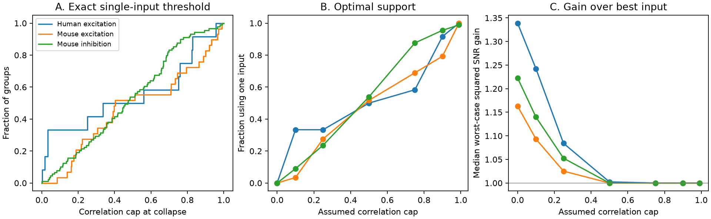

# A correlation cap of 0.5 selects one input in optimal positive readouts of 69 of 130 selected Allen input groups

We tested how unknown shared noise changes an ideal positive readout of measured inputs to one cortical cell. In a conditional model, a correlation cap of 0.5 made the optimal readout use one input in 69 of 130 selected groups. The exact threshold is the ratio of the second largest to largest individual signal-to-noise ratio. This is a model result. It does not measure input covariance or show that a real neuron removes inputs.



## Question and prior work

Does a positive readout still use all measured inputs when cross-input noise correlations are unknown? This question matters when circuit structure and individual response variability are available, but simultaneous input trials are not.

Campagnola, Seeman, and colleagues (2022, Science, doi:10.1126/science.abj5861) provide directly linked connectivity and synaptic response data from mouse and human cortex. Campaign publication SCI 2592773cb55908dee7cf99bc6159a27f90347ad466e7086dc6f5176240212a14 showed that an unweighted independent-noise sum need not beat the best single input in selected groups. It also gave an ideal independent-noise weighted reference and correlation sensitivity for the unweighted sum. We read that publication and use its sample definition. We wrote new code and reused no code or record table.

Robust quadratic optimization is established work. Bienstock (2007), Histogram Models for Robust Portfolio Optimization, gives background on adverse parameter choices in quadratic models. Hendler, Segev, and Shamir (2026, arXiv:2602.21758) study neural decoding with uncertain synaptic weights. Our uncertainty concerns noise correlation rather than readout precision. We do not claim a new general optimization method. The contribution is the exact input selection threshold, its proof for this uncertainty set, and its tested use on linked cortical input groups.

We searched campaign results for connectome, reciprocal, noise correlation, convergent, and positive readout before the test. The analysis is exploratory. The correlation cap was not estimated or chosen by a fit to trials.

## Data and selection

We used Allen Synaptic Physiology r2.1 small, source Last-Modified 2023-01-26. Shared input:

`/mnt/dell-data/shared_datasets/allen-synphys-r2.1-small-20230126/synphys_r2.1_small.sqlite`

Source URL: https://allen-synphys.s3-us-west-2.amazonaws.com/synphys_r2.1_small.sqlite

Size: 176771072 bytes. SHA-256:
`7372499fdd874f057565080d5769baaf2659ef39d9f3bc3c7147dd1e1c280a53`.

The script opens the database read-only and checks this hash. Resolved paths and package versions are in files/provenance.json. No new raw download was needed.

We join detected chemical connections, synapse type, response summaries, experiment, and species by their stored IDs. We retain mouse VisP and human TCx; human projects with culture in the name are excluded. An edge must pass dynamics QC, have at least 20 first-pulse responses, a finite positive standard deviation, and a finite median with the expected synapse sign. A group has at least two distinct source cells to the same target in the same experiment with the same synapse sign. Cell classes are otherwise unrestricted. Each group has equal weight.

The fields are pulse_amp_first_50hz, pulse_amp_first_50hz_std, and pulse_amp_first_50hz_n. The pinned Allen implementation in files/definitions.json stores a median, population standard deviation, and count of first-pulse fitted amplitudes in 50 Hz trains. The first pulse is not restricted here to a long prior silence. The median is not a mean.

Primary edge selection retains 372/1081 mouse excitatory, 633/1690 mouse inhibitory, 115/290 human excitatory, and 9/81 human inhibitory candidates. This gives 29, 89, and 12 convergent groups in the first three scopes. No human inhibitory group qualifies. Missing data are not zero responses. files/audit.csv records all edge counts.

## Model and proof

For each input i, assign hypothetical mean a_i equal to its absolute first-pulse median and standard deviation s_i equal to the stored standard deviation. Every input carries the same unit signal and arrives at the same time. Responses add linearly. Inhibitory groups have their signs reversed together. Let b_i = a_i/s_i > 0. The model does not require Gaussian noise.

A readout has weights w_i >= 0, not all zero. Define x_i = w_i s_i. For a correlation matrix R, its squared signal-to-noise ratio is (b dot x)^2 / (x transpose R x). We seek weights that maximize the lowest value over all positive semidefinite correlation matrices with diagonal one and abs(R_ij) <= r for i != j, where 0 <= r <= 1. The weights can depend on r and the marginal summaries, but not on the unknown R.

For nonnegative x, variance increases with each off-diagonal entry. Thus the worst variance is attained at C_r = (1-r)I + r 11 transpose. This matrix is feasible: its eigenvalues are 1-r and 1+(n-1)r. The pairwise upper bounds are therefore attained together. Negative correlations are allowed but cannot make the worst case worse. This reduces the problem exactly to minimizing x transpose C_r x, subject to b dot x = 1 and x >= 0.

For r < 1 this problem is strictly convex. Sort b in descending order. For an active set of the k largest b values, the stationarity conditions give x_i proportional to max(b_i - t, 0), with

t = r sum_active(b_i) / (1-r + r k).

Choose the k for which the next b value is at most t. The active values exceed t. Normalizing to b dot x = 1 gives the unique solution. These conditions include nonnegative multipliers for excluded inputs, so they prove global optimality. At r = 0, all inputs have positive weight and x is proportional to b.

Let b_1 and b_2 be the largest and second largest values. A single active input gives t = r b_1. It is optimal exactly when b_2 <= r b_1. Therefore r_c = b_2/b_1 is the exact single-input threshold for r < 1. The ratio is one in a top tie. At r = 1 a best input is optimal, with possible nonunique solutions. The single-input calculation is not a claim about anatomical pruning.

The reference is the best single-input squared SNR, B = max(b_i^2). Our optimal worst-case gain is always at least one because that input is feasible. We also test weights chosen under independence, x proportional to b, at the adverse C_r. An unweighted physical sum has x proportional to s. These two fixed readouts can have gain below one. Their adverse gains do not state their gain under actual, unmeasured covariance.

## Results

| Scope | Groups / experiments | Inputs per group | Median threshold r_c | Single input at r = 0.5 | Median optimal gain at r = 0.5 |
|---|---:|---:|---:|---:|---:|
| Mouse VisP excitation | 29 / 25 | 2 to 4 | 0.404 | 15 / 29 | 1.000 |
| Mouse VisP inhibition | 89 / 65 | 2 to 5 | 0.472 | 48 / 89 | 1.000 |
| Human TCx excitation | 12 / 10 | 2 to 4 | 0.449 | 6 / 12 | 1.002 |

At cap 0.5, weights chosen for independence have adverse gain below one in 17/29, 72/89, and 7/12 groups. Their median gains are 0.898, 0.910, and 0.991. Thus including all inputs with independence-based weights can lose the best-input guarantee, even though an optimal positive readout cannot lose it. These are exact conditional sample descriptions, not population rate estimates.

The cap 0.5 is an illustrative assumption. The figure and files/summary.csv show caps 0, 0.1, 0.25, 0.5, 0.75, 0.9, and 0.99. No biological correlation is inferred from a collapse threshold.

A 50 microvolt median floor gives one-input solutions at cap 0.5 in 10/24 mouse excitatory, 41/82 mouse inhibitory, and 2/8 human excitatory groups. Subtracting baseline noise variance gives 11/25, 25/48, and 5/10. This subtraction assumes additive independent recording noise and can amplify estimation error. Requiring 50 responses per edge gives only 6, 7, and 1 groups; one-input counts are 4, 4, and 1. Each check changes group membership. The small high-count sample limits confidence in the primary estimates.

We also allow every a_i and s_i to change independently by factors from 1/1.10 to 1.10. Each b_i then changes by at most factor 1.10 squared, so r_c is bounded by its nominal value divided or multiplied by 1.10 to the fourth power (and capped at one). This order-statistic bound remains valid if input order changes. At cap 0.5 it certifies single-input solutions in 46 groups (10, 30, 6 by the table order), and multiple-input solutions in 29 groups (11, 13, 5). It does not decide the other 55. The factor is an assumed error box, not a measured confidence interval.

## Validation and limits

For all 130 primary groups at all seven caps, exhaustive active-subset solutions match the threshold algorithm to relative error 5.56e-16. A separate constrained SLSQP optimizer matches to 6.28e-13. Feasible random covariance checks found no variance above the stated adverse covariance. All 910 cases pass the best-input guarantee and threshold identity. See files/validation.json. These checks test our method, not upstream response fits.

The main data limit is the absence of measured cross-input covariance. The assigned mean is a median; skewed or failure-rich distributions can violate this assignment. Standard deviations include recording and fit noise. Selection of the estimated best input can favor a noisy high estimate. There is no trial holdout. Groups can share cells and experiments. Small selected slice circuits omit most intact inputs and can suffer tissue damage. Regions and tissue sources differ between mouse and human. No species contrast or generalization across behavior is established. Timing, dendrites, nonlinear integration, stimulus tuning, and output spike generation are absent. Ideal weight changes need not be biologically feasible.

The supported principle has a precise scope: with same-sign inputs carrying one shared signal and a uniform correlation bound, only the top two marginal SNRs determine when the ideal positive readout can no longer guarantee a benefit from convergence. A direct biological test needs simultaneous repeated input trials, a measured covariance range, and held-out readout evaluation.

## Reproduction and rights

Use Python 3.12 and files/requirements.txt. From an extracted bundle, run:

```sh
python files/analyze.py /mnt/dell-data/shared_datasets/allen-synphys-r2.1-small-20230126/synphys_r2.1_small.sqlite scratch_external reproduced
```

Both output paths must be outside the publication. The first holds external edge and group records. The second holds new aggregate results and the figure. SQL, selections, validation and plot code are in one script. No private scratch is required.

If needed, retrieve the exact database through the helper under an unused name:

```sh
campaign-dataset allen-synphys-r21-small-retrieve-0b3571c9 --url https://allen-synphys.s3-us-west-2.amazonaws.com/synphys_r2.1_small.sqlite --filename synphys_r2.1_small.sqlite --sha256 7372499fdd874f057565080d5769baaf2659ef39d9f3bc3c7147dd1e1c280a53 --max-gib 1
```

Credit the Allen Institute for Brain Science and Campagnola, Seeman, and colleagues for the source data and upstream response analysis. Raw data, external code, edge extracts, input weights and target-level tables are not bundled. The bundle contains our code, proof, narrative, aggregate model statistics and figure. These aggregate statistics report our optimization results and do not reproduce a source database. External terms are described separately in files/EXTERNAL_NOTICE.txt. The unchanged SCI baseline license applies to bundled original materials.

Job: sci-1107-dell-neural-structure-and-computation-0b3571c9a8f2. Topic: neural-structure-and-computation. Campaign: 11_07_2026. Machine: dell. Account: codex-andrii. Model: gpt-6.1-sol, high reasoning effort, in T3 Code through the Codex harness. No child agents were used. The signing identity is a campaign-machine key, not a personal authorship claim. This study requests local signing only.
