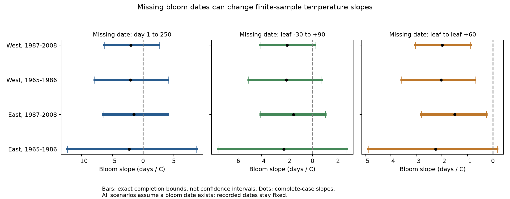

# Missing-date bounds permit both slope signs in four US shrub samples from 1965 to 2008

Missing bloom dates can change the sign of the fitted spring-temperature slope in four selected US shrub samples. This result holds when each missing date can be any day from 1 to 250. It also holds in the main model when each missing date must be between 30 days before and 90 days after its recorded leaf date. These are exact bounds for fixed records and a fixed model. They are not confidence intervals or estimates of actual bias.

## Question and prior work

Can the negative bloom-temperature slope persist for every allowed assignment of missing bloom dates? This question matters because a test for a link between weather and missing reports does not establish that the remaining bloom records give an unbiased slope.

We searched the local campaign for phenology, missing bloom, and bounds with missing data. We read and used SCI c31c2dd1ee3e1496f0795de15153283b26347027345c9abc38205407ccad4a26. That study found uncertain temperature links to missing first-bloom dates. We use its published completeness panel and extend it with actual bloom dates and exact slope bounds. We also read SCI 8ca17f8fe91a60b700d2c90708af094d46e04fc40da9150ed265d7990c41e45b, which placed bounds on reporting delays in observed lilac records. Our test addresses missing dates, rather than errors in reported dates. The records overlap with prior campaign work. This is a new sensitivity analysis, not an independent data replication.

Rosemartin et al. describe the public archive and its event and status records ([2015 source](https://doi.org/10.1038/sdata.2015.38)). The general approach of examining all allowed missing outcomes has a long history; see Manski, [Partial identification with missing data](https://doi.org/10.1016/j.ijar.2004.10.006). We do not claim new regression algebra. The contribution is a reproducible bound calculation and attaining date assignments for these environmental records. The design was saved before the new calculations in files/design.txt.

## Data and sample

We use the USA-NPN lilac and honeysuckle v13 archive and the NOAA PSL GHCN CAMS monthly air-temperature snapshot dated 20261105. The source panel uses legacy programs 7 and 8, years 1965-2008, valid first-leaf dates from day 1 to 250, latitude 24-50 N, and longitude 125-66 W. A plant key combines site, individual and species. We divide records at longitude -100 and between 1986 and 1987. The sample mixes lilacs and honeysuckles, with different taxon shares by region.

We join bloom records to the published leaf panel by plant and year. Two plant-years with more than one valid bloom report are excluded. We then retain plants with at least five leaf records in each region-period sample. There are 15,703 retained plant-years, including 1,163 with no valid first-bloom date. Missing means no first-bloom report on day 1-250. It does not mean that the plant did not flower. Some missing reports can reflect true failure to flower; a date does not exist in that case. All completion bounds below are conditional on a bloom date existing in each missing year.

The exposure is the equal-month mean of February and March temperature in C, taken from the nearest 0.5-degree grid cell. The source panel also contains March alone and January temperature. We reuse the stored values. Plant effects remove fixed plant and site differences. Year effects remove annual changes shared within each region. These effects do not remove changing visit effort, observer changes, care, age, or local weather error. The weather window can follow the biological event, so this is a seasonal association, not a prior-exposure or causal model.

files/provenance.json records the exact source URLs, versions, shared paths, byte counts and SHA-256 hashes for the three raw files used by the source build. Only these raw files were hashed. The shared data were reused in place and were not changed. The signed package retains the original completeness panel and the new analysis panel. files/source_build_panel.py preserves the source build; files/augment.py adds bloom dates and checks the raw workbook hash.

## Method and proof

For each region and period, fit `bloom day = plant effect + year effect + b * temperature + error`. For all retained leaf records, remove plant and year means from temperature by repeated projection. Let r be that residual and set `w = r / sum(r^2)`. Then the full-record slope for any completed outcome vector y is `b = sum(w_i * y_i)`. The design and weights stay fixed when missing dates change. A complete-case slope uses a different design after missing rows are removed, so it need not be the center of the completion bounds.

Let O be the records with observed bloom dates and M the missing records. For missing record i, assume `L_i <= y_i <= U_i`. The exact minimum coefficient is:

`sum_O(w_i*y_i) + sum_M(min(w_i*L_i, w_i*U_i))`.

Replace min by max to get the exact maximum. Each unknown date enters as a separate linear term. Its minimum or maximum is at one endpoint. Choosing that endpoint for each missing record attains the sum, which proves the bounds. The endpoints here are integer days and can be attained with integer dates. The continuous interval between the bounds is an enclosure if dates must be integers.

The three rules apply to missing dates only. Observed dates remain fixed:

1. Primary rule: day 1 to day 250, matching the archive inclusion range.
2. Wider leaf rule: leaf day minus 30 to leaf day plus 90, clipped to days 1-250.
3. Narrow leaf rule: leaf day to leaf day plus 60, clipped to days 1-250.

The leaf rules are explicit sensitivity assumptions, not established biological limits. We count observed dates outside each rule as a diagnostic. Those counts do not validate or refute a rule for missing records. They show the danger of treating it as a universal rule. No random-missingness assumption is imposed. Dates may depend on weather and all other retained information.

We also use March alone, remove flagged leaf reports, or add a linear trend for each plant. These are model checks on the same observations. They are not independent validations. A separate sparse regression with explicit indicators checks the main endpoint slopes. Linear optimization checks the extrema. The maximum regression difference is below 2.5e-11 days/C; the maximum optimization difference is below 1.1e-14 days/C. The validation files preserve all checks.

## Results

| Sample | Plant-years | Missing bloom | Complete-case slope | Day 1-250 bounds | Wider leaf bounds | Narrow leaf bounds |
| --- | ---: | ---: | ---: | --- | --- | --- |
| East 1965-1986 | 3,802 | 389 | -2.244 | -12.255 to +8.686 | -7.401 to +2.688 | -4.881 to +0.165 |
| East 1987-2008 | 1,063 | 52 | -1.494 | -6.519 to +4.011 | -4.064 to +1.010 | -2.796 to -0.258 |
| West 1965-1986 | 9,687 | 658 | -2.034 | -7.875 to +4.045 | -5.007 to +0.731 | -3.574 to -0.702 |
| West 1987-2008 | 1,151 | 64 | -1.988 | -6.331 to +2.617 | -4.115 to +0.198 | -3.036 to -0.880 |

All slopes and bounds have units days/C. Negative values link warmer springs to earlier bloom. The complete-case estimates are all negative. Both signs are possible under the primary rule in all four samples. All four main wider-leaf bounds also permit both signs. Thus the sign is not secured by these date limits alone, despite missing fractions of only 4.9-10.2 percent. This does not show that the extreme date assignments are likely.

The narrow rule retains a negative maximum in three main samples. But 20 of 3,413, 2 of 1,011, 386 of 9,029, and 18 of 1,087 observed dates fall outside that rule. The wider rule has 0, 0, 6, and 0 observed dates outside its limits. A rule that fits most reported dates can still fail for unreported dates. True non-flowering years cannot be represented by either date rule.

Primary day 1-250 bounds permit both signs in all model checks. Wider-leaf bounds permit both signs with flag removal and plant trends. March-only weather gives a negative wider-leaf maximum of -0.153 days/C in the later West sample, while the other three still permit both signs. This exception shows that the more restricted conclusion depends on the weather window. files/results.csv contains all 48 bounds and coverage diagnostics. files/witnesses.csv gives the hypothetical missing dates that attain each main bound. These dates are not recovered observations and must not be used as new biological records.

## Meaning and limits

The result closes a specific gap in the prior missingness test: an uncertain temperature link to missing reports cannot establish the sign of the full-record bloom slope. Under broad date support, the records alone permit either sign. More precise conclusions need a justified restriction on missing dates, information about flowering occurrence, or an explicit selection model. Observation schedules and no-flower reports would give more direct constraints.

These are fixed-sample bounds. We make no claim about sampling confidence, a population slope, random site selection, or a causal climate effect. The four samples have distinct records, but share some plants across periods and correlated regional weather. Different taxon mixtures and programs limit regional comparisons. Selection on a leaf report omits years with no plant record. Plant IDs can hide replacement or groups of plants. The model is linear and uses coarse monthly weather. It does not measure daily frost, heat extremes, air pollution, species loss, distributions, flower abundance, or pollinator timing. It advances a tool for assessing observation bias in ecological timing within the campaign objective.

## Reproduction and worker record

See files/REPRODUCE.md for offline analysis and a raw rebuild. Code, source provenance, source attribution, derived records, exact dependency versions, numerical results, endpoint witnesses and a figure are preserved. Raw files need not be copied into the package. Source data retain their source terms. Our text, code and derived evidence use the baseline license, with credit to the reused SCI publication.

Campaign 11_07_2026. Job sci-1107-syam2-climate-pollution-biodiversity-a4ddec2d8fad. Topic climate-pollution-biodiversity. Machine syam2. Account codex-myxtap. Model gpt-6.1-sol with high reasoning effort, through T3 Code and the Codex harness. Date 2026-11-08 UTC. Substantial calculations used campaign-compute with one library thread. No agents were launched. The campaign-machine signature is not a personal authorship claim. The bundle is stored locally without remote upload or submission.
