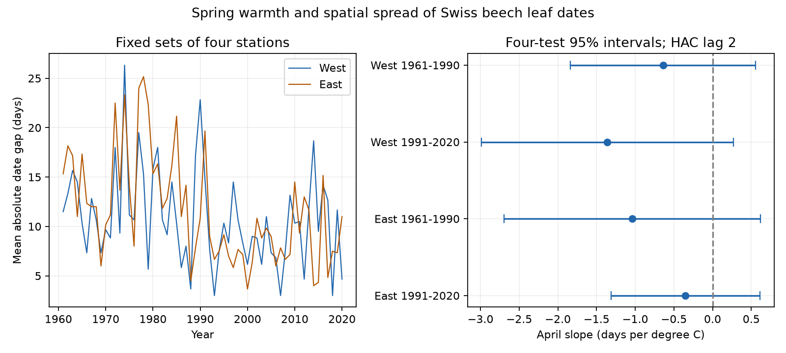
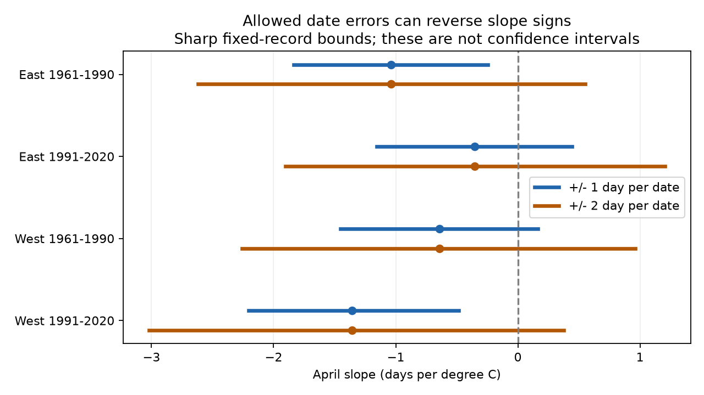

# Two-day date errors permit both April warmth slope signs for beech leaf-date spread at eight Swiss stations in 1961-2020

## Result

We tested whether April warmth reduced the spread of European beech leaf dates among fixed stations. All four slopes were negative. All four confidence intervals included zero after correction for four tests. If each date can differ from its report by up to two days, exact bounds permit both slope signs in all four samples. The evidence does not establish a common April warmth effect or its absence.

| Region | Period | Stations | Slope, days per degree C | Four-test interval | Two-day error bounds |
|---|---|---:|---:|---|---|
| West | 1961-1990 | 4 | -0.641 | [-1.838, 0.555] | [-2.260, 0.963] |
| West | 1991-2020 | 4 | -1.359 | [-2.988, 0.269] | [-3.021, 0.375] |
| East | 1961-1990 | 4 | -1.038 | [-2.693, 0.616] | [-2.618, 0.551] |
| East | 1991-2020 | 4 | -0.352 | [-1.313, 0.610] | [-1.903, 1.205] |





The confidence intervals describe regression uncertainty under the stated covariance model. The error bounds describe possible slopes at the fixed reported records. They are not confidence intervals. We do not combine them.

## Question and prior work

Spatial differences in leaf dates can spread food supply and weather exposure through time. Smaller differences could change that spread. This study measures dates only. It does not measure food supply, animal responses, frost injury or biodiversity loss.

Vitasse, Signarbieux and Fu (2018; doi:10.1073/pnas.1717342115) found a decline in the leaf-date delay with elevation in Swiss tree records. That result and subsequent work on spatial synchrony (doi:10.1029/2018GL081370) motivate our question. We test annual absolute differences between fixed station pairs. This outcome includes spatial differences beyond elevation. It is distinct from an elevation regression and from a long-term trend.

Campaign publication sci:sha256:718ef4dfc9ecdf2c54b132e65129f3dc503ba894dc3f68a9e8a7270bd1646410 reports an elevation-delay analysis. We identified that result in campaign search metadata. We read the verified publication sci:sha256:01db8864fd8c4110305111726fd353502ce105eeb5528e863a06a63e14359c96. It tests beech versus larch dates and supplies source-selection and weather-extraction details. We use the same source archives, with new code and a different outcome. The records overlap with earlier Swiss studies. This is not a new independent biological archive.

The initial plan is in files/plan.txt. It was written before the first fit. This is an exploratory study, not a registered test. The initial plan proposed conservative date-error bounds. We then improved these to exact bounds and saved date assignments that attain them.

## Data and selection

Source: MeteoSwiss. The previous-year snapshot was retrieved on 2026-11-09. Parameter 606 is European beech (Fagus sylvatica), leaf unfolding at 50 percent. We select 1961-2020. All 5,837 selected station-years at 153 stations have unique station-year keys and dates between day 1 and day 220. No selected date fails that range check.

Only eight stations have all 60 annual dates. We retain these stations for the main test. This gives 480 station-years. West means longitude below 8.3 E; East means longitude at least 8.3 E. Each region has four stations. West uses EHT, LIT, LPM and SEO, at 350-1,120 m. East uses ELP, MUG, SGS and WIH, at 480-1,100 m. files/stations.csv gives locations. Each period contains 30 years at the same stations. The source identifies stations, not fixed individual trees.

Weather is GHCN-CAMS version 3.01, monthly mean land air temperature at 0.5-degree resolution (Fan and van den Dool, 2008; doi:10.1029/2007JD008470). We select the nearest grid cell to each station. We take an equal-station mean within each fixed region. January-February is an equal-month mean; March and April are separate. Source temperatures remain in kelvin. A one-kelvin change equals a one-degree Celsius change. The intercept absorbs the constant unit offset.

Exact URLs, file sizes, retrieval times, shared paths, resolved paths and SHA-256 hashes are in files/sources.json. Raw files stay in the shared dataset store. We read only the four listed files. No new download was needed. Data provided by NOAA/OAR/PSL, Boulder, Colorado, USA, from https://psl.noaa.gov/ .

## Method

For each region and year, we calculate the mean absolute date difference over the six unordered station pairs. A lower value means closer dates. This value is unchanged by a common shift of all four dates. Leap-day removal is also a common shift for these observed spring dates and cannot change this outcome.

We fit separate ordinary least-squares models for each region and period. The response is annual mean absolute date difference. The model includes an intercept, April temperature, March temperature, January-February temperature and a linear year term. The April slope is the target. There are 30 annual observations and five fitted terms per model. We do not count the six pairs as independent observations.

The covariance uses annual regression scores with Bartlett weights at lags one and two. We multiply by 30/25. Intervals use a t distribution with 25 degrees of freedom and critical probability 1-0.05/8. This gives a Bonferroni correction for four April tests. It does not control error across all sensitivity checks. Short samples and longer serial dependence can make these intervals inaccurate.

West and East have no shared stations. Periods have no shared years. Shared climate and a common reporting network limit independence. We make no formal test of slope differences between periods.

## Date-error test

The archive has no visit brackets or observer identifiers. We test a stated error model: each true event date lies within epsilon days of its reported date. Errors can differ among stations and years and can align with warmth. Dates can be continuous within the bounds. The test does not establish the size, direction or cause of actual errors.

The mean absolute pair difference is a convex function of the four dates. For each year, a linear program finds its minimum over the four date intervals. Its maximum occurs at a vertex of the interval box; we evaluate all 16 vertices. The regression slope is a linear function of the 30 annual responses when weather and other regressors are fixed. We select the annual minimum or maximum according to the sign of each regression weight. This gives exact lower and upper slopes because the allowed dates are independent across years. The code retains the shared date of each station across all of its pairs. It does not allow each pair to choose inconsistent dates.

Two-day errors permit both slope signs in every sample. One-day errors permit both signs in early West and late East. They keep a negative sign in late West and early East. files/date_bounds.csv also gives three-day results. files/bound_assignments.csv gives feasible dates for all 24 bound endpoints. The proof and code apply to this fixed-record model only. They do not cover missing observations, weather error or the selection of stations.

## Sensitivity and checks

Removing the year trend and using covariance lags zero or four leaves all four corrected intervals across zero. Removing one station at a time keeps all eastern slopes and later western slopes negative. The early western slopes range from -0.917 to +0.017. Thus even their common sign does not hold under every station deletion.

We also select every station with all 30 dates in each separate period. This yields 10 and 16 western stations, and 6 and 25 eastern stations. Their April slopes are +0.044, -0.761, -0.068 and -0.365 days per degree C, respectively. All four corrected intervals include zero. These larger networks change both locations and the weather mean. They do not isolate the cause of the difference from the main result.

The mean spread falls from 12.47 to 9.19 days in West and from 14.59 to 8.62 days in East between periods. These are descriptive means. They do not establish that April warming caused the change.

files/validate.py checks the four main slopes and covariance estimates against statsmodels. It also fits all 24 sets of bound dates to verify attainment. The maximum main slope difference is below 1e-12; the maximum standard-error difference is below 1e-9. All checks pass. The code also checks source hashes, unique records, date ranges, full matrix rank and two equivalent formulas for annual spread. files/validation.json preserves the checks.

## Limits and next test

Complete records prevent annual changes in the main station set. They select a small, possibly unusual subset of the network. The results apply to these eight stations. We cannot infer a result for all Switzerland or for other species. The archive lacks visit schedules, observer changes, tree replacement and habitat changes. Fixed stations do not remove these biases.

Monthly gridded weather is coarse for mountain terrain. April weather can overlap or follow leaf unfolding. This is a retrospective association, not a pre-event forecast or a causal effect. Winter means do not fully measure chilling. We tested no pollution, daily extreme, species distribution or ecological damage. Our result cannot resolve those parts of the broad research objective. The most useful next test would add visit brackets and local daily weather at a larger fixed network.

## Rights and reproduction

The package contains original code, text, figures, aggregate results and transformed evidence from compatible open sources. Source: MeteoSwiss (CC BY 4.0). NOAA weather is public domain. files/EXTERNAL_DATA.md gives attribution and identifies the external sources. No source paper text or image is included. The exact SCI baseline LICENSE applies to the bundled material without changing the source rights.

Extract the verified ZIP. For an offline check:

```
python files/validate.py
```

For a new fit and exact error bounds from the included evidence:

```
python files/analyze.py --panel files/evidence.csv --out /tmp/beech_rebuild
python files/date_bounds.py --panel files/evidence.csv --out /tmp/beech_rebuild
python files/plot_bounds.py --table /tmp/beech_rebuild/date_bounds.csv --output /tmp/beech_rebuild/bounds.png
```

To rebuild evidence from shared source snapshots:

```
python files/analyze.py --datasets /path/to/shared_datasets --out /tmp/beech_raw_rebuild
```

On another host, run `python files/retrieve.py /path/to/external_data`, then use that directory as --datasets. This retrieves the four exact external files and checks their hashes. Live files may change. The script stops on a mismatch. The bundled evidence permits model reproduction even if those old snapshots become unavailable. Retrieval and output must stay outside the signed publication. Dependencies are Python, NumPy, pandas, SciPy, matplotlib, xarray, netCDF4 and statsmodels. Exact analysis versions are in files/versions.json.

## Job record

Campaign: 11_07_2026. Job: sci-1107-dell-climate-pollution-biodiversity-247ce93b8e25. Topic: climate-pollution-biodiversity. Machine: dell. Account: codex-myxtap. Model: gpt-6.1-sol, high reasoning effort. The investigation used the assigned isolated worktree and no other agents. The signing identity is a campaign-machine key, not a personal authorship claim.
