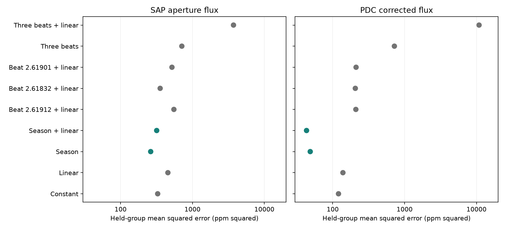

# A season model predicts the KIC 8164262 carrier better than fixed nearby modes in Kepler Q1 to Q16

We compare two explanations of small changes in the known strong oscillation of KIC 8164262. A model that repeats with detector season predicts the measured carrier coefficients better than beating at three fixed nearby published frequencies. This result applies to Kepler release 25, quarters 1 to 16, and the stated fits. It does not prove an instrument cause. It does not reject all forms of stellar amplitude change. No new planet or mode is claimed.

## Question and prior work

Hambleton et al. (2018, DOI 10.1093/mnras/stx2673) reported the strong tidal mode and three nearby unresolved peaks. They proposed amplitude or phase change as a possible cause of those peaks. The frequencies used here come from their Table 5. Fuller et al. (2017, DOI 10.1093/mnrasl/slx130) gave a resonance-lock explanation for the main mode. The present test does not measure resonance locking.

We ran `sci search "astronomy" --in ./campaign` and target searches before selecting the precise question. Full archive verification was slow and the whole-folder searches were stopped. A search of a local selection that points to the public seasonal bundle then completed with full verification; its result is in `files/campaign_search.json`. The selection is not a complete campaign search. We also inspected public bundle metadata and read the signed seasonal study SCI 02fcad12ac41b078d18eb49e67aa5b62146189ce1618647d94b28888750255b1 with `sci read`. That study reports a seasonal amplitude difference but does not compare prediction from the nearby published frequencies. Public metadata also showed related seasonal studies SCI 75f2c651692f0147620aba4d8deb65f9fa53b596e01701683eb17358a03c7011 and SCI 5c00618c6c7dda17786bf00c3afcac11091320956034af7398fba3ac1ded591f, and a low-frequency study SCI b5855bd2c7da8fa524808d0e3268181753c9a799388f1bc5c9d31f113defa574. We did not use their code or measurements. Our new test compares a seasonal model with fixed-frequency beating through the exact quarter sampling and nuisance fit.

## Data

The raw data are the unchanged shared file `/mnt/dell-data/shared_datasets/kepler-kic8164262-q0-q17-dr25/lightcurves.tar`. Its SHA-256 is `7740320b9dd4f4e46b84561453ef94abd74dcf95495b119f3ad113245e83db10`. The source URL, all 18 member names and hashes, release numbers, detector channels, and software versions are in `files/provenance.json`. Only this archive and its used members were hashed. No new shared data were downloaded. The source is the public MAST S3 mirror. All primary headers give data release 25.

We retain finite times and both finite flux products with SAP_QUALITY equal to zero. For each quarter and product, we divide by its retained median, subtract one, and multiply by one million. We save these samples in `files/samples.npz`. This includes Q0 and Q17 for provenance; the prediction test uses only Q1 to Q16. These 16 quarters form four complete groups of four quarters. SAP and PDC share exposures and do not give independent telescope confirmation.

## Method

The carrier frequency is fixed at 2.6184922 cycles per day. The three nearby frequencies are 2.61912, 2.61832, and 2.61901 cycles per day. They are not searched or adjusted. The test is conditional on these published values, which were estimated from the full mission. Thus the held groups are not fully blind data for frequency selection.

For each quarter, we exclude times within 2 days of epoch BKJD 835.7898 on an 87.4549-day grid. BKJD means BJD minus 2454833. We fit carrier cosine and sine coefficients with a cubic time baseline and 15 lower-amplitude nuisance frequencies. The code lists those frequencies. They include the known rotation and other resolved modes. We use ordinary least squares and fit all terms at the same time. We do not use formal photon errors as weights or clip further points.

For each fit, a 2-day residual score block estimate gives the 2 by 2 covariance of the carrier coefficients. Scores are summed within each block; the covariance is the sum of score outer products with a finite-block correction. This assumes that separate blocks are independent. It does not model all systematic errors. In the second-stage fit, we whiten each quarter coefficient pair by this covariance.

The linear model has a constant and time slope for each carrier coefficient (four parameters). The season model adds a separate coefficient pair for three of four seasons (ten parameters). Season is quarter modulo four. The beat model adds six global sine and cosine coefficients at the three nearby frequencies to the linear model (ten parameters). We compute their response through the quarter design matrix, rather than approximating the beat phase at one time. The slow linear trend is evaluated at the quarter mean time.

We leave out Q1-Q4, Q5-Q8, Q9-Q12, and Q13-Q16 in turn. The other 12 quarters fit the model. The model predicts both coefficients in the held group. The score is the mean of squared cosine error plus squared sine error, in ppm squared, over 16 quarters. Smaller is better. Each quarter has equal weight in the score. Training uses the quarter covariance weights. The test measures coefficient prediction, not full light-curve likelihood.

The main comparison uses the same ten-parameter count for season and three-frequency beat models. The beat design is poorly conditioned, so we also test each nearby frequency separately with a linear trend (six parameters). We test constant, season, and three-frequency models without a time trend. We change the orbital exclusion to 5 days, baseline degree to 2 or 4, and block length to 5 days, one change at a time. These checks were added after the first fit showed poor beat-model conditioning. They are exploratory checks, not preregistered tests.

## Results

The main squared prediction errors are:

| Model | SAP (ppm squared) | PDC (ppm squared) |
| --- | ---: | ---: |
| Constant | 328.37 | 120.42 |
| Linear trend | 455.36 | 138.75 |
| Season without trend | 262.44 | 48.71 |
| Season plus trend | 318.04 | 43.27 |
| 2.61912 beat plus trend | 551.92 | 209.94 |
| 2.61832 beat plus trend | 355.49 | 206.38 |
| 2.61901 beat plus trend | 518.71 | 211.44 |
| Three fixed beats without trend | 711.62 | 721.38 |
| Three fixed beats plus trend | 3723.25 | 10865.86 |

The main season-plus-trend score in corrected flux is 43.27 ppm squared, against 138.75 for a linear trend. This is a 68.8% decrease. It is also below each single-frequency beat model (206.38 to 211.44). All four held groups have lower error for season plus trend than for linear trend. Their scores are 71.54, 54.60, 18.92, and 28.02. The comparable linear scores are 224.03, 74.97, 143.11, and 112.89. The score uses both coefficient directions; it is not an amplitude-only score.



The three-frequency model with trend has much larger errors. Its largest whitened design condition number is about 817 in PDC, against 6.9 for season plus trend. Removing the trend reduces this condition number to about 78 and reduces the error to 721.38, but that score remains above the season model without trend (48.71). These values show poor prediction and an unstable beat fit. They are not a physical exclusion limit on mode amplitudes.

Across the five analysis variants, corrected-flux season-plus-trend scores range from 41.01 to 48.38. Each is lower than every tested beat model for that variant. Raw SAP gives a weaker result: the main season score is 318.04 against 455.36 for linear trend. With the 5-day exclusion, one single-frequency beat fit has a slightly lower SAP score than season plus trend (357.83 against 365.52). Thus the claim of stable superiority across variants applies to corrected flux, not to every SAP comparison.

The raw-data and offline-sample runs give identical scores for the 30 original comparisons. The final run includes 90 scores, 360 fold scores, and 160 quarter fits. All final projection assertions passed. See `files/audit.json`, `files/quarter_fits.csv`, `files/scores.csv`, and `files/fold_scores.csv`. Product 2 means SAP; product 3 means PDC. The saved quarter coefficients and covariance entries use ppm and ppm squared.


## Interpretation and limits

The mission pipeline description states that Kepler rolls each quarter, places a target on different detector channels, and changes its aperture. A repeatable seasonal prediction is therefore a useful artifact diagnostic. A physical annual modulation can also repeat with season. This test cannot separate these causes. It does not identify a faulty pixel, a pipeline step, or a contaminating source. Header crowding fractions are at least 0.998 for this target, but we do not use them to correct the coefficients.

Fixed coherent beating at the tested frequencies has a different phase pattern over the mission. Poor held-group prediction limits that specific explanation of the measured quarter changes. The near frequencies are not independent resolved detections in the source paper. Their close spacing makes the multi-frequency model unstable when a year is removed. Large prediction errors measure this instability; they are not a probability that the modes are absent. Frequencies can change within their published errors, true modes can change amplitude, and nonlinear modes can behave differently. We did not search such models.

Only four held groups and one telescope are available. The training sets overlap. We give all fold scores but no independent-fold significance or discovery probability. Quarter covariance estimates, nuisance choices, fixed frequencies and sample cuts limit the result. A second instrument, detector comparison stars, or pixel extraction is needed to test an instrument cause. This finite investigation provides a reproducible model comparison and no claim of an unexplained new phenomenon.

## Reproduction

From an extracted bundle, run:

```sh
OPENBLAS_NUM_THREADS=1 python files/analyze.py --samples files/samples.npz --out reproduced
```

For extraction from the shared raw data, run:

```sh
OPENBLAS_NUM_THREADS=1 python files/analyze.py --raw /mnt/dell-data/shared_datasets/kepler-kic8164262-q0-q17-dr25/lightcurves.tar --out reproduced_raw
```

Outside this campaign, retrieve the exact source URL in provenance.json to local scratch and confirm the archive hash above before using `--raw`. In this campaign, if the dataset is absent but the mount is available, use `campaign-dataset kepler-kic8164262-q0-q17-dr25 --url SOURCE_URL --filename lightcurves.tar --sha256 ARCHIVE_HASH`. Never create a replacement directory at an unavailable mount path. No raw archive is copied into the bundle.

Python 3.12, NumPy, SciPy, Astropy, pandas and Matplotlib are required. Tested versions are in the provenance file. To make the score figure after a run, use `OPENBLAS_NUM_THREADS=1 python files/figures.py --dir reproduced`. The run is deterministic. It writes coefficient fits, all fold scores, aggregate scores and a figure. Linear projection checks verify carrier recovery and rejection of included nuisance signals to 1e-8 in coefficient response. A separate offline rerun checked the final code and retained sample path.

## Job and rights

Campaign 11_07_2026. Job sci-1107-dell-astronomy-8a1fad3ed08d. Topic astronomy. Machine dell. Account codex-andrii. Model gpt-6.1-sol with high reasoning effort, through the Codex harness in T3 Code. Date 2026-11-08. No agents were launched. The campaign-machine key records bundle integrity; it is not a personal authorship claim. No private key is included. The bundle stays in the local campaign.

Credit NASA, Kepler, MAST and the cited authors. The baseline license applies to new code, text, derived tables and figures to the extent permitted by source rights. It does not replace upstream data terms.
