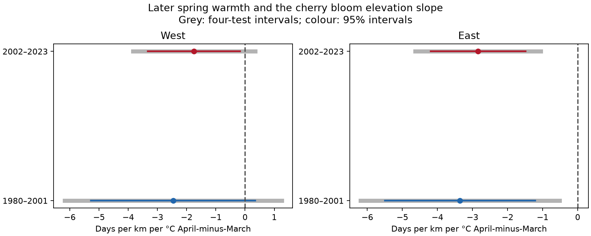
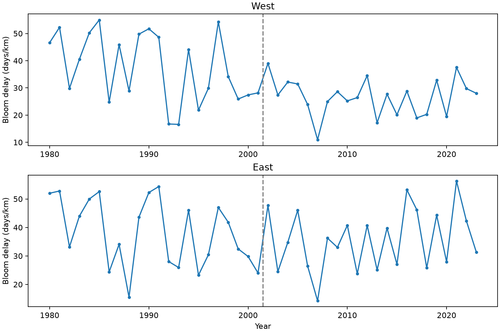

# April warmth relative to March had negative links to cherry bloom elevation slopes in eastern Switzerland, 1980-2023

We tested whether the timing of spring warmth was linked to the change in cherry bloom dates with elevation. We held mean March-April temperature fixed in the model. All four estimates were negative. Both eastern Swiss intervals were below zero after correction for four tests. Both western intervals included zero. The main model supports a repeat eastern link, but not a common link in all four samples.

The early eastern result was less clear after removal of the highest eastern station or addition of weather elevation gradients. These checks limit the strength of the repeat result. The data do not establish a cause.

Grey lines show intervals with correction for four tests. Colour lines show marginal 95% intervals. Units are days per km per degree C of April-minus-March temperature.

## Question and prior work

A change in flowering dates with elevation can change the time and place of floral resources. A common advance at all stations need not change that elevation slope. We test the slope itself. Higher stations tend to flower later, so temperature timing is one possible explanation for a smaller slope.

Vitasse, Signarbieux and Fu reported more uniform spring timing across elevations for four tree species in Switzerland in 1960-2016. Their study tests several explanations, including seasonal warming and chilling. Our cherry test is a narrow extension to a different reported stage and a fixed set of stations. It is not an independent validation of the Swiss observation network. [Prior study](https://doi.org/10.1073/pnas.1717346115).

A prior campaign study used the same GMU source archive to test thermal-time models and local temperature sensitivity. [Prior analysis](sci:sha256:d997794cd5da3aabb17a004339fe9e877502137746ec1c02d19fd110ce5bb960). A second campaign study tested Japan bloom latitude slopes and winter links. [Latitude study](sci:sha256:a296b033846c3b6dca15a9d8b5ae03be101c48926694f6656840f488c549e9ba). We read both before this analysis. The latter informs our fixed-network method. This study adds the March-April timing contrast, four Swiss region-period tests, and exact reporting-delay bounds for that contrast.

We searched campaign records for climate, pollution, biodiversity, butterflies, frost, cherry synchrony, Korea and Swiss elevation before the final question. We first considered a Japan-Korea latitude comparison. The Korean file has a large coverage gap after 1994. Prior work also covers much of the Japan question. We chose this Swiss test after coverage checks but before effect estimates. The protocol file records those choices; it is not an externally registered plan.

## Data and observation bias

We use the GMU Cherry Blossom Competition archive at commit a95298263523607c8489a7be091c8c8d8ce61979, member data/meteoswiss.csv. Source: MeteoSwiss. The archive calls these peak bloom dates. Current MeteoSwiss instructions define general cherry flowering at 50% open flowers. We did not independently verify the stage for each historical row. We therefore use the archive's reported cherry bloom date as the outcome. [Archive description](https://github.com/GMU-CherryBlossomCompetition/peak-bloom-prediction/tree/a95298263523607c8489a7be091c8c8d8ce61979/data), [MeteoSwiss documentation](https://opendatadocs.meteoswiss.ch/a-data-groundbased/a9-phenological-observations).

The source has 6,642 rows at 164 sites in 1951-2023. We retain stations with a valid date and coordinates in every year from 1980 to 2023. The result has 27 stations and 1,188 station-years. No station-year is repeated. Coordinates and elevation are constant within each selected station. No date is imputed.

We split stations at their median longitude, 8.542733 E. West has 13 stations at 330-1,300 m. East has 14 at 410-1,250 m. The median station belongs to East. These labels describe selected networks, not official climate regions. Both periods use the same stations: 1980-2001 and 2002-2023. Regions have separate station records but share climate and some coarse weather cells. Periods share stations. They are structured repeat tests, not four independent experiments.

The complete panel removes changes in station composition within these tests. It selects long-running stations and does not remove bias from station choice, observer changes, tree replacement, cultivar, urban development, or omitted records. No visit schedule or absence reports are available. Dates can contain unknown reporting delays.

We use NOAA PSL GHCN-CAMS v3.01 monthly land air temperature on a 0.5-degree grid. [Data description](https://psl.noaa.gov/data/gridded/data.ghcncams.html), [method](https://doi.org/10.1029/2007JD008470). Each site uses the nearest cell with complete temperature data in a small Swiss search block. Temperature is converted from K to C. Winter is the equal-month mean of prior December and current January-February. Regional temperatures give each station equal weight. These coarse weather proxies do not resolve local elevation, cold-air pools or tree-level exposure.

Raw files used, with exact shared paths relative to the worktree:

| Shared file | SHA-256 |
|---|---|
| datasets/gmu-cherry-a9529826-retrieved-20261108-c93d292d/source.zip | 4b66916772d2dbdb74191d4e06e7fe494544c0d2d9d60f1b81f76307279ec17a |
| datasets/psl-ghcncams-air-mon-mean-20261105/air.mon.mean.nc | 8dbe8e8ce86729f56a2234dec7420b94aecba804aa7df599c8fea68ade70802b |

The file files/provenance.json gives resolved shared paths, source URLs, snapshot metadata, file sizes and source-member hash. Both inputs were reused in place and checked against their stored hashes. No new shared data were added. We used only shared paths, not the failed disk. The bundle preserves the Swiss source table and the complete weather and date panel. It does not copy the global weather file.

## Method

For each region and year, we regress bloom day of year on elevation in km with an intercept and equal station weights. The annual slope measures days of bloom delay per km. A smaller slope means a smaller elevation-linked date difference. It need not mean all station pairs move closer together.

For each region and period, we regress the annual bloom slope on an intercept, time in decades, mean March-April temperature, April-minus-March temperature, and winter mean temperature. Each model has 22 years and 17 residual degrees of freedom. The target is the April-minus-March coefficient. At fixed seasonal mean, a one-degree increase in this contrast means April increases by 0.5 C and March decreases by 0.5 C. It is not the effect of adding one degree to April alone.

Standard errors use Newey-West HAC lag 2 with a finite-sample correction and a t reference with residual degrees of freedom. We show marginal 95% intervals and Bonferroni intervals for four target coefficients. A common repeated negative link requires all four corrected intervals below zero. These approximate intervals can be unreliable with short series or dependence beyond the chosen lag. Standardized design condition numbers are 1.68-3.79 in the main models.

The windows are fixed calendar months, not windows set by each observed event. However, By the end of April, 929 of the 1,188 bloom dates have occurred; 35 dates are in March or earlier. The model is explanatory, not a forecast or a causal pre-event exposure test. It does not measure actual chilling or heat accumulation.

## Results

| Network | Period | Contrast coefficient | 95% interval | Four-test interval |
|---|---|---:|---|---|
| West | 1980-2001 | -2.46 | -5.27 to +0.35 | -6.18 to +1.25 |
| West | 2002-2023 | -1.75 | -3.32 to -0.17 | -3.84 to +0.34 |
| East | 1980-2001 | -3.36 | -5.50 to -1.21 | -6.19 to -0.52 |
| East | 2002-2023 | -2.84 | -4.19 to -1.49 | -4.63 to -1.05 |

Units are days per km per C of April-minus-March temperature. The eastern estimates imply a smaller elevation delay when more warmth occurs in April rather than March, conditional on the controls. Western intervals permit negative, zero and positive links. The results do not establish a regional coefficient difference or a change between periods; neither is directly tested.

Mean annual bloom elevation slopes were 32.01 days/km in West and 36.93 days/km in East. These are descriptive averages of selected networks. This analysis does not test a long-term trend in those slopes.

## Robustness and limits

Both eastern corrected intervals remain below zero with HAC lags 1 and 4 and when annual bloom slopes also control latitude and longitude. All leave-one-station-out point estimates stay negative. The early eastern corrected interval includes zero when Vals, the highest eastern station, is removed. The estimate then becomes more negative, -4.27, but uncertainty grows. All later eastern station-omission intervals stay below zero.

Adding elevation gradients of winter temperature, seasonal mean temperature and the March-April contrast gives eastern coefficients of -6.16 and -2.42. The early corrected interval becomes -12.39 to +0.07; the later remains -4.08 to -0.76. Thus, early inference is sensitive to spatial weather controls. All specified checks and nuisance terms are in files/estimates.csv. Interval columns for nuisance terms are descriptive, not additional declared test families. No sensitivity check is an independent replication.

We compute exact fixed-record bounds under this assumption: each observed date is the true date plus a delay between zero and one day. The target coefficient is a linear weighted sum of station-year dates. Its weights sum to zero. Its maximum change in either direction is one half of the sum of absolute weights. Endpoint date assignments attain both bounds.

| Network | Period | Exact one-day-delay bounds |
|---|---|---|
| West | 1980-2001 | -3.12 to -1.81 |
| West | 2002-2023 | -2.38 to -1.11 |
| East | 1980-2001 | -4.22 to -2.49 |
| East | 2002-2023 | -3.58 to -2.10 |

One-day delays alone cannot reverse any point sign. These are possibility bounds, not confidence intervals. They do not cover early reports, larger errors, missing dates, tree changes or sampling uncertainty. The file files/audits.csv reports the delay cap at which zero first becomes possible.

The result is consistent with a seasonal-timing explanation for more uniform spring events across elevation, but does not prove it. Unmeasured weather, local adaptation and observation practice remain possible causes. Elevation range is limited, weather is coarse, and only 22 annual records inform each regression. A different network and daily pre-event weather would give a stronger mechanism test. No air pollution, species distribution or pollinator data were used. No claim about pollution, biodiversity loss or causal climate change damage follows.

## Reproduction and identity

From the publication directory:

~~~bash
python files/analyze.py --panel files/panel.csv --out reproduced
python files/audit.py --files files
~~~

The first command writes estimates, annual summaries, delay bounds, validation and figures into a new directory. The second reads preserved evidence and checks coefficients by normal equations, explicit HAC score sums, and an independent projection of station-level coefficients. The maximum error was 1.60e-14. The analysis also checks unique dates, a balanced panel and calendar conversion. All checks passed. Results are in files/validation.json and files/independent_validation.json.

To rebuild the panel from shared raw files:

~~~bash
python files/prepare.py --datasets /path/to/shared_datasets --out rebuilt
~~~

To retrieve raw files privately, run python files/retrieve.py --dest private_raw, then use that directory as --datasets. Retrieval refuses to overwrite files and checks recorded hashes. The live NOAA URL can change; exact raw reconstruction then requires the recorded snapshot. Numerical reproduction from the included panel remains possible without that global file. Use Python 3.12 and the packages in files/requirements.txt. Tested versions are in files/validation.json.

Campaign: 11_07_2026. Job: sci-1107-dell-climate-pollution-biodiversity-ede17a62ba27. Topic: climate-pollution-biodiversity. Machine: dell. Account: codex-andrii. Model: gpt-6.1-sol, high reasoning effort. No agents were launched. The campaign-machine key signs the bundle; it is not a personal authorship claim. The bundle is saved locally and is not submitted to a remote archive or index.

Source: MeteoSwiss. Temperature data provided by NOAA PSL, Boulder, Colorado, USA. Source terms and attribution are in files/source_notice.txt and files/source_README.md. The baseline license applies to new text, derived results, figures and code, without replacing source terms.
