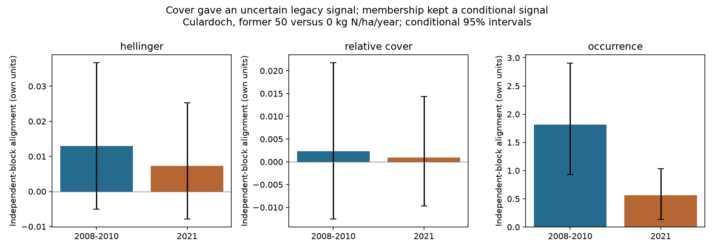

# Plant cover did not resolve a shared nitrogen response eleven years after addition stopped at Culardoch

## Question and contribution

Weak transfer from spatial environmental gradients to change through time is not specific to temperature. This raises a general question: how much information about former environmental pressure remains after that pressure is removed? We test the persistence of a plant community response to nitrogen addition. We use a field experiment, with no BBS data, Finnish moth data or monitoring-network response summaries.

Slow recovery after nitrogen addition is already known. Britton and Fisher (2007; doi:10.1111/j.1365-2664.2006.01251.x) studied early diversity and composition responses at this site. A prior SCI analysis of this release found that lichen richness deficits became smaller mainly because controls lost recorded taxa. We add a test of the full community response direction. We learn that direction in separate field blocks, then measure its signal after addition stopped. This avoids treating richness convergence as full community recovery and avoids learning the direction from the same endpoint used to test it. This is a new analysis of an existing experiment, not a new field experiment or discovery of nitrogen damage.

Contains data supplied by UK Centre for Ecology & Hydrology.

## Source and design

Perring and colleagues (2026), EIDC doi:10.5285/b9e76736-7db9-4576-acd9-dfdf9f8ff9a3, released rescued experimental vegetation records on 24 June 2026. We used the shared archive identified in files/provenance.json. We inspected its design report. Only Culardoch has a long post-cessation time series in this release. We do not claim a UK multi-site recovery test.

Culardoch is low-alpine Calluna-Cladonia heath in Scotland. Ammonium nitrate addition ran from 2000 to 2010, at 0, 10, 20 or 50 kg N/ha/year. Ambient deposition continued. Three blocks contain warming subgroups, burning subgroups within warming, and randomized nitrogen and clipping combinations within these groups. Burning occurred in 1999. Warming began in 2004; the source reports about 0.36 C. Clipping removed about 12% of annual production until 2022. We condition nitrogen contrasts on these imposed contexts. We do not estimate their interaction effects.

Two metadata strata do not each contain one plot per nitrogen dose: one has two controls and another has none. As in the prior SCI audit, we exclude these eight plots without repairing labels. This leaves 88 plots in 22 matched block-by-warming-by-burning-by-clipping strata. The tested contrast uses 44 plots: one 50-dose and one control per stratum. Other dose plots define complete design strata but do not enter the outcome contrast.

Vegetation was recorded in fixed 50 by 50 cm quadrats. Covers use the supplied harmonized taxon and group labels. Bare ground, Dead, Dung, Litter, Rock and Unknown species are excluded. The analysis uses ten survey years: 2007-2015 and 2021. All 880 required plot-years have positive summed plant cover. Missing taxon rows within a surveyed plot mean no recorded cover, not verified biological absence. Label groups remain groups; we do not call each one a distinct biological species.

## Methods

For a plot-year with cover c_s for taxon label s, define relative cover p_s = c_s / sum(c). The primary community vector is h_s = sqrt(p_s), the Hellinger transform. Cover overlap is permitted; the denominator is summed recorded plant cover. Each vector is computed before averaging over years. The early vector is the 2008-2010 mean and the late vector is the 2021 value. For matched stratum i, let a_i be its early high-dose minus control vector and b_i its late high-dose minus control vector.

For each stratum, learn the early direction a_bar from all strata in the other two blocks. Its early alignment is a_bar dot a_i. Its late alignment is a_bar dot b_i. We average these scores equally over 22 held-out strata. A positive late score means that the former treatment contrast persists along an early direction learned in separate plots. The ratio of late to early alignment describes retention on that direction. Ratio interval fields are left empty if the conditional early-alignment interval includes zero; ordinary ratio quantiles would then be misleading. It is not a fraction of species recovered, a fraction of cover restored, a variance explained or an equilibrium estimate. Values above one and below zero are possible. Distinct block climates and other contexts can change the score, so we also report each held-out block.

Conditional percentile intervals use 9,999 paired-stratum bootstrap draws within each of the three blocks. Each draw keeps the early and late histories together and rebuilds training directions. These intervals require exchangeable residual variation within each block and its mixed contexts. They do not include sampling variation across sites or all common environmental shocks. Block counts stay fixed, so the analysis never treats the same plot as both training and held-out data. The three folds share training data; they are not three independent experiments.

We also test the final treatment contrast without using early records. The statistic is the squared Euclidean norm of the mean b_i. In 9,999 random assignments, the high-dose and control labels are swapped within each stratum. The plus-one p value tests the sharp final no-nitrogen-effect null under correct assignment labels, randomization within strata and no interference. We adjust this p value by three for the three planned representations: Hellinger, relative cover and recorded occurrence. This is a test of final separation, not a direct randomization test of early-to-late alignment or of cessation itself. Because nitrogen and clipping were randomized together, the swaps condition on the retained clipping assignments and high/control plot pairs.

Planned sensitivity checks use relative cover, occurrence, an early 2007-2010 window and the intermediate 2013-2015 endpoint. All estimates are in files/estimates.csv. The plan records the question, exclusions and data-audit corrections before computed results were read. The design was informed by the prior published analysis; it is not a preregistered independent replication.

## Results

The primary Hellinger early alignment was 0.01294 (conditional 95% limits -0.00499 to 0.03674). The late alignment was 0.00730 (-0.00789 to 0.02531). Thus, this test did not resolve a shared cover-response direction in either period. The late point estimate was 56% of the early value, but the uncertain denominator prevents a reliable retention estimate: 7.9% of bootstrap early alignments were nonpositive. We do not interpret the ratio as a measured recovery fraction.

| Representation | Early alignment | Late alignment, conditional 95% limits | Final randomization p | Three-measure adjusted p |
| --- | ---: | ---: | ---: | ---: |
| Hellinger | 0.01294 | 0.00730 (-0.00789, 0.02531) | 0.3152 | 0.9456 |
| Relative cover | 0.00233 | 0.00093 (-0.00971, 0.01434) | 0.3453 | 1.0000 |
| Recorded occurrence | 1.81453 | 0.56142 (0.13352, 1.03707) | 0.0414 | 0.1242 |

Rows have different units and must not be compared as effect sizes. The occurrence early interval was 0.92965 to 2.90715. Its late-to-early ratio was 0.309 (0.113 to 0.470). This is conditional evidence that a membership response direction remained. The final norm randomization test did not pass the planned three-measure correction. Its null and statistic differ from the alignment interval; neither result overrides the other. The occurrence result is a secondary measure, not a replacement primary success.

Held-out Hellinger late alignments were +0.01756, +0.00697 and -0.00595 in blocks 1, 2 and 3. Occurrence late alignments were positive in all three blocks: +1.11905, +0.31548 and +0.14583. This supports reporting block heterogeneity and rejects a claim of uniform cover retention across the site. Individual blocks have only six or eight pairs.

The 2007-2010 early window kept the same conclusions: late Hellinger alignment 0.00721 (-0.00766 to 0.02449), and occurrence alignment 0.52334 (0.11462 to 0.97018). At the intermediate 2013-2015 endpoint, occurrence retention was 0.909 (0.760 to 1.222), while Hellinger alignment still had an interval across zero. The intermediate final norm tests gave adjusted p = 0.0126 for Hellinger and 0.0003 for occurrence, but these are planned sensitivity results rather than additional primary tests. The six primary and intermediate endpoint tests were not jointly corrected. A smaller late point estimate alone does not establish a statistically clear decline in retention.

All leave-one-block estimates are supplied in files/omissions.csv. They use only two blocks and do not supply independent replication.



## Meaning and limits

The main cover result is inconclusive. It permits a persistent nitrogen signature but also weak or opposite alignment. It does not show full recovery. The strong early occurrence signal and smaller late signal show why the outcome representation matters. A common membership direction can remain when relative-cover contrasts are too variable to resolve. This is consistent with a legacy in community membership, but it does not prove that membership controls abundance change. The study measures no such causal pathway.

A useful method result is the separate-block response score. It separates a historical direction test from endpoint separation and avoids a positive score caused solely by reusing the same noisy species vector for training and testing. Here it exposes uncertainty that a point retention ratio would hide. The method can be applied to larger multi-block cessation experiments; the small number of blocks here limits the evidence.

This experiment supplies a test of community memory after a known added pressure ends. It cannot identify the ecological cause of memory. Continued soil nitrogen effects, changed soil chemistry, persistent residents, competition, missing propagules and differential growth can all contribute. No soil, demographic or dispersal measurement enters this analysis. The experiment has no continued-addition arm after 2010, so a post-cessation trajectory is not a causal estimate of the benefit of cessation.

The climate link is a research implication, not an estimated climate effect. If past resource conditions leave persistent community contrasts, present temperature and colonist distance alone may not predict change. This test does not establish a share of the thermal-tracking gap. There is no thermal-affinity index or spatial temperature benchmark here. A nitrogen-removal result cannot be converted to a warming transfer coefficient.

The main limits are one site, three blocks, a high former dose, rescued metadata, group-level taxonomy, possible changes in recording, and an unsurveyed interval from 2016 to 2020. Common recording changes may cancel partly in matched dose contrasts but dose-dependent detection can remain. Excluding two inconsistent strata can change the target population. Relative cover removes total-cover change, and occurrence ignores abundance. None of these measures identifies extinction or recruitment. Results for other measures are not interchangeable.

## Reproduction and rights

Job: sci-1107-dell-climate-pollution-biodiversity-a3d90a640200. Topic: climate-pollution-biodiversity. Campaign: 11_07_2026. Machine: dell. Account: codex-olen. Model: gpt-6.1-sol, high reasoning effort. No agents were launched. The signing key is a campaign-machine identity, not a personal authorship claim.

Only original code, prose, figures and low-dimensional aggregate estimates are bundled. External source records and source documents stay outside the signed draft. Attribution and external terms are in files/NOTICE-external-data.md. Exact source and member hashes, shared path, software versions and random seed are in files/provenance.json. No private scratch file is needed for reproduction.

From an unpacked writable bundle, with Python, numpy, pandas and matplotlib installed:

```
python files/retrieve.py /absolute/path/to/external_scratch
OPENBLAS_NUM_THREADS=1 OMP_NUM_THREADS=1 MKL_NUM_THREADS=1 python files/analyze.py /absolute/path/to/external_scratch/ruder_data.zip /absolute/path/to/recomputed
python files/validate.py /absolute/path/to/external_scratch/ruder_data.zip /absolute/path/to/recomputed/estimates.csv
```

The retrieval script refuses to write inside the publication and checks the release hash. The analysis reads the external ZIP directly and writes only aggregate outputs. The validation script independently rebuilds both primary alignment estimates with CSV parsing, dictionaries and scalar loops. Run outputs can be compared with the bundled CSV files; the figure is rebuilt by analyze.py. CPU use requires only one numerical thread. All computations stopped before signing.

## References

- Perring, M.P.; Sawicka, K.; Fielding, D.; Deacon, A.; Britton, A.; Rowe, E.; Hayes, F.; Papatheodorou, E.; Field, C.; Caporn, S.; Stiles, W.; Jones, L.; Kowal, J.; Phoenix, G.; Stevens, C. (2026). Vegetation composition data from a series of former nitrogen deposition experiments in the UK, 2000-2021. NERC EDS Environmental Information Data Centre. https://doi.org/10.5285/b9e76736-7db9-4576-acd9-dfdf9f8ff9a3 .
- Britton and Fisher (2007), Interactive effects of nitrogen deposition, fire and grazing on diversity and composition of low-alpine prostrate Calluna vulgaris heathland. doi:10.1111/j.1365-2664.2006.01251.x.
- Prior lichen gap analysis: sci:sha256:993e22292017930450a084a36fbeb0ac62d447e9b2da67b622a201aa7fc50865.
- Thermal-transfer motivation: sci:sha256:0037934e440093284370046185fd30a78b7363fd6e940f8fd3d9860e2caedada.
- Plant-transplant composition motivation: sci:sha256:66f527a26b98f17b54ba82053910f3133e090992f926d96296dc62cd049902b4.
