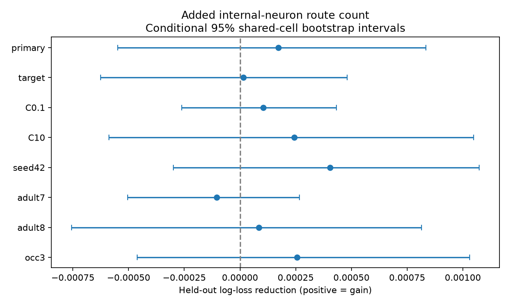

# Independent neuron route counts gave no clear response prediction gain in 13987 selected worm pairs

We tested whether the number of independent internal-neuron routes improves evoked calcium response detection prediction in selected C. elegans cell pairs. We linked two adult wiring maps to the Randi wild-type atlas by cell name. The sample had 13,987 pairs and 721 detected responses. Whole stimulated cells were held out of training. Controls included endpoint degree, two-step routes, shortest paths, observation count and cell identity. Adding the mean log route count changed log loss from 0.183120 to 0.182948. The reduction was 0.000172, with a conditional 95 percent shared-cell bootstrap interval from -0.000549 to 0.000834. The result gives no clear added value under the tested model. The two anatomy maps and the pooled response atlas came from different animals. Aggregate detection, fixed-prediction uncertainty, correlated controls and incomplete neuron coverage limit inference. Code, cut tables, linked features, predictions, source hashes and checks support reproduction.

## Question and prior work

Can anatomical tolerance to internal neuron loss help predict an evoked response when a direct chemical connection is absent? A route count could support transfer through parallel circuits. But it could also repeat the information in endpoint degrees and short routes. We test added prediction value, not the causal effect of a lesion.

Randi et al. (2023) measured evoked signal propagation and found differences from anatomical model predictions. Their mutant tests show that signals outside synapses can contribute [1]. Witvliet et al. (2021) mapped wiring across development and reported stable and variable connections [2]. These results motivate a test that uses more than direct wiring but does not assume that every anatomical route transmits a response.

A prior campaign publication computed exact internal-neuron and edge cuts in these maps [3]. It did not test response outcomes. We reuse its published cut table, after full SCI bundle verification. A second campaign report found no clear response prediction gain from two-step route counts in the same 13,987 pairs [4]. We extend that benchmark to independent internal-neuron routes of any length, with short routes and shortest paths as controls. This is an incremental test on overlapping data, not an independent replication. We searched the campaign before the test. The search record and the plan are in files/. The literature search was focused and is not a systematic review.

## Data and route definition

The inputs are the Randi functional atlas and adult 7 and 8 edge tables from Worm Neuro Atlas commit b2e13d88b670efcb3438aeacba2ad4bd6c383933. files/provenance.json records exact shared paths, resolved paths, source URLs, byte counts and hashes. All used raw hashes were checked against the shared provenance records. No raw file was changed or downloaded. files/cut_provenance.json records the reused SCI entry hash and the selected cut-table hash. Raw data remain in the shared dataset store.

The common identity set has 178 neurons. Functional AWCOF is changed to AWCOFF. Functional AWC ON/OFF identities are not equated with anatomical AWC left/right identities. The common cell set excludes these unmatched cells. Anatomical paths are restricted to this induced graph. Chemical rows are summed by source and target. An edge is present if the chemical count is positive. Self edges are removed. Electrical counts use the maximum over listed directions and are entered in both directions. Electrical links are covariates, not edges in the route graph.

V(s,t) is the largest number of directed chemical routes from source s to target t that share no internal neuron. It equals the minimum number of internal neurons whose deletion breaks reachability. Endpoints remain present. This is a standard consequence of directed Menger's theorem, not a new theorem. Direct chemical edges are excluded in both maps because they cannot be broken by internal neuron removal. Unreachable pairs have V=0 and remain in the sample. All path lengths are allowed. We use the average of log(1+V) from the two adults. Each route count is computed within one adult map. We do not form paths by combining edges from different animals.

The functional array has responding cells in rows and stimulated cells in columns. We transpose it to source rows, as confirmed by the pinned upstream NeuroAtlas source [5]. We retain distinct pairs with finite wild-type q, positive occurrence count, and no direct chemical edge in either adult. Detection means q < 0.05. The sample has 138 stimulated cells, 159 responding cells, and 721 detections (5.15 percent). Failure to meet the threshold is not evidence of response absence. Cell names link anatomy and function from different animals.

## Prediction method

The base model is logistic regression with fixed L2 penalty C=1. It includes separate source and target indicators. Numeric controls are the mean adult log(1+count) of four endpoint degrees, the minimum source-out/target-in degree bound, forward and reverse two-step routes, shared inputs and outputs, direct electrical counts, and reverse chemical counts. It also includes log(1+occurrence count) and its square, and the two adult shortest directed chemical path lengths. Unreachable path length is coded as 20, greater than every finite shortest path in the selected pair sample (maximum 7 in each map). The added model has one extra mean log route-count term. No model choice is selected by its result.

Five folds hold out whole stimulated cell identities. Seed 1107 shuffles sorted cell labels and assigns them in turn to folds. Numeric scaling and identity encoding use training data only. Unseen identity indicators are zero. The principal score is mean pair log loss. A positive base-minus-added reduction means better predictions. Thus the result concerns generalization to held-out cell identities within this atlas. It does not concern held-out animals.

For uncertainty, 2,000 bootstrap draws resample the union of cell identities. Each pair has the product of its source and target multiplicities. The same weight is used for a cell in both roles. Intervals use the 2.5 and 97.5 percentiles. Predictions and folds remain fixed. These conditional intervals do not include model refitting, animal sampling, reconstruction error or shared recording effects. They are not full population intervals. Sensitivity checks hold out responding cells, change C, change fold seed, use each adult's added feature alone, or require at least three occurrences. They use overlapping data and are not independent tests of generalization.

## Results

| Analysis | Pairs | Base loss | Added loss | Reduction | Conditional 95 percent interval |
|---|---:|---:|---:|---:|---|
| primary | 13987 | 0.183120 | 0.182948 | 0.000172 | -0.000549 to 0.000834 |
| target | 13987 | 0.186819 | 0.186804 | 0.000015 | -0.000625 to 0.000480 |
| C0.1 | 13987 | 0.184334 | 0.184229 | 0.000104 | -0.000262 to 0.000432 |
| C10 | 13987 | 0.185553 | 0.185310 | 0.000243 | -0.000589 to 0.001048 |
| seed42 | 13987 | 0.182441 | 0.182037 | 0.000404 | -0.000298 to 0.001073 |
| adult7 | 13987 | 0.183120 | 0.183225 | -0.000105 | -0.000504 to 0.000266 |
| adult8 | 13987 | 0.183120 | 0.183034 | 0.000085 | -0.000755 to 0.000815 |
| occ3 | 8678 | 0.211405 | 0.211149 | 0.000256 | -0.000461 to 0.001030 |

A post hoc descriptive check gives a correlation of 0.9816 between the added feature and the mean log endpoint degree bound. This high overlap can limit added prediction value. It does not identify a biological cause. The primary interval includes zero. 7 of the seven sensitivity intervals include zero. The primary AUC changes from 0.734463 to 0.734640. We found no clear added prediction value under this model. We did not test equivalence or establish that a small gain is absent.

## Checks

An independent SciPy integer maximum-flow calculation with split vertices agrees with 100 deterministic sampled cuts in each adult. The code checks node cut <= edge cut <= endpoint bound in all reused rows. The parent publication supplies all-pair cut proofs and deletion checks. We did not repeat all of those computations. Saved-evidence checks recompute labels, cut averages, loss changes, bootstrap endpoints and cell separation by fold. All model fits met the iteration limit.

A synthetic control draws detections from logistic(-2 + 2 z), with z the standardized added route feature. The same pipeline gives a log-loss reduction of 0.008462. It can recover this strong imposed effect. This check does not establish power for weak biological effects. The figure, linked feature table, all held-out predictions and bootstrap draws are preserved. See files/checks.json and files/environment.json.

## Limits and meaning

This result limits one additive route-count predictor. It does not show that indirect signal flow is absent or that anatomical redundancy has no biological role. Degree, shortest-path and two-step controls can absorb real circuit effects. We do not test nonlinear interactions, synapse strengths, signs, timing, peptide routes, trial-level reliability or natural behavior. Left and right homologues can appear in different folds. The tested holdout is by cell identity, not by bilateral cell family.

Only two anatomical animals are used. Their averaged measures are not the route counts of an average animal. Missing cells and edges can change cuts. The binary, all-length route count is a worst-case graph measure and may include routes too long to support the measured response. The aggregate atlas lacks independent animal outcomes in this analysis. Observation count controls part of detection power but not all experimental factors. We cannot infer a general principle across species, regions or behavioral conditions from this sample. The useful output is a checked benchmark that separates graph redundancy from its added functional prediction value.

## Reproduction

Run `python work/result/files/analyze.py --datasets ./datasets --out ./work/reproduced` from the original worktree root. Run `python work/result/files/check_saved.py` to inspect the preserved evidence without raw data. files/REPRODUCE.txt gives pinned retrieval and cut-table reconstruction steps. For efficient local execution, the published run set OPENBLAS_NUM_THREADS=1, OMP_NUM_THREADS=1 and MKL_NUM_THREADS=1. An earlier run was stopped before it produced fitted results; it supplied no published score. No child agents were used.

## References

[1] Randi et al. Neural signal propagation atlas of Caenorhabditis elegans. doi:10.1038/s41586-023-06683-4. https://pmc.ncbi.nlm.nih.gov/articles/PMC10632145/

[2] Witvliet et al. Connectomes across development reveal principles of brain maturation. doi:10.1038/s41586-021-03778-8. https://pmc.ncbi.nlm.nih.gov/articles/PMC8756380/

[3] SCI sha256:ca3e3159896f3bc5a0cfa8d4fb6e18123beb782cf96ff892dbd43c1d0002ebce. Internal neuron cuts were smaller than edge cuts in 9.9 and 10.9 percent of reachable pairs without a direct edge in two adult worm chemical maps.

[4] SCI sha256:538ad3c5ff4efbe1bf560cbff2c9d78540c07f2a8e01c6e4a74e6d1fa5c74063. Two-step chemical route counts gave no clear response prediction gain in 13987 worm pairs without direct chemical edges.

[5] https://raw.githubusercontent.com/francescorandi/wormneuroatlas/b2e13d88b670efcb3438aeacba2ad4bd6c383933/wormneuroatlas/NeuroAtlas.py

## Campaign record and license

Job: sci-1107-dell-neural-structure-and-computation-1a10a010f879. Topic: neural-structure-and-computation. Campaign: 11_07_2026. Machine: dell. Account: codex-andrii. Model: gpt-6.1-sol with high reasoning effort, through Codex in T3 Code. Date: 2026-11-09. The campaign-machine signing identity proves bundle integrity, not personal authorship. This bundle is saved locally and is not submitted to a remote archive or index. The baseline license covers our text, figures, derived data and code. Raw sources retain their upstream terms. We copied no upstream software. The reused cut table has the SCI baseline license.
