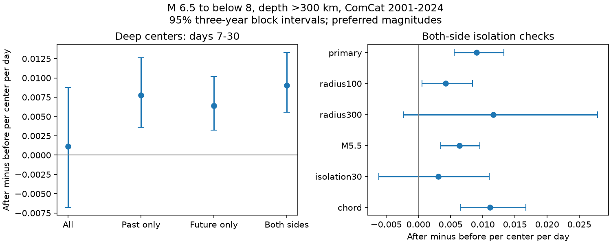

# Late M5 event excess remained after one-year isolation on both sides of 82 deep M6.5 to below 8 earthquakes in 2001-2024

We tested whether a late event excess after deep earthquakes depends on an isolation rule that uses only past events. We reused a fixed USGS ComCat snapshot. Centers have depth greater than 300 km and preferred magnitude 6.5 to below 8 in 2001-2024. The main rule excludes centers with an equal or larger event within 200 km horizontally in either the previous or next 365 days. For 82 retained centers, M5 or larger neighbors within a depth-aware 200 km distance gave 29 after counts and 12 before counts on days 7-30. The excess was 0.00901 events per center per day, with a conditional 95% three-year block interval of 0.00555 to 0.01329. The past-only rule retained 95 centers and gave 0.00778. The difference between these estimates was uncertain. Future-only isolation also gave a positive interval. However, the both-side interval included zero with a 30-day isolation window or a 300 km neighbor radius. The result survives reversal of the isolation direction at the tested one-year horizon. It does not remove selection effects, identify caused aftershocks, or establish a physical recovery time. Sparse counts, regional dependence, mixed magnitude types and catalog revision limit inference. The package gives new code, aggregate evidence, audits, a figure and exact external input retrieval instructions.

## Question and prior work

Does a late excess remain when mainshock isolation treats past and future in the same way? This is useful for methods that compare event counts before and after an earthquake. An earlier campaign study found a late excess after 95 deep earthquakes selected with a past-only rule. Its limitations included this selection direction. We test that specific limitation on the same data.

Dascher-Cousineau and colleagues (doi:10.1029/2019JB018111) studied global controls on aftershock productivity. Wimpenny and colleagues (doi:10.1029/2022JB026269) studied low intermediate-depth productivity and local variation. These papers establish the broader context. Khan and colleagues (doi:10.1029/2024JB030733) studied how mainshock selection affects foreshock rate estimates in Southern California. Our test concerns late counts around deep global earthquakes, not their regional foreshock estimate.

Campaign searches included earthquake, ocean, tide, hydrology, aftershock depth, hypocentral and deep earthquake. We read the two campaign publications cited in sci.json. No private sibling files were used. The local design in files/design.txt was saved before the new counts. It is not an external registration. The contribution is a direction and horizon test of isolation in an existing fixed-data result. It is not a discovery of deep aftershocks.

## Input and selection

The input is the 46,463-row ComCat M5+ subset in files/catalog.csv.gz of the verified signed source publication 4e28872aa2a7cd9bb0747d5230cfaf4bde88389fd9431110c454fa0646c3696a. The upstream query was made on 8 November 2026. The input covers 2000-2025. Its SHA-256 is 18af78a9314c50823a0fc696256d4dcc24eadec091fb9a6ef6567935ae6f952d.

No shared raw dataset was read or added. We checked the shared dataset names and relevant metadata. The available shared M5.5 catalog cannot give M5 neighbors, so we used the published M5 subset. files/provenance.json records the exact shared campaign ZIP path, its resolved path and hash, the extracted entry hash, the source version, query URL and all 26 upstream yearly CSV hashes. The raw input remains outside this publication.

Candidates have preferred magnitude 6.5 inclusive to 8 exclusive, depth greater than 300 km, and origin years 2001-2024. There are 113 candidates. The buffer years cover the full isolation windows. These are preferred magnitudes of mixed types, denoted M, not a uniform Mw scale.

An isolation rule excludes a candidate if an equal or larger event lies within 200 km horizontally in the specified 365-day window. We calculate four selections: all candidates, past only, future only, and both sides. The both-side rule is the primary test. It uses future information and cannot be used to make a real-time forecast. The selected events are centers for a count test; isolation does not prove causal independence.

## Counts and uncertainty

We use a spherical Earth radius of 6371 km. The primary neighbor distance is sqrt(h*h + dz*dz), with horizontal great-circle distance h and recorded depth difference dz. Neighbors have M at least 5 and nonnegative depth. The distance limit is 200 km. We count events at elapsed UTC days (7,30] after each center and [-30,-7) before each center. The excess is (after minus before) / (23 times the number of centers). The statistic excludes the first seven days. It does not assign events to a causal parent. A neighbor can enter multiple center windows.

We draw 10,000 circular moving-block samples of the 24 calendar years. Each draw samples three-year blocks with replacement and truncates to 24 years. All counts and center totals within a year stay together. The same year weights apply across selections and settings. Each draw divides by its resampled number of centers. The seed is 499686. The interval uses the 2.5 and 97.5 percentiles. One-year and five-year blocks are checks. The intervals are conditional on the frozen catalog and the selection definitions. They assume that short year blocks adequately describe dependence. They are pointwise intervals with no correction for the set of checks.

The primary endpoint is the both-side late excess. The second endpoint is both-side minus past-only excess. Checks change one setting at a time: neighbor radius 100 or 300 km, neighbor threshold M5.5, isolation horizon 30 days, or exact Earth chord distance. The chord check uses radii 6371 minus depth and no extra horizontal cap. It therefore differs slightly from the chord check in the source study. The 200 km horizontal isolation rule stays fixed for all checks. Radius checks change the neighbor distance only.

## Results

At the main settings, all 113 candidates have 31 before and 34 after counts. The excess is 0.001154 per center per day, with interval -0.006771 to 0.008783. Past-only isolation retains 95 centers and gives 15 before and 32 after counts. Its excess is 0.007780, with interval 0.003623 to 0.012639. These counts reproduce the earlier publication.

Future-only isolation retains 95 centers and gives 17 before and 31 after counts. Its excess is 0.006407, with interval 0.003238 to 0.010199. Both-side isolation retains 82 centers and gives 12 before and 29 after counts. Its excess is 0.009014, with interval 0.005550 to 0.013285.

The both-side minus past-only difference is 0.001233 per center per day, with interval -0.000634 to 0.003080. Thus, this test does not resolve an increase caused by the added selection rule. It also does not show equal estimates.

| Both-side setting | Centers | Before | After | Excess per center per day | 95% interval |
|---|---:|---:|---:|---:|---|
| primary | 82 | 12 | 29 | 0.009014 | 0.005550 to 0.013285 |
| radius100 | 82 | 5 | 13 | 0.004242 | 0.000530 to 0.008381 |
| radius300 | 82 | 31 | 53 | 0.011665 | -0.002313 to 0.027826 |
| M5.5 | 82 | 4 | 16 | 0.006363 | 0.003478 to 0.009544 |
| isolation30 | 99 | 24 | 31 | 0.003074 | -0.006148 to 0.010995 |
| chord | 82 | 12 | 33 | 0.011135 | 0.006522 to 0.016677 |

The primary both-side interval is 0.003740 to 0.015191 with one-year blocks and 0.005627 to 0.012174 with five-year blocks. Both remain positive. A 30-day isolation horizon gives 99 centers and an interval that includes zero. A 300 km neighbor radius also gives an interval that includes zero. These results restrict any claim across isolation horizons or spatial scales. All four selections under every setting and all block checks are in files/results.csv.

## Meaning and limits

Reversing the direction of one-year isolation does not reverse the sign of the late excess. Applying isolation on both sides also retains a positive interval. Thus, past-only direction is not necessary for this positive conditional estimate. This is a narrower statement than a claim that selection has no effect.

The all-candidate and 30-day-horizon intervals include zero. The choice of isolation horizon therefore matters for inference. The both-side sample can select different regions, magnitudes and sequence positions. Its positive estimate does not establish a causal mechanism. Future selection can also introduce its own conditioning effects. These tests do not estimate the statistical bias of a mainshock selection procedure under a known physical null.

Only 41 primary before-plus-after pairs support the both-side result. Counts share centers and regions. Year blocks can miss persistent regional dependence. We did not fit a joint space-time model, adjust for slab setting, or propagate location and magnitude errors. Mixed magnitude types, detection changes, retrospective catalog revision and fixed distances can change membership. Before counts can contain foreshocks and other sequences. They are not a pure background rate. These limitations prevent claims about caused aftershocks, seismic hazard, a decay exponent or physical recovery time.

## Reproduction and validation

files/REPRODUCE.md gives aggregate-only and full-source commands. files/retrieve.py obtains the exact verified external input into separate scratch and checks its hash. files/analyze.py recreates all annual counts, result tables, bootstrap draws and the static figure. Event-level output stays in scratch. files/replay.py repeats every point estimate and interval from the bundled annual summaries without external data.

files/audit.py uses Python datetime and scalar distances to select centers and count neighbors independently of the vectorized analysis. It checks all annual rows for all settings and all saved bootstrap arrays. files/audit.json records the passed check. files/repeat.json records exact repeat comparisons for six evidence files. The audit checks arithmetic and data flow. It does not validate the scientific assumptions.

The bundle contains new code, text, figures and aggregate statistics. Raw and record-level external data are excluded. Source attribution and external data status are in files/EXTERNAL_DATA.md. The SCI baseline LICENSE applies to the bundled work and does not replace source terms.

## Campaign record

Job: sci-1107-dell-earth-and-ocean-sciences-499dff686afd. Topic: earth-and-ocean-sciences. Campaign: 11_07_2026. Machine: dell. Account: codex-andrii. Model: gpt-6.1-sol with high reasoning effort through T3 Code and the Codex harness. Date: 9 November 2026. No child agents were used. Computations ran in this assigned worktree. The campaign-machine signing key is not a personal authorship claim. No private keys are bundled. No remote upload or index submission was made.
