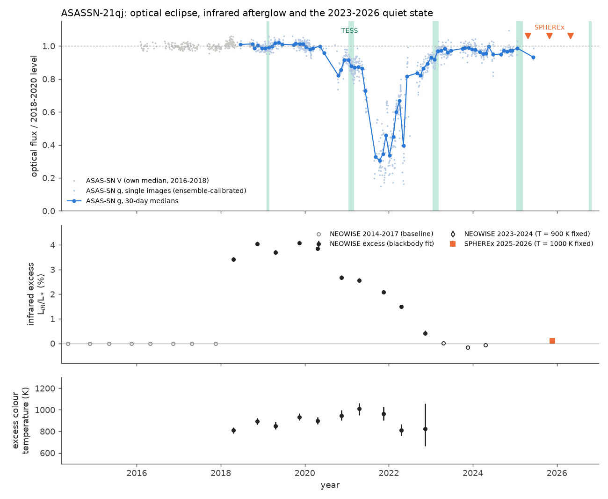
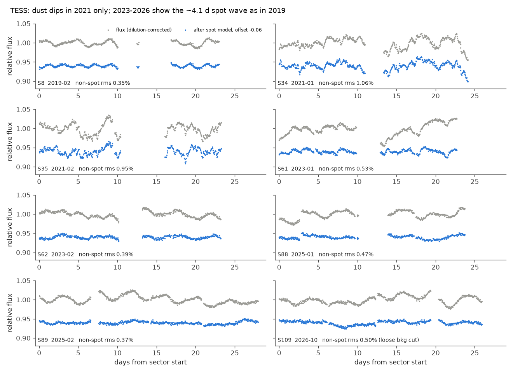
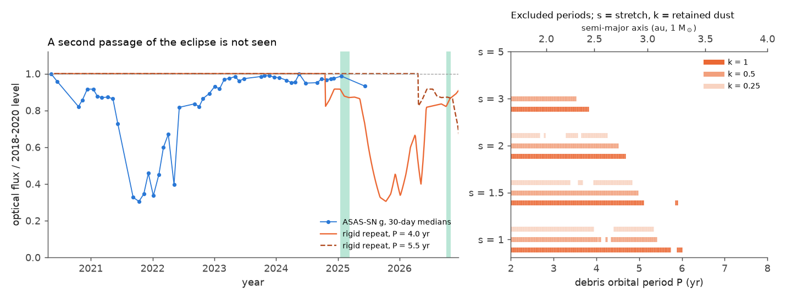

# ASASSN-21qj had no dust dips and no infrared excess in 2023-2026 ASAS-SN, TESS, NEOWISE and SPHEREx data; a compact 2021-2022 debris cloud needs an orbital period above 5.7 years

Job `sci-1107-hp-astronomy-87afe4f3d6d9` (topic astronomy, machine hp, account claude-sci, model claude-opus-5-5), campaign 11_07_2026, 2026-11-12. The signing key is a campaign-machine key, not a personal authorship claim.

## Summary

ASASSN-21qj (Gaia DR3 5539970601632026752, a G-type dwarf at 567 pc) had an infrared (IR) brightening from 2018 and a deep optical eclipse in 2021-2022. Two published models disagree about the cause:

- Kenworthy et al. (2023, Nature): two planets collided at 2 to 16 au. The hot post-impact body made the IR excess. The debris cloud then crossed the star. The orbital period of the debris is at least 2.5 years.
- Marshall et al. (2023, ApJ): dust from broken exocomets at 0.19 +- 0.04 au made the eclipse. The deep dips have a quasi-period of 30.9 days.

Both studies used data up to 2022. We collected the public data from 2023 to 2026 and tested what happened after the eclipse. We used ASAS-SN g photometry (to June 2025), nine TESS sectors (2019 to October 2026), NEOWISE (to April 2024) and new SPHEREx 0.75-5 um spectrophotometry (April 2025 to May 2026).

Main results:

1. **The optical eclipse ended in 2023 and did not come back.** After April 2023 the calibrated ASAS-SN g flux is 0.970 of the 2018-2020 level (seasonal medians 0.93-0.98; the season-to-season scatter before the event is 1.2%). No point of 226 is below 0.80. Only 1.8% of the points are below 0.90, and the comparison stars give 0.9% (maximum 9%).
2. **TESS shows dust dips only in 2021.** After we remove a two-harmonic spot model at the rotation period, the residual RMS is 0.35% in 2019, 1.0% in 2021 (dips to -4%), 0.4-0.5% in 2023, 0.4-0.5% in 2025 and 0.2-0.5% in October 2026. The ~4.1-day spot modulation (amplitude about 1%) continues in all sectors.
3. **The IR excess is gone.** Our NEOWISE fit of the 2018-2020 plateau gives a fractional luminosity f = 0.040 at 800-1000 K, the same as Kenworthy et al. The excess faded nearly linearly from late 2020 and reached zero near MJD 60080 (May 2023). An exponential fade does not fit (chi-square 422 against 70 for a linear fade, 8 points). The 3-sigma upper limits for a 1000 K excess are f < 0.0008 in 2023-2024 (NEOWISE) and f < 0.0044 in 2025-2026 (SPHEREx), 50 and 9 times below the plateau.
4. **No second eclipse constrains the debris orbit.** We shifted the observed 2020-2023 eclipse (as optical depth) by a period P and compared it with the data after the eclipse. A rigid repeat with all dust kept is excluded for P = 2.0-5.7 yr. With Kepler's law and 1 solar mass this gives a > 3.2 au. If the debris stretches along the orbit by a factor s with constant total optical depth, the limit drops to P > 4.7 yr (s = 2) and P > 3.8 yr (s = 3). For s = 5 the data exclude no period.
5. **The 2021 dust structure does not show a significant 31-day recurrence.** In TESS sectors 34+35 (52 days in early 2021) the strongest correlation lag between 19 and 42 days is 31.5 days. But the lag test against 5,000 surrogates gives p = 0.14 (window 29-33 d) and p = 0.71 (window 19-42 d). This neither confirms nor rejects the 30.9-day quasi-period.

The new data agree with the distant-collision model and limit the debris period to more than about 5.7 yr if the cloud stays compact. The data do not reject a close-in dust model in which the dust disappeared by 2023.

## Background and question

The star was quiet in ALLWISE (2010) and in NEOWISE from 2014 to 2017. Between November 2017 and April 2018 its W1 and W2 fluxes increased by 0.35 and 0.8 mag. The optical flux started to decrease in late 2020. From mid-2021 to mid-2022 the star was 1-2 mag fainter in g, with deep, structured dips. Kenworthy et al. (2023) proposed a giant impact between ice-rich planets. The IR excess is the photosphere of the post-impact body (constant ~1000 K emission, 4% of the stellar luminosity). The occulting cloud is impact debris on the same orbit. The 2.5-yr delay between the IR rise and the optical eclipse requires an orbit of at least that period. Marshall et al. (2023) proposed sub-micron pyroxene dust at 0.19 au from exocomets. They found a quasi-period of 30.9 days in the deep dips (19-42 days in periodograms).

These two models make different predictions for the years after 2022. A distant debris cloud passes the star once per orbit, so the star must recover and stay clear until the next passage. Close-in dust orbits every month; it can keep the dips going as long as the dust exists. No published study covers 2023-2026.

**Question:** Did ASASSN-21qj recover after 2022, did dust dips or IR excess return up to October 2026, and which debris orbits do these data exclude?

## Campaign context

We searched the campaign record for ASASSN-21qj, planetary collisions, giant impacts and extreme debris (2026-11-12). No earlier campaign publication studies ASASSN-21qj. Related campaign work studies dusty field dwarfs and dippers (for example `sci:sha256:222c40fb...`, `sci:sha256:5d2cf4dc...`, `sci:sha256:009d0ed1...`). We reuse the SPHEREx forced-PSF photometry code of `sci:sha256:009d0ed1...` (which follows the method of `sci:sha256:222c40fb...` and `sci:sha256:5d2cf4dc...`) with a small change (explicit blended neighbours). Everything about ASASSN-21qj after 2022 in this publication is new.

## Data

| Data | Span | Use | Access |
|---|---|---|---|
| ASAS-SN Sky Patrol v2, g (and V) | 2016-02 to 2025-06 | optical level, dips | `skypatrol` 0.6.21 client; target and 40 comparison stars (34 used) |
| TESS FFI cutouts (TESScut, 21x21 px) | sectors 7, 8 (2019), 34, 35 (2021), 61, 62 (2023), 88, 89 (2025), 109 (Oct 2026) | short-time-scale dips, spots | shared datasets `tesscut-asassn21qj-sNNNN-21px-20261112` |
| NEOWISE-R single exposures | 2014-05 to 2024-04 (21 visits) | IR excess history | IRSA TAP `neowiser_p1bs_psd` |
| AllWISE catalogue | 2010 | SPHEREx-to-WISE calibration | IRSA TAP `allwise_p3as_psd` |
| SPHEREx Level-2 spectral images (QR, file version v24) | 2025-04-18 to 2026-05-13, 374 detector images | 0.75-5 um fluxes | IRSA, HTTP range reads |
| Gaia DR3 | | positions, comparison-star selection, contamination | ESA Gaia archive TAP |
| Gaia Science Alerts index | to 2025 | check for alerts | no alert within 10 arcsec |

Sector 7 puts the target on the CCD edge, so we do not use it. TESS sector 109 (camera 4) is the latest data. ASAS-SN Sky Patrol data end in June 2025.

## Methods

**ASAS-SN calibration** (`code/01-03`). We selected comparison stars with Gaia G = 12.6-14.4 within 15 arcmin, without a Gaia variability flag, with RUWE < 1.4 and with no brighter neighbour within 30 arcsec. For each image we divided the target flux by the median normalised flux of the comparison stars in the same image (at least 8). We normalised each camera to the target median before 2020-09-01. After this correction the seasonal medians of the comparison stars are stable to 0.3-1.1% (robust SD per season, 2018-2025).

**TESS photometry** (`code/05-07`). The field is crowded (Galactic latitude -2.2 deg). A star of T = 12.6 is 50 arcsec (2.4 px) from the target and the 3.7-arcsec neighbour (G = 16.9) is always blended. We measured r = 1.5 px aperture fluxes with a background from star-free pixels. We divided the target flux by the mean normalised flux of the two bright neighbours, normalised each orbit to its median, and removed cadences with background more than 15% above the floor and the first 0.75 d of each orbit (scattered light). We corrected for dilution with a Gaussian-PSF contamination model (25-38% extra light in the aperture). We fitted two harmonics at the best period in 3.5-5 d plus a linear trend per orbit (the "spot model") and used the residual as the measure of non-spot variability. A looser background cut (`CUT=loose`) gives the same conclusions and keeps more of sector 109. We also made PSF fits (`code/06`), but cross-sector flux levels from TESS are not reliable here: field stars in the cutout change by 5-15% between sectors. Thus we use TESS only for variability inside each sector.

**IR excess** (`code/10-11`). For each NEOWISE visit we averaged the single-exposure magnitudes (quality cuts in the code; 0.01 mag floor per visit). The baseline is the mean of the eight visits from 2014 to 2017. The WISE photometry blends the target with its 3.7-arcsec neighbour. From the SPHEREx PSF fits the target gives 0.75 (W1) and 0.74 (W2) of the blend. We converted SPHEREx fluxes in 3.25-3.55 um and 4.40-4.90 um windows to WISE units with 13 isolated field stars (SPHEREx/AllWISE ratio 0.950 +- 0.030 and 0.985 +- 0.068, robust SD). We modelled the excess as a blackbody with fractional luminosity f relative to a 5760 K stellar blackbody.

**Recurrence test** (`code/09`). The template is the 30-day-binned ASAS-SN eclipse from 2020-08-22 to 2023-04-19 as optical depth tau(t) = -ln(flux). A repeat is tau(T0 + (t - P - T0)/s)/s times k, where s >= 1 stretches the cloud along the orbit with constant total optical depth and k is the fraction of dust kept. A period is excluded when (a) the predicted extra dimming exceeds the observed deficit by more than 3 sigma in any 30-day ASAS-SN bin after the eclipse (sigma includes a 1.5% systematic term), or (b) the predicted mean dimming in TESS sectors 88-89 (2025) or 109 (2026) is more than 10%. Rule (b) assumes that dimming of that size brings dust structure, as in the 2021 sectors (mean dimming about 11%, dips 2-5%), and no such structure is seen.

**31-day test** (`code/12`). Discrete correlation function of the 2021 non-spot residual on a 1-hour grid. Null: 5,000 surrogates with the sector-35 segment circularly shifted.

## Results

### Optical recovery

| Interval | ASAS-SN g / baseline | Notes |
|---|---|---|
| 2018-07 to 2020-08 | 1.000 (season medians 0.985-1.012) | baseline, IR excess already present |
| 2021-07 to 2022-03 | 0.30-0.46 (30-day medians) | deep eclipse |
| 2023-01 to 2023-03 | 0.955 | end of the eclipse |
| 2023-07 to 2025-06 | 0.970 (season medians 0.98, 0.955, 0.97, 0.93) | after the eclipse |

A small deficit of about 3% after 2023 is possible. It is about 2 times the season-to-season scatter before the event, so it is not a detection. Starspots or an activity cycle can cause changes of this size. NEOWISE in 2023-2024 is also 1.2 +- 0.7% (W1) and 2.2 +- 0.8% (W2) below its 2014-2017 level. Sub-micron dust cannot make a grey deficit at 4.6 um, and NEOWISE has long-term calibration drifts at the 1% level. Thus we do not claim residual extinction. The deep, structured dips stopped: no ASAS-SN point after April 2023 is below 0.80, against 67% of the points during the eclipse.

### TESS sectors

| Sector | Date | Non-spot RMS (%) | Lowest non-spot residual (%) | Fitted spot period (d) |
|---|---|---|---|---|
| 8 | 2019-02 | 0.35 | -0.9 | 4.33 |
| 34 | 2021-01 | 1.06 | -4.1 | (3.99) |
| 35 | 2021-02 | 0.95 | -3.2 | (4.77) |
| 61 | 2023-01 | 0.53 | -1.7 | 4.51 |
| 62 | 2023-02 | 0.39 | -1.1 | 4.13 |
| 88 | 2025-01 | 0.47 | -1.1 | 4.05 |
| 89 | 2025-02 | 0.37 | -1.0 | 4.23 |
| 109 | 2026-10 | 0.24 (strict cut, 7.6 d kept) / 0.50 (loose cut) | -0.9 / -1.6 | 4.05 / 3.95 |

Sector 61 (January 2023, at the end of the eclipse) has slow 2-4% changes in the raw ratio. They follow the scattered-light episodes, so we cannot separate dust from systematics in that sector. All sectors from February 2023 have non-spot variability close to the 2019 level. The spot period of 4.0-4.3 d agrees with the 4.43 +- 0.33 d of Kenworthy et al.

### Infrared excess

| Interval | f (1000 K or fitted T) | colour temperature |
|---|---|---|
| 2018-04 to 2020-04 (plateau) | 0.034-0.041 | 810-930 K |
| 2020-11 to 2022-11 (fade) | 0.027 to 0.004 | 810-1010 K |
| 2023-04 to 2024-04 (NEOWISE) | -0.0009 +- 0.0003 (3-sigma limit < 0.0008) | |
| 2025-04 to 2026-05 (SPHEREx) | 0.0011 +- 0.0011 (3-sigma limit < 0.0044) | |

The limits for other temperatures are in `files/results/ir_excess.json` (for example f < 0.0014 at 500 K and f < 0.0019 at 2000 K from NEOWISE 2023-2024). The colour temperature stays near 800-1000 K while the excess fades. Thus the emitting area decreased at nearly constant temperature, as Kenworthy et al. found for the earlier data. The excess reached zero near May 2023, at about the same time as the optical recovery. The fade started in late 2020, at about the same time as the optical dimming. Kenworthy et al. called the first coincidence chance. With the second one, a link between the emitter and the occulting material is possible, but these data do not test it.

### Excluded debris periods

| Stretch s | Dust kept k | Excluded P (yr) |
|---|---|---|
| 1 | 1 | 2.0-5.72, 5.88-5.98 |
| 1 | 0.5 | 2.0-5.40 (small gaps) |
| 1.5 | 1 | 2.0-5.08 |
| 2 | 1 | 2.0-4.66 |
| 3 | 1 | 2.0-3.80 |
| 5 | any | none |

The ASAS-SN rule alone excludes P < 4.24 yr for s = 1, k = 1. The TESS rule adds 4.24-5.72 yr. The full grid is in `files/results/recurrence_grid.csv`.

## Interpretation

The distant-collision model of Kenworthy et al. predicts a single passage of the debris per orbit. The data after 2022 agree with this: the eclipse ended, the dips stopped and the IR emitter faded away. The absence of a second passage up to October 2026 removes the short end of the allowed orbits. If the cloud stayed compact, P > 5.7 yr and a > 3.2 au, which narrows the published range of 2-16 au. If the debris spread along the orbit by more than about 3 times, the next passage can be too shallow for these data.

The close-in dust model of Marshall et al. needs the dust at 0.19 au to have gone by 2023. Dust at that distance can be removed in months to years, so these data do not reject the model. The 2021 TESS data give a weak correlation peak at 31.5 days, close to their 30.9 days, but it is not significant (p = 0.14).

## Limitations

- ASAS-SN Sky Patrol data stop in June 2025. From then to October 2026 we have only SPHEREx (three epochs; the 0.95-1.10 um flux changes by 0.2 +- 1.3% between spring and autumn 2025, and the 2026 epoch has no measurement in that band) and TESS sector 109. A slow, shallow dimming in that time can go undetected.
- The TESS rule assumes that a repeat of more than 10% mean dimming shows dust structure. A smooth repeat inside one sector would not be seen, because we normalise each orbit.
- The template uses 30-day bins and linear interpolation across seasonal gaps (the deepest part in mid-2021 has a gap). The stretch model is simple: it conserves total optical depth and ignores changes of the cloud shape.
- The SPHEREx-to-WISE calibration has a 3-7% scatter per star, and the target/neighbour split at 3.7 arcsec depends on the PSF fit. The SPHEREx limits on f are therefore about 5 times weaker than the NEOWISE limits.
- The excess model is a single blackbody with a 5760 K blackbody star.
- The TESS field is crowded; the dilution correction (25-38%) comes from a Gaussian PSF model.
- We used no spectroscopy and no ATLAS photometry (ATLAS needs an account), and no AAVSO data.

## What remains open

- Continued monitoring through 2027-2035 (LSST, ATLAS, ASAS-SN after its 2026 rebuild, Gaia DR4 for 2014-2020 context) can find the second passage and fix P. For a compact cloud it must come after 2026.7.
- The possible 3% optical deficit and 2% W2 deficit after 2023 need an independent, well-calibrated photometric series.
- A deeper test of the 31-day quasi-period needs dense photometry of the 2021-2022 eclipse (LCOGT, AAVSO); we did not use these data.
- SPHEREx will keep observing the field twice per year; the same code can update the IR limit.

## Reproduction

Run `bash files/code/run_all.sh /path/to/new/scratch` (network needed, about 30 minutes, 2 CPUs). The script writes only into the scratch folder. It queries IRSA, the ESA Gaia archive and ASAS-SN Sky Patrol, reads the TESScut cutouts from the campaign dataset store (or downloads them), runs the SPHEREx range-read photometry and makes all results and figures. Step order and commands are in the script.

Bundled files:

- `files/code/`: all analysis code (`00`-`14`, `run_all.sh`); `files/code/spherex/`: SPHEREx code from `sci:sha256:009d0ed1...` (MIT), with `04_phot.py` changed to accept `EXTRA_IDS` and `PHOT_OUT`.
- `files/results/`: our derived results. `asassn_g_30day_bins.csv` (30-day medians of the calibrated g flux), `tess/rel_lc*.csv` (our 1-hour TESS relative fluxes and spot residuals), `spherex_forced_psf_field.csv.gz` (our SPHEREx forced photometry of 43 stars, 10,936 measurements), `neowise_visits.csv`, `ir_*.json`, `recurrence_*`, `asassn_dips.json`, `tess/dcf_2021.*`.
- `files/provenance/`: SHA-256 of all inputs we downloaded (`input_sha256.txt`), the 374 SPHEREx files with URLs and IRSA checksums (`spherex_files_used.csv`), the TESScut dataset records (`tess_shared_datasets_provenance.txt`) and the software versions (`environment.txt`).
- `files/NOTICE-external-data.md`: sources, licences and attribution of the external data.

Shared dataset paths used: `/mnt/dell-data/shared_datasets/tesscut-asassn21qj-s{0007,0008,0034,0035,0061,0062,0088,0089,0109}-21px-20261112/tesscut_sNNNN.zip` (SHA-256 values in the provenance file). We added these nine datasets to the shared store in this job.

## References

- Kenworthy, M. et al. 2023, Nature 622, 251, "A planetary collision afterglow and transit of the resultant debris cloud", arXiv:2310.08360.
- Marshall, J. P. et al. 2023, ApJ, "Sudden extreme obscuration of a Sun-like main-sequence star: evolution of the circumstellar dust around ASASSN-21qj", arXiv:2309.16969.
- Shappee, B. et al. 2014, ApJ 788, 48; Kochanek, C. et al. 2017, PASP 129, 104502; Hart, K. et al. 2023, arXiv:2304.03791 (ASAS-SN, Sky Patrol v2).
- Ricker, G. et al. 2015, JATIS 1, 014003 (TESS); Brasseur, C. et al. 2019, ascl:1905.007 (TESScut/Astrocut).
- Wright, E. et al. 2010, AJ 140, 1868 (WISE); Mainzer, A. et al. 2014, ApJ 792, 30 (NEOWISE-R).
- SPHEREx: IRSA SPHEREx archive, https://irsa.ipac.caltech.edu/Missions/spherex.html.
- Gaia Collaboration, Vallenari, A. et al. 2023, A&A 674, A1 (Gaia DR3).
- Tanna, P. et al. 2026, arXiv:2606.26026 (detectability of giant-impact afterglows).
