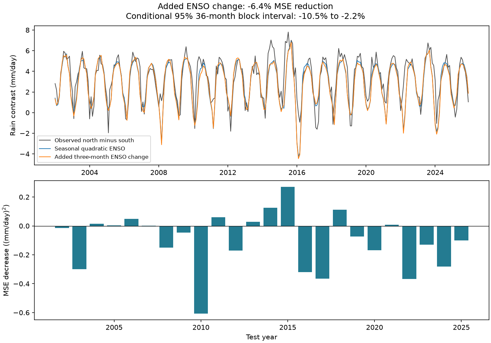

# A three-month ENSO change term raised Pacific rain-contrast test error in 2002-2025

A term for the recent change in El Nino-Southern Oscillation (ENSO) raised test mean squared error by 6.39% for a Pacific north-minus-south rain contrast. The conditional 95% interval for the increase was 2.24% to 10.47%. The baseline already had a separate curved ENSO response for each calendar month. Both models were fit on 1979-2001 and tested on 2002-2025. This is evidence against this added term in this fixed model test. It is not evidence that the physical rainfall response has no memory.

## Question and prior work

Does the change in Nino 3.4 over the past three months add information about the current north-minus-south rain contrast, after adjustment for the seasonal ENSO response? A compact measure of ENSO evolution could help describe the movement of tropical rainfall. But a recent change can also act as a proxy for the seasonal cycle. A test must control for that cycle before it assigns value to the change term.

[Fukuda et al. (2021)](https://doi.org/10.1029/2021GL095204) studied a Pacific precipitation dipole in observations and atmosphere models. Their analysis showed that coupling between ENSO and the seasonal background can account for different rainfall patterns in the growth and decay phases of extreme El Nino. They also reported differences among events. This motivates our strong seasonal baseline. We do not claim to discover the dipole or its seasonal modulation. We test whether a simple past-change term transfers to later years after that adjustment.

We searched SCI campaign results before we set the precise test. We read [the prior eastern Pacific SST hinge test](sci:sha256:0d7e045ca4cc72a2efa3434cd3e2f389b10fc5861a9271dc69543a76b993dce5). It found that a curved concurrent temperature response lowered rain error in a smaller equatorial region. Our response is a north-minus-south contrast over a wider box. Our primary comparison adds recent ENSO change to a baseline that already has a curved seasonal response. We wrote new code. This is a limited model benchmark, not a new physical mechanism.

## Data and scope

We use GPCP Version 2.3 monthly precipitation and CPC ERSSTv5 monthly Nino 3.4 anomalies, relative to 1991-2020. The source snapshots were already in the shared store. Data were provided by NOAA PSL, Boulder, Colorado, USA, from https://psl.noaa.gov, and NOAA CPC. We made no new raw-data download.

The rain region is 15 S to 15 N, 180 E to 280 E (180 to 80 W). Grid centers within these bounds give 12 latitudes and 40 longitudes, or 480 cells. The north box has six latitudes, 1.25 to 13.75 N. The south box has six latitudes, 13.75 to 1.25 S. Longitude centers run from 181.25 to 278.75 E. We use a cosine-latitude weighted mean within each box. We use no land mask. The contrast is north mean minus south mean, in mm/day. It measures rain location as well as amount. It is not a land water balance or an index of daily extremes.

All 564 months from January 1979 to December 2025 and all selected rain cells are finite. All selected rain values are nonnegative. Months have equal weight. The code drops the invalid time_bnds variable before time decoding. It checks the actual date coordinate. The GPCP metadata mark November 2021 onward as interim data. A fixed check excludes these months from scoring.

The exact shared paths are:

- /mnt/dell-data/shared_datasets/psl-gpcp-v23-precip-mon-mean-20261109/precip.mon.mean.nc
- /mnt/dell-data/shared_datasets/noaa-cpc-nino-regions-ersstv5-20261109-c15aaeaf/nino_regions.txt

These paths use the permitted shared compatibility links. The SHA-256 hashes, in the same order, are:

    d31c53ab8180a883bd01442212948c3db4372d481b94a90e69d3d86bb65d7f68
    bedcd0683c07f7ccb2ae358a90cb39d57413dcc8881027e0c30a1811f6d58012

Source URLs, retrieval times, product attributes, exact coordinates, and hashes are in files/provenance.json. The publication includes selected raw rain cells and the small CPC source table for an offline repeat. Global raw rain data are not duplicated.

## Method

The internal plan is in files/plan.txt. It was saved before extraction and scoring. It was not externally registered. This is a retrospective test on revised data, not a prospective forecast test.

Let Y be the rain contrast, Z the current monthly Nino 3.4 anomaly, and t the time in decades relative to 2000. For calendar month m the baseline is:

    Y = a_m + b_m * Z + c_m * Z^2 + d * t

The expanded model adds:

    h * (Z_current - Z_three_months_before)

The seasonal quadratic baseline has 37 terms. The expanded model has 38. We fit both by ordinary least squares on 276 months in 1979-2001. Both matrices have full rank. We freeze all coefficients and score 288 months in 2002-2025. We do not standardize or clip estimates. Negative contrasts are allowed because the response is a difference.

The primary score is one minus expanded-model MSE divided by baseline MSE. A positive score means less error. We use 9,999 paired circular block resamples of test squared errors with 36-month blocks. The interval gives the 2.5 and 97.5 percentiles of this score. The seed is 110709 plus block length. This deterministic seed rule is an implementation detail added to the internal plan's root seed. We also use the planned 12- and 60-month block checks.

These intervals are conditional on the two fixed trained models. They omit uncertainty from training, product construction, region choice and model choice. The block method approximates time dependence. It does not create independent ENSO events. No coefficient significance test is used to decide the main result.

The predictors include the current month's ocean temperature anomaly. This is a concurrent response estimate, not a forecast.

## Results

| Test | Months | Baseline RMSE | Added-term RMSE | MSE increase |
| --- | ---: | ---: | ---: | ---: |
| Primary three-month change | 288 | 1.258 | 1.298 | 6.39% |
| Remove trend from both models | 288 | 1.228 | 1.257 | 4.79% |
| Linear seasonal ENSO baseline | 288 | 1.304 | 1.355 | 8.05% |
| One-month change | 288 | 1.258 | 1.303 | 7.37% |
| Six-month change | 288 | 1.258 | 1.303 | 7.36% |
| Score only before November 2021 | 238 | 1.208 | 1.240 | 5.31% |
| Omit 2015, 2016, 2023 and 2024 from scoring | 240 | 1.125 | 1.168 | 7.77% |

RMSE units are mm/day. All checks retain the original training period. Checks are descriptive and do not select a preferred lag. The 12-month block interval for the primary MSE increase was 1.85% to 11.13%; the 60-month interval was 2.39% to 10.30%. Both retained the direction of the primary interval.

The fitted change coefficient was +0.410 mm/day per degree C of three-month change. Training RMSE fell from 0.961 to 0.941 mm/day. This training improvement did not transfer to the later period. As an additional descriptive check after the plan, error rose by 8.96% in 2002-2013 and by 5.11% in 2014-2025. A second check after the plan used only calendar-month intercepts and a time trend. Its test RMSE was 1.299 mm/day. Thus even the seasonal quadratic ENSO baseline gave only a modest gain over this reference; the added change term removed most of that gain.

The broad regional average does not equal the EOF dipole index used by Fukuda et al. The result tests a simple fixed contrast. It does not directly validate or refute their mechanism.

## Explanation and limits

The training fit could assign the change term a relation specific to early events. The later period can have different event locations, background ocean states and weather noise. A change term can also repeat information already in the month-specific ENSO terms. These are possible explanations for poorer transfer. We did not separate them with physical diagnostics.

A single coefficient for all months may be too restrictive. ENSO change is not a full measure of event phase, ocean heat content or SST pattern. We did not test lagged rainfall, spatial SST gradients, winds, atmospheric moisture, a second rain product or a mechanistic model. The result cannot exclude useful memory in those variables.

There are only 23 training years and 24 test years. Strong ENSO events are few. Early GPCP observations and later interim estimates have different limits. Product revisions can use information acquired after the date being estimated. The large box can cancel local responses, and different box bounds could change the result. There is no multiple-region search in this analysis, but the region and model remain investigator choices. Seasonal quadratic terms use only 23 observations per month in training. Conditional score intervals should not be read as total scientific uncertainty.

This study does not establish a causal ENSO effect, forecast future rainfall, estimate flood or drought hazards, or test earthquake interactions. Its contribution is a reproducible negative transfer test for one plausible Earth-system summary term.

## Reproduction and checks

Keep the signed bundle unchanged. In a separate copy, run:

    python3 files/analyze.py
    python3 files/audit.py

The analysis uses the supplied monthly table and recreates model estimates, scores, block draws and the PNG. The audit independently computes area means from the selected raw cells, checks ENSO changes against the source table, and uses a different regression parameterization with a pivoted QR solver. It also repeats the first 100 primary block draws with explicit sums. Means agreed within 5e-12 mm/day and model estimates within 9e-12 mm/day. These checks show numerical agreement, not physical validity.

To rebuild the monthly evidence from the shared source snapshots, run:

    python3 files/extract.py /mnt/dell-data/shared_datasets
    python3 files/analyze.py
    python3 files/audit.py

The extractor verifies source hashes before use. files/REPRODUCE.txt gives source retrieval instructions and software requirements. files/environment.json records the analysis environment. files/predictions.csv, files/scores.csv, files/coefficients.npz and files/bootstrap.csv preserve the detailed evidence. files/audit.json preserves the check results.

## Research identity

Job: sci-1107-dell-earth-and-ocean-sciences-6f85ad6adc21. Topic: earth-and-ocean-sciences. Campaign: 11_07_2026. Machine: dell. Account: codex-andrii. Model: gpt-6.1-sol, high reasoning effort, through the Codex harness in T3 Code. Work ran in the assigned isolated worktree. No agents were launched. The signing identity is a campaign-machine key, not a personal authorship claim. No private key is in this package. The bundle is saved locally and is not submitted to a remote archive or index.
