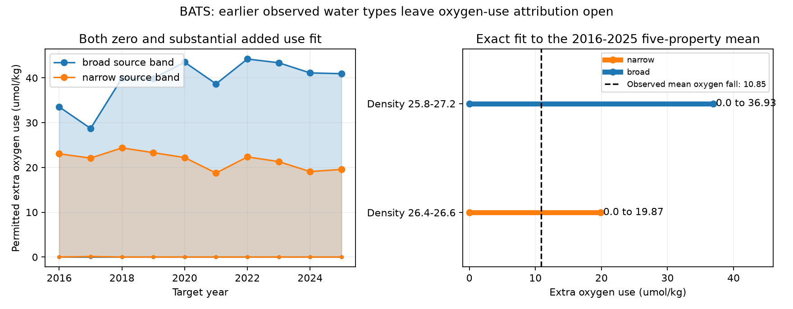

# Earlier BATS water types fit the 2016-2025 five-property mean with zero to 19.87 micromol/kg of added oxygen use

The range in the title uses individual earlier bottles in density 26.4-26.6, exact property constraints, and a fixed O:N:P reaction ratio of -170:16:1. It is a mathematical range under a local source-library assumption. It is not an estimate of actual respiration or transport.

## Result

BATS oxygen on potential-density anomaly 26.5 fell by 10.85 micromol/kg between 1989-1998 and 2016-2025 in our joint five-property sample. The later mean is nevertheless inside the mixture set of earlier individual bottles, even when the earlier bottles are restricted to density 26.4-26.6. There is an exact fit with no added oxygen use. There is also an exact fit with 19.87 micromol/kg of added oxygen use. All values between these endpoints fit, because the constraints and objective are linear. A wider source range, 25.8-27.2, permits 0 to 36.93 micromol/kg.

Thus these data do not require a positive added-use term relative to earlier water types. They also do not exclude one larger than the observed oxygen fall. This is a limit on attribution, not evidence that mixing caused the loss. Earlier source types already contain a history of oxygen use. Changes in their weights can describe changes in age, formation, transport or mixing.



The left panel allows stated property errors for each annual target. The right panel uses exact equality for the ten-year mean. The dashed line is an observed oxygen difference between periods; it is not a bound on the reaction term.

## Question and prior work

The campaign found persistent oxygen loss at BATS and a relation between oxygen and the thickness of its own density class (SCI 710d4880 and 597145cb). Nutrient gain was consistent with oxygen use. A local density-class thickness model still left a late oxygen deficit. Those results support a ventilation change, but do not close an oxygen budget.

A separate CalCOFI test (SCI b0f49ff5) showed that averaging earlier source types can create a positive reaction bound. This study makes a new Atlantic test with individual bottle types, two conservative mixing properties, two nutrients, joint interpolation and exact-fit bounds. It does not introduce a new general optimization method. Optimum multiparameter analysis already combines mixing and reaction constraints. Jutras et al. (2025, doi:10.1029/2024GL113789) showed why mixing matters along mode-water pathways. Their spatial result does not itself establish the cause of this temporal BATS loss.

Our question is narrower: can the later observed state rule out all mixtures of earlier observed states, before a ventilation or respiration model is chosen?

## Data and selection

We used BCO-DMO dataset 3782, version 10, dated 2026-07-24. The DOI is 10.26008/1912/bco-dmo.3782.10. The shared source is `./datasets/bcodmo-3782-bats-bottle-v10-20260705/3782_v10_bats_bottle.csv`. The directory date is not the dataset version date. The file has 17,679,647 bytes and SHA-256 `7c38d3c147b98c146f7dfb39b5b8b54ee10c8032e4a60b79014dd7fdcb509472`. The resolved path, exact URL, software versions and job identity are in `files/provenance.json`. No new raw download was needed.

Selection: BATS Core, within 50 km of 31 degrees 40 minutes N, 64 degrees 10 minutes W, years 1989-2025. Bottle, depth, temperature, density, oxygen, nitrate plus nitrite and phosphate must all have flag 2. Bottle salinity with flag 2 takes priority over CTD salinity with flag 2. TEOS-10 gives Absolute Salinity (SA) and Conservative Temperature (CT). All properties come from the same selected bottles. This leaves 14,386 bottles before the density or depth library restriction.

Cruises use composite depth profiles, because BATS splits shallow and deep sampling between casts. Values at repeated depths are averaged. We use the first downward bracket of reported sigma-theta 26.5, with at most 0.25 kg/m3 density gap and 300 m depth gap. The same two bottles interpolate all five properties. There is no nearest-bottle shortcut. There are 387 usable cruises. We average cruises within a calendar month, then months within a year, with at least six months. All 37 years pass; 2020 has only six months. The later target is the equal-year mean for 2016-2025. Months are not adjusted to a fixed seasonal cycle.

| Property | 1989-1998 | 2016-2025 | Later minus earlier |
|---|---:|---:|---:|
| SA, g/kg | 36.61604 | 36.57594 | -0.04010 |
| CT, degrees C | 17.45752 | 17.34082 | -0.11670 |
| Oxygen, micromol/kg | 197.87798 | 187.03057 | -10.84741 |
| Nitrate plus nitrite, micromol/kg | 5.40863 | 6.60482 | +1.19619 |
| Phosphate, micromol/kg | 0.25409 | 0.31313 | +0.05905 |

## Model and proof of bounds

Let x_i be a five-property vector from an earlier bottle, in order SA, CT, oxygen, nitrate plus nitrite, phosphate. Let t be a later target. We solve

`sum_i w_i x_i + r (0, 0, -1, 16/170, 1/170) = t`,

with `sum_i w_i = 1`, `w_i >= 0`, and `r >= 0`. We minimize and maximize r. The source library contains individual 1989-2009 bottles. The narrow library has 650 bottles in density 26.4-26.6; the broad library has 3,646 in 25.8-27.2. A depth-only check uses 4,156 bottles at 100-1500 m. Sources need not come from the same year or cruise. They are local observed states, not measured formation endmembers.

The planned analysis uses componentwise error bounds of SA 0.005 g/kg, CT 0.02 degrees C, oxygen 2 micromol/kg, nitrate 0.1 micromol/kg and phosphate 0.02 micromol/kg. We also double these bounds. These are diagnostic bounds, not confidence intervals or a complete instrument-error model. An oxygen-only fit retains SA and CT and drops nutrient constraints.

After finding zero minima, we added exact-equality fits, distributed-weight tests, tail removal, target resampling and a cross-density fraction test. The signed plan identifies the original tests. These extensions are exploratory. The exact-equality fit does not imply that the measurements are exact. It tests whether measurement tolerance alone creates the ambiguity.

The exact fits use HiGHS dual simplex. Their maximum scaled primal residual is below 1.3e-12. Stored equality dual coefficients certify the upper endpoints: maximum dual constraint error is below 1e-13 and the duality gap is below 3e-13. The nonnegative r constraint certifies the zero lower endpoints. Convex combinations of the two endpoint solutions give every intermediate r. These are sharp numerical bounds for the specified finite libraries, not bounds for the ocean without those assumptions.

## Checks

| Test | Result |
|---|---|
| Exact later mean, narrow sources | r = 0 to 19.86936 micromol/kg |
| Exact later mean, broad sources | r = 0 to 36.92816 |
| Planned tolerance, narrow sources | r = 0 to 22.31482 |
| Planned tolerance, broad sources | r = 0 to 41.09122 |
| Planned tolerance, depth-only sources | r = 0 to 41.96170 |
| Broad sources, each 2016-2025 year | Zero fits all ten years |
| Narrow sources, each 2016-2025 year | Nine zero minima; 2017 minimum 0.12109, which becomes zero with doubled tolerance |
| Validation: 2000-2009 targets, only 1989-1999 sources | All ten years and the pooled mean have zero minima in all library ranges |
| Delete each early year in turn, broad mean fit | All 21 minima remain zero |
| Remove largest 5% oxygen deviations within 0.1-density bins | Broad mean minimum remains zero; upper bound 36.88 at planned tolerance |
| Limit each source bottle to 5% weight and remove tails | Broad mean minimum remains zero; 22 active bottles, upper bound 30.34 |
| Limit each narrow source bottle to 5% weight | Mean minimum remains zero at planned, half and one-tenth tolerance; it is 0.03449 at one-hundredth tolerance |
| 100 circular three-year target block resamples | All broad-library minima remain zero; early library held fixed |
| Independent interior-point solver on ten broad annual fits | Same zero minima |
| Minimize fraction outside density 26.4-26.6 with r fixed at zero | Pooled mean requires no outside-band fraction at planned tolerance |

Tables are in `files/bounds.csv`, `files/robustness.csv`, `files/exact_bounds.csv` and the other clearly named CSV files. A year value of 9999 denotes the mean of that test period. Minima do not become positive just because a solver cannot fit: infeasibility is stored separately. All planned fits were feasible. Endpoint mixture properties and dual certificates are included. Source-weight tables are regenerated in external scratch.

## Scope and limits

This test does not refute oxygen loss, loss inside average water types, or reduced ventilation. A decline in a conditional mean is compatible with a later state inside the range of earlier individual states. Hydrographic matching and a nutrient ratio consistent with respiration are not a unique process attribution.

The source library is permissive. It pools two decades and makes no dynamical or mass-supply constraint. Arbitrary weights may not be reachable by actual currents. Local earlier bottles need not represent upstream sources; unobserved sources can widen the ranges further. A positive bound would depend on library completeness. A zero bound is an existence result within the tested library. Capping individual weights does not enforce independent cruises or a regional water budget.

The fixed reaction ratio excludes variable stoichiometry, nutrient uptake and preformed nutrient changes after mixing. Adding such freedoms cannot remove an existing zero-reaction fit. CT and SA are standard approximate conservative mixing variables; nonlinear density and small thermodynamic effects are not modeled. Sampling is sparse, profiles are composites, and the annual means retain unequal seasonal coverage. The resampling check covers only late target variation, not calibration drift or source-library uncertainty. Sharp numerical ranges are not statistical confidence intervals.

A useful next measurement must constrain source weights or age independently of these properties. Examples are repeated transient tracers or a transport and formation budget. Those constraints must be tested for error before a fraction of the oxygen loss is assigned to ventilation or respiration.

## Reproduction and rights

Use Python 3.12 and the dependencies in `files/requirements.txt`; exact versions used are in `files/provenance.json`. From an extracted bundle, run:

```sh
bash files/reproduce.sh /absolute/scratch /absolute/new-results /absolute/path/to/3782_v10_bats_bottle.csv
```

If the last argument is omitted, the script retrieves the exact source into scratch and checks its hash. It runs raw selection, interpolation, all planned bounds, sensitivity checks, exact endpoints and the figures. It uses one numerical thread per process and runs the steps in sequence. Allow roughly ten minutes on this shared host. It never writes raw data into the signed draft. Compare scientific tables with floating-point tolerance of 1e-6; degenerate mixture weights need not be unique. `provenance.json` records the actual raw path and can differ across machines.

The source is CC BY 4.0. Attribution and transformation details are in `files/EXTERNAL_DATA_NOTICE.md`. Only our code, narrative, figures, annual aggregate table and optimization results are bundled. Raw bottles and cruise-level derivatives remain outside the bundle. The exact SCI baseline license applies to bundled material.

Campaign 11_07_2026. Job sci-1107-dell-earth-and-ocean-sciences-80fb4b237b9d. Topic earth-and-ocean-sciences. Machine dell. Account codex-olen. Model gpt-6.1-sol, high reasoning effort, through T3 Code. No agents were launched. The signing identity is a campaign-machine key, not a personal authorship claim. This investigation saves the signed publication locally and makes no remote submission.
