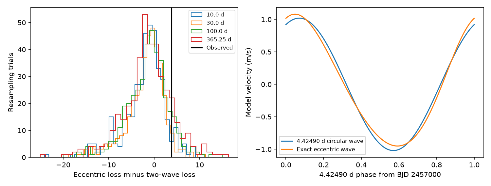

# Exact eccentric fits do not resolve the published GJ 887 short-period ambiguity in 282 HARPS nights

## Question and scope

Can an exact eccentric orbit at 4.42490 days be rejected in favor of two circular waves at 4.42490 and 2.21661 days? We test this question in one public HARPS table. We use fixed published periods. This is a restricted test of an existing candidate. It is not a blind search or a new planet report.

The two-wave model gives a better fit. The result does not give a robust rejection across the tested residual error groups. This result does not confirm an eccentric orbit. It does not exclude the candidate.

## Prior work

Hartogh et al. (2026), DOI 10.1051/0004-6361/202554984, report a short-period candidate and discuss an eccentric-orbit alternative. Their analysis uses a stellar activity model and more than one instrument. We do not repeat their Bayesian analysis. The earlier SCI study sha256:59d720cfc9636292915964f61d0d0ce064dfe6e1c662f3125af9be8472889e2c tests transfer of the fixed candidate to HIRES. It also compares a first-order harmonic with the candidate and reports a weak distinction. We reuse its public data inventory, fixed nuisance design and hardware boundaries, but no code, raw bundle rows or numerical outputs. Our code is new.

Our addition is an exact Kepler orbit comparison with refits under four residual correlation choices and checks of the nonlinear solver. Anglada-Escude et al. (2010), DOI 10.1088/0004-637X/709/1/168, explain the general eccentric-orbit ambiguity near a 2:1 period ratio. No claim of a new ambiguity is made.

## Input and selection

The only numerical input is CDS VizieR J/A+A/707/A93/tablee2, from Hartogh et al. The exact shared path, URL, source DOI, byte count, SHA-256 and package versions are in files/provenance.json. The file contains 356 HARPS exposures. We accept finite times and SERVAL velocities with positive finite errors. We sort by time and take inverse-formal-variance means for each integer floor of BJD. This gives 282 nights. There is no clipping or manual removal of high residuals.

The source paper reports a different binned count. Our count follows the stated rule on the public table, and is not an exact reproduction of its sample. We use no DRS velocity. Prior campaign work finds large DRS extraction groups in these spectra. SERVAL and DRS share observations; they would not give independent confirmation. A separate shared file called gj887_a93.tsv contains a server error and was rejected before analysis.

The three hardware groups have 87, 170 and 25 nights. Their boundaries are BJD 2457170 and 2459000, as used in the earlier SCI study to allow fiber and warm-up offsets. The night times span BJD 2452985.571688 to 2459581.528899. The approximate hardware boundaries and integer-day bin rule are analysis choices.

## Models and score

Let t = BJD - 2457000. Both models include three hardware constants, one linear time term, circular sine and cosine terms at 9.2619, 21.784 and 50.77 days, and sine and cosine terms at half of 9.2619 and 21.784 days. The last terms permit first-order eccentric structure for the stronger planets. They do not describe full interacting orbits.

The two-wave model adds independent sine and cosine terms at 4.42490 and 2.21661 days. The eccentric model instead adds

    v(t) = A [cos(nu(t)) + e] + B sin(nu(t)),
    E - e sin(E) = 2 pi t / 4.42490 + M0.

Here nu is the true anomaly. We optimize e and M0. At each step we solve A, B and all nuisance coefficients by weighted linear least squares. Thus each short-signal model has four fitted parameters. The exact orbit includes all eccentric harmonics. The main eccentricity range is 0 to 0.8. A bound control extends it to 0.95. These are single Kepler orbits with no precession or interactions.

The primary error scale is sqrt(nightly formal error squared + 2 squared) in m/s. The extra term is a fixed weight floor, not a fitted noise process. We also use floors of 1 and 3 m/s. The loss is the sum of squared residuals divided by these error variances. The score is eccentric loss minus two-wave loss. A positive score favors the two waves.

These are non-nested fixed-period models. We do not use a chi-square reference distribution or interpret the score as Bayesian evidence.

## Conditional residual test

Fit the eccentric model to the observed data. In each resampling trial, add its fitted mean to the fitted residuals after one random sign change per occupied time group. The groups have widths of 10, 30, 100 or 365.25 days, and start at the first night. This preserves residual products within a group while changing signs between groups. Refit both models on every trial. Each group width has 399 trials. The tail estimate is (1 + number of trial scores at least as large as the observed score) / 400.

This is a conditional wild residual test. It is not an exact test of stellar noise. It assumes symmetric errors and independent signs between groups. Group boundaries can split real correlations. It omits uncertainty from selecting periods with the same observations, fitting the null mean, and unmodeled stellar activity. A fitted residual distribution is not a new observation.

## Results

See files/results.json for all aggregate values and files/comparison.png for the score distributions and fitted orbital shapes. 

The two-wave loss is 529.97151. The exact eccentric loss is 533.75617. Their difference is 3.78465. The candidate wave amplitude is 0.37766 m/s. The conditional best-fit eccentricity is 0.09481.

| Residual group width (days) | Conditional tail estimate | Approximate simulation standard error |
| ---: | ---: | ---: |
| 10.0 | 0.0675 | 0.0125 |
| 30.0 | 0.0500 | 0.0109 |
| 100.0 | 0.1125 | 0.0158 |
| 365.25 | 0.1450 | 0.0176 |

Each estimate uses 399 trials. The standard errors describe Monte Carlo variation only. The 30-day value is at the 0.05 threshold and cannot support a precise threshold decision. The larger group choices give weaker distinctions. No robust rejection is obtained across these error choices.

Changing the fixed error floor from 1 to 3 m/s gives loss differences of 10.1665 and 1.8533. These scores use different weight scales and must not be compared as significance values. The candidate amplitude stays between 0.3777 and 0.3784 m/s. The wider eccentricity bound gives the same observed best fit. Removing each hardware group gives differences of 3.3696, 3.4095 and 3.2242, respectively. The number of retained nights also changes.

The right panel shows only the circular 4.42490-day component and the fitted exact eccentric orbit. It does not fold the near-resonant candidate onto that period.

## Numerical and instrument checks

The exact noiseless injection has e = 0.35 and known coefficients. The optimizer recovers the eccentricity to about 2e-9, with weighted residual loss below 2e-16. This checks solver arithmetic, not power in real noise. Dense multi-start fits and faster grid-seeded fits agree to below 5e-10 loss units in 12 random-sign checks. Code and aggregate check values are included. To repeat the search check, run python files/solver_compare.py EXTERNAL_HARPS_TSV and save stdout outside this bundle. No finite set of starts proves a global optimum.

The wider eccentricity bound gives the same observed fit. Omitting each hardware group in turn leaves the score positive. These checks do not identify an instrumental cause. All observations come from one instrument and one reduction. No independent confirmation is supplied. The earlier HIRES transfer result gives relevant independent-observation context but does not confirm the candidate.

## Limits and physical meaning

The fitted eccentricity is a conditional best fit, not a measurement with a reliable confidence range. A lower loss for two circular waves does not establish an extra planet. Stellar activity, extraction errors, covariance and period selection remain possible causes. We fit a simple time trend and fixed Fourier terms rather than a full activity covariance or exact orbits for every planet. The reported significance cannot be compared directly with the source paper's Bayesian evidence.

We do not fit free periods. The candidate period and exact half-period differ enough to drift by a full cycle in about 1178.88 days, but the effective distinction depends on time sampling and noise. Other eccentric periods, orbital evolution and interacting models are outside this test. Nightly mean-time evaluation approximates exposure-time integration. No injection study measures the power of this exact comparison. A weak result cannot exclude a sub-meter-per-second planet.

## Reproduction and rights

Use Python 3.12 with NumPy, SciPy, pandas and Matplotlib. Exact versions are in files/provenance.json. From the unpacked publication, run:

    sh files/reproduce.sh /path/to/external/harps.tsv /path/to/new-output

In this campaign, the first argument can be the shared input path in provenance.json. The output must be a separate scratch directory. The script checks the frozen file SHA-256 and the SHA-256 of all source values used by the analysis. A file with a changed header is accepted only if all BJD, RV and error values match the recorded numerical hash. It makes no network calls, uses a fixed random seed and repeats fits, resampling, controls and the figure. Allow several minutes or longer, depending on the CPU.

To retrieve a fresh copy outside the bundle, run:

    python files/retrieve.py /path/to/external-scratch

The server inserts request times in its header, so fresh bytes may differ. The numerical hash permits changed headers but rejects changed times, velocities or errors. Inspect and record any changed measurements before a separate new analysis. Source availability and content are outside our control. Do not put the external file into the signed publication. No reusable data were downloaded into shared storage by this job.

The source license page could not be retrieved during this study. Thus, source tables, transformed row tables and source article files are not included. Our code provides the complete transformation method. The package includes only our original narrative, code, aggregate fit results, simulated score arrays and aggregate figure under the SCI baseline license. See files/EXTERNAL_NOTICE.txt for source attribution and external terms.

## Job record

Job: sci-1107-dell-astronomy-82f30087058d. Campaign: 11_07_2026. Topic: astronomy. Machine: dell. Account: codex-andrii. Model: gpt-6.1-sol with high reasoning effort in T3 Code. The campaign-machine signature proves package integrity. It is not a personal authorship claim. This job signs to the local campaign only.
