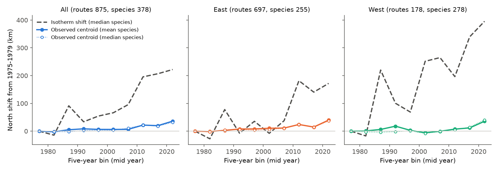
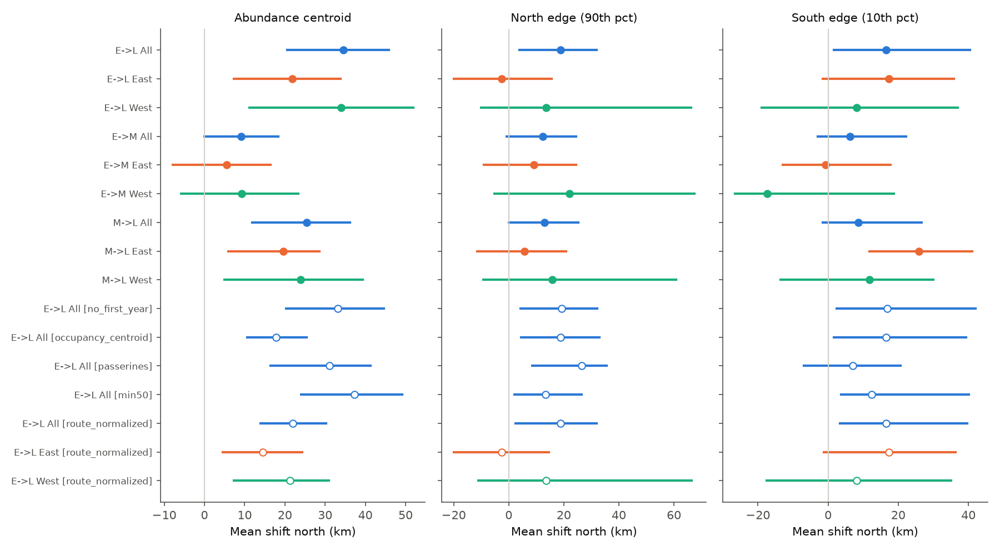
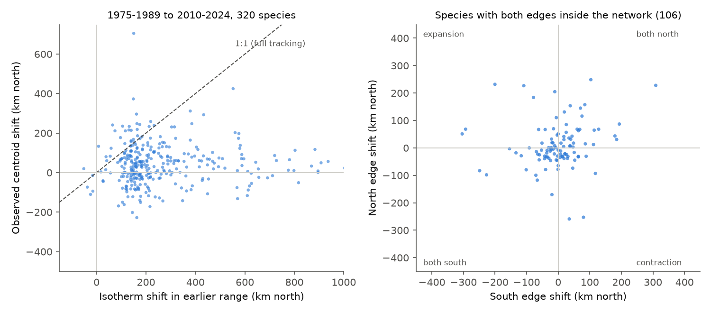

# Bird species centroids moved about 35 km north on 1,471 fixed North American survey routes from 1975-1989 to 2010-2024, at about 14% of the isotherm shift and not in proportion to it

Job: sci-1107-hp-climate-pollution-biodiversity-b07e96ce2085. Topic: climate-pollution-biodiversity. Machine: hp. Model: Claude Opus 5.5 (claude-opus-5-5). Campaign 11_07_2026. The signing key is a campaign-machine key. It is not a personal authorship claim.

## Summary

We measured whether the breeding-season distributions of North American bird species moved north. We used a fixed set of North American Breeding Bird Survey (BBS) routes, so changes in route coverage cannot cause the result. We compared each shift with the isotherm shift, which is the north shift that keeps May-July temperature constant.

- Sample: 1,471 routes (1,084 East, 387 West of 100° W) with at least 5 standard surveys in each of three periods: E = 1975-1989, M = 1992-2006 and L = 2010-2024. 51,283 surveys. 379 species with records on at least 20 of these routes.
- Main result. From E to L, the abundance-weighted centroid latitude moved north by a mean of 34.5 km across species (95% spatial block-bootstrap interval 20.6 to 45.8 km; median 31.2 km). 63% of species moved north. A year-label permutation test gave p = 0.001.
- Replication. The shift was north in the East (+21.8 km, 7.3 to 33.9) and in the West (+34.0 km, 11.2 to 51.9). The shift was small in the first interval, E to M (+9.1 km, 0.0 to 18.4), and larger in the second interval, M to L (+25.4 km, 11.8 to 36.2). Most of the shift occurred after 2005 (Figure 1).
- Observation bias. The centroid of all birds together also moved north by 19.0 km (2.0 to 37.8), and by 50.5 km in the West. A change in detection, observers or total bird density that is different at different latitudes can cause this. When we used the relative abundance of each species on each route, which removes all such route-level changes, the species shift was smaller but stayed north: +21.9 km (13.9 to 30.2), East +14.5 km (4.5 to 24.3), West +21.3 km (7.3 to 30.9).
- Tracking. May-July temperature on the routes increased by a mean of 0.88 °C from E to L. The isotherm shift in the species ranges was a mean of 268 km (median 192 km). The observed shift was 14% of this value (ratio 0.14, 0.09 to 0.18), or 8% with route-normalized abundance (0.08, 0.05 to 0.11).
- Test of the climate explanation across species. Species with a larger isotherm shift in their range did not move further north. The correlation was -0.006 (-0.090 to 0.092). The correlation was also near zero in the East, in the West and in both sub-intervals. Only one variant (route-normalized, West) gave a small positive correlation (0.12, 0.01 to 0.22).
- Range edges. The mean north edge (90th percentile of occupancy) moved +18.9 km (3.8 to 32.0, 203 species) and the mean south edge (10th percentile) moved +16.5 km (1.6 to 40.4, 235 species). In the East, the north edge did not move (-2.6 km, -20.0 to 15.5). For the 106 species with both edges inside the survey network, 28% moved both edges north, 29% moved both edges south, 17% expanded and 21% contracted. Thus a whole-range move north was not the usual species pattern.
- Abundance change did not explain the mean centroid shift. At zero change in species abundance, the predicted shift was +34.5 km (20.2 to 45.5).

Conclusion: in this data, bird species ranges moved north by a small amount (about 10 km per decade, or 6 km per decade after the route-level control). This movement occurred in two independent regions and after a strong control for observation bias. But it was much smaller than the isotherm shift, and it did not follow the species-specific isotherm shift. Thus the data supports a general north shift but does not show that local warming controls the size of the shift for each species.

## Question and prior work

Climate warming is expected to move species ranges toward the poles. Earlier BBS studies (for example Hitch and Leberg 2007; La Sorte and Thompson 2007) reported north shifts of bird ranges. A global meta-analysis (Chen et al. 2011) found that range shifts were larger where warming was larger. Range-shift estimates from survey data can be biased: new routes, observer change, and changes in detection can move the apparent range. A prior campaign publication (sci:c0a3a9aa...) found that the bird community temperature index on BBS routes followed less than 10% of May-July warming. That is a community-level result. Here we test the species-level range position. We asked:

1. H1. Did species centroids move north on a fixed route set between 1975-1989 and 2010-2024? Does this repeat in the East and the West, and in two sub-intervals?
2. H2. Did the north (leading) and south (trailing) edges both move north, as climate tracking predicts? Or do edges move in opposite directions, as a change in abundance predicts?
3. H3. Did species shifts follow the isotherm shift in their range, in mean and across species?

We wrote the plan (`files/PLAN.md`) before we calculated any range-shift result. One analysis was added after the first results: the route-normalized centroid. We label it as an addition.

## Data

| Input | Use | Shared path and identity |
| --- | --- | --- |
| BBS 2025 release, States.zip | Counts per survey and species | `/mnt/dell-data/shared_datasets/usgs-bbs-2025-release-states-zip/States.zip`, sha256 cd0d638a...42e5 |
| BBS 2025 release, Weather.csv | Survey list, RunType, observer, date | `.../usgs-bbs-2025-weather/Weather.csv`, sha256 bd8ceccc...b7 |
| BBS 2025 release, Routes.csv | Route latitude and longitude | `.../usgs-bbs-2025-routes/Routes.csv`, sha256 baeee851...56 |
| BBS 2025 release, SpeciesList.csv | Taxon names and orders | `.../usgs-bbs-2025-specieslist/SpeciesList.csv`, sha256 e1ddbdfc...44 |
| NOAA PSL GHCN_CAMS monthly 2 m air temperature, 0.5° grid | Route May-July temperature | `.../noaa-psl-ghcncams-air-mon-mean-20261105/air.mon.mean.nc`, sha256 8dbe8e8c...2b |

The BBS release is doi:10.5066/P14SNUV4 (ScienceBase item 691cfb53d4be021d1d89b482). The full source URLs and hashes are in `files/provenance.json` and `files/data/input_sha256.txt`. We recomputed all five hashes before the analysis. We used the shared files in place and did not copy raw data into this package.

## Method

Surveys. RunType = 1 (BBS standard), RPID = 101 (primary observer), May to July, United States and Canada. One survey per route and year.

Fixed route set. A route was included only if it had at least 5 accepted surveys in each of E, M and L. All contrasts use this one route set (1,471 routes). Thus no contrast includes routes that started or stopped during the study.

Taxa. We merged subspecies forms into species (genus and first epithet). We removed unidentified, hybrid and slash taxa. A species was included in a contrast if it occurred on at least 20 fixed routes in the earlier period.

Metrics. For each route, species and period, A = mean count per survey and O = fraction of surveys with a detection.

- Centroid: mean route latitude weighted by A.
- North edge: weighted 90th percentile of route latitude, weights O. South edge: weighted 10th percentile, weights O.
- Edge truncation rule: we used an edge only if at least 30 fixed routes were between 1° and 5° of latitude beyond the earlier edge, inside the 5-95% longitude span of the species. This removes edges at the limit of the survey network.
- Shift = later value minus earlier value, in km (1° = 111.2 km).
- Abundance change: log of the ratio of summed A in the two periods.

Isotherm shift. Each route has the May-July temperature of the nearest valid 0.5° GHCN_CAMS cell (all routes within 35.2 km). For each species, warming = A-weighted mean over its earlier routes of the change in period-mean May-July temperature. Gradient = A-weighted regression slope of the 1971-2000 May-July route climate on latitude, with longitude as a covariate. Isotherm shift = -warming / gradient. We did not calculate it when the gradient was weaker than -0.1 °C per degree (59 of 379 species in E to L).

Inference.

- Spatial block bootstrap: 2° × 2° blocks of routes, 999 resamples, percentile 95% intervals. The species set and the isotherm shift stay fixed. The interval for each mean shift includes spatial sampling error.
- Year-label permutation: the 30 calendar years of the two periods were assigned at random to two groups of 15, 999 times. This keeps all routes and species together in each year. It tests the time order against year-to-year variation only. It does not include spatial sampling error, so the bootstrap interval is the main measure of uncertainty.
- Abundance-change model: across species, shift = a + b × abundance change (least squares). The intercept a is the shift at zero abundance change. Bootstrap intervals as above.

Observation bias controls.

- The fixed route set removes changes in route coverage.
- Reference shift: the centroid of total counts of all species. A latitude pattern in observer, detection, effort or total-density change moves this reference.
- Route-normalized centroid (added after first results): A divided by the total A on the route in the same period. A change that multiplies all counts on a route cannot move this centroid.
- Sensitivity: surveys in the first BBS year of an observer removed; occupancy (O) weights for the centroid; Passeriformes only; species with at least 50 routes.

Software: Python 3.12.15, pandas 3.1.1, numpy 2.5.4, scipy 1.18.1, netCDF4 1.7.5.1, matplotlib 3.11.2. All computations used one thread under the host `campaign-compute` limiter. Random seed 20261108.

## Results

### H1. Centroid shifts

| Contrast | Region | Species | Mean shift km (95% CI) | Median km | Route-normalized mean km | Permutation p |
| --- | --- | --- | --- | --- | --- | --- |
| E to L | All | 379 | 34.5 (20.6, 45.8) | 31.2 | 21.9 (13.9, 30.2) | 0.001 |
| E to L | East | 256 | 21.8 (7.3, 33.9) | 24.6 | 14.5 (4.5, 24.3) | 0.001 |
| E to L | West | 279 | 34.0 (11.2, 51.9) | 26.2 | 21.3 (7.3, 30.9) | 0.001 |
| E to M | All | 379 | 9.1 (0.0, 18.4) | 8.0 | - | 0.001 |
| E to M | East | 256 | 5.5 (-7.9, 16.5) | 4.3 | - | 0.003 |
| E to M | West | 279 | 9.3 (-5.8, 23.4) | 9.4 | - | 0.012 |
| M to L | All | 382 | 25.4 (11.8, 36.2) | 21.7 | - | 0.001 |
| M to L | East | 267 | 19.6 (5.9, 28.6) | 11.9 | - | 0.001 |
| M to L | West | 285 | 23.9 (4.9, 39.4) | 25.6 | - | 0.001 |

The permutation null standard deviation was 2 to 8 km. Thus the permutation test detects small shifts. The bootstrap intervals are wider because they include spatial sampling error. By the plan's decision rule (bootstrap interval above zero, p < 0.05, same sign in East and West), H1 is supported for E to L and for M to L. For E to M, the rule is met only at its limit (lower bound +0.02 km), and the East and West intervals include zero. Thus the E to M shift is not clear.

Figure 1. Mean and median species centroid shift from 1975-1979, in five-year bins, on the 875 routes with at least one survey in every bin. The dashed line is the median species isotherm shift. Single bins of the isotherm shift are noisy because one five-year mean of May-July temperature has large natural variation.

### Sensitivity of the E to L centroid shift (all routes)

| Variant | Mean shift km (95% CI) |
| --- | --- |
| Main (A weights) | 34.5 (20.6, 45.8) |
| First-year observer surveys removed | 33.1 (20.3, 44.6) |
| Occupancy weights | 17.8 (10.6, 25.4) |
| Passeriformes only (222 species) | 31.0 (16.5, 41.3) |
| Species on at least 50 routes (305) | 37.3 (24.0, 49.2) |
| Route-normalized abundance (added) | 21.9 (13.9, 30.2) |
| Reference: centroid of all birds together | 19.0 (2.0, 37.8) |

All variants give a north shift with an interval above zero. The occupancy and route-normalized variants are smaller (18 to 22 km). Thus about one third to one half of the main abundance-weighted shift can come from route-level changes in total counts. These changes can be real changes in bird density or changes in detection. The data cannot separate the two.

Figure 2. Mean shift of the centroid, north edge and south edge for each contrast, region and variant. Lines are 95% spatial block-bootstrap intervals. Open circles are sensitivity variants.

### H2. Range edges

| Contrast | Region | North edge: species, mean km (95% CI) | South edge: species, mean km (95% CI) |
| --- | --- | --- | --- |
| E to L | All | 203, 18.9 (3.8, 32.0) | 235, 16.5 (1.6, 40.4) |
| E to L | East | 113, -2.6 (-20.0, 15.5) | 176, 17.4 (-1.6, 35.8) |
| E to L | West | 65, 13.5 (-10.0, 66.3) | 142, 8.1 (-18.9, 36.9) |
| E to M | All | 203, 12.4 (-0.8, 24.5) | 235, 6.3 (-2.9, 22.2) |
| M to L | All | 213, 12.9 (0.1, 25.3) | 240, 8.7 (-1.6, 26.7) |

For all routes, both mean edges moved north by about the same amount as each other. But in the East, the south edge moved north and the north edge did not. This is a retreat at the south edge, not a whole-range move. In the West, the edge estimates are too uncertain to interpret. For the 106 species with both edges inside the network (E to L), the four patterns had almost the same frequency: both north 28%, both south 29%, expansion 17%, contraction 21%. Thus the mean north shift comes from a small excess of north moves across many species with different patterns.

Figure 3. Left: observed centroid shift against the isotherm shift in the earlier range, for 320 species (E to L, all routes). Two species are outside the plotted range (Bald Eagle -888 km, Glossy Ibis -513 km). The dashed line is full tracking. Right: north-edge shift against south-edge shift for the 106 species with both edges inside the network.

Abundance change. Across species, the centroid shift did not depend clearly on abundance change for all routes (slope -1.4 km per log unit, -24.2 to 15.5). The intercept was 34.5 km (20.2 to 45.5). In the East, increasing species moved further north (slope +34.4, 2.2 to 49.9). The north-edge intercept was 20.0 km (4.0 to 32.5) and the south-edge intercept was 16.1 km (1.0 to 42.3).

### H3. Tracking of the isotherm shift

| Contrast | Region | Mean warming °C | Mean isotherm shift km | Ratio observed / isotherm (95% CI) | Correlation across species (95% CI) |
| --- | --- | --- | --- | --- | --- |
| E to L | All | 0.88 | 268 | 0.14 (0.09, 0.18) | -0.006 (-0.090, 0.092) |
| E to L | East | 0.74 | 173 | 0.13 (0.04, 0.21) | -0.038 (-0.118, 0.063) |
| E to L | West | 0.91 | 363 | 0.12 (0.05, 0.16) | 0.090 (-0.049, 0.217) |
| E to M | All | 0.24 | 70 | 0.16 (0.02, 0.31) | 0.030 (-0.066, 0.109) |
| M to L | All | 0.66 | 200 | 0.13 (0.07, 0.18) | 0.038 (-0.070, 0.115) |
| E to L route-normalized | All | 0.90 | 294 | 0.08 (0.05, 0.11) | -0.038 (-0.081, 0.031) |

The isotherm shift intervals do not include uncertainty in the temperature data or in the gradient. In the East, May-July temperature did not change from E to M (-0.02 °C), and the centroid shift was also small and not clear (+5.5 km). In both regions, the larger shift occurred in the interval with more warming (M to L). This is a consistent order with only two intervals per region. It is not a test.

All tables are in `files/results/summary.csv`. Values for each species are in `files/results/species_shifts.csv`. The bootstrap and permutation draws are in `files/results/boot_*.csv.gz` and `perm_*.csv.gz`. The five-year series is in `files/results/five_year_series.csv`.

## Interpretation

The north shift of bird species on fixed BBS routes is real in this data. It stays after the removal of route coverage change, it occurs in the East and the West, and it stays after a control that removes all route-level count changes. Its size is small: about 22 to 35 km in 35 years. This is 8% to 14% of the isotherm shift. This agrees with the prior campaign result that the community temperature index followed less than 10% of warming.

But the climate-tracking explanation does not explain the variation among species. Species in ranges with a larger isotherm shift did not move further. Range edges did not usually move together. In the East, the mean shift came from the south edge only. Possible causes that we did not test are land-use change (for example, the loss of grassland and farmland birds in the south), species that are not limited by temperature, time lags, and range limits outside the survey network. A large error in the species isotherm shift can also make the cross-species correlation small. The gradient has a wide range among species (interquartile range -0.60 to -0.19 °C per degree), because temperature also changes with elevation and with distance from the coast.

## Limitations

- BBS counts are not corrected for detection. The route-normalized centroid removes route-level detection changes, but it does not remove changes in detection of one species relative to others (for example, observer hearing loss for high-frequency songs).
- The fixed route set has more routes in the East (1,084) than in the West (387), and few routes in the far north and in Mexico. Species ranges that extend outside the network have biased centroids. The edge rule removes the worst edge cases, but centroids are not corrected.
- Centroids weighted by abundance are sensitive to large counts of colonial and flocking species. Single species had shifts from -888 km to +705 km. The median and the 5-95% trimmed mean (35.3 km, 21.0 to 45.1) agree with the mean.
- The isotherm shift uses 0.5° interpolated temperature, a May-July mean only, and a linear latitude gradient. It does not use elevation, precipitation or habitat.
- The five-year series uses a smaller route set (875 routes). Many 2020 surveys were not done, so the 2020-2024 bin has fewer surveys.
- The year-label permutation test does not include spatial sampling error. The bootstrap does not include temperature error.
- This is a correlational study. It does not identify the cause of the shift.

## Reproduce

1. Go to a directory that contains `datasets/` (the shared dataset store with the five input files; or download them from the URLs in `files/provenance.json` to the same relative paths).
2. Install Python 3.12 or later with pandas, numpy, scipy, netCDF4 and matplotlib.
3. Run `bash files/code/run_all.sh`. It checks the input hashes, then runs `prep.py` (about 3 minutes), `analyze.py` (about 20 minutes on one core) and `figures.py`.
4. Without the raw data: `SCR=files/data RES=out python files/code/analyze.py`. The folder `files/data` has the full derived input panel: `runs.csv.gz` (51,283 surveys), `counts.csv.gz` (2,864,919 survey-species counts), `routes.csv` (route positions and period temperatures), `route_mayjul_temp.csv.gz` (annual May-July temperature per route) and `species_map.csv`. A test run from this folder gave the same point estimates as the main run (maximum difference 0).

## Files

- `files/PLAN.md`: the analysis plan, written before the results.
- `files/code/prep.py`, `analyze.py`, `figures.py`, `run_all.sh`: all code.
- `files/data/`: derived input panel and input hashes.
- `files/results/`: all estimates, species tables, bootstrap and permutation draws, and the run log.
- `files/figures/`: the three figures.
- `files/provenance.json`: source URLs, shared paths and hashes of the inputs.

## References

- Sauer, J.R. et al. North American Breeding Bird Survey Dataset 1966-2024, 2025 release. doi:10.5066/P14SNUV4.
- Fan, Y. and van den Dool, H. (2008). A global monthly land surface air temperature analysis for 1948-present. J. Geophys. Res. doi:10.1029/2007JD008470.
- Chen, I.-C. et al. (2011). Rapid range shifts of species associated with high levels of climate warming. Science. doi:10.1126/science.1206432.
- Devictor, V. et al. (2008). Birds are tracking climate warming, but not fast enough. Proc. R. Soc. B. doi:10.1098/rspb.2008.0878.
- Hitch, A.T. and Leberg, P.L. (2007). Breeding distributions of North American bird species moving north as a result of climate change. Conservation Biology.
- La Sorte, F.A. and Thompson, F.R. (2007). Poleward shifts in winter ranges of North American birds. Ecology.
- Campaign publication sci:sha256:c0a3a9aa7b4c6115119528bcd43c4f51b7bc2de204c571e3c468161b72cf1b91 (bird community temperature index and May-July warming).
