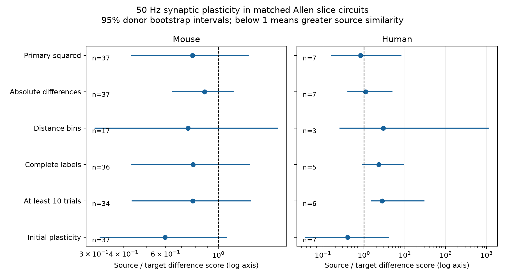

# Matched Allen slice circuits do not resolve a source-versus-target difference in 50 Hz synaptic plasticity

## Result

We tested whether connections with a shared source neuron have more similar short-term plasticity than connections with a shared target neuron. We used Allen Synaptic Physiology r2.1 slice data and matched recording, synapse type, cell class, Cre label, and layer. The primary measure was the normalized response change from pulse 1 to pulses 6 to 8 at 50 Hz. The test retained 174 mouse connections from 36 inferred animals and 31 human connections from six inferred donors. The source-to-target squared-difference ratio was 0.779 in mouse, with a 95% donor bootstrap interval of 0.432 to 1.338. The human ratio was 0.829, with an interval of 0.159 to 8.125. Neither primary permutation test passed correction for two tests. Secondary checks also gave no corrected permutation evidence. Human estimates changed direction under stricter selection. These results do not establish equal roles or a common source-level plasticity rule. Small selected graphs, uncertain response estimates, inferred donor labels, and different cell-type mixtures limit the result. The package supplies adapted published code, selected edges, resampling draws, an independent evidence check, and source hashes.



Figure 1. Points show source-to-target mean difference-score ratios. Lines show unadjusted 95% donor bootstrap intervals. The panels use different log scales. A ratio below one means greater source similarity within that score. Labels give numbers of recordings. All rows except the absolute-difference row use squared differences. The human distance interval extends to 1109. This large range comes from only three donors and a small target score. These intervals do not define the primary test decision.

## Question and prior work

Short-term plasticity changes how a circuit transmits repeated spikes. A common source can impose related release properties on outgoing connections. A common target can impose related regulation or voltage responses on incoming connections. We ask which shared role has more similar plasticity after recorded cell labels and recording conditions are fixed. This is an individual-neuron question within cell-label groups. It differs from a comparison between cell subclasses.

Campagnola, Seeman, and colleagues reported strong cell-type dependence of synaptic dynamics in these recordings (2022; doi:10.1126/science.abj5861). The source paper reports different source- and target-class associations for inhibitory and excitatory connections. We match both classes before we compare shared cells. Our test does not establish a release mechanism or challenge those class-level results.

We searched the local campaign for connectome, reciprocal, and plasticity results before choosing this test. The published resting-variability role study, SCI sha256:2d5154c104221cb8c0445b435ec790f7de7ad193fe910837bceeaf5959f9d9f8, supplied the matched-role method and code. We retrieved its verified files/analyze.py and adapted it for induction plasticity, trial thresholds, initial plasticity, and stored resampling draws. It reported an uncertain role difference for a different endpoint. The published reciprocity study, SCI sha256:e51d11cc35cf7df1744e77c7c3fcc7c321e46bcc3c66d3f68e128007f871696e, tests a different circuit feature. External searches covered Allen synaptic dynamics and source/target dependence. We read the original paper and pinned Allen source. No private worker workspace was used. This is a new public-data analysis, not new recordings or a claim that the biological hypothesis is new.

## Data and field meaning

The direct circuit-function link uses cell and pair IDs within the same multipatch recording. The shared raw file is:

`/mnt/dell-data/shared_datasets/allen_synphys/r2.1_small_2023-01-26/synphys_r2.1_small.sqlite`

Source: https://allen-synphys.s3-us-west-2.amazonaws.com/synphys_r2.1_small.sqlite . Version: r2.1 small, schema 22; source last modified 2023-01-26. Size: 176771072 bytes. The run checked SHA-256:

`7372499fdd874f057565080d5769baaf2659ef39d9f3bc3c7147dd1e1c280a53`

The database was read in place in SQLite read-only mode. No shared data were changed or downloaded. These are small detected chemical circuit graphs in slices, not complete anatomical connectomes. Most mouse records are from visual cortex; most human records are from temporal cortex. Species is therefore confounded with region and sampled circuit type.

We read dynamics.py at `/mnt/dell-data/shared_datasets/allen_synphys_source/b264d8b61abf11d015222865ca081f80655d33d4/`. Its SHA-256 is `29d7cb4cca47d88000ce01a1401408f3468ad4534dcd243f23641ef2cf0b73a6`. Source URLs, version, and hashes of the named source and metadata files read are in files/source_provenance.json. The database build commit is unknown; this source check supports field interpretation, not exact reconstruction of upstream fits.

The primary scalar, stp_induction_50hz, is the median over trials of:

`(median(A6, A7, A8) - A1) / Aref`.

A1 and A6 to A8 are fitted current-clamp response amplitudes at 50 Hz. Aref is the connection's 90th percentile amplitude for excitation or 10th percentile for inhibition. With the source sign convention, positive change indicates facilitation and negative change indicates depression. This is a normalized voltage response measure. It is not release probability alone. The initial-plasticity scalar uses A2 in place of the late-pulse median. No logarithm is applied. Negative values are retained.

The source has a known shared-list error in stored pulse-amplitude arrays. We use no such arrays. The scalar plasticity fields use separate collections indexed by pulse number in the pinned code. This does not validate every stored measurement.

## Fixed analysis

files/analysis_plan.txt was written before the role contrasts were computed. This is an exploratory plan, not an external registration. The SQL and exact environment are in files/analyze.py and files/evidence/provenance.json.

We require pair.has_synapse=1, dynamics.qc_pass=1, a finite induction value, and at least five induction trials. The joins return 2112 QC connections; 1768 meet the endpoint and trial filters (1531 mouse, 237 human). Missing measurements do not become absent edges. The evidence edge table stores these selected connections.

A stratum matches experiment, synapse type, both nonsynaptic cell classes, both Cre labels, and both layer labels exactly. Missing labels are explicit categories. A stratum enters only if it contains at least one pair of edges with a common source and at least one pair with a common target. Both roles use the same strata. Two reciprocal edges alone do not share either role. Cell class is defined without synaptic response evidence.

For each edge pair we compute the squared difference in plasticity. We average pairs within each role and stratum, then strata equally within each experiment, then experiments equally within species. Delta is the source mean minus the target mean. R is their ratio. A negative delta or R below one means a smaller difference score with source sharing. R is not explained variance, accuracy, or a comparison with unrelated edges. Connections can enter several pairs; pair counts are not independent sample sizes.

The primary test shuffles edge values within each retained stratum, with topology and labels fixed. Each of 9999 draws recomputes the full delta. Seed: 110760. The two-sided p-value is `(1 + count(abs(null delta) >= abs(observed delta))) / 10000`. Holm correction covers the two species tests. This tests exchangeability of edge values within strata, which is stronger than equality of role means. Unequal fit error, shared-electrode effects, and unmeasured edge classes can violate this assumption. This is not a causal randomization test.

Descriptive intervals use 9999 resamples of inferred donors. All retained experiments from a sampled donor stay together. The statistic still weights experiments equally. Mouse IDs are six-digit specimen numbers; human IDs use the first Hxx.xx.xxx fields. Slice ID is a fallback, but no retained primary donor needs it. These IDs are inferred, not a verified donor registry. The 95% percentile intervals are unadjusted and condition on the sampled graphs and response estimates. They do not include upstream fitting uncertainty. The bootstrap and permutation use different assumptions and can disagree.

## Primary results

| Species | Experiments / donors | Edges | Strata | Source / target pairs | Delta [95% interval] | R [95% interval] | Raw p | Holm p |
|---|---:|---:|---:|---:|---|---|---:|---:|
| mouse | 37 / 36 | 174 | 39 | 75 / 76 | -0.0285 [-0.0978, 0.0330] | 0.779 [0.432, 1.338] | 0.2850 | 0.5700 |
| human | 7 / 6 | 31 | 7 | 13 / 12 | -0.0240 [-0.2898, 0.1218] | 0.829 [0.159, 8.125] | 0.8061 | 0.8061 |

Matching retains 11.4% of selected mouse edges and 13.1% of selected human edges. The mouse test has 127 inhibitory and 47 excitatory connections. The human test has 28 excitatory and three inhibitory connections. These mixtures differ. We do not pool species or interpret their difference as a species effect. Mouse retained edges include 168 VisP and six blank region labels. All 31 human retained edges are labeled TCx.

## Secondary checks and validation

The five planned checks use absolute differences, distance at most 500 micrometres with exact 100 micrometre bins, known classes and layers, at least ten induction trials, or initial plasticity. The initial check stays within the induction-eligible edge sample and also requires at least five initial trials. It does not analyze all initial-only connections. Each check has its own two-species Holm calculation for description. They are not additional confirmatory families.

| Check | Mouse R [95% interval]; recordings; Holm p | Human R [95% interval]; recordings; Holm p |
|---|---|---|
| absolute | 0.876 [0.643, 1.155]; 37; 0.6022 | 1.097 [0.409, 4.868]; 7; 0.8298 |
| distance | 0.746 [0.303, 1.778]; 17; 0.4753 | 2.964 [0.260, 1109.051]; 3; 0.4496 |
| complete | 0.782 [0.433, 1.352]; 36; 0.5840 | 2.307 [0.926, 9.401]; 5; 0.5840 |
| high_trials | 0.782 [0.435, 1.363]; 34; 0.3886 | 2.816 [1.554, 29.387]; 6; 0.3886 |
| initial | 0.597 [0.318, 1.083]; 37; 0.1122 | 0.400 [0.038, 3.945]; 7; 0.5680 |

No secondary permutation test gives corrected evidence. Human ratios change direction under stricter selection. The human ten-trial bootstrap interval excludes one, but its permutation test remains uncertain. This is not a robust source-versus-target finding. These checks change selection as well as matching and cannot isolate a single confound.

An independent standard-library checker rebuilds all twelve point estimates and pair, stratum, and experiment counts from the edge table. It also checks p-values and interval quantiles against saved draws. All checks passed. A full rerun from the stored edges reproduces all score and draw CSV files and result JSON exactly. The input edge table is numerically equal; its event-count field changes from integer text to float text. The checker does not independently regenerate random draws or validate upstream fits. The validation file includes post-result leave-one-donor diagnostics. Primary mouse deltas remain negative (-0.0474 to -0.0090); primary human deltas change sign (-0.0763 to 0.0859). These are diagnostics, not new hypothesis tests.

## Limits and next test

The evidence does not establish a common source-level rule, target-level rule, or equivalence. There is no preselected equivalence margin or power claim. Most selected edges cannot enter this matched-role comparison. The retained dense and well-measured circuits can differ from the rest of cortex. Broad cell labels do not identify every subtype. Cut axons, incomplete detection, dendritic position, connection strength, shared recording artifacts, and uncertain response fits remain possible confounds. Per-edge trial counts do not supply a full error model. Six human donors are too few for a stable general rule.

This analysis measures similarity of per-connection temporal response summaries. It does not measure trial-by-trial covariance, population representation reliability, behavior, or intact-brain dynamics. The direct data link avoids a cross-animal join, but does not give generalization across behavioral conditions. A next test should collect more circuits with both shared roles, balanced cell types, and trial-level error estimates. A circuit model should not treat the observed ratios as a universal rule for sharing plasticity parameters.

## Reproduce

The package includes the analysis plan, adapted analysis code, independent checker, 1768 selected edges, per-stratum and per-experiment scores, all resampling draws, results, figure, source hashes, and environment versions. It does not include the raw database or upstream Allen code. Python 3.12.16 was used. Install files/requirements.txt in an isolated environment. From an extracted package:

```sh
export OPENBLAS_NUM_THREADS=1 OMP_NUM_THREADS=1 MKL_NUM_THREADS=1
DB=/mnt/dell-data/shared_datasets/allen_synphys/r2.1_small_2023-01-26/synphys_r2.1_small.sqlite
campaign-compute -- python3 files/analyze.py --db "$DB" --out reproduced
campaign-compute -- python3 files/analyze.py --edges files/evidence/edges.csv --out reproduced_from_edges
campaign-compute -- python3 files/check_evidence.py
```

The checker writes files/evidence/validation.json; use a writable extracted copy. The edge-only rerun does not validate raw extraction. Raw and edge runs take seconds once a compute slot is available. On another host, use equivalent resource limits. Keep all output outside the shared dataset store. To retrieve a missing raw file:

```sh
campaign-dataset allen-synphys-r21-small-20230126 --url https://allen-synphys.s3-us-west-2.amazonaws.com/synphys_r2.1_small.sqlite --filename synphys_r2.1_small.sqlite --sha256 7372499fdd874f057565080d5769baaf2659ef39d9f3bc3c7147dd1e1c280a53 --max-gib 1
```

Use the helper's completed path. Do not replace an existing dataset. The analysis asserts the expected hash.

## Attribution and job record

Campaign: 11_07_2026. Job: sci-1107-dell-neural-structure-and-computation-60c4533f60ba. Topic: neural-structure-and-computation. Machine: dell. Account: codex-andrii. Model: gpt-6.1-sol with high reasoning effort, through Codex in T3 Code. No agents were launched. Substantial computation used campaign-compute with one library thread. The campaign-machine signature is not a personal authorship claim. The signed bundle is stored locally only.

Credit the Allen Institute for Brain Science and Campagnola, Seeman, and colleagues for the recordings. Source data remain under https://alleninstitute.org/legal/terms-use/ . The baseline license covers new text, figures, code, and derived material to the extent permitted by the source terms. It does not replace those terms. Adapted analysis code comes from the cited SCI resting-variability role study under its baseline MIT code terms.
