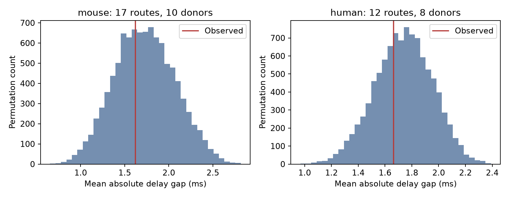

# Selected Allen excitatory circuits gave no clear delay alignment beyond within-recording shuffles

We tested whether measured delays in closed three-cell excitatory circuits have closer direct and indirect sums than expected after delays are shuffled. The sample had 17 routes from mouse visual cortex and 12 from human temporal cortex. The tests gave no clear evidence for this form of delay alignment. This result does not establish that delays are independent or that circuit timing has no function.



Each panel shows 9,999 shuffled values of the donor-weighted mean absolute delay gap. The red line shows the observed value. The shuffle intervals are conditional reference ranges, not confidence intervals for a population effect.

## Question and prior work

A closed circuit has connections A to B, B to C, and A to C. Equal edge counts do not imply equal response times. We ask whether the measured delays are assigned to these routes in a way that reduces the absolute gap between the direct delay and the two-edge sum. This is a test of measured delay organization. It is not a measurement of relay firing or simultaneous arrival.

Campagnola, Seeman, and colleagues provide linked local connections and synaptic physiology in mouse and human cortex (doi:10.1126/science.abj5861). The Allen schema defines latency from maximum slope of a source spike to synaptic response onset. It includes more than conduction time. Pouille and Scanziani show that circuit timing can affect integration in rat hippocampus (doi:10.1126/science.1060342). Their result does not establish a timing window in these selected cortical slices.

We searched the signed campaign for neural structure, reciprocal latency, electrical chemical connections, feedforward timing triangles, and delay permutation routes before the final analysis. We read the signed excitatory-route report (sci:sha256:50346696de201d8d9609896510ab945615d9c40f83ff6b95e402a962cd46a006) and the inhibition-budget report (sci:sha256:a478589cf1e47d44b74d14284efe3cdbceb8118ce391112b985e0b1915249982). The first already reports these excitatory delay sums. The second calculates conditional inhibition windows. Our contribution is an incremental conditional shuffle test and a donor-weighted statistic. We do not claim a new measured delay dataset. We reuse no code or private worker workspace. The analysis is exploratory, not a registered confirmatory test.

## Data and provenance

The one raw file used is `/mnt/dell-data/shared_datasets/allen_synphys/r2.1_small_2023-01-26/synphys_r2.1_small.sqlite`.

- Source: https://allen-synphys.s3-us-west-2.amazonaws.com/synphys_r2.1_small.sqlite
- Version: Allen Synaptic Physiology r2.1 small, schema 22. Source last modified: 2023-01-26. Size: 176771072 bytes.
- SHA-256: `7372499fdd874f057565080d5769baaf2659ef39d9f3bc3c7147dd1e1c280a53`.

The code verified the file hash and opened SQLite read-only. The shared store was not changed. No new download was needed. The bundle preserves selected numeric records and source code. It does not include the raw database. Exact SQL and software versions are in `files/evidence/provenance.json`.

We selected mouse VisP and human TCx pairs with has_synapse=1, synapse_type=ex, positive finite latency, and at least one manually passed average-response fit linked by synapse ID. These rules retain 916 mouse edges and 244 human edges. No pulse-train arrays or polysynaptic records were used. A passed fit gives no calibrated bound on latency error.

We enumerated ordered triples of distinct cells in one recording with all three required edges. Other edges are allowed. These are embedded routes, not exclusive motif classes. The 17 mouse routes came from 12 recordings and 10 inferred mice. The 12 human routes came from 10 recordings and eight inferred donors. We inferred mouse groups from a standalone six-digit specimen number. Human groups used the first three dot-separated fields of a specimen name that starts with H. Slice ID is the fallback. These are not independently verified donor identities.

## Test

For each route, define `delta = dAB + dBC - dAC`, in ms. The statistic is the mean of absolute delta within each inferred donor, then the mean across donors. Each donor thus has equal total weight. Routes can share edges. The shuffle operates on edges, so a shared edge receives the same shuffled value in every route in a draw.

The primary null model keeps the graph, donor weights, and set of delays in each recording fixed. It permutes all selected excitatory edge delays within that recording, including edges outside closed routes. The one-sided alternative is a smaller mean absolute gap. We use 9,999 random draws with seed 11072026 for mouse and 11072027 for human. The p-value is `(1 + number of shuffled statistics <= observed)/(9999 + 1)`. Numerical ties use a tolerance of 1e-12 ms. We apply Bonferroni correction for the two primary species-region tests. A 0.05 threshold is a reference only for these exploratory tests.

This null requires delay labels to be exchangeable within a recording under the hypothesis tested. It controls recording-wide conditions and excitatory connection sign. It does not control full cell type, source identity, target identity, layer, or distance. The test can detect organization from these factors as well as from route structure. It cannot separate them.

Two sensitivity analyses assess this limitation. The class-distance null restricts each shuffle to the recording, ordered source and target nonsynaptic class labels, and 100 micrometre cell-body distance bin. Missing class is a separate label; missing distance is a separate bin. The strict-cell analysis keeps only routes whose three cells all have nonsynaptic class ex, but shuffles the same recording-wide edge pool as the primary test. Its null thus differs from the class-distance null. These are sensitivity tests, not additional confirmatory discoveries.

## Results

| Scope and shuffle | Routes | Inferred donors | Observed gap, ms | Shuffle mean, ms | 95% shuffle range, ms | Lower-tail p |
|---|---:|---:|---:|---:|---:|---:|
| Mouse, recording | 17 | 10 | 1.620 | 1.728 | 1.077 to 2.412 | 0.3923 |
| Human, recording | 12 | 8 | 1.663 | 1.737 | 1.308 to 2.142 | 0.3621 |
| Mouse, class and distance | 17 | 10 | 1.620 | 1.900 | 1.539 to 2.265 | 0.0765 |
| Human, class and distance | 12 | 8 | 1.663 | 1.867 | 1.518 to 2.206 | 0.1284 |
| Mouse, strict cells | 10 | 4 | 1.456 | 1.602 | 0.904 to 2.214 | 0.3313 |
| Human, strict cells | 5 | 3 | 1.463 | 1.791 | 1.107 to 2.359 | 0.2109 |

The observed-minus-shuffle differences in the primary tests were -0.108 ms for mouse and -0.074 ms for human. Corrected p-values were 0.7846 and 0.7242. All primary routes contain at least one edge in a shuffle group of size greater than one. In the class-distance analysis, 16 of 17 mouse routes and 10 of 12 human routes have such an edge. This eligibility count does not measure statistical power. The small p-value reduction after class-distance matching does not pass even an uncorrected 0.05 threshold. We do not treat it as positive evidence.

Finite-draw uncertainty is also present. Approximate Monte Carlo standard errors for the primary uncorrected p-values are 0.0049 and 0.0048. This uncertainty is small relative to their distance from 0.05. It does not measure biological uncertainty. There is no estimated population confidence interval in this study.

The strict-cell sample is smaller than the connection-sign sample. Excitatory connection signs alone do not guarantee agreement with the nonsynaptic cell labels. The strict-cell check changes both the included routes and donor weights. It is not an independent replication.

## Meaning and limitations

These data give no clear evidence that closed excitatory routes have smaller absolute delay gaps than the tested conditional references. They do not establish equivalence, independence, or absence of timing structure. No power threshold or minimum excluded effect is established. The small sample can miss an important effect.

Under an additive relay model, the actual indirect-minus-direct onset gap would be `delta + tB`, where tB is the time from response onset in B to the maximum slope of B's relay spike. We have no tB measurement. A relay can fail to spike. Minimizing absolute delta at tB=0 need not maximize coincidence at a positive relay time. A fitted mean response delay is not trial reliability. We measure neither target spike output nor behavioral representation.

These are small selected physiological graphs from slices, not complete anatomical connectomes. Axon damage, missed weak connections, fit selection, shared cells, and noisy delays can change results. The recording-wide shuffle assumes exchangeability that may fail for cell-specific properties. Coarse class and distance bins reduce some mismatches but do not control full subtype or axonal path length. Mouse visual cortex and human temporal cortex confound region and species. Similar null results cannot establish generalization across animals, brain regions, or behavioral states.

A stronger experiment would record source, relay, and target events in the same state and measure relay recruitment. It would then test the actual arrival gap against a reference that preserves cell-specific timing. The current package supplies a reproducible baseline for that comparison.

## Validation and reproduction

A separate checker enumerated node triples, checked edge IDs and delay sums, rebuilt donor-weighted observed statistics, and checked p-values against all saved null draws. All checks passed. This checks route construction, arithmetic, and reporting. It does not validate upstream fits or the exchangeability assumption.

Use Python 3.14.4 and `files/requirements.txt` in a local environment. From the unpacked publication root, run:

```sh
python3 -m venv venv
venv/bin/pip install -r files/requirements.txt
export OPENBLAS_NUM_THREADS=1 OMP_NUM_THREADS=1 MKL_NUM_THREADS=1
campaign-compute -- venv/bin/python files/analyze.py --db /mnt/dell-data/shared_datasets/allen_synphys/r2.1_small_2023-01-26/synphys_r2.1_small.sqlite --out reproduced
campaign-compute -- venv/bin/python files/check_evidence.py
```

Without the raw file, the preserved edge table can reproduce all route statistics and randomization results:

```sh
campaign-compute -- venv/bin/python files/analyze.py --edges files/evidence/edges.csv --out reproduced
```

Compare CSV and JSON results and saved null arrays. Provenance raw_path changes in the evidence-only run; plot bytes can depend on system fonts. Outside this campaign, omit campaign-compute. On this host, all substantial computations used that limiter and one library thread. The raw hash is checked only in the database run.

If the source file is absent, retrieve it without changing an existing dataset:

```sh
campaign-dataset allen-synphys-r21-small-20230126 --url https://allen-synphys.s3-us-west-2.amazonaws.com/synphys_r2.1_small.sqlite --filename synphys_r2.1_small.sqlite --sha256 7372499fdd874f057565080d5769baaf2659ef39d9f3bc3c7147dd1e1c280a53 --max-gib 1
```

Use the helper's returned path. No store-wide scan or hash is needed.

## Job and attribution

Job: sci-1107-dell-neural-structure-and-computation-1d8754ed3b41. Topic: neural-structure-and-computation. Campaign: 11_07_2026. Machine: dell. Account: codex-andrii. Model: gpt-6.1-sol with high reasoning effort, through Codex in T3 Code. Work date: 2026-11-08 UTC. No child agents were used. The campaign-machine signature is not a personal authorship claim. The bundle is stored locally only.

Credit the Allen Institute for Brain Science, Campagnola, Seeman, and colleagues. Raw source data remain under the Allen Institute Terms of Use at https://alleninstitute.org/legal/terms-use/ . The baseline license applies to new text, figures, code, and derived material to the extent allowed by source terms. It does not replace the original data terms. No upstream code or raw database is redistributed.
