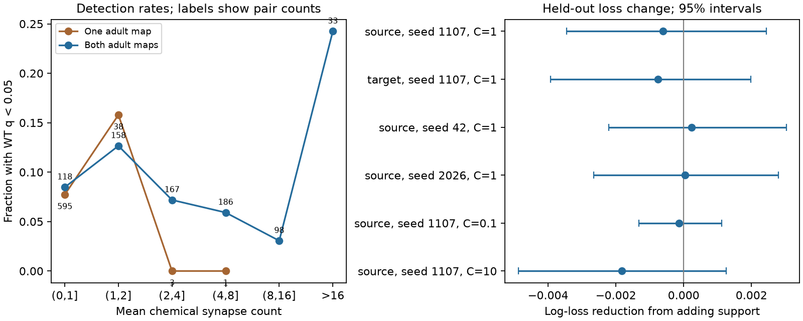

# Presence in two adult worm maps gave no clear evoked-response prediction gain in 1397 selected pairs

## Question and result

Does chemical-edge presence in two adult anatomy maps add information about evoked-response detection beyond mean synapse count? In this selected sample, it gave no clear gain. This is a prediction test under a stated model. It is not a test of trial-to-trial response reliability.

Adding two-map presence changed held-out log loss from 0.277920 to 0.278525. The reduction was -0.000604, with a conditional 95% interval from -0.003460 to 0.002444. Positive reductions mean better predictions. A small positive gain remains compatible with this interval.

## Prior evidence

Randi et al. measured evoked responses with stimulation and calcium imaging. Their study found that signal propagation can use indirect and non-wired routes [doi:10.1038/s41586-023-06683-4]. Witvliet et al. measured wiring across development and found stable and variable connections [doi:10.1038/s41586-021-03778-8]. Here, presence in two adult maps is a narrow measure of agreement. It is not their developmental stability classification.

We searched the campaign for connectome, Randi, connectome consistency, Witvliet response, mirror and reconstruction. We read the published peptide-route study [sci:sha256:bcd56cbbaf2b2a6017163f45c5983596ff749473db319cb2d95cfad91faaaaa6]. It used wiring and cell controls for the same evoked atlas. This report adds an adult-map support test with new code. We found no direct duplicate in these searches. They are not a complete review.

## Data and selection

The raw data were reused in place at /mnt/dell-data/shared_datasets/worm-neuro-atlas/b2e13d88b670efcb3438aeacba2ad4bd6c383933. The source is Worm Neuro Atlas at commit b2e13d88b670efcb3438aeacba2ad4bd6c383933. The functional file states compilation time 2023-06-28_19-52-14. files/provenance.json records the exact URLs, byte counts and SHA-256 hashes of the three files used.

We used funatlas.h5 and the two aconnectome_witvliet_2020_7.csv and aconnectome_witvliet_2020_8.csv exports. We did not use the composite default anatomy or White maps. Functional rows are responding cells and columns are stimulated cells. We used sorted HDF5 labels and normalized AWCOF to AWCOFF. Anatomy edges were linked by exact labels. Unmatched labels were skipped. We did not equate anatomical AWC left/right labels with functional ON/OFF labels.

There were 23902 nonself pairs with finite WT q and positive occurrence count. Requiring both cells in the endpoint sets of both adult maps left 15384 pairs. Requiring a chemical edge in at least one map left 1397 pairs, with 126 source and 148 target identities. The common endpoint set had 178 identities. An endpoint set consists of labels in any listed chemical or electrical edge. It is a coverage proxy, not proof that each possible edge was examined.

A chemical count is the sum of matching directed rows in each export. The mean is the sum of the two adult counts divided by two. For each adult electrical map, we filled both directions with the larger listed count, as in the upstream loader, and then averaged the adults. WT response detection means q < 0.05. A value above this threshold does not establish functional absence.

## Method

The plan in files/PLAN.md was written before outcome comparisons. It records one data-handling correction after the first two preliminary fits: electrical maps use the maximum of listed directions. The preliminary primary reduction was -0.00059034. The corrected result was -0.00060415. Test and tuning rules did not change.

The base logistic model used a cubic polynomial of log(1 + mean chemical count), log(1 + mean electrical count), log(1 + reverse mean chemical count), log(1 + occurrence count), and source and target identity indicators. The added binary predictor was chemical presence in both maps. Numeric controls were scaled using training data only. Identity and support indicators were not scaled. L2 regularization used C=1, a fixed choice. Unknown held-out identities had zero indicators.

The primary five-fold split kept each stimulated identity in one fold. Its pairs were all excluded from that fold's training data. Seed 1107 defined the split. Scores weight directed pairs equally. Identities with more measured partners have more weight. We did not hold out functional animals; the aggregate endpoint does not permit that test here.

For uncertainty, we resampled source identities and target identities independently with replacement and multiplied their multiplicities to weight pairs. We used 2000 draws and percentile limits. These crossed cell intervals address dependence on the two cell axes in a limited way. They hold fitted predictions fixed. They do not include refitting, q uncertainty, reconstruction error, anatomy-animal sampling, or common experiment effects.

Five sensitivity checks held out targets, used two other source split seeds, or changed C to 0.1 or 10. They use the same data and are not independent replications. Full-data coefficients are descriptive. No coefficient confidence interval is claimed.

## Results

| Map support | Pairs | Detections | Detection rate | Median mean count |
|---|---:|---:|---:|---:|
| One map | 637 | 52 | 8.16% | 0.5 |
| Both maps | 760 | 64 | 8.42% | 3.5 |

| Held-out identity | Seed | C | Log-loss reduction | Conditional 95% interval |
|---|---:|---:|---:|---|
| source | 1107 | 1 | -0.000604 | -0.003460 to 0.002444 |
| target | 1107 | 1 | -0.000762 | -0.003924 to 0.001982 |
| source | 42 | 1 | 0.000237 | -0.002210 to 0.003026 |
| source | 2026 | 1 | 0.000035 | -0.002647 to 0.002800 |
| source | 1107 | 0.1 | -0.000135 | -0.001324 to 0.001118 |
| source | 1107 | 10 | -0.001822 | -0.004879 to 0.001254 |

The primary Brier score changed from 0.073594 to 0.073807. AUC changed from 0.652770 to 0.654486. The small AUC increase does not imply better probability predictions. The primary score was log loss. The full-data support coefficient was 0.336767, or an odds ratio of 1.4004. This fitted association did not give a clear held-out gain.

Weight overlap was limited. One-map mean counts ranged from 0.5 to 4.5; two-map mean counts ranged from 1 to 37. Only six exact mean-count values occurred in both groups, with 545 pairs at these values. Most one-map edges were weak. The cubic control is a model assumption over unequal distributions. High-count two-map edges do not have matched one-map controls. The figure makes this limited overlap visible; it does not show a dose-response law.

## Meaning and limits

These data do not establish added prediction value for two-map presence under this model. They also do not establish equal function for one-map and two-map edges. A small benefit remains possible. Other models or a larger sample could give different results.

Two adult reconstructions are a small anatomy sample. Count differences can reflect coverage and reconstruction practice as well as biological variation. Anatomy and activity came from different animals. The functional atlas pools experiments and applies a detection threshold. Observation count partly controls detection power but cannot remove all sampling effects. Responses can include indirect and extrasynaptic signals. No claim is made about a direct synaptic mechanism, one animal's wiring, other species, behavior, or general response reliability.

The useful product is a compact linked benchmark with explicit support and count overlap, predictions that hold out cell identities, and a negative result. More adult maps with matched coverage and individual-animal activity with repeated responses would support a stronger reliability test. This study does not test a cross-species principle.

## Reproduction and checks

See files/REPRODUCE.md. From the original worktree root, run python work/result/files/analyze.py to regenerate the numeric results and figure. Set --data and --out to use other locations. files/retrieve.py retrieves only the three used raw files and checks their hashes. files/validate.py checks pair identities, support, scores and source fold separation without refitting. It passed for 1397 pairs. All fits stopped before the 3000-iteration limit.

The bundle includes a pair table, aggregate results, binned rates, environment versions, original code and source hashes. Raw files are not duplicated. Data retrieval requires network access; inspection of predictions and score checks does not.

## Campaign record and license

Job: sci-1107-dell-neural-structure-and-computation-ba16fdd4accf.
Topic: neural-structure-and-computation.
Campaign: 11_07_2026. Machine: dell. Account: codex-andrii.
Model: gpt-6.1-sol, high reasoning effort, through Codex in T3 Code.
No child agents were used. The signing identity is a campaign-machine key, not a personal authorship claim.

The baseline license covers new text, figures, derived numerical evidence and original code. Raw files keep their upstream terms. The source repository has a GPL-3.0 license. This bundle does not copy its software. We consulted its array definitions to check data handling.
