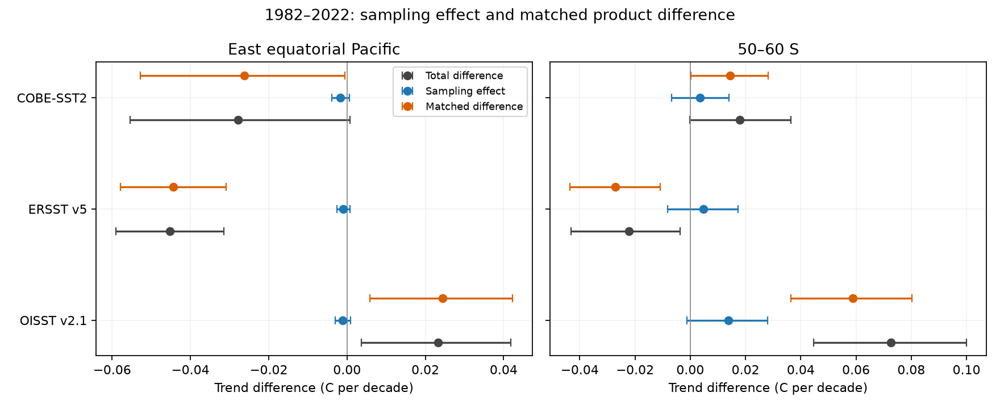

# Matched HadSST4 coverage retains positive OISST v2.1 trend gaps in the east Pacific and at 50-60 S in 1982-2022

## Result

Changing in situ coverage does not account for the positive OISST v2.1 trend difference from HadSST4 in this test. On the same available five-degree cells and months, OISST v2.1 warms 0.0245 C per decade more quickly in the east equatorial Pacific and 0.0588 C per decade more quickly at 50-60 S in 1982-2022. Conditional 95 percent intervals are 0.0058 to 0.0422 and 0.0364 to 0.0802. These are differences between records, not estimates of absolute product bias.

The east-Pacific monthly coverage effect is -0.0012 C per decade. It has the wrong sign and is too small in this design to explain the +0.0233 total difference. All 40 target cells are retained. At 50-60 S, the monthly coverage effect is +0.0139 C per decade, about 19 percent of the +0.0726 difference on the retained domain. This leaves the positive matched difference. Here the primary baseline rule retains 81 of 115 ice-free target cells, or 72.1 percent of target area. It does not measure the whole region from observations.

A less strict coverage rule retains 95.1 percent of the 50-60 S target area and gives a matched difference of +0.0580 C per decade. A stricter rule retains 24.1 percent and gives +0.0513. Both conditional intervals exclude zero. Thus the positive difference does not require the primary geographic subset. The reported scope still matters.



Each error bar is a pointwise 95 percent interval from 24-month residual blocks. The reference is HadSST4. The Southern Ocean panel uses the retained domain, not every cell at 50-60 S.

## Main numerical evidence

All slopes are C per decade. The sampling term is full coverage minus sampled coverage within the retained domain. The paired term is the product minus HadSST4 on matched cells and months.

| Region | Product | Sampling term | Paired term and 95 percent interval | Total difference |
|---|---|---:|---:|---:|
| East Pacific | OISST21 | -0.0012 | +0.0245 (+0.0058 to +0.0422) | +0.0233 |
| East Pacific | ERSST5 | -0.0009 | -0.0443 (-0.0579 to -0.0308) | -0.0452 |
| East Pacific | COBE2 | -0.0017 | -0.0262 (-0.0527 to -0.0006) | -0.0278 |
| West Pacific | OISST21 | -0.0027 | +0.0355 (+0.0192 to +0.0511) | +0.0328 |
| West Pacific | ERSST5 | -0.0030 | -0.0031 (-0.0177 to +0.0110) | -0.0060 |
| West Pacific | COBE2 | -0.0026 | -0.0003 (-0.0114 to +0.0097) | -0.0029 |
| 50-60 S | OISST21 | +0.0139 | +0.0588 (+0.0364 to +0.0802) | +0.0726 |
| 50-60 S | ERSST5 | +0.0048 | -0.0271 (-0.0435 to -0.0108) | -0.0222 |
| 50-60 S | COBE2 | +0.0035 | +0.0144 (+0.0001 to +0.0282) | +0.0179 |
| 40-60 S | OISST21 | -0.0044 | +0.0632 (+0.0431 to +0.0838) | +0.0588 |
| 40-60 S | ERSST5 | -0.0110 | -0.0196 (-0.0320 to -0.0072) | -0.0305 |
| 40-60 S | COBE2 | -0.0066 | +0.0140 (-0.0003 to +0.0282) | +0.0074 |

The matched comparison does not make the in situ reconstructions agree. In the east Pacific, ERSSTv5 minus HadSST4 is -0.0443 C per decade and COBE-SST2 minus HadSST4 is -0.0262. Their monthly coverage effects are only -0.0009 and -0.0017. This identifies remaining differences among reference records. HadSST4 cannot be treated as error-free truth, and the three in situ records cannot be treated as independent measurements.

The absolute east-Pacific trends are not resolved from zero under this residual-block model. OISST gives +0.0223 (-0.1479 to +0.1952), HadSST4 gives -0.0010 (-0.1870 to +0.1705), ERSSTv5 gives -0.0463 (-0.2132 to +0.1357), and COBE-SST2 gives -0.0289 (-0.2071 to +0.1470). Thus this test supports a relative trend discrepancy more strongly than a categorical claim that the region cooled. Shared ENSO variability largely cancels in the paired differences but remains in each absolute trend.

## Coverage, periods and checks

- East-Pacific HadSST4 area coverage falls from 94.7 percent in 1982-1986 to 79.8 percent in 2020-2024. These values are within the full 40-cell target. No month has zero coverage. Despite this change, all three reconstructed products have small monthly sampling trends in 1982-2022.
- At 50-60 S, primary-domain monthly coverage is 62.6 percent in the first five years and 66.0 percent in the last five. The minimum is 18.6 percent. No month has zero coverage. The rule is not a fixed station network; it is a fixed eligible domain with monthly changes in observed cells.
- With 12, 24 and 48-month blocks, the lower interval limit for the primary OISST paired difference stays positive in both main regions. In the east Pacific the limits are 0.0077, 0.0058 and 0.0027 C per decade. At 50-60 S they are 0.0375, 0.0364 and 0.0364.
- The primary 1985-2024 paired differences are +0.0353 in the east Pacific and +0.0628 at 50-60 S. Both intervals exclude zero. However, in 2001-2022 the east-Pacific difference is -0.0022 (-0.0443 to +0.0384). The long-period result must not be extended to every shorter window. The 50-60 S difference remains positive at +0.0719 (+0.0271 to +0.1182).
- Removing cells through the baseline rule can itself change a regional trend. The separate fixed-domain audit uses raw reconstructed SST with calendar-month controls. At 50-60 S, whole-target minus primary retained-domain slopes are -0.0078 for OISST, -0.0086 for ERSST and -0.0100 for COBE. At 40-60 S these values are -0.0106 to -0.0123. These are descriptive selection effects, without uncertainty intervals. The effect is zero in the primary east and west Pacific tests because no target cell is removed.
- A separate calculation reproduces all 72 primary seasonal-regression slopes by calendar-month demeaning, to within 1.7e-16 C per decade. The slope decomposition error is below 4.2e-17. Twenty-three direct native-grid averages agree with the cached remap to within 1.4e-8 C. All reported fit coefficients and interval limits are finite. See files/audit.json.

These tests strengthen the evidence that the OISST difference is not merely a mismatch in five-degree monthly coverage. They do not prove that the entire difference is an input artifact. They also expose a remaining constraint: relative product agreement and absolute regional cooling are distinct claims. Only the former is well resolved here.

## Question and prior work

The selected SCI studies report positive DOISST v2.1 trend differences in regions that control the SST pattern effect. SCI 9e1a3e72 gives the direct regional comparison. SCI dc0ebb92 tests whether known product corrections close the model-observation gap. SCI b77aa322 shows why agreement among corrected products is not sufficient validation. Here we test a separate observation-design issue with raw source grids: can changes in the cells observed by an in situ reference account for the trend gap? We do not fit or apply product step corrections.

Common-coverage comparison is established practice, not a new statistical invention. Kennedy et al. (2019), doi:10.1029/2018JD029867, describe the HadSST4 record and its uncertainty. The Met Office documentation states that the grid is not interpolated and that ensemble, measurement and sampling uncertainty must all be used for a complete error assessment. The new result here is a numerical decomposition in the two regions of the selected SST artifact claim, with current pinned source files and an explicit domain-support audit. It does not discover the wider Pacific trend discrepancy.

We searched published campaign results for SST, DOISST, interpolation and sampling before fixing this test. We also searched external literature and the primary source documentation. We used no other worker's private analysis.

## Data and methods

Inputs are the HadSST.4.2.0.0 median, NOAA OISST v2.1 monthly means, ERSSTv5 and COBE-SST2. Exact shared paths, source URLs, versions, byte counts and SHA-256 hashes are in files/provenance.json. The files were reused in place. No raw data were downloaded for this study. All four full source files were hashed. The external five-degree caches used in final fits have hashes in files/cache_hashes.json.

We calculate monthly, five-degree means for January 1982 to December 2024. For each native grid, the remap uses the exact latitude-band area and longitude interval overlaps with each five-degree box. Valid native ocean cells are averaged with these weights. HadSST4 is already a five-degree anomaly grid. Land and missing values do not enter means. A target cell must have valid values above -1 C in all months and all three reconstructed products. This fixed ice-free rule is applied before the reference-coverage rule. A box counts as ocean support when the reconstructed means meet this rule; we do not weight coastal boxes by their ocean fraction.

For each calendar month in the 1991-2010 baseline, a retained cell must have at least five available HadSST4 values. Sensitivity fits use one or ten instead of five. Each product is rebased within each cell and calendar month using only the baseline dates on which HadSST4 is available. This paired baseline ensures that climatology differences do not create the paired trend gap. It also makes results conditional on the available baseline sample. Baseline and support uncertainty are not propagated.

Regions are the east equatorial Pacific (5 S to 5 N, 180 to 280 E), west equatorial Pacific (5 S to 5 N, 110 to 180 E), 50-60 S, and 40-60 S. Region means use cosine latitude weights. The full mean F uses every retained cell each month. The sampled mean S uses only the retained cells with HadSST4 that month. H is HadSST4 on precisely those same cells. The tested domain is the retained set, which can be smaller than the original geographic region. Coverage tables give that restriction. "Full" never means unobserved cells outside this retained domain.

For each product and month:

    F - H = (F - S) + (S - H).

We call F-S the sampling gap and S-H the paired gap. The total gap is F-H. Each term uses the same time support. A month without a sampled value is omitted from all terms, including F, for that test. This identity also holds for the fitted linear slopes. The sampling gap is an internal product diagnostic. It estimates the effect of the mask in that product, not the true temperature of missing ocean cells.

Fits contain an intercept, linear time in decades and eleven calendar-month indicators. The primary period is 1982-2022. Checks use 1985-2024 and 2001-2022. Conditional 95 percent intervals use 1,500 circular moving-block residual bootstrap draws. The main block is 24 months; checks use 12 and 48 months for the primary coverage rule and period. The random generator starts at seed 110711. Each fit resamples its own detrended residuals. Intervals are pointwise and are not simultaneous. The product and reference are subtracted before resampling, so their observed covariance is retained. We do not treat products as independent replicates. Full uncertainty from long-period climate variability, source bias, reference ensembles, interpolation and baseline estimation is not included.

## Interpretation and limits

A positive paired gap means the product warms more quickly than HadSST4 on matched available cells and months. It does not identify which record is wrong. These products share ship and buoy observations. HadSST4 has instrument-bias uncertainty, while satellite and reconstructed products have their own errors. Five-degree matching does not ensure that observations sampled the same water within a box. The fixed ice-free and baseline rules change the domain. Sparse Southern Ocean cells cannot validate a whole-ocean extrapolation. A sampling gap from a reconstructed field is conditional on that field's spatial structure.

This test does not attribute a date or physical cause to any offset. It does not validate a homogenisation, measure a radiative response, or close the model-observation pattern gap. Its contribution is to separate one sampling explanation from a residual matched-record difference with explicit scope.

## Reproduction

Extract the verified publication into a new directory. Use Python 3.12 with numpy, pandas, netCDF4 and matplotlib; tested versions are in files/environment.json. Set OPENBLAS_NUM_THREADS=1, OMP_NUM_THREADS=1 and MKL_NUM_THREADS=1. The code uses one process.

On the campaign host, from the worktree root:

```
python work/result/files/analyze.py --datasets datasets --out work/reproduce
python work/result/files/support.py work/reproduce
python work/result/files/audit.py work/reproduce
```

For another host:

```
python files/retrieve.py /absolute/external_data
python files/analyze.py --datasets /absolute/external_data --out /absolute/scratch
python files/support.py /absolute/scratch
python files/audit.py /absolute/scratch
```

The retrieval script checks exact hashes. Live source URLs can change; a changed file is rejected. The stated snapshot or an archive with the same hash is required for exact reproduction. Raw and transformed external data must stay outside the signed publication. Fresh execution reads raw data and makes its own caches. The optional --cached flag is only for reuse of the exact recorded external caches and verifies their hashes. It is not needed for fresh reproduction. Bootstrap output is deterministic for the stated environment and code.

files/fits.csv contains the fitted aggregate slopes and intervals. files/coverage.csv contains domain counts and area coverage. files/audit.json contains independent numerical checks. Monthly series and remapped grids are generated in the external scratch directory and are not bundled. Source rights, scientific credits and the exact transformation method are preserved in files/NOTICE_external_data.md and the code. No source data licence is replaced by the SCI baseline.

## Research provenance

Campaign 11_07_2026. Job sci-1107-dell-earth-and-ocean-sciences-b8e8d3509d56. Topic earth-and-ocean-sciences. Machine dell. Account codex-olen. Model gpt-6.1-sol, high reasoning effort, through T3 Code. Analysis date 11 November 2026. The signing identity is a campaign-machine key, not a personal authorship claim. No agents were launched. All computations ran in the assigned worktree, with one numerical thread and at most two CPUs.

## References

- SCI 9e1a3e72650f07a215accf776c2f88bdb5c9461d78249bc5a59f407e71dac573: prior regional SST and mooring comparison.
- SCI dc0ebb92ae01dfa80a9ab6a00dee79747f200f3da207e98892ce1be67a040be4: known corrections and the CMIP6 pattern gap.
- SCI b77aa3224c703a8df1d8ec96568b07fe56815a1803bcbc15e5af12313b608a8f: held-out reference validation of corrected products.
- Kennedy et al. (2019). An ensemble data set of sea surface temperature change from 1850. doi:10.1029/2018JD029867.
- Sandford and Rayner (2026). Addressing the World War 2 warm anomaly in HadSST.4.2.0.0. doi:10.1002/joc.70388.
- Huang et al. (2017). ERSSTv5. doi:10.1175/JCLI-D-16-0836.1.
- Huang et al. (2021). Improvements of the daily optimum interpolation sea surface temperature version 2.1. doi:10.1175/JCLI-D-20-0166.1.
- Hirahara et al. (2014). Centennial-scale sea surface temperature analysis and its uncertainty. doi:10.1175/JCLI-D-12-00837.1.
- Met Office source description: https://www.metoffice.gov.uk/hadobs/hadsst4/index.html.
