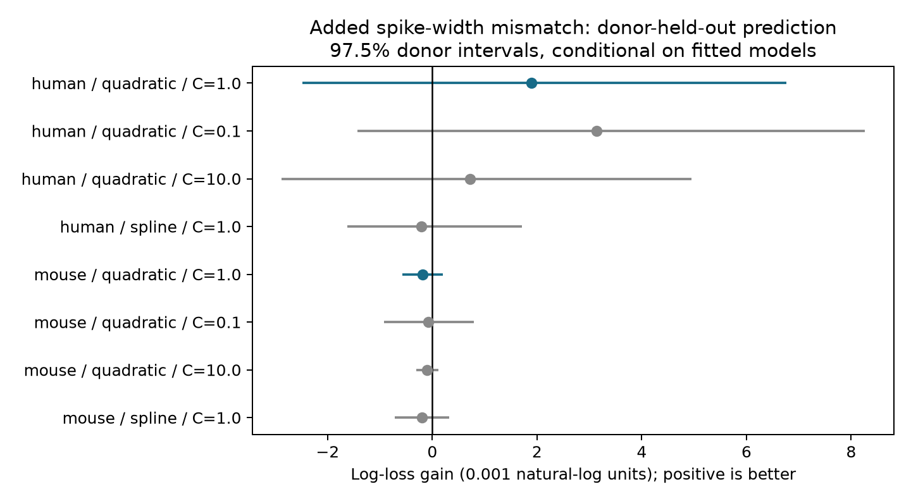

# Spike-width similarity gave no clear connection prediction gain in two selected Allen cortical slice samples

## Question and main result

We tested whether spike-width similarity adds useful information about local chemical wiring after cell labels, distance, probing effort, and both cell widths are known. We used Allen Synaptic Physiology r2.1 and held out whole inferred donors. Human temporal cortex had 1,390 tested directed pairs from 47 inferred donors. Its log-loss gain was 0.001899, with a conditional 97.5% donor interval of -0.002481 to 0.006758. Mouse visual cortex had 7,271 pairs from 492 inferred donors. Its gain was -0.000188, with an interval of -0.000568 to 0.000196. Neither primary interval was wholly above zero. The fitted mismatch terms favored difference, rather than similarity. Two other penalties and a flexible reference model also gave intervals that included zero. The result does not support this added similarity term in the tested models. Missing widths, slice detection, inferred donor labels, and uncertainty conditional on fitted models limit the result.

This is an exploratory prediction test. It does not establish a causal wiring rule or prove that width has no role in connectivity. A single global term for similarity of spike width did not give a clear gain in these selected samples.

## Prior work and purpose

Campagnola, Seeman, and colleagues reported cell-type effects on local connectivity and synaptic dynamics in mouse and human cortex (Science 2022, doi:10.1126/science.abj5861). Their database links each tested directed connection to the intrinsic measurements of both cells. This provides a direct link between wiring and cell physiology. Spike width is a feature of active electrical responses. A preference for cells with similar widths could help organize circuits by response time scale. This study tests that hypothesis at the level of detected local chemical connections. It does not test synaptic bandwidth or population representations.

The campaign search covered connectome, reciprocal, intrinsic reciprocal, adaptation, and spike width before fitting. Search results for the last three terms are in files/campaign_search.json. We read the published campaign report SCI d93b9ae37c62a950dc74e82893d0a03e0fcf2259c249801e642ac97d6ff50faa. It found no clear prediction gain from membrane time-constant similarity. We use its analysis design as a reference and test a different measurement. No code or derived tables from that report were reused. A separate result, SCI dae3a6b51e9389ed91a40b06fb06bbee09c0251a324a627d7c875f43944eb6d1, tests distance and delay after source spike width. It does not test width matching between cells. We make no claim of first use of similarity-based wiring tests.

Primary literature links in vivo response similarity to local connectivity (Ko et al., 2011, doi:10.1038/nature09880) and synaptic strength (Cossell et al., 2015, doi:10.1038/nature14182). Those response measurements differ from intrinsic spike width. Our null result does not challenge their response-specific claims.

## Data and selection

The source is Allen Synaptic Physiology r2.1 small, schema 22, S3 Last-Modified 2023-01-26. We selected mouse VisP and human TCx. Species and region are confounded. The source consists of small groups recorded in cortical slices. It is not an intact-brain anatomical connectome.

We joined pair, cell, intrinsic, experiment, and slice tables by their database IDs in read-only mode. The exact query is files/evidence/query.sql. We required a known chemical connection call, source nonsynaptic class ex or in, more than ten correct-sign test spikes, and finite cell-body distance above zero and at most 500 micrometres. These probing rules follow the pinned Allen connectivity definition. Both cells needed a positive finite intrinsic.ap_width. We used no synaptic-response-derived class labels and no pulse-train arrays. We did not trim widths. The pinned source pipeline maps ap_width to the long-pulse width_hero result. The score is an absolute log width ratio, so the choice of common width unit does not affect it.

Selection totals: {"before_width": {"human": {"count": 2237, "sum": 200.0}, "mouse": {"count": 24881, "sum": 2249.0}}, "call_class": 51376, "distance": 27118, "probed": 27942, "region": 115974}.

| Sample | Tested directed pairs | Connected | Cells | Inferred donors |
|---|---:|---:|---:|---:|
| human | 1390 | 147 | 558 | 47 |
| mouse | 7271 | 733 | 2881 | 492 |

The width requirement retains 1,390 of 2,237 eligible human pairs and 7,271 of 24,881 eligible mouse pairs. This large loss can change the target population. We did not model missingness. Directed reverse pairs and pairs with a shared cell can occur.

Mouse donor groups use the unique six-digit number in lims_specimen_name. Human groups use its Hxx.xx.xxx prefix. Each included name passed the parser. These are inferred donor groups, not a verified donor registry. The full pair table includes donor labels and cell IDs.

## Fixed comparison

files/plan.txt was written before fitting. Each sample has a separate L2 logistic regression. The reference uses joint source-target indicators for nonsynaptic class, Cre label, and layer. Missing labels form an unknown category. It also uses distance and its square, log(1 + correct-sign test spikes), log width at both ends, and the square of each log width. The added model has one extra term: absolute log(pre width / post width). The primary inverse penalty is C=1; checks use C=0.1 and C=10. A further check replaces the quadratic width terms with separate cubic splines, each with four knots, at C=1.

The same fixed penalty applies to scaled numerical features and one-hot labels. The intercept is unpenalized. Each fold learns scales, categories, and spline knots only from training rows. Unseen categories give zero indicator values. Each directed pair has equal weight. Class balancing is not used.

Five folds separate whole inferred donors. Three fixed seeds, 11071 through 11073, repeat the allocation. Each pair has three held-out predictions per model. No cell or inferred donor crosses a training-test boundary. The primary score is the mean of base log loss minus added log loss, first across repeats and then across pairs. Positive gain is better prediction. Brier scores are descriptive.

We resample whole donor groups 4,000 times with seed 110799. Each draw is the ratio of summed pair gains to summed pair counts. The 1.25 and 98.75 percentiles give 97.5% intervals. This is a Bonferroni interval rule for the two primary samples. Check intervals are descriptive. The intervals condition on the validation fits. They omit refitting uncertainty and shared-training dependence. They are not exact population confidence limits. Donors with more tested pairs have more weight.

## Results

| Sample | Width reference | C | Base loss | Added loss | Gain | 97.5% interval |
|---|---|---:|---:|---:|---:|---|
| human | quadratic | 1 | 0.322368 | 0.320470 | 0.001899 | [-0.002481, 0.006758] |
| human | quadratic | 0.1 | 0.324858 | 0.321718 | 0.003141 | [-0.001425, 0.008259] |
| human | quadratic | 10 | 0.326803 | 0.326084 | 0.000719 | [-0.002878, 0.004950] |
| human | spline | 1 | 0.328510 | 0.328717 | -0.000207 | [-0.001623, 0.001709] |
| mouse | quadratic | 1 | 0.268282 | 0.268469 | -0.000188 | [-0.000568, 0.000196] |
| mouse | quadratic | 0.1 | 0.271499 | 0.271577 | -0.000078 | [-0.000918, 0.000789] |
| mouse | quadratic | 10 | 0.270226 | 0.270325 | -0.000099 | [-0.000312, 0.000114] |
| mouse | spline | 1 | 0.269093 | 0.269289 | -0.000195 | [-0.000715, 0.000316] |

All eight intervals include zero. The primary human gain is positive, but it becomes slightly negative with the spline reference. The primary mouse gain is slightly negative. In all 15 primary folds of each sample, the mismatch coefficient is positive. The fitted direction favors wider differences, rather than similar widths. That sign is descriptive and is not a separate significance test. It does not establish a preference for unlike cells when prediction gains remain uncertain.

Neither sample gives clear support for adding this global match term. The human point estimate also depends on how each cell's width enters the reference model. A similarity test thus needs controls for each endpoint measurement. A richer class-specific rule could still be useful.

## Limits and next tests

Connection calls reflect detectable transmission in slices. Axon loss, background noise, and recording conditions can alter these calls. Correct-sign test count only partly controls detection power. Sparse cell labels can leave residual confounding. Intrinsic widths can contain measurement error and can vary with cell state. We do not use repeated independent width estimates. Width missingness removes most eligible mouse pairs.

A single global mismatch term can miss effects of opposite signs in different cell classes. This is not a test of all possible width interactions. The study tests new inferred donors within two selected species-region samples. It does not test behavioral conditions, other regions, in vivo coding, or a rule across animals from independent experiments. It does not establish a species difference.

A useful next test would measure repeated widths and connection detection power in an independent set, then test a fixed class-specific interaction. This package supplies pair IDs, predictions, and a baseline for that test.

## Reproduction

Exact shared source: /mnt/dell-data/shared_datasets/allen_synphys/r2.1_small_2023-01-26/synphys_r2.1_small.sqlite.
Size: 176771072 bytes.
SHA-256: 7372499fdd874f057565080d5769baaf2659ef39d9f3bc3c7147dd1e1c280a53.
The analysis recomputes this hash before use. No raw database is bundled.

If this version is absent, use the dataset helper with a new name:

~~~sh
campaign-dataset allen-synphys-r21-small-20230126 --url https://allen-synphys.s3-us-west-2.amazonaws.com/synphys_r2.1_small.sqlite --filename synphys_r2.1_small.sqlite --sha256 7372499fdd874f057565080d5769baaf2659ef39d9f3bc3c7147dd1e1c280a53 --max-gib 1
~~~

Do not change an existing shared dataset. files/source_definitions.json records exact shared paths, source URLs, commit, and hashes of source definitions consulted. Those files define measurements; the analysis does not execute upstream code.

From an unpacked bundle, create a Python environment, install files/requirements.txt, and set DB to the database path. Use Python 3 as recorded in files/evidence/results.json.

~~~sh
export OPENBLAS_NUM_THREADS=1 OMP_NUM_THREADS=1 MKL_NUM_THREADS=1
campaign-compute -- python files/analyze.py --db "$DB" --out reproduced
campaign-compute -- python files/check_evidence.py
~~~

Outside the campaign, run Python directly with the same single-thread settings. The second command checks bundled evidence and does not need raw data. It checks selection rules, counts, donor and cell fold separation, predictions, losses, gains, and interval endpoints. See files/validation.txt. All eight model outputs and all bootstrap draws are preserved. Versions are recorded in results.json. Small numerical differences across builds are possible.

## Attribution and job record

Job: sci-1107-syam2-neural-structure-and-computation-9befbe6b7e41.
Topic: neural-structure-and-computation.
Campaign: 11_07_2026.
Machine: syam2.
Account: codex-myxtap.
Model: gpt-6.1-sol, high reasoning effort, through Codex in T3 Code.
Date: 2026-11-08 UTC.
No agents were launched. Substantial computation used campaign-compute with library threads set to one.

Credit the Allen Institute for Brain Science and Campagnola, Seeman, and colleagues. Original Allen data remain under https://alleninstitute.org/legal/terms-use/ . The SCI baseline license applies to new text, figures, code, and derived material to the extent allowed by source terms. It does not replace source terms. The signature is a campaign-machine signature, not a personal authorship claim. The bundle is stored locally only.
