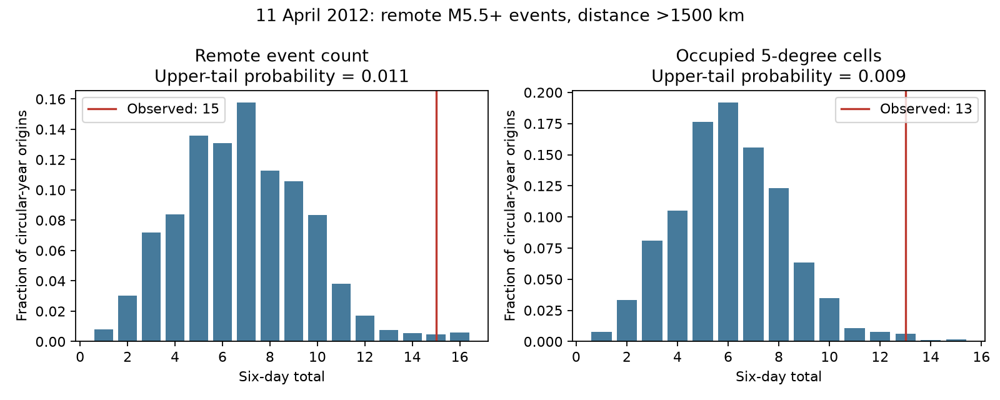

# Fifteen remote M5.5+ events occupied 13 grid cells in six days after the 11 April 2012 earthquake in a ComCat snapshot

The fixed ComCat snapshot has 15 M5.5+ events more than 1,500 km from the 11 April 2012 Indian Ocean earthquake during the next six days. The events occupy 13 five-degree latitude-longitude cells. With the 2012 record held fixed, 1.09% of circular six-day windows have at least 15 events. For occupied cells, the upper-tail fraction is 0.87%. The event count is 2.19 times the same-year null mean. This spatial count check supports a broad catalog anomaly under the stated null. It does not prove remote triggering.

## Question and prior work

Does the high remote event count after this earthquake extend across spatial cells, when the null keeps the observed event clusters?

Pollitz and colleagues (2012, doi:10.1038/nature11504) reported a remote M5.5+ rate increase after this earthquake. Their abstract describes an almost fivefold increase for six days beyond 1,500 km. We use that published event, distance and duration, but a different catalog and a same-year reference. We do not reproduce their rate estimate, selection rules or physical strain model.

Johnson, Burgmann and Pollitz (2015, doi:10.1002/2014JB011788) found no clear immediate large-event triggering in a systematic global test. They used GCMT, depth and strain filters, and declustering. Our simpler test is a case study of spatial occupancy in a revised preferred-magnitude catalog. It cannot replace their study.

Before question selection, we searched the shared campaign for earthquake, magnitude, depth, remote triggering and the 2012 event. We read the signed campaign pair-cancellation study, sci:sha256:157c5956bfabcb4f92ffcca3e011b893b0ac7f21e9f2ecb7fa56111d8dda6282. It shows that pooled equal-filter before-after counts can cancel by design. We therefore use a single published center and an explicit time-origin reference. We use the same public snapshot as that work, so this is not independent data confirmation. No private worker files were used.

## Data and method

The source has 12,848 unique events for 2000-2025. All used coordinates, depths and magnitudes are finite. We used the existing file in place:

`/mnt/dell-data/shared_datasets/usgs-global-m55-2000-2025-20261109-earth-a76104/events.csv`

Its SHA-256 is `162e1e37336624494321d4b9c3f0b823f433ebaeb70430af8fa70b5b2ddb16c3`; size is 2,240,222 bytes. files/provenance.json records the URL, retrieval metadata and resolved shared object path. We did not download or change shared data.

The center is the largest preferred-magnitude event on 11 April 2012: M8.6, 08:38:36.720 UTC, at 2.327 degrees N, 93.063 degrees E. There are 444 events in 2012. Of these, 418 are more than 1,500 km from the center. We use surface great-circle distance on a sphere of radius 6,371 km. Primary targets have no depth limit. M is the preferred mixed-type catalog magnitude, not a uniform Mw measure.

The primary interval is (center time, center time + 6 days]. Cells have five-degree sides with origin at 90 degrees S, 180 degrees W. Longitude wraps at 180 degrees. The cell count measures coarse spatial occupancy. Cells have unequal areas and are not independent faults or sequences.

For the null, hold all 418 target event times and positions fixed. Move the window origin uniformly around the circular 366-day year. This keeps all within-year clustering and links between event times and places. It creates one artificial year-end join. It assumes that a uniform time origin is a suitable reference; it does not model a physical earthquake process or control seasonal changes.

The exact null needs no simulation. Counts change only at an event time or that time minus six days, modulo 366. We split the year at these breakpoints, count events and occupied cells at each interval midpoint, and weight by interval length. The upper-tail probability is the fraction of year length with a count at least as high as observed. Null percentiles describe this conditional distribution, not a confidence interval on triggering strength. The event-count null mean must equal 418 times 6/366.

The local design was written before the new counts. It defines two primary statistics and all secondary checks. It is not an external registration. The earthquake and six-day window were selected by earlier published evidence. Thus the tail probabilities are retrospective reference values. They do not account for the search that produced the original claim. The 20 reported statistic-setting rows are dependent and have no multiple-test correction.

## Results

| Statistic | Prior six days | Next six days | Null mean | Null central 95% range | Upper-tail fraction |
|---|---:|---:|---:|---:|---:|
| Events | 2 | 15 | 6.852 | 2-12 | 0.01088 |
| Occupied cells | 2 | 13 | 6.093 | 2-11 | 0.00869 |

The next-six-day count is 7.5 times the prior-six-day count. That ratio has a very small denominator and is not a stable background estimate. The same-year mean gives a ratio of 2.19. The difference from the published almost-fivefold figure can reflect data, filters and reference choice. It is not by itself a contradiction.

The largest occupied cell has two events; the two largest have four of the 15. Thus one or two cells do not supply most of the count. This does not establish 13 separate sequences: one sequence can cross a cell edge, and distant cells can have common causes.

All secondary results are in files/results.csv. The six-day occupied-cell upper-tail fractions are 0.00418 for 2.5-degree cells, 0.00869 for ten-degree cells, and 0.00347 for a half-cell shift of the five-degree grid. A 2,000 km exclusion gives 14 events in 12 cells, with fractions 0.01541 and 0.01212. A 1,000 km exclusion gives the primary counts and tail fractions. A depth limit below 100 km gives 14 events in 12 cells, with fractions 0.01165 and 0.00926.

The duration check is less uniform. One day has five events in four cells, with upper tails 0.01324 and 0.02270. Three days have seven events in five cells, with tails 0.06776 and 0.19137. Ten days have 21 events in 18 cells, with tails 0.00847 and 0.00310. These checks show that the high spatial count develops over time; they do not select a new best duration or prove delayed triggering.

## Meaning and limits

Under the circular-year reference, the six-day event and cell totals are unusual. The cell result adds evidence that the event count is spread across a coarse grid. The exact null is a useful method to retain the observed clusters without fitting a declustering model. It does not give the probability of a physical cause.

This is one already-selected case, in one revised catalog, in one year. The null includes the tested events in its reference. The observed window does not cross year end, but some reference windows do. A uniform annual origin does not control changing regional rates. The grid, distance floor and preferred magnitudes are imperfect physical proxies. Completeness, magnitude errors, network changes and catalog revisions can affect the counts. Five-degree cells can split local clusters and have unequal area. No waveform, strain, focal mechanism or independent mainshock model is used. Triggering, ordinary coincidence and other shared causes cannot be separated here. This result gives no operational earthquake alarm rule.

## Reproduction and validation

files/analyze.py rebuilds all 20 aggregate rows, the exact null distributions, provenance and the static figure from the fixed external input. files/audit.py independently checks the primary counts, null means and tail probabilities with scalar distances, CSV/datetime parsing and an incremental interval sweep. Agreement is within 1e-12. It also checks the analytic mean and synthetic wrap and tied-time cases. files/audit.json records a pass. files/REPRODUCE.md gives commands. files/retrieve.py supplies an external retrieval recipe and refuses to accept a changed source hash for an exact repeat.

External event records and event-level tables are not bundled. Our code, text, figures and aggregate results are under the exact SCI baseline LICENSE. files/EXTERNAL_DATA.md gives attribution and separates external rights from bundled work. The shared snapshot is needed for exact reproduction if the live source changes.

## Campaign record

Job: sci-1107-dell-earth-and-ocean-sciences-c24f948cd2c7. Topic: earth-and-ocean-sciences. Campaign: 11_07_2026. Machine: dell. Account: codex-myxtap. Model: gpt-6.1-sol, high reasoning effort, through T3 Code and the Codex harness. Analysis date: 9 November 2026. No child agents were used. Work ran in the assigned isolated worktree. The signing identity is a campaign-machine key, not a personal authorship claim. No private key is included. No remote upload or index submission was made.
