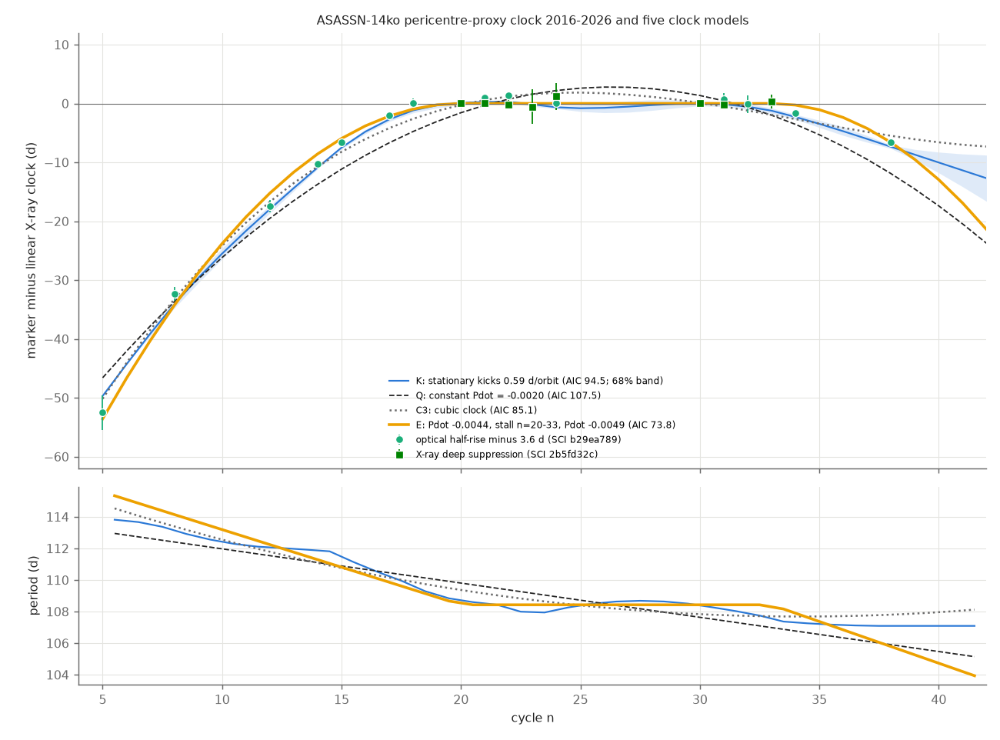
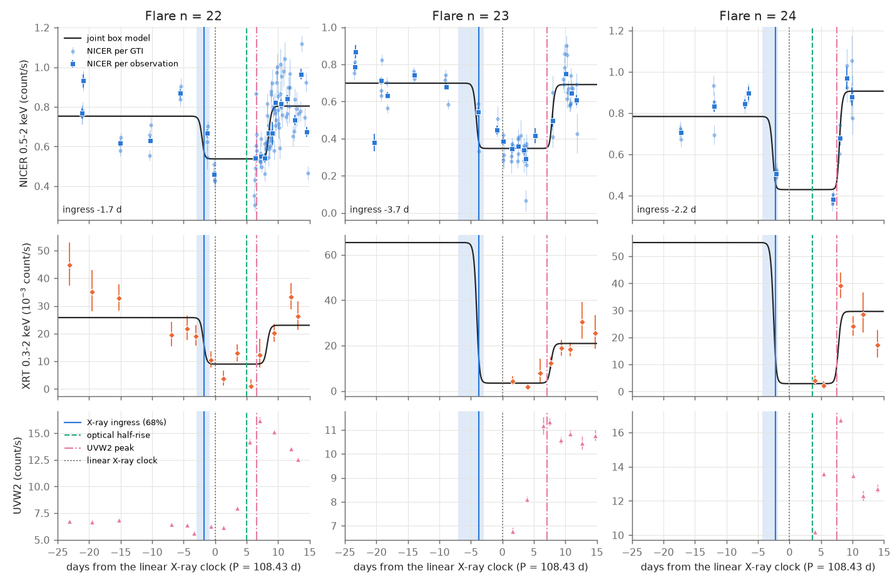
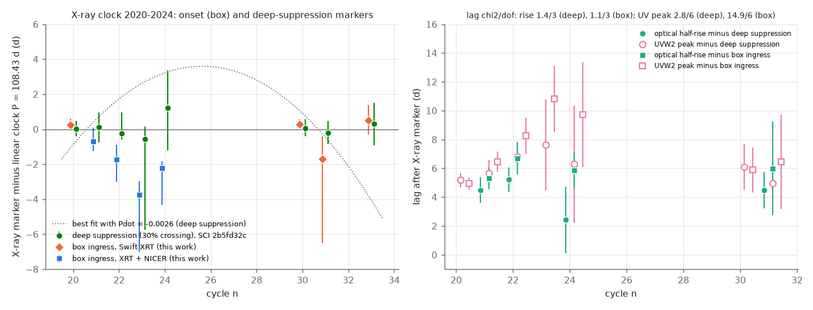

# Bootstrap tests of the 2016-2026 ASASSN-14ko clock reject steady decay and a cubic; an on-off decay beats 0.6-d-per-orbit period kicks only at p = 0.025-0.05 if the half-rise lag is constant

**Job:** sci-1107-dell-astronomy-70208806ccb1. **Topic:** astronomy. **Campaign:** 11_07_2026. **Machine:** dell. **Account:** claude-olen. **Model:** Claude Opus 5.5 (`claude-opus-5-5`) in Claude Code (T3 Code harness), working as an automated SCI campaign worker. **Analysis dates:** 2026-11-10 to 2026-11-11. The signing key is a campaign-machine key. It is not a personal authorship claim.

## Summary

**Question.** The repeating nuclear transient ASASSN-14ko had a fast period decrease before 2020. From 2020 to 2024 its soft X-ray dips repeat at a constant period (SCI 049d6e3e, 2b5fd32c). What clock makes such a stall? Two classes of answer exist in the campaign: random period kicks at each passage (SCI 9817499f, c9cc95cf; a stationary stochastic clock), and deterministic clocks whose period change switches off and on (SCI 049d6e3e, cd4bd328). Earlier tests used flare peaks. Peaks have shape-dependent delays, so the earlier tests could not separate an orbital change from an emission delay (SCI caa44342, ba2e717c). We ask: (1) does the optical half-rise follow the X-ray dip with a constant lag, so that it can be a pericentre proxy before and after the X-ray era? (2) With this proxy, which clock describes 2016-2026: steady decay, a smooth change of the decay rate, stationary random kicks, kicks with an era-dependent size, or an episodic (on-off) decay?

**Data.** (a) We reduced all 163 public NICER observations (2020 December to 2023 December) without HEASoft, combined them with the Swift XRT counts of SCI 049d6e3e, and measured the dip ingress of cycles 20-24, 30, 31 and 33 with the box-dip model of SCI 049d6e3e (window and background variants). (b) For the same cycles we used the deep-suppression times (first crossing of 30 percent of the pre-dip rate) that SCI 2b5fd32c measured independently from the same NICER and XRT data with a blank-sky background model. (c) We used 14 optical half-rise times (ASAS-SN g/V and TESS, cycles 5-38, 2016-2026) and the Swift UVW2 peak times from SCI b29ea789 and 049d6e3e.

**Main results.**

1. **The optical half-rise has a constant lag after the X-ray dip; the UV peak does not, for the dip onset.** The half-rise follows the deep suppression by 4.67 +/- 0.54 d (four cycles, chi2 = 1.4 for 3 dof; extra scatter below 1.3 d, 95 percent). It follows our box ingress by 5.75 +/- 0.54 d (chi2 = 1.1/3). The UVW2 peak follows the deep suppression with a constant lag (5.54 +/- 0.37 d, chi2 = 2.8/6, as SCI 2b5fd32c found), but not the box ingress (chi2 = 14.9/6, p = 0.02, range 5.9 d), because the 2021 box ingresses are 0.8-3.5 d before the deep suppression. Thus the half-rise is a good pericentre proxy: it is tied to the X-ray dip within about 1 d in 2020-2024.
2. **Our NICER reduction confirms the early, slow dip onsets of 2021.** The box ingress of cycles 22-24 is 1.6-3.7 d before the linear clock (Figure 1; linear chi2 = 11.5/6 for our box markers, 0.6/6 for the deep-suppression markers). The box marker depends on the fit window: with the wide window of SCI 049d6e3e (-40 to +30 d) it locks onto other light-curve features 13-15 d away in cycles 22 and 24. With either X-ray marker, the published Pdot = -0.0026 is rejected inside 2020-2024: delta chi2 = 11.1-52.5 for timing jitter of 0-1 d (4.4-11.3 for 2 d).
3. **Information criteria strongly prefer an on-off clock, but calibrated bootstraps show only weak evidence for it.** We fitted five clock models to the X-ray markers plus the 14 half-rise times (offset and white jitter free; full Gaussian likelihood). With the deep-suppression markers the AIC values are: constant Pdot 107.5, stationary period kicks (K) 94.5 (sigma_k = 0.59 d per orbit), quadratic plus kicks 90.6, cubic 85.1 and episodic (E) 73.8 (box markers: 116.5, 103.8, 100.5, 98.7, 84.0). E has breaks at the edges of the X-ray era (cycles 20 and 33), a constant period P = 108.426 +/- 0.039 d between them, Pdot = -0.0044 +/- 0.0002 before and -0.0049 +/- 0.0009 after; added kicks go to zero. A scan of the breaks prefers 21-22 and 28-32 (a stall of 7-11 orbits, Pdot after -0.0014 to -0.0033). But AIC is not calibrated for these non-nested models. Parametric bootstraps give: (a) constant Pdot is rejected (likelihood ratio of K over Q 6.5; p < 1/150 under Q). (b) The cubic is rejected: under the cubic, its advantage over K would be 12.5-16.5 in lnL (5-95 percent), against 5.7 observed (p < 1/60); under K, an advantage of 5.7 is common (p = 0.33). (c) E against K: the advantage (11.4 in lnL with fixed breaks; 16.7 with a search over 17 break pairs) has p = 0.05 (fixed breaks, 60 samples) and p = 0.025 (break search, 40 samples) under K. Under E itself, the expected advantage is 15-22, so the observed value is also too small for a pure E (p < 1/60).
4. **Thus stationary kicks remain allowed, and the stall is a 2-5 percent event under them.** Kicks of 0.59 d per orbit (95 percent: 0.4-1.0) fit the long record. The deep-suppression clock alone limits kicks in 2020-2024 to below 0.4 d per orbit (95 percent), but a model with separate kick sizes for the early, stall and late eras is not significantly better (likelihood ratio 0.9, bootstrap p = 0.54; stall-era kick size 0-0.95 d per orbit). No simple deterministic clock that we tested (constant Pdot, cubic, on-off) is consistent with the data as a complete model. The data are between stationary kicks and a pure on-off decay: an on-off decay with some extra timing noise, or kicks with a quiet phase, are both possible.
5. **Forecasts separate the models now.** For cycle 41 (2026 November) the half-rise forecasts are 2026-11-07 +/- 2.9 d (episodic), 2026-11-14 +/- 2.8 d (kicks) and 2026-11-18 (cubic). For cycle 42 they are 2027-02-19 +/- 3.7 d, 2027-03-01 +/- 3.9 d and 2027-03-06 (`results/f30/forecast.csv`). No public data cover these flares yet.

**Interpretation.** If the half-rise keeps its 2020-2024 lag before 2020 and after 2024, the period of ASASSN-14ko decreased at about Pdot = -0.004 to about cycle 21, was constant for 7-13 orbits, and then decreased again. Two physical pictures remain. (1) Stochastic: the orbit receives a random energy change at each passage with an rms of about (2/3)(0.59/108.4) = 0.36 percent of the orbital binding energy, and the 2020-2024 quiet phase is a chance event of a few percent probability. (2) Episodic: one dissipation process switches off and on (for example the precessing star-disc drag of SCI cd4bd328), with additional timing noise. Steady decay and a smooth change of the decay rate are excluded. A half-rise or X-ray dip time of the 2026 November and 2027 February flares (cycles 41 and 42) separates the two pictures by 7-10 d (Table 6).

**Main limitations.** The pericentre-proxy method assumes that the half-rise lag before 2020 and after 2024 is the same as in 2020-2024, where we measured it with only four cycles. The post-stall decay rests on three half-rise times (cycles 32, 34, 38). The break cycles (20, 33) are the edges of the X-ray era; we chose them after we saw the data; the look-elsewhere bootstrap includes a break search but not all choices we made. The bootstraps are small (40-200 samples), so p values near 0.02-0.05 have large Monte Carlo errors (about +/- 0.02). AIC values are not calibrated and overstate the preference for the deterministic models. The deep-suppression errors of SCI 2b5fd32c appear conservative (chi2 = 0.6 for 6 dof), which makes "regularity" tests unreliable; we use likelihood comparisons instead.

**Figure 3.** Top: X-ray deep-suppression times (squares, SCI 2b5fd32c) and optical half-rise times minus the fitted offset (circles, SCI b29ea789), relative to the linear X-ray clock (P = 108.43 d). Lines: the five clock models fitted to all points (episodic E, cubic C3, constant Pdot Q, stationary kicks K with the conditional 68 percent band). Bottom: the period per cycle that each model implies.

## 1. Background

ASASSN-14ko (nucleus of ESO 253-G003, z = 0.0425) shows UV/optical flares every 108-115 d. Payne et al. (2021, 2022) found a period decrease, Pdot = -0.0026, from the flare peaks of 2014-2021. Campaign studies found that later flares arrive progressively late relative to this ephemeris (SCI 9398601f, 9817499f, b29ea789, 8ce2fda4). The soft X-ray dip that precedes each UV peak gives an independent clock: in 2020-2024 it repeats at a constant period (SCI 049d6e3e). SCI 2b5fd32c reduced the NICER data of 2020-2022 and showed that the time of deep suppression keeps the constant period and a constant 5.5-d lead on the UV peak, while the dip onset varies by up to 6 d. The open question (objective of this job) is the physical clock that produces the stall.

Two kinds of clock are possible. **Stochastic:** the period gets an independent random change at each passage (for example chaotic tidal energy exchange or mass-loss kicks). Then a quiet interval is a chance event, and the change after the stall is unrelated to the change before it. **Deterministic and episodic:** one dissipation process stops and starts again (for example drag that depends on the orbital geometry). Then the decay rate after the stall can be the same as before it. Peak times cannot separate these clocks, because peaks have variable, shape-dependent delays (result 1, and SCI caa44342). The X-ray dip exists only for 2020-2024. Thus we test whether a second marker with a constant lag to the X-ray dip exists, and we use it to extend the clock to 2016-2026.

Our original plan was to add NICER ingress times to the X-ray clock. During this work, SCI 2b5fd32c (a sibling worker) published a more complete NICER analysis with a blank-sky background model. We kept our independent reduction as a check (Section 4.1) and used the deep-suppression markers of SCI 2b5fd32c as our primary X-ray markers.

## 2. Data

| Data | Source and version | Use | In bundle |
| --- | --- | --- | --- |
| NICER cleaned events and filter files, 163 observations, 2020-12-10 to 2023-12-25 (326 files, 1.16 GB) | HEASARC archive through its AWS Open Data mirror, retrieved 2026-11-10; `data/inputs/nicer_file_manifest.csv` (URL, size, ETag, SHA-256) | Box ingress, cycles 21-25 | No. Per-GTI counts in `data/derived/nicer_gti_counts.csv` |
| Swift XRT per-observation counts (0.3-2 keV), reference times, UVW2 peak markers | SCI 049d6e3e (`xrt_per_obs.csv`, `reference_times.csv`, `markers_soft.csv`, `oc_table_soft.csv`) | Box ingress; UV lags | No (hashes in `data/inputs/sci_inputs_sha256.txt`) |
| Deep-suppression (f30) X-ray markers, cycles 20-24, 30, 31, 33 | SCI 2b5fd32c `marker_table.csv` | Primary X-ray markers | Eight rows in `results/f30/ingress_f30.csv` |
| Optical half-rise times (ASAS-SN g/V, TESS S4 and S98), 14 cycles from 5 to 38; Swift UVOT UVW2 light curve | SCI b29ea789 (`times_rise.csv`, `uvot_lc.csv`) | Pericentre proxy; Figure 1 | No (hashes in `sci_inputs_sha256.txt`) |

See `files/NOTICE_external_data.md` for terms and acknowledgements.

## 3. Methods

**3.1 NICER per-GTI counts** (`02_nicer_gti_counts.py`). From each archived cleaned event file we take the GTIs (pieces closer than 10 s merged, pieces shorter than 60 s dropped) and count events in 0.5-2 keV (main), other soft bands and 13-15 keV. We read the mean overshoot rate and other parameters from the filter file. We keep GTIs with at least 40 active detectors and a 13-15 keV rate below 0.5 count/s, and we do not use data after MJD 60070 (the optical light leak of 2023 May).

**3.2 NICER background** (Section 4.1 of this README; coefficients in `03_joint_ingress.py`). A within-observation robust regression of the 0.5-2 keV rate on the 13-15 keV rate and the overshoot rate (observation means removed, so the slowly varying source cancels) gives 0.77 soft counts per 13-15 keV count plus 0.53 times the overshoot rate. The constant part of the background (sky, host galaxy, the second nucleus) is a free "floor" in each fit. Variant "h": 1.48 soft counts per 13-15 keV count only. The within-observation residual scatter (0.16 count/s per GTI) is 4.5 times the Poisson error, so the fits use a negative-binomial likelihood with a free extra scatter. SCI 2b5fd32c built a better background model from blank-sky fields; we use its markers as primary.

**3.3 Box ingress** (`03_joint_ingress.py`). The model of SCI 049d6e3e: a box dip in log rate with 0.25-d logistic edges. For XRT plus NICER the two instruments share the ingress and egress times and have separate levels and scatter. emcee sampling (48 walkers, 2000 burn-in, 3000 steps). Primary window: t_ref - 30 to t_ref + 10 d (t_ref from SCI 049d6e3e). Variants: windows (-20, +6) and (-25, +6), background "h", per-observation binning. The systematic error is half the range of the variant medians (`04_assemble_ingress.py`). The wide window (-40, +30) of SCI 049d6e3e is reported separately, because it fails (Section 4.1). Cycle 25 has NICER data only, and its decisive points have high background; we do not use it.

**3.4 Lags and X-ray-era tests** (`05_clock_tests.py`). Weighted mean lags (half-rise and UVW2 peak minus the X-ray marker), chi2 and maximum-likelihood extra scatter; UVW2 peaks only where SCI 049d6e3e flags them clean. Linear and quadratic clocks with fixed or fitted white jitter; delta chi2 for the published Pdot = -0.0026. A restricted (REML) likelihood for integrated period kicks plus white jitter (`clock_lib.py`).

**3.5 Long-span clock** (`06_longspan.py`, `09_era_kicks.py`, `10_cubic_vs_kicks.py`, `11_episodic_model.py`, `12_episodic_vs_kicks_fixed.py`). We fit the X-ray markers (reference) and the half-rise times (free constant offset, free white jitter sigma_r) together. The X-ray markers get a free white jitter sigma_w. Models: Q, constant Pdot; C3, cubic; K, linear mean plus integrated random period kicks with SD sigma_k per passage; QK, Q plus kicks; E, episodic: constant period between cycles 20 and 33, constant Pdot before and after, continuous period (5 fixed effects). Kick models use the exact covariance of integrated kicks. We maximise the full Gaussian likelihood over the fixed effects and the noise parameters and compare the models by AIC. Because AIC is not calibrated for these non-nested models, we use two-sided parametric bootstraps of the likelihood difference: K against Q (150 samples under each); C3 against K (60 samples under each); E with fixed breaks against K (60 under each); E with the best of 17 break pairs (b1 = 17, 19, 21, 23; b2 = 28, 30, 32, 34; plus 20/33) against K (40 under K); and era-dependent kicks (separate SDs for passages up to 20, 21-33 and from 34) against stationary kicks (200 under K). For the box markers the sample sizes are 40-150.

**3.6 Forecasts** (`08_forecast.py`). Gaussian conditional forecasts of cycles 39-42 for K, C3 (white jitter only) and E (with the error of its fixed effects).

## 4. Results

### 4.1 Our NICER box ingresses

**Figure 1.** Cycles 22-24 (2021). Top: NICER 0.5-2 keV rate per GTI (light) and per observation (squares) after the particle background, with the joint box model (the free floor included). Middle: Swift XRT 0.3-2 keV. Bottom: Swift UVOT UVW2. Blue line and band: fitted box ingress (68 percent). Dashed green: optical half-rise. Dash-dot magenta: UVW2 peak. Dotted: linear deep-suppression clock.

Table 1. X-ray markers (MJD; 68 percent intervals). Box: this work, primary window. Deep suppression: SCI 2b5fd32c. Files: `results/box_primary/ingress_final.csv`, `ingress_variants.csv`, `results/box_window40/`.

| n | Box ingress (data) | Box t_in | sys. half-range | Wide window (-40, +30) | Deep suppression t_30 |
| --- | --- | --- | --- | --- | --- |
| 20 | XRT | 59088.36 (+0.35/-0.33) | 0.01 | 59088.38 | 59088.13 (+0.46/-0.42) |
| 21 | XRT+NICER | 59195.84 (+0.79/-0.55) | 0.46 | 59195.83 | 59196.64 (+0.87/-0.85) |
| 22 | XRT+NICER | 59303.24 (+0.84/-1.28) | 0.24 | 59290.80 | 59304.73 (+1.20/-0.35) |
| 23 | XRT+NICER | 59409.65 (+0.78/-3.30) | 1.71 | 59408.75 | 59412.83 (+0.71/-5.19) |
| 24 | XRT+NICER | 59519.58 (+0.42/-2.08) | 0.66 | 59533.65 | 59523.04 (+2.12/-2.43) |
| 30 | XRT | 60172.65 (+0.29/-0.33) | 0.04 | 60172.60 | 60172.43 (+0.52/-0.46) |
| 31 | XRT | 60279.11 (+1.30/-4.82) | 2.36 | 60280.36 | 60280.61 (+0.66/-0.66) |
| 33 | XRT | 60498.18 (+0.85/-0.83) | 0.08 | 60498.19 | 60497.97 (+1.20/-1.22) |

The box ingress of cycles 21-24 is 0.8-3.5 d before the deep-suppression time. This agrees with the slow 2021 onsets of SCI 2b5fd32c. In cycle 31 the posterior is two-peaked (slow decline or sharp drop), and the window variants move it by 4.7 d. With the wide window, the box locks onto a pre-flare decline 14 d early (cycle 22) and onto a post-flare decline 12 d late (cycle 24). The wide-window set gives a linear chi2 = 78 for 6 dof and is not usable for timing.

### 4.2 Lags: the half-rise is tied to the X-ray dip

**Figure 2.** Left: X-ray markers relative to the linear clock fitted to the deep-suppression times (P = 108.43 d). Dotted: best fit with the curvature fixed at Pdot = -0.0026. Right: lags of the optical half-rise (filled) and UVW2 peak (open) after the deep-suppression time (circles) and after the box ingress (squares).

Table 2. Lags after the X-ray marker (`results/*/clock_tests.json`, `lags.csv`).

| Lag | X-ray marker | N | Mean (d) | chi2 / dof | Extra scatter, 95 % upper limit (d) |
| --- | --- | --- | --- | --- | --- |
| Half-rise | deep suppression | 4 (21, 22, 24, 31) | 4.67 +/- 0.54 | 1.4 / 3 | 1.3 |
| Half-rise | box ingress | 4 | 5.75 +/- 0.54 | 1.1 / 3 | 1.4 |
| UVW2 peak | deep suppression | 7 (20-24, 30, 31) | 5.54 +/- 0.37 | 2.8 / 6 | 1.0 |
| UVW2 peak | box ingress | 7 | 5.71 +/- 0.33 | 14.9 / 6 (p = 0.02) | 2.7 |

The half-rise lag is constant for both X-ray markers. The ASAS-SN half-rise is the optical marker with the most cycles before 2020 and after 2024. Thus we use it as the pericentre proxy outside the X-ray era.

### 4.3 The X-ray era alone

Table 3. Clock tests on the eight X-ray markers of cycles 20-33.

| Marker set | Linear chi2 / 6 | P (d) | Free Pdot (jitter fitted) | delta chi2 for Pdot = -0.0026 (jitter 0.5 / 1 / 2 d) | Kick limit, 95 % (d per orbit) |
| --- | --- | --- | --- | --- | --- |
| Deep suppression (SCI 2b5fd32c) | 0.6 | 108.427 +/- 0.050 | +0.0001 +/- 0.0005 | 19.8 / 11.1 / 4.4 | < 0.4 |
| Box ingress (this work) | 11.5 | 108.463 +/- 0.040 | +0.0009 +/- 0.0006 | 52.5 / 28.7 / 11.3 | < 1.2 |
| Box ingress, systematic errors added | 8.9 | 108.458 +/- 0.041 | +0.0008 +/- 0.0006 | 47.0 / 25.8 / 10.4 | < 1.2 |

### 4.4 The long-span clock (2016-2026)

Table 4. Model comparison with the X-ray markers and the 14 half-rise times (`results/*/longspan.json`, `episodic.json`). k: number of parameters. sigma: fitted kick SD (d per orbit), half-rise jitter, X-ray jitter (d).

| Model | k | AIC (deep suppression) | AIC (box ingress) | Noise (deep suppression set) |
| --- | --- | --- | --- | --- |
| Q: constant Pdot (-0.0020) | 6 | 107.5 | 116.5 | sigma_r = 2.3 |
| K: stationary kicks | 6 | 94.5 | 103.8 | sigma_k = 0.59, sigma_r = 0, sigma_w = 0 |
| QK: constant Pdot + kicks | 7 | 90.6 | 100.5 | sigma_k = 0.41, sigma_r = 0.17 |
| C3: cubic | 7 | 85.1 | 98.7 | sigma_r = 1.17 |
| E: episodic (breaks 20, 33) | 7 | **73.8** | **84.0** | sigma_r = 0.95, sigma_w = 0, sigma_k -> 0 if added |

Parameters of E (deep-suppression set): P = 108.426 +/- 0.039 d in cycles 20-33; Pdot = -0.0044 +/- 0.0002 before cycle 20; Pdot = -0.0049 +/- 0.0009 after cycle 33. With the box markers: -0.0043 and -0.0052. If we scan the breaks (b1 = 16-24, b2 = 28-37), the best pair is 21 and 30 (AIC 63.2 before a penalty for two more free parameters; Pdot -0.0039 and -0.0020). The scan table is `episodic_scan.csv`.

Table 5. Bootstrap tests (`results/*/bootstrap.csv`, `era_bootstrap.csv`, `cubic_vs_kicks*.json`, `episodic_vs_kicks_fixed*.json`, `episodic.json`).

| Test | Statistic (deep suppression) | Bootstrap result |
| --- | --- | --- |
| K against Q | delta lnL = 6.5 | p < 1/150 under Q; typical under K (p = 0.62) |
| Era-dependent kicks against stationary kicks | LR = 0.9 | p = 0.54 under K (200 samples); stall-era sigma_k = 0.45, 95 %: 0-0.95 |
| C3 against K | delta lnL = 5.7 | p = 0.33 under K (60 samples); p < 1/60 under C3 (simulated 12.5-16.5) |
| E (fixed breaks 20, 33) against K | delta lnL = 11.4 | p = 0.05 under K (60; simulated 95th percentile 9.8, maximum 15.0); p < 1/60 under E (simulated 15.1-22.3) |
| E (best of 17 break pairs) against K | delta lnL = 16.7 | p = 0.025 under K (40; simulated 95th percentile 16.6) |
| Box markers: C3 / E (fixed) against K | 3.6 / 10.9 | p = 0.53 / 0.025 under K (40); p < 1/40 under C3 / E |

Kick profile (model K, `kick_profile_longspan.csv`): sigma_k = 0.59 d per orbit, 95 percent 0.4-1.0 (deep suppression) and 0.4-1.1 (box). These values agree with the kicks that SCI 9817499f and c9cc95cf fitted to peak times (0.6-0.97). But the deep-suppression data of 2020-2024 alone limit kicks to below 0.4 d per orbit. Thus stationary kicks need a large kick size outside the X-ray era and a small one inside it. The era test cannot detect this difference (Table 5). The on-off model fits better by AIC, but the bootstraps show that a difference of this size occurs in 2.5-5 percent of kick realizations.

### 4.5 Forecasts

Table 6. Forecasts for cycles 39-42 (`results/f30/forecast.csv`; MJD and 1-sigma; the C3 values have only the white jitter).

| n | E half-rise | K half-rise | C3 half-rise | E X-ray dip | K X-ray dip |
| --- | --- | --- | --- | --- | --- |
| 39 | 2026-04-12 +/- 1.7 | 2026-04-13 +/- 0.9 | 2026-04-16 | 2026-04-08 | 2026-04-09 |
| 40 | 2026-07-26 +/- 2.3 | 2026-07-30 +/- 1.8 | 2026-08-02 | 2026-07-22 | 2026-07-25 |
| 41 | 2026-11-07 +/- 2.9 | 2026-11-14 +/- 2.8 | 2026-11-18 | 2026-11-04 | 2026-11-09 |
| 42 | 2027-02-19 +/- 3.7 | 2027-03-01 +/- 3.9 | 2027-03-06 | 2027-02-16 | 2027-02-24 |

The SPHEREx peak of cycle 37 (SCI 8ce2fda4) and the 2026 flares (cycles 39-41) have no published half-rise times. A half-rise time of cycle 41 or 42 separates E from K by 7-10 d and from C3 by 11-15 d (about 2-3 sigma of the forecast errors).

## 5. Discussion

**What the pericentre proxy shows.** The X-ray dip and the optical half-rise keep a constant lag in 2020-2024 (within about 1 d), while the UV peak keeps a constant lag only to the deep suppression. Under the assumption that the half-rise lag is the same in the other eras, the half-rise times of 2016-2019 and 2024-2026 measure the pericentre clock to about 1 d. With this clock, the record has three parts: a decrease at Pdot of about -0.0035 to -0.0044 (cycles 5 to about 21), a constant period for 7-13 orbits, and a decrease again (to cycle 38) at Pdot -0.0014 to -0.0049, depending on where the stall ends.

**Which clocks are excluded.** (1) Steady decay at one Pdot (p < 1/150 against kicks). (2) A smooth change of the decay rate (cubic; its fit is much worse than the cubic itself predicts, p < 1/60, and it does not fit the straight X-ray segment, chi2 = 8.3 for 8 points). (3) A pure on-off decay with only white timing noise (p < 1/60 under E). Not excluded: stationary random kicks of about 0.6 d per orbit (p = 0.025-0.05 against the on-off alternative). AIC alone would have chosen the on-off model with delta AIC = 21; the bootstraps show that this preference is weak.

**What a physical clock must do.** Either (a) it gives random period changes of about 0.4-1.0 d per orbit rms (0.25-0.6 percent of the orbital energy per passage), and the 13-orbit quiet phase of 2020-2024 is a chance event (2-5 percent); or (b) it switches the orbital energy loss off for 7-13 orbits from about cycle 21 and on again with 0.4-1.1 times the earlier strength, with additional timing noise. Picture (b) includes geometric switches such as star-disc drag in a precessing orbit (SCI cd4bd328). Mechanisms whose strength follows the flare energy or the mass loss smoothly fit neither picture well; SCI e5616202, c2b0b0ea and edf8ce3b also found no energy-proportional change. The kick sizes that earlier studies fitted to peak times (0.6-0.97 d per orbit) agree with picture (a) on the long record, but inside the X-ray era the deep-suppression times allow only kicks below 0.4 d per orbit (as SCI 2b5fd32c found). This tension is the main reason why the bootstrap p values are near 0.03.

**Comparison with eRASSt J0456-20.** J0456-20 also has a fast early decrease and then a constant recurrence time (SCI e2dd9320, edf8ce3b). If the switch in J0456-20 is of the same type, its period decrease can resume. Its later cycles can test this.

## 6. Limitations

- The method assumes a constant half-rise lag outside 2020-2024. We measured the lag in four cycles. A drift of the lag by a few days over 2016-2019 or 2024-2026 would change the inferred period history.
- The post-stall decrease rests on three half-rise times (cycles 32, 34, 38). Pdot after the stall has an error of 0.0009 for fixed breaks and changes by a factor of 2-3 with the break cycle.
- We chose the episodic break cycles at the edges of the X-ray era after seeing the data, and the break scan prefers slightly different breaks. The break-search bootstrap covers part of this choice, not all of it.
- The bootstraps use 40-200 samples, so small p values are bounds. AIC is an approximate criterion. All models assume Gaussian, independent marker errors.
- Our NICER background is empirical and simpler than that of SCI 2b5fd32c. The box ingress depends on the fit window; we report the failure of the wide window.
- The deep-suppression errors appear conservative (chi2 = 0.6 for 6 dof). This makes tests of X-ray-era regularity unreliable, so we use likelihood comparisons.
- No public data cover the 2026 flares. The SPHEREx (cycle 37) and TESS peak markers are not half-rise times and we did not use them in the fits (except the TESS S98 half-rise of cycle 38).

## 7. Reproduction

`files/code/run_all.sh <scratch_dir> <campaign_dir>` downloads the NICER files (1.2 GB) into the scratch folder, reads the inputs from the signed SCI bundles with `sci read`, and runs all steps. Python 3.12 with `files/code/requirements.txt`. The MCMC ingress fits take 10-30 min each on a normal machine; the bootstraps take 1-3 h on a loaded machine. MCMC and bootstrap results change by Monte Carlo noise if seeds or library versions change.

Files:

- `files/code/`: all code (MIT). `clock_lib.py` holds the timing-noise likelihoods.
- `files/data/inputs/`: NICER observation list, S3 key list, file manifest with SHA-256; SHA-256 of the SCI inputs.
- `files/data/derived/nicer_gti_counts.csv`: our per-GTI NICER counts and filter-file parameters.
- `files/results/ingress_fits/`: box-ingress fits of every variant (tables, posterior samples, logs).
- `files/results/box_primary/`, `box_conservative/`, `box_window40/`, `f30/`: clock tests, lags, long-span fits, bootstraps, era tests, episodic fits, forecasts.
- `files/figures/`: Figures 1-3.

## References

- Payne, A. V. et al. 2021, "ASASSN-14ko is a periodic nuclear transient in ESO 253-G003", arXiv:2009.03321.
- Payne, A. V. et al. 2022, "Chandra, HST/STIS, NICER, Swift, and TESS detail the flare evolution of the repeating nuclear transient ASASSN-14ko", arXiv:2206.11278.
- Campaign publications (full identifiers in `sci.json`): SCI 049d6e3e, 2b5fd32c, b29ea789, 9817499f, c9cc95cf, caa44342, ba2e717c, cd4bd328, 9398601f, 8ce2fda4, e5616202, c2b0b0ea, edf8ce3b, e2dd9320, b7ac6fd3, 252d5770.
