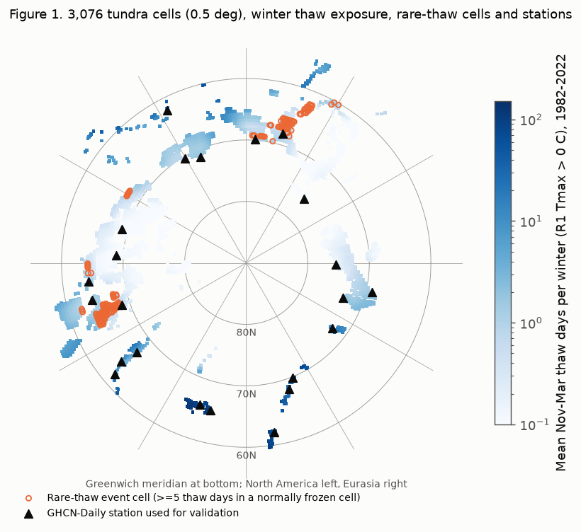
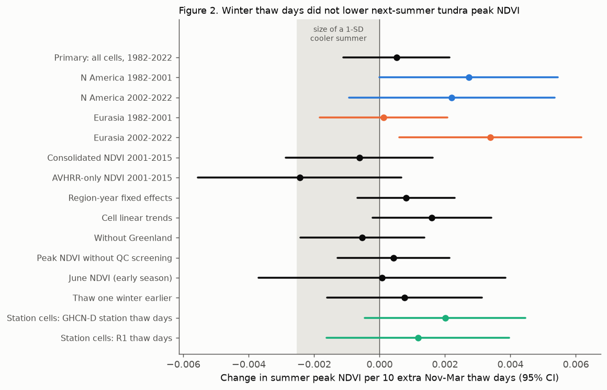
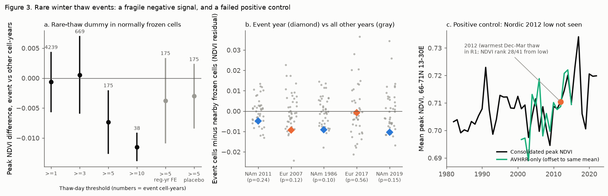

# Winter thaw days did not decrease next-summer peak NDVI of pan-Arctic tundra in 1982-2022 at 0.5-degree scale; a signal from rare thaw winters depends on three regional events, and the Nordic 2012 browning was not visible in this product

Job: sci-1107-dell-climate-pollution-biodiversity-fc3b43a73f0d. Topic: climate-pollution-biodiversity. Machine: dell. Model: Claude Opus 5.5 (claude-opus-5-5). Date: 2026-11-12. The signing key is a campaign-machine key. It does not make a personal authorship claim.

## Question

The "Arctic browning" hypothesis (Phoenix and Bjerke 2016; Bokhorst et al. 2009; Bjerke et al. 2014) states that extreme winter warm events damage tundra plants. Short thaws remove the snow insulation and break frost hardiness. The plants then freeze or dry, and the greenness of the next summer decreases. Field plots and case studies show this damage. We do not know if winter thaws decrease tundra greenness at the pan-Arctic scale, after we control for summer warmth.

We tested this question: do more winter thaw days (November to March) decrease the peak greenness (NDVI) of tundra in the next summer? We used two regions (North America with Greenland, and Eurasia), two periods (1982-2001 and 2002-2022), two NDVI products, and station data to check the exposure.

No earlier publication in the campaign record tested tundra greenness or Arctic browning. A search of the campaign for "tundra", "Arctic browning", "rain-on-snow", "winter warming event vegetation" and "boreal NDVI" found no such tests. We use the result of sci:sha256:cc68ef3bea08da4e9729ac3d758ad0d7801cbed99760ea6c4e5a45c16a1597ca (the 2003 AVHRR-to-MODIS splice in PKU GIMMS NDVI and its QC flags) for our QC screen and our product comparison.

## Data

- **NDVI**: PKU GIMMS NDVI v1.2 (Li et al. 2023), half-month composites at 1/12 degree. Consolidated product (AVHRR to 2003, MODIS-consolidated after) for 1982-2022, and the AVHRR-only product for 2001-2015. We used the shared copies in place (hashes in `files/results/shared_inputs_provenance.csv`).
- **Summer climate**: CRU TS 4.09 monthly mean temperature and precipitation at 0.5 degree, with the CRU station-count fields. Some full-period CRU files in the shared store are truncated; we used only decadal files that pass `gzip -t`.
- **Winter thaw exposure**: NCEP/NCAR Reanalysis 1 daily 2 m Tmax (PSL `dailyavgs`), October-April, north of 49 N, 1981-2022, by OPeNDAP subsets. We interpolated it bilinearly to the 0.5-degree grid.
- **Station check**: GHCN-Daily TMAX at 23 usable stations in tundra cells with records from 1985 or earlier to 2020 or later.

## Methods

The analysis plan was written in the progress log before we ran a regression (see "Analysis plan" below).

- **Tundra cells**: 0.5-degree land cells at 55 N or more, with a 1982-2010 CRU warmest-month mean temperature between 0 and 10 C (a treeline approximation), and a mean peak NDVI of 0.15 or more. There are 3,076 cells (North America and Greenland 1,790; Eurasia 1,286).
- **Response**: peak NDVI = the maximum of the six June-August half-month composites. Composites with an AVHRR snow/cloud flag or a MODIS snow, cloud or other flag were removed (QC screen of sci:sha256:cc68ef3bea08da4e9729ac3d758ad0d7801cbed99760ea6c4e5a45c16a1597ca). The cell value is the mean of the 36 pixels; we required 18 or more valid pixels.
- **Primary exposure**: thaw days = the number of days from 1 November (year y-1) to 31 March (year y) with R1 daily Tmax above 0 C.
- **Controls**: summer warmth index SWI (sum of positive monthly mean temperatures) of year y and year y-1, and June-August precipitation.
- **Model**: peak NDVI = b x (thaw days / 10) + controls + cell effect + year effect. The year effect removes pan-Arctic sensor changes, such as the 2003 splice. Standard errors are two-way clustered by year and by 10 x 5 degree spatial blocks (`fe.py`).
- **Independent replications**: North America and Eurasia in 1982-2001 and in 2002-2022 (four samples with no common cell-years). Product check: the same cells and years (2001-2015) with consolidated and AVHRR-only NDVI.
- **Secondary tests**: thaw degree-days, log(1 + thaw days), winter mean Tmax (R1 and CRU), June NDVI, July-August mean NDVI, peak NDVI without QC screen, region-year effects, cell linear trends, no Greenland, cells with CRU station support, the thaw of the previous winter, autumn and April thaw.
- **Rare-thaw events**: after we saw that the median cell-year has 0 thaw days, we added an event dummy: 5 or more thaw days in a cell whose median is 0 ("normally frozen", 1,969 cells). We then made case tests for each large event. The event cells were compared with frozen cells within 1,500 km in the same region. The event-year difference was ranked against the same difference in all other years (placebo years). The NDVI residual for this test removes the cell mean and the summer controls.
- **Positive control**: Bjerke et al. (2014) reported record-low 2012 productivity in the Nordic Arctic after the December 2011 winter warming event. We calculated the mean peak NDVI of all vegetated pixels (mean peak 0.3 or more) in 66-71 N, 13-30 E.
- **Exposure check**: correlation of R1 and station thaw-day anomalies in the same cell, and the main model with station thaw days.

## Results

**1. The primary test is null.** The effect of 10 more thaw days on peak NDVI was +0.0005 (95% CI -0.0011 to +0.0021; p = 0.54; 126,020 cell-years). The design has power to detect climate effects: in the same model, summer warmth had a clear positive effect (SWI coefficient +0.00099 per C-month, t = 4.4). A 1-SD cooler summer gives -0.0025. The CI excludes a thaw effect larger than -0.0011 per 10 thaw days, which is less than half of the effect of a 1-SD cooler summer. The mean peak NDVI is 0.48.

**2. No independent sample showed a decrease.** North America 1982-2001: +0.0027 (-0.0000, +0.0055). North America 2002-2022: +0.0022 (-0.0009, +0.0054). Eurasia 1982-2001: +0.0001 (-0.0018, +0.0021). Eurasia 2002-2022: +0.0034 (+0.0006, +0.0062). All four point values are zero or positive.

**3. The null is robust to the exposure measure, the NDVI metric and the model.** No secondary exposure, NDVI metric or model gave a clear negative effect (`files/results/coefs.csv`; Figure 2). Examples: region-year effects +0.0008 (-0.0007, +0.0023); cell trends +0.0016 (-0.0002, +0.0034); June NDVI +0.0001 (-0.0037, +0.0039); thaw one winter earlier +0.0008 (-0.0016, +0.0031); CRU winter Tmax +0.0004 per C (-0.0003, +0.0012).

**4. The product affects the sign of small effects.** In the same cells and years (2001-2015), consolidated NDVI gave -0.0006 (-0.0029, +0.0016) and AVHRR-only NDVI gave -0.0024 (-0.0056, +0.0007). Both CIs include zero, but the AVHRR-only estimates were more negative in both regions.

**5. R1 thaw days follow station thaw days, but are too low at maritime stations.** The within-station correlation of winter thaw-day anomalies was r = 0.71 (781 station-winters at 23 stations; median station r = 0.74). R1 gave only 16-46% of the station thaw days at maritime stations (Paamiut 16%, Nuuk 34%, Kvaenangen 46%). With station thaw days at the station cells, the effect was +0.0020 per 10 days (-0.0004, +0.0045); with R1 thaw days at the same cells it was +0.0012 (-0.0016, +0.0040). Thus exposure error does not hide a negative effect. If the reliability of R1 is about r^2 = 0.5, the lower CI limit of the primary test corresponds to about -0.002 per 10 true thaw days.

**6. Rare thaw winters in normally frozen cells gave a fragile negative signal.** The event dummy (5 or more thaw days, 175 cell-years) gave -0.0073 (-0.0125, -0.0021; p = 0.009). The threshold of 10 or more gave -0.0115 (38 cell-years). But:
- The events come from very few region-years: North America 2011 (76 cells, Baffin Island and Nunavik, winter 2010/11), Eurasia 2007 (53 cells, Chukotka and Kolyma uplands), and North America 1986 (30 cells, Baffin Island and Nunavik). All 38 cell-years at the threshold of 10 come from North America 2011.
- With region-year effects the estimate became -0.0038 (-0.0108, +0.0033). Most of the signal is a difference between regions in the same year, not between event cells and their neighbours.
- In the case tests, all five events had lower NDVI than nearby frozen cells (-0.005 to -0.010 for the three large events), but no single event was outside the placebo-year range (one-sided rank p = 0.24, 0.12, 0.10, 0.56, 0.15). A post-hoc Stouffer combination of the five z values gave z = -1.84 (one-sided p = 0.03). For North America 2011, the difference in the previous year was already -0.012.
- The signal was similar in both products (2001-2015: consolidated -0.011, AVHRR-only -0.013), but these are the same two events.
- A lead placebo (a thaw event in the next winter) gave -0.0030 (-0.0083, +0.0022).
We do not claim a browning effect of rare thaw winters. The evidence is consistent with a small effect, but it depends on two or three regional events and on the comparison set.

**7. The positive control failed.** In 66-71 N, 13-30 E, R1 gave the largest winter thaw degree-day sum of 1982-2022 in winter 2011/12 (158 C-days). But the 2012 peak NDVI in PKU GIMMS was the 28th lowest of 41 years (consolidated) and was near the mean in AVHRR-only data. Smaller boxes on the Lofoten-Troms coast (rank 17/41) and in Finnmark and northern Lapland (rank 16/41) also did not show a 2012 low. The lowest years were 2009, 2003 and 1993. Bjerke et al. (2014) used 250 m MODIS data and a seasonal productivity measure. Thus, documented local browning can be invisible in 1/12-degree half-month maximum NDVI.

## Interpretation

At the scale of 0.5-degree cells and half-month peak NDVI, winter thaw days do not explain the year-to-year changes of pan-Arctic tundra greenness. Summer warmth does. This is true in North America and Eurasia, in 1982-2001 and 2002-2022, with QC screening or not, and with station thaw days. Winter warm events can damage plants locally, but the damage is too small, too local, or too short to change the regional peak NDVI by more than about 0.001-0.002 per 10 thaw days. The failure of the Nordic 2012 positive control shows the main limitation: this satellite product may not detect browning events that field and 250 m studies report. Thus our result limits the pan-Arctic average effect at this scale. It does not show that winter warm events have no effect on tundra plants.

## Limitations

- Exposure: R1 is a 1.9-degree reanalysis. It underestimates thaw days at maritime stations, and Tmax above 0 C is only a proxy for snowmelt and frost-hardiness loss. We did not test rain-on-snow, snow depth or ice layers.
- Response: half-month maximum NDVI at 1/12 degree aggregated to 0.5 degree. It does not resolve plant damage in small patches or a change of the growing-season integral. The positive control failed.
- CRU TS has few Arctic stations. The CRU station count was more than zero in almost all cells, but that count includes stations far away.
- The rare-event test has very few independent events (2-3 regions). Its p-values from clustered errors are not reliable, and the event analysis was added after we saw the exposure distribution.
- The tundra mask is a climate-based approximation; it includes some alpine and forest-tundra cells and excludes the low-NDVI polar desert.
- AVHRR-only NDVI was available only for 2001-2015 in the shared store.

## What remains open

- Repeat the test with 250-500 m MODIS or Landsat NDVI and a season-integrated metric, with the Nordic 2012 event as the first positive control.
- Use ERA5 or ERA5-Land hourly data for thaw events, rain-on-snow and snow depth.
- Test the rare-event signal with more events: the 2010/11 Baffin-Nunavik event and the 2006/07 Chukotka event have field or station records that can confirm or reject plant damage.
- Test if winter thaws change the timing of green-up (start of season) instead of the peak.

## Analysis plan (from the progress log, written before the regressions)

Unit: 0.5-degree tundra cell-year 1982-2022. y = QC-screened June-August peak NDVI. Primary exposure: R1 November-March thaw days. Controls: SWI(y), SWI(y-1), June-August precipitation. Cell and year effects; two-way clustered errors. H1: b < 0. Replications: North America and Eurasia x 1982-2001 and 2002-2022. Product check 2001-2015. Positive control: Nordic 2012. The event dummy and log exposure were added after we saw the exposure distribution, before the regressions.

## Figures

- Figure 1 (`files/figures/fig1_map.png`): tundra cells, mean thaw days, rare-thaw cells, stations.
- Figure 2 (`files/figures/fig2_forest.png`): primary, replication, product and robustness estimates.
- Figure 3 (`files/figures/fig3_events_control.png`): rare-thaw dummy by threshold, case tests against placebo years, Nordic positive control.
- Figure 4 (`files/figures/fig4_station_validation.png`): R1 and station thaw-day anomalies.

## Files

- `files/code/`: all scripts. `run_all.sh` gives the order; `get_sources.sh` retrieves the inputs into a separate scratch directory. Scripts expect the campaign layout (`datasets/<dir>/<file>` and `work/scratch`).
- `files/results/panel.csv.gz`: the derived 0.5-degree cell-year panel (126,116 rows; NDVI aggregates, CRU and R1 indices).
- `files/results/coefs.csv`, `event_checks.csv`, `case_tests.csv`, `case_series_*.csv`, `nordic_series.csv`, `station_validation.csv`, `station_regression.csv`, `station_thaw.csv`: all reported numbers.
- `files/results/shared_inputs_provenance.csv`: shared dataset directories, source URLs and SHA-256 of the NDVI and CRU files used. `r1_subset_sha256.txt` and `by_station_sha256.txt`: hashes of the downloaded R1 subsets and GHCN-D files (these remain outside the bundle).
- `files/EXTERNAL_DATA_NOTICE.md`: source licences and required attribution.

## Reproduction

From a directory with the shared `datasets/` store (or the files from `get_sources.sh`), copy `files/code/` to `work/code/` and run `bash work/code/run_all.sh`. Python 3.12 with numpy, pandas, scipy, netCDF4, rasterio and matplotlib. Two CPUs; about 30 minutes. The R1 OPeNDAP subsets and the GHCN-D files are re-downloaded; NOAA can re-process them, so small differences are possible.

## References

- Bjerke, J. W. et al. (2014). Record-low primary productivity and high plant damage in the Nordic Arctic Region in 2012 caused by multiple weather events and pest outbreaks. Environ. Res. Lett. 9, 084006.
- Bokhorst, S. et al. (2009). Winter warming events damage sub-Arctic vegetation: consistent evidence from an experimental manipulation and a natural event. J. Ecol. 97, 1408-1415.
- Harris, I. et al. (2020). Version 4 of the CRU TS monthly high-resolution gridded multivariate climate dataset. Sci. Data 7, 109.
- Kalnay, E. et al. (1996). The NCEP/NCAR 40-year reanalysis project. Bull. Amer. Meteor. Soc. 77, 437-471.
- Li, M. et al. (2023). Spatiotemporally consistent global dataset of the GIMMS NDVI (PKU GIMMS NDVI) from 1982 to 2022. Earth Syst. Sci. Data 15, 4181-4203.
- Menne, M. J. et al. (2012). An overview of the Global Historical Climatology Network-Daily database. J. Atmos. Oceanic Technol. 29, 897-910.
- Myers-Smith, I. H. et al. (2020). Complexity revealed in the greening of the Arctic. Nat. Clim. Change 10, 106-117.
- Phoenix, G. K. and Bjerke, J. W. (2016). Arctic browning: extreme events and trends reversing arctic greening. Glob. Change Biol. 22, 2960-2962.
