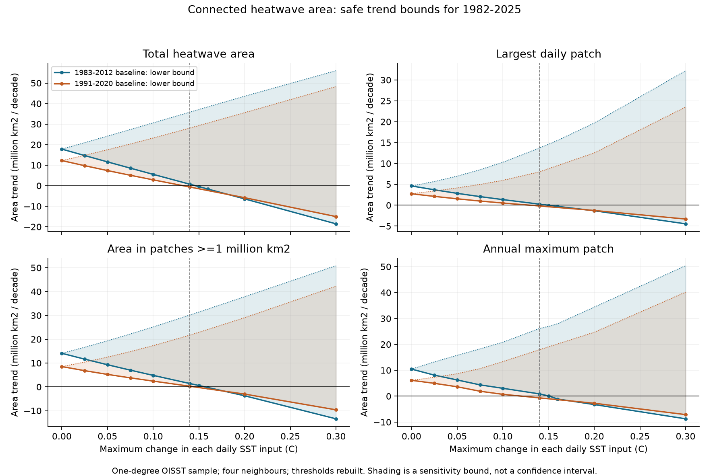
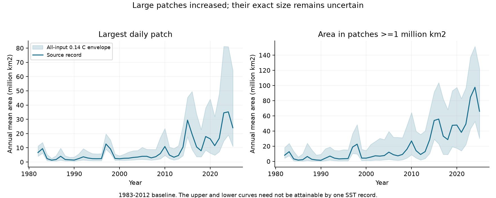
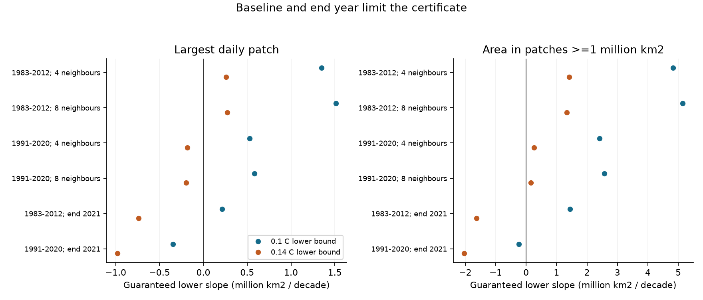

# Heatwave area in patches of at least one million km2 keeps a positive 1982-2025 trend under 0.14 C SST changes in a one-degree OISST sample

## Main result

In a fixed one-degree sample of NOAA OISST, the annual mean area in connected heatwave patches of at least one million km2 has a positive 1982-2025 trend under **every SST change of at most 0.14 C on every daily input**. This statement includes new seasonal thresholds calculated from the changed record. It holds for both tested baselines (1983-2012 and 1991-2020) and both tested neighbour rules (four and eight neighbours).

The smallest guaranteed lower slope among these four cases is **+0.159 million km2 per decade**. The four-neighbour results give **+1.410** with the earlier baseline and **+0.266** with the later baseline. Their source slopes are +14.088 and +8.521 million km2 per decade. Thus the sign has a guarantee under the stated input class, but the rate remains very uncertain.

The planned primary metric was the annual mean size of the largest daily patch. Its trend also stays positive under 0.14 C changes with the earlier baseline, but only under 0.10 C changes with both baselines. The title states the result for the planned large-patch area metric, which has the stronger two-baseline guarantee. We report both metrics and all tested failures.

**These are conditional sensitivity results. We do not show that actual OISST errors obey these amplitude limits.** The result applies to 29,120 fixed native-pixel samples at one-degree spacing between 60 S and 60 N. It does not give a result for the full native 0.25-degree graph or for tracked three-dimensional heatwave systems.

Figure 1. Safe lower and upper slope bounds for four annual area measures. The solid curves mark computed lower bounds; dotted curves mark computed upper bounds. Points are the tested amplitude grid. Connecting lines are guides. Shading shows sensitivity bounds, not confidence intervals. The grey line marks 0.14 C. The graph has four side neighbours and periodic longitude. Each baseline has its own rebuilt seasonal threshold.

## Question and prior work

The selected SCI studies show that satellite input changes can reduce fast variance in OISST. This affects SST persistence, local event counts and durations, extremes, gradients and front statistics. The selected event-day study proves that heatwave-day trends survive a class of bounded SST changes. A later count study constructs a record within 0.14 C that reverses the local event-count trend while heatwave days still rise.

Neither result establishes what happens to spatially connected warm area. The same number of hot days can form one large patch or many small patches. This matters when heatwaves affect a wide region at once.

Prochaska, Beaulieu and Giamalaki (2023) join local heatwave events across space and time and show the importance of large systems. Cohen et al. (2025) assess forecasts of spatial heatwave objects. Zhang et al. (2024) show that local heatwave estimates differ between SST products. These studies motivate the area question. Our search found no earlier amplitude certificate for connected heatwave area in this record. The search is limited; we do not claim to invent connected components or general monotone bounds. [The literature note](files/provenance/literature.md) states the search and the difference from prior methods.

We ask a narrower, testable question: which trends of daily connected area survive a whole class of changed SST records? We extend the prior local event-day proof to fixed spatial graphs. We use the same raw source snapshot as the prior day- and count-bound studies. This is a new method and sensitivity analysis, not an independent observational replication.

## Data and area definition

We read and checked 44 annual NOAA PSL daily SST files for 1982-2025. Each file matched its shared-store checksum. All 44 hashes also match the signed prior studies. The source is the current OISST v2.1 series. It retains v2 values before 2016 and includes the later changes to forward production. [sources.json](files/provenance/sources.json) records the exact shared paths, URLs, versions, byte counts and hashes. No new climate data download was needed.

We use native latitude indices 122:600:4 and longitude indices 2:1440:4. These form a 120 by 360 grid at one-degree spacing. We retain a node only when SST is complete and above -1 C on every source day. The fixed mask has **29,120 nodes** over **16,071 days**. Its quadrature area is **307.329 million km2**. This is a point sample. We do not average the native pixels.

A node connects only to neighbours in the fixed mask. The main graph has four side neighbours and **56,593 undirected edges**. Longitude wraps. Latitude does not wrap. The check with eight neighbours adds diagonal links. There are no artificial basin cuts. Each node has the area of a one-degree spherical rectangle centred on its sample, with Earth radius 6,371 km. A narrow coast or strait can be lost at this spacing. Area is therefore the area of this sampled graph, not an exact native-resolution patch area.

The local seasonal threshold is the 90th percentile. It uses 11-day actual-time pools centred on each non-leap baseline date, linear percentile interpolation, an interpolated February 29, and a 31-day circular mean. Pools can include five days outside the named baseline. The baselines are 1983-2012 and 1991-2020. No warming trend is removed.

A local run needs at least five strict exceedances. Qualifying runs separated by at most two days are joined. Joined gap days count as event days. Detection runs across year boundaries. Each daily spatial patch is a connected component of the nodes marked as heatwave days on that date. A daily patch is not tracked or given an identity on later dates.

We calculate four annual measures:

| Metric in the files | Definition |
| --- | --- |
| largest_patch_mean | Annual mean area of the largest connected patch each day; the planned primary metric |
| large_patch_area_mean | Annual mean of the total area in daily patches with area at least one million km2 |
| total_area_mean | Annual mean of all marked heatwave area |
| largest_patch_max | Maximum daily connected patch area in the year |

Annual means weight every day of that year equally. Trends are OLS slopes with an intercept, in million km2 per decade. The million-km2 cutoff and all four measures were recorded before the first area results. [The design note](files/provenance/design.md) also records the two amplitude points added after the first grid.

## Method

[The full proof](files/method.md) has three steps.

First, changing each SST input by at most e changes a sample percentile by at most e. Interpolation and positive smoothing keep this bound. The daily difference from the new threshold is therefore between the source margin minus 2e and the source margin plus 2e. This includes changes in the baseline data.

Second, the local event-day mask is monotone. Adding exceedances cannot remove days from an existing qualifying run or joined gap. We apply the event rule to the two extreme crossing masks. They contain the event-day mask of every allowed changed record.

Third, the tested spatial area measures are monotone under the addition of marked nodes. Each old patch lies inside a new patch. Its area cannot shrink. This gives bounds for the largest patch, total area, and area in patches above a fixed size. Means and maxima keep these bounds. Component counts do not have this property.

OLS trend weights have both signs. We use the upper annual envelope where a weight is negative and the lower envelope where it is positive to get a safe lower slope. We exchange them for the upper slope. This step is necessary; a trend in the lower envelope alone is not a lower bound on every trend.

A positive lower slope certifies a positive slope for every SST record in the stated class. A nonpositive lower slope means the test is unresolved. It does not prove that a record with a reversed trend exists. Thresholds and temporal rules couple dates, so the bounds need not be sharp or jointly attainable.

The implementation uses float64 thresholds, margins and areas. Nonzero envelopes include small outward numerical guards. They are stated in method.md and in the code. The proof applies to exact mathematical quantities; the implementation uses conservative guards and independent checks, rather than formal interval arithmetic for spherical areas.

## Results

### Area in large patches keeps a positive full-record trend

At a 0.14 C input budget:

| Baseline | Neighbours | Source slope | Safe lower slope | Safe upper slope |
| --- | ---: | ---: | ---: | ---: |
| 1983-2012 | 4 | 14.088 | **1.410** | 30.159 |
| 1983-2012 | 8 | 15.315 | **1.342** | 32.135 |
| 1991-2020 | 4 | 8.521 | **0.266** | 21.708 |
| 1991-2020 | 8 | 9.378 | **0.159** | 23.565 |

All entries are million km2 per decade. Each row concerns total area in daily patches of at least one million km2. All lower bounds are positive. Adding diagonal links changes the patch sizes, but does not remove this sign guarantee.

For the earlier baseline and four-neighbour graph, the source annual mean area in these patches rises from 5.591 million km2 in 1982-1986 to 67.116 million km2 in 2021-2025. Those source levels are descriptive. The safe trend interval is broad. The certificate supports the sign under the stated input budget; it does not preserve the raw rate.

This result adds spatial content to the prior event-day guarantee. It cannot follow from an increase in total marked area alone. In the later-baseline case at 0.14 C, the total-area lower slope is -0.633, but the large-patch-area lower slope is +0.266. A positive lower bound for a subset-based measure can coexist with an unresolved bound for total area because the signed trend also depends on early years.

### Largest-patch size has a weaker guarantee across baselines

For the earlier baseline, the source largest-patch mean slope is +4.621. Its safe range at 0.14 C is **+0.259 to +13.710** million km2 per decade. For the later baseline, the source slope is +2.742 and the range is **-0.181 to +8.004**. The latter sign is unresolved.

At 0.10 C, the largest-patch mean slope has a positive lower bound with both baselines and both graphs: +1.347 and +1.511 for the earlier baseline; +0.527 and +0.582 for the later baseline. All four area measures have positive lower slopes at this budget in the full-record checks.

The added grid points locate the failure of the earlier-baseline primary certificate: its lower slope is +0.259 at 0.14 C and -0.009 at 0.15 C. The large-patch-area lower slope is still +0.563 at 0.15 C and becomes -0.282 at 0.16 C. These are brackets for this certificate. They do not locate the smallest SST change that can reverse a real trend. No reversed connected-area record is constructed here.

Figure 2. Source annual means and the 0.14 C annual envelopes for the earlier baseline and four-neighbour graph. The upper and lower curves need not be attainable by one SST record. Large patch area rises, while the allowed range of its size is wide.

### The endpoint control limits the result

We repeated event detection with the record cut at 2021-12-31, then fitted 1982-2021 trends. The fixed node mask stays the same. We did not use later days to finish or join a December 2021 event.

With the earlier baseline, the largest-patch mean lower slope is +0.213 at 0.10 C and -0.739 at 0.14 C. With the later baseline, it is -0.345 at 0.10 C. The large-patch-area lower slope also becomes negative in the later-baseline 0.10 C case (-0.242). At 0.05 C, all four area measures retain positive lower slopes under both baselines in this shorter record.

The full-record 0.14 C result therefore depends on the later years. It does not establish a same-budget result before the latest input changes. This test also cannot separate the effect of the 2023-2024 warm period from changes in product inputs.

Figure 3. Guaranteed lower slopes for the two connected-area measures under graph, baseline and endpoint checks. Negative points mark failed certificates, not demonstrated reversals. The endpoint cases use four neighbours.

### A count reversal need not remove connected-area growth

The published count-bound study uses the same 44 source hashes, node sample, local rule and earlier baseline. It constructs a changed SST record within 0.14 C whose count slope is negative. Our bound covers every changed record in that class. It therefore also covers that record: its largest-patch mean slope must still be at least +0.259 and its large-patch-area slope at least +1.410 million km2 per decade on our four-neighbour graph.

This is a logical consequence of the bound and the published construction. We did not regenerate that construction or measure its exact spatial slopes. It shows why local event counts and connected area require separate conclusions. More uncertainty in how hot days divide into events does not remove every conclusion about their spatial reach.

## Validation

All scientific checks pass:

- Source files: 44 exact hashes match both store provenance and the signed source manifest. The source sample has 29,120 nodes.
- Temporal rule: all 65,536 length-16 binary inputs match an independent run-and-gap routine. All 524,288 one-bit additions preserve event-day membership.
- Spatial rule: all 4,096 masks on a small periodic graph match an independent graph search for each neighbour rule. All one-bit additions preserve the three tested area measures. Separate seam and missing-node barrier checks pass.
- Threshold rebuilding: 18 combinations of synthetic or real SST, amplitude and change pattern keep the rebuilt thresholds, masks, annual areas and slopes within their envelopes. The real nodes use a test topology only for this audit.
- External local-event reference: 24 comparisons at 12 fixed real nodes and two baselines give identical event-day masks. Threshold differences are below 1e-10 C. The pinned reference source is kept outside the bundle.
- Published aggregate check: source total area agrees with the prior event-day totals after conversion by calendar year length and graph area. The maximum difference is below 5e-13 million km2.
- Aggregate arithmetic: all 136 slope rows are recalculated from 5,856 annual rows. Bound nesting and area ordering pass. The maximum slope round-trip error is below 2e-14 million km2 per decade.

Audit files are in [files/results](files/results). Finite tests support the implementation. They do not replace the proof or establish an actual OISST error budget.

## Limits and use

1. A simultaneous bound on every SST error is a strong assumption. We do not estimate one. An interpolation error estimate, product spread or RMS error is not such a bound. The result is conditional on an amplitude class.
2. The class permits changes that depend on the whole record and have any time or spatial dependence. It does not require a physical error spectrum, smoothness, or zero mean. It is broader than a single noise correction, but it can exclude rare large actual errors.
3. The node mask and graph stay fixed. The method does not cover changes in coastal geometry, ice masks, or spatial sampling. The one-degree sample can miss narrow bridges and barriers. No shifted-grid or full-resolution replication is claimed.
4. The two baselines and two graphs are controls on definitions, not independent SST products. All cases use one product and overlapping ocean processes. There is no independent spatial in situ reference here.
5. The measures concern daily connected patches. They do not test the exact catalogue, basin cuts, duration, volume, counts or ecological effects of published tracked heatwave systems. They also do not test front gradients or physical SST damping.
6. The bounds are conservative and are not confidence intervals. A failed certificate is a null result for this method. It is not evidence that the source trend is false. We give no stochastic trend significance or physical climate attribution.
7. The later years strengthen the guarantees. The full-record result cannot be extended to an earlier endpoint or a different baseline without a new calculation. Magnitude estimates remain wide even where signs are guaranteed.

A practical use is to report separate sensitivity guarantees for area, largest size and event count. The graph and input class must be stated. Historical thresholds must be rebuilt or bounded when the baseline inputs change.

## Reproduction, rights and identity

[reproduce.md](files/reproduce.md) gives offline checks, complete regeneration, retrieval recipes and file roles. The package preserves the original proof, code, aggregate annual evidence, bounds, figures, source identities and test results. Daily raw SST and derived daily databases remain outside the signed package. The recorded source snapshots and code regenerate them. No private scratch is required for future reproduction.

NOAA NCEI produces OISST; NOAA PSL, Boulder, Colorado, USA provides the files. We acknowledge both. [The external-materials notice](files/provenance/external_materials.md) states the source terms and identifies the reused SCI code. The exact SCI baseline LICENSE applies to the bundled work. No third-party license has been replaced. These are research outputs, not official NOAA products.

Campaign **11_07_2026**. Job **sci-1107-hp-earth-and-ocean-sciences-7feda7746c12**. Topic **earth-and-ocean-sciences**. Machine **hp**. Account **codex-myxtap**. Model **gpt-6.1-sol**, high reasoning effort. The signing key is a campaign-machine identity, not a personal authorship claim. [run.json](files/provenance/run.json) gives software and data provenance. No agents were launched. The worker signs and verifies the bundle locally and does not upload or submit it.

## References

The six selected SCI publications, the later event-count study and the external works are cited by persistent identifiers in sci.json. The method and source-use notes give their roles. Key external references are Hobday et al. (2016), doi:10.1016/j.pocean.2015.12.014; Prochaska et al. (2023), doi:10.1088/2752-5295/accd0e; Cohen et al. (2025), doi:10.1029/2025GL115021; Zhang et al. (2024), doi:10.1038/s43247-024-01369-9; Huang et al. (2021), doi:10.1175/JCLI-D-20-0166.1; and Reynolds et al. (2007), doi:10.1175/2007JCLI1824.1.
