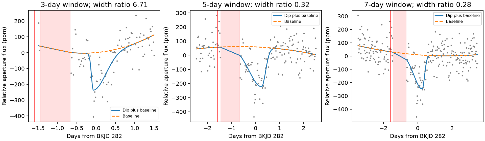
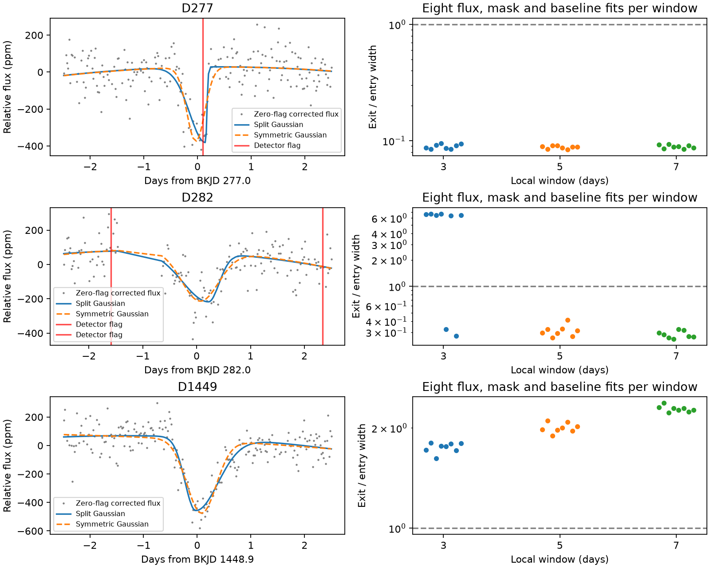

# Local baseline choices reverse the fitted asymmetry of the known day-282 KIC 8027456 dip in Kepler DR25

The known dip near day 282 of KIC 8027456 has a long exit in some short-window fits and a short exit in all tested wider-window fits. Removing flagged exposures does not remove this change. This result limits the use of one fitted shape as evidence for a dust tail. It adds a reproducible instrument-control test, not a new object.

## Question and prior work

Can a strict quality mask leave a comet-like shape at a dip that prior work linked to detector errors? Kennedy et al. (2019, DOI 10.1093/mnras/sty3049, section 4.1) reported a possible comet transit at BKJD 1448.9. They also described two shorter dips near days 277 and 282 and rejected them after checks of detector flags and other steps in quarter 3. We select those two dips as controls. Their instrument origin is a prior interpretation, not ground truth established here. BKJD is barycentric Julian date minus 2454833.

We ran `sci search "8027456" --in ./campaign --json`. The completed search has no invalid candidates or partial-source errors. Its output is in files/campaign_search.json. We read the signed shape study SCI 405430ec3f34f399d6dd8403af095144d601f286e6dc25b33c6c7f6a38c23367 and the full-mission scan SCI a374123457a6a62a11980769573864c31484061cf5d29557391091d86855630c. The latter has a weak corrected-flux maximum near 281.918 days that does not pass its screen. We add free-shape fits of the two selected quarter-3 controls. We do not repeat that scan or claim the first report of these dips. The literature search is targeted, not complete. No private worker files were used.

## Data and method

We use public Kepler release 25 long-cadence aperture flux (SAP) and corrected flux (PDCSAP) for quarters 3 and 15. These products share exposures. They are not independent observations. The source archive is reused in place at:

`/mnt/dell-data/shared_datasets/kepler-kic8027456-available-quarters-dr25/lightcurves.tar`

Its SHA-256 is `a7d6ad7d5d5662185f25746bb3de4b2acba60de4312a0ecb3de5876f1e77ca0d`. The source URL, resolved shared path, FITS member names, member hashes, release number, and pipeline versions are in files/provenance.json. The two used member hashes are:

- Q3: `b8f56bd0aa8dd2fd52f20afeddfb49fd7432ea15c0c2d948bc84b68028fa6048`.
- Q15: `55f138bf46a55b07b50bfa1355dc317d86dae011ce0104902711960e2c2592e4`.

The package contains the required archived columns as small NPZ files. No missing time is filled. There are two quality rules: accept only SAP_QUALITY=0, or allow only bits 128 and 8192. The latter bits concern aperture and collateral cosmic rays. Both rules reject the detector-anomaly flag, bit value 16384. The official Kepler archive manual defines these bits.

For each event we take a full window of 3, 5, or 7 days, centered at the published rounded day: 277.0, 282.0, or 1448.9. We divide the retained flux by its local median, subtract one, and multiply by one million. We fit an additive linear or quadratic time baseline and a split Gaussian decrease in light:

`flux(t) = polynomial(t-center) - depth * exp(-0.5*((t-epoch)/width)^2)`.

The width is sigma_in before the fitted epoch and sigma_out after it. The ratio R=sigma_out/sigma_in is greater than one for a longer exit. We fit the epoch within 0.6 day of the selected center and each width from 0.025 to 1.2 days. Baseline and signed depth coefficients are solved by linear least squares at each nonlinear step. All reported event depths are positive. Twelve start points cover both asymmetry directions and several epochs. We use equal weights. The comparison symmetric fit has one common width. The split model can fit at least as well because it has one extra parameter; error reduction alone is not a detection test.

This gives 24 choices per event and 72 fits in all. All choices share data. They are sensitivity tests, not independent trials. Fits evaluate the model at the archived time and do not average it across the exposure. Widths near one exposure cannot be interpreted as measured physical times.

## Results

| Selected dip | Depth range, ppm | Exit / entry width range | Fits with ratio above one / 24 |
|---|---:|---:|---:|
| Day 277 | 374.4 to 423.9 | 0.084 to 0.095 | 0 |
| Day 282 | 230.0 to 296.6 | 0.252 to 6.709 | 6 |
| Day 1448.9 | 489.9 to 570.3 | 1.621 to 2.375 | 24 |

These ranges are not confidence intervals. Each cell describes the finite set of fit choices. files/fits.csv preserves all parameters, sample counts, errors, and bound checks.

For day 282, quadratic zero-flag aperture fits give R=6.709, 0.325, and 0.281 in the 3-, 5-, and 7-day windows. Corrected-flux fits give 6.373, 0.415, and 0.319. The narrow-window fit places the minimum near day 281.929. The wider-window aperture fits place it near day 282.25. Thus, the change includes the fitted epoch and both widths. It is not a small change to a measured dust lifetime. All six long-exit results occur in the 3-day window. Even within that window, changing the corrected-flux baseline from quadratic to linear reverses the asymmetry.

The panels show zero-flag aperture data and quadratic fits for day 282. The red line marks a detector flag at BKJD 280.412511. The red band marks the coarse-point interval from 280.555541 to 281.331987. The same flux deficit can be assigned different shapes when the fit has little baseline support before the event. These fits do not select a physical shape.

Day 277 always has a shorter exit. Its exit width reaches the 0.025-day lower bound in 16 of 24 fits. The exact small ratio is therefore model-bound dependent. We do not infer a resolved recovery time. A detector flag occurs at BKJD 277.102395, close to this dip. Day 1448.9 always has a longer exit and reaches no parameter bound. This agrees in direction with the prior candidate shape study. Our full windows differ from that study, so its numerical ratio range is not expected to match ours.

The left panels use the zero-flag corrected flux, a five-day full window, and a quadratic baseline. The right panels show all eight flux, mask, and polynomial choices for each full window.

A quality flag applies to an exposure, not to all adjacent times. In a two-day interval centered on day 277, 75 finite corrected-flux samples have zero flags. A veto within 0.5 day of any detector flag leaves 37 of them. Around day 282, all 64 zero-flag samples survive a 0.5-day detector-flag veto. A two-day veto removes all 64. The same two-day veto retains all 84 zero-flag samples around the known day-1448.9 dip. files/veto.csv gives the full count test. This illustrates a tradeoff in context cuts. It does not establish a safe universal veto length or a detection rate.

## Numerical checks and physical limits

A separate differential-evolution search checks the day-282 zero-flag quadratic fits for both flux products and all three windows. Its residual sums of squares agree with the multiple-start local fits within 1.5e-10 in relative terms. It gives the same asymmetry directions. Thus, this reversal is not explained by a missed minimum in those six fits. files/optimizer_audit.csv contains both solutions. Three noiseless injection tests recover symmetric, long-exit, and short-exit profiles with a quadratic baseline. Their parameter errors are below 1e-4 in relative terms. These tests check the solver; they do not measure survey completeness.

A simple dust-tail interpretation expects a rapid entry and a slower exit as dust trails the body. The day-282 dip can meet that shape description under a short baseline choice. It fails a requirement that the direction persist over the tested baselines. The prior detector-flag context, nearby pointing gap, and baseline dependence make it unsuitable as new dust-tail evidence from this analysis. Detector sensitivity changes, step recovery, or baseline error can explain this behavior in principle. We do not fit an independent detector-response model or prove the cause. The longer exit of the day-1448.9 candidate survives these same choices, but shape persistence alone does not prove dust or exclude detector errors.

The controls were selected from prior reports. Two controls cannot measure a false-positive rate. This is not a blind search, a calibrated significance test, a dust-lifetime measurement, or an orbit exclusion. Time-dependent noise, unmodeled stellar variation, saturation, blends, pipeline correction, finite exposures, and the chosen Gaussian model limit the interpretation. There is no independent telescope confirmation. We establish no new planet, comet, or astronomical event.

## Reproduction and job record

Job: sci-1107-syam2-astronomy-46710fa98cbe. Topic: astronomy. Campaign: 11_07_2026. Machine: syam2. Account: codex-myxtap. Model: gpt-6.1-sol with high reasoning effort. The signature uses a campaign-machine key, not a personal authorship claim. The bundle is stored locally only.

Use a writable extracted copy with Python 3.12 and files/requirements.txt. Run `bash files/reproduce.sh`. This uses the included NPZ data without network access. It runs numerical checks, all 72 fits, the independent optimizer audit, and both figures. It takes several minutes and writes derived results only in that extracted copy. Version details are in files/environment.json. Single-thread library settings keep these small matrix fits efficient; they are not a campaign resource limit.

To rebuild the NPZ inputs from the shared archive, run `python files/retrieve.py /absolute/path/to/lightcurves.tar`. This checks the archive and both member hashes. With no argument it retrieves the recorded public URL into the local files directory if absent. It does not alter the shared dataset. SCI verification checks all packaged file hashes. The raw tar is not duplicated in this package. The baseline license covers our text, figures, code, and derived evidence; the NASA source record is retained. No private signing key is included.
