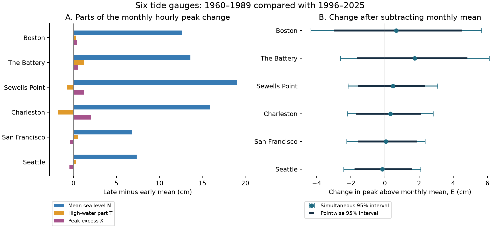
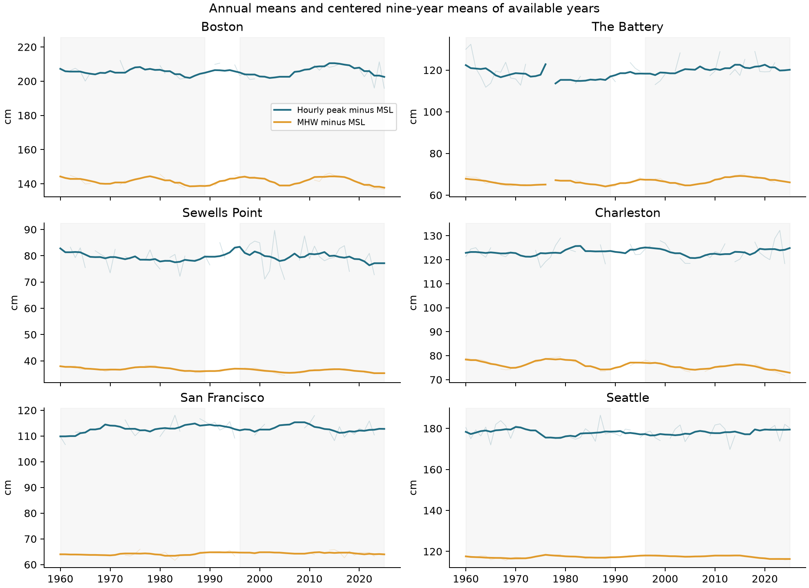

# Subtracting mean sea level left uncertain changes in monthly peaks at six US gauges in complete years of 1960-1989 and 1996-2025

## Result

Mean sea level supplied most of the point-estimate rise in the mean monthly hourly peak at these six gauges. The peak rise was 6.85 to 19.47 cm. The rise in the peak above its concurrent monthly mean was -0.16 to 1.75 cm. All six primary uncertainty intervals included zero. This result leaves a rise above the monthly mean uncertain. It does not prove equality or absence of storm changes.

The question matters because a rise in a coastal peak can come from the mean water level, changes in high tides, changes in weather, or their combination. A peak series alone cannot separate these parts.

| Gauge | Years, early / late | Peak H change (cm) | Mean M change (cm) | E change (cm) | Pointwise 95% interval (cm) | Simultaneous 95% interval (cm) |
|---|---:|---:|---:|---:|---|---|
| Boston | 18 / 19 | 13.28 | 12.62 | 0.66 | -2.98 to 4.52 | -4.33 to 5.65 |
| The Battery | 18 / 20 | 15.36 | 13.61 | 1.75 | -1.64 to 4.84 | -2.61 to 6.11 |
| Sewells Point | 23 / 23 | 19.48 | 19.01 | 0.46 | -1.59 to 2.35 | -2.16 to 3.08 |
| Charleston | 21 / 23 | 16.25 | 15.94 | 0.32 | -1.68 to 2.11 | -2.19 to 2.83 |
| San Francisco | 18 / 18 | 6.85 | 6.79 | 0.06 | -1.55 to 1.89 | -2.23 to 2.35 |
| Seattle | 23 / 22 | 7.19 | 7.35 | -0.16 | -1.78 to 1.59 | -2.41 to 2.09 |

The estimates use only the complete years that passed the stated quality rules in each period. They are not estimates from all 30 years in either period. All six mean-level and peak-change pointwise intervals were positive, but those 12 secondary intervals were not adjusted for multiple comparisons. The primary family has six E estimates.

## Question, prior work, and added value

We asked whether the average monthly hourly maximum rose more than monthly mean sea level at Boston, The Battery, Sewells Point, Charleston, San Francisco, and Seattle. Site choice gave a small Atlantic and Pacific comparison. It did not give a random or complete coastal sample.

[Zervas (2005)](https://tidesandcurrents.noaa.gov/est/050415-53.pdf) used monthly extreme levels and adjustments for mean-level or tidal-level trends. [Wahl and Chambers (2015)](https://doi.org/10.1002/2014JC010443) found regional variation on long time scales and some trends in extremes above the mean. [Morim et al. (2025)](https://doi.org/10.1038/s41558-025-02315-z) studied storm extremes with methods and targets that differ from ours. The present arithmetic split is not a new physical method. The added result is a fixed-data, constant-hourly-sampling comparison through 2025, with exact support rules, joint uncertainty, full field extracts, and a data audit. It gives a small benchmark that other methods can inspect and reuse.

The local campaign search returned rainfall and earthquake studies but no coastal tide-gauge study for the recorded coastal query. This search does not establish novelty. Search queries and returned identifiers are in [campaign_searches.json](files/campaign_searches.json).

## Data and support

We used NOAA CO-OPS verified daily hourly maxima and monthly water levels, in meters relative to each station's fixed MSL datum. M below is an observed monthly mean relative to that datum. It is not zero by definition. The rise is relative to local land and can include land motion. Each source was read in place from the shared dataset store. We did not change existing datasets. We added 48 source objects and three direct hourly audit objects with the locked campaign dataset helper.

The bundle has 142,385 daily rows and 4,738 monthly rows from 1960-2025. These are exact used-field extracts from the fixed responses. They include years outside the primary eras for the time plot and checks. Source query strings, snapshot hashes, byte counts, retrieval metadata, exact shared paths, and resolved shared paths are in [provenance.json](files/provenance.json) and [audit_provenance.json](files/audit_provenance.json). There is no provider version tag. SHA-256 identifies each unmodified response snapshot. The source version is the snapshot retrieved on 2026-11-08.

The monthly API returned one January 2026 row at each station beyond the requested end month. We excluded all six rows. No 2026 value entered the analysis. Daily records were also range checked. A local-standard-time daily request set the peak calendar. NOAA does not apply its time-zone argument to monthly products. Cross-product calendar boundaries and other source processing can differ.

For each day, we required a finite hourly maximum, at least 90% hourly completeness, and an inferred flag of zero. A month needed valid days for at least 95% of its calendar days, finite monthly MSL and MHW, and a monthly inferred field of zero. H was the highest accepted daily hourly maximum. We required all 12 accepted months for a primary annual value. Each month and each retained year had equal weight. We did not fill data gaps or infer an unobserved peak.

Only 18-23 years per site and era passed all rules. The primary comparison has 246 retained site-years. [quality.csv](files/results/quality.csv) lists excluded years, monthly counts, inferred fields, and cross-product differences. [annual.csv](files/results/annual.csv) lists all 396 possible site-years and their accepted-month counts. This strict support avoids unequal season weights but can select a biased set of years. In particular, storm-related loss can remove extreme events and their entire year. The Battery year 2012 is excluded from the primary comparison. The result must not be used to assess Hurricane Sandy or other rare events.

The written [original plan](files/analysis_plan.md) preceded the full-record analysis. A [coverage amendment](files/plan_amendment.md) followed an initial computation that stopped before any effect estimate was produced. Early monthly MHHW values were absent at two stations. We used monthly MHW for the main split and kept the original MHHW support as a sensitivity check. The change does not alter E on a given month; it does alter which months would pass the original rule.

## Method

For each accepted month:

- H is the maximum hourly observed water level.
- M is the concurrent monthly mean sea level.
- T = MHW - M.
- X = H - MHW.
- E = H - M = T + X.

Thus H = M + T + X, exactly. We first averaged each term over 12 months, then over retained years. We subtracted the early mean from the late mean. The same observations support all five terms. T is a typical high-water part. X is the peak above observed mean high water. Both include possible nonastronomical effects. Neither is a measured pure tide change or pure storm surge. H is an hourly maximum, not the highest six-minute water level.

The primary calculation used 19,999 circular moving-block bootstrap draws with five-year blocks, separately in each 30-year era. Every draw used the same year indices at all six sites. Site-specific missing values remained missing. Means used retained years in each draw. The seed was 11072026. All primary draws are saved in [primary_draws.npz](files/results/primary_draws.npz).

Pointwise intervals are the 2.5th and 97.5th percentiles. For the primary six-site E family, we divided each centered bootstrap error by its bootstrap standard deviation. We took the 95th percentile of the maximum absolute standardized error across sites. That critical value was 2.60039. The simultaneous interval is the point estimate plus or minus that value times its standard deviation. This is an approximate bootstrap family interval. It assumes that time blocks can represent variation within each era. It is not a proof of 95% coverage under unknown dependence.

A joint draw with no retained year at a site has no defined mean. We reject and redraw such draws. None occurred in the primary run. Two occurred in the original MHHW check, 17 in the all-days check, and two in the 19-year check. [run.json](files/results/run.json) gives all run counts and software versions. Resampling does not include instrument or catalog error, or correct nonrandom missingness.

## Component result

| Gauge | T change (cm) | X change (cm) |
|---|---:|---:|
| Boston | 0.27 | 0.39 |
| The Battery | 1.25 | 0.50 |
| Sewells Point | -0.74 | 1.21 |
| Charleston | -1.74 | 2.06 |
| San Francisco | 0.50 | -0.44 |
| Seattle | 0.30 | -0.46 |

The typical high-water part and remaining peak excess had opposite point-estimate signs at Sewells Point, Charleston, San Francisco, and Seattle. For example, Charleston had T = -1.74 cm and X = +2.06 cm, leaving E = +0.32 cm. This arithmetic shows why a small E change cannot establish that every part stayed fixed. Component intervals are in [summary.csv](files/results/summary.csv). We did not assign a physical cause to these parts or select secondary component tests after seeing their signs.

## Sensitivity and uncertainty

All planned checks are in [sensitivity.csv](files/results/sensitivity.csv). Secondary checks used 4,999 draws and fixed seeds. We did not select the main result from these checks.

Changing block length to 1, 3, or 10 years left all primary-window E pointwise intervals across zero. Matched 19-year windows, 1960-1978 and 2007-2025, also left all E intervals across zero. These 19-year windows reduce, but do not remove, concern about long tidal cycles and period choice.

Relaxing the valid-day fraction to 90% and using at least 11 months with equal calendar-month era weights left all E pointwise intervals across zero. At The Battery, the 11-month estimate was +2.77 cm, with an interval of -0.55 to 5.83 cm.

The all-days check required valid daily records on every day of each month. It retained only 7-13 late years at some sites. At The Battery it gave +4.07 cm, with a pointwise interval of 0.89 to 8.27 cm. Its six-site simultaneous interval was -1.28 to 9.43 cm. The stricter rule therefore changes the support and the estimate; it does not provide a bias correction.

For the shorter comparison of 1996-2010 with 2011-2025, Boston gave +4.59 cm (pointwise interval 1.13 to 8.97 cm), and The Battery gave +3.03 cm (0.04 to 5.92 cm). Their six-site simultaneous intervals still crossed zero. These checks prevent a broad claim of stable peaks above the mean across all time windows. The modern comparison has few retained years and does not cover a full long tidal cycle in each period.

The original MHHW support retained only 12 early years at The Battery and 11 at Charleston. The Battery E estimate became +2.98 cm, with a pointwise interval of 0.14 to 5.49 cm. Its simultaneous interval crossed zero. This shows why the coverage amendment matters. It does not show that replacing one high-water statistic physically changed E.

The annual maximum of monthly E is a different, more variable target. All six of its pointwise intervals crossed zero. Omitting one primary year at a time moved The Battery E estimates from 1.29 to 2.57 cm, Boston from -0.22 to 1.21 cm, and the other sites within the full ranges in [leave_one_year_out.csv](files/results/leave_one_year_out.csv). These deletions are influence checks, not new uncertainty intervals.

On the same accepted month support, using NOAA's source highest field instead of reconstructed hourly H gave E changes from -0.36 to 1.72 cm. All pointwise intervals crossed zero. Source highest and the reconstructed hourly maximum are not interchangeable: source highest is even lower in some months. Three direct hourly checks reproduced 92 complete daily maxima exactly. They validate our daily-hourly extraction; they do not resolve every cross-product difference.

## Limits and use

The result concerns the mean of monthly hourly peaks in available complete years at six selected gauges. It cannot establish unchanged distributions, small changes everywhere, rare-event return levels, high-tide flood counts, open-coast wave effects, or future safety. Harbor gauges do not represent every nearby coast. Hourly sampling misses some sub-hour peaks by design. Historic sensors, filtering, datum processing, harbor changes, and source revisions can affect the series. Within-month gaps can still hide the largest peak. Removing a monthly mean can also remove part of a long storm signal.

The intervals assume that the chosen blocks describe relevant time dependence. Multidecadal variation, nonstationarity within each era, nonrandom gaps, and only 18-23 retained years can defeat that assumption. Synchronized resampling retains observed cross-site dependence but does not make these sites representative of a coast. The study is a retrospective accounting test. It does not identify a physical cause or attribute a change to climate forcing.

## Reproduce and inspect

The signed bundle contains all inputs for an offline numerical repeat. Raw JSON responses need not be downloaded. All substantial calculations used the host campaign-compute limiter with one library thread. No other agent was used.

1. Verify the ZIP with `sci verify BUNDLE.zip --json`. Extract only after verification, using a normal ZIP reader.
2. In the extracted publication root, install Python dependencies from `files/requirements.txt` in an environment outside the bundle. The recorded run used Python 3.14.4, NumPy 2.3.5, and Matplotlib 3.11.2. No pandas or SciPy is required.
3. With that environment's Python on PATH, run `sh files/reproduce.sh /absolute/path/outside_bundle`. On a host without the campaign limiter, run the two Python commands shown in that script directly, with thread variables set to one. Allow roughly a minute and less than 1 GiB of memory for this small study; actual limit use is host dependent.
4. Inspect `summary.csv`, `quality.csv`, `sensitivity.csv`, and `audit.json` in that output. Compare the numerical files to `files/results/`. The signed [repeat record](files/results/repeat.json) records an exact same-host offline repeat of all analysis outputs.
5. To inspect the raw responses in the shared store, read `files/provenance.json`. If needed, `python3 files/retrieve.py` uses the locked dataset helper and checks the saved hashes. Later provider revisions can prevent a byte-identical retrieval. Do not overwrite a dataset to bypass this check. `files/export_sources.py --out /absolute/path/export` regenerates the two bundled field tables from the shared raw responses and verifies every raw hash first.

The separate [audit code](files/audit.py) uses decimal arithmetic and a second implementation to rebuild support, annual means, and all 30 point estimates. It checks additive identities in every primary bootstrap draw and rebuilds the simultaneous interval. It also checks daily maxima against three direct hourly extracts. All checks passed. This is a same-worker audit, not external peer review. [audit.json](files/results/audit.json) records the scope. A fresh source export matched both bundled input hashes exactly.

## Campaign and license

Job: `sci-1107-hp-earth-and-ocean-sciences-1cc15b049cd5`. Topic: `earth-and-ocean-sciences`. Campaign: `11_07_2026`. Machine: `hp`. Assigned account: `codex-andrii`. Model: `gpt-6.1-sol`, high reasoning effort, in T3 Code through the Codex harness. [investigation.json](files/investigation.json) records this context. The campaign-machine signing key is not a personal authorship claim. Private keys are outside the package. The bundle is saved locally and is not uploaded to a remote archive or index.

The SCI baseline license covers this package. NOAA source observations are United States government data. Attribution and source limits are preserved in [source_notes.md](files/source_notes.md).
