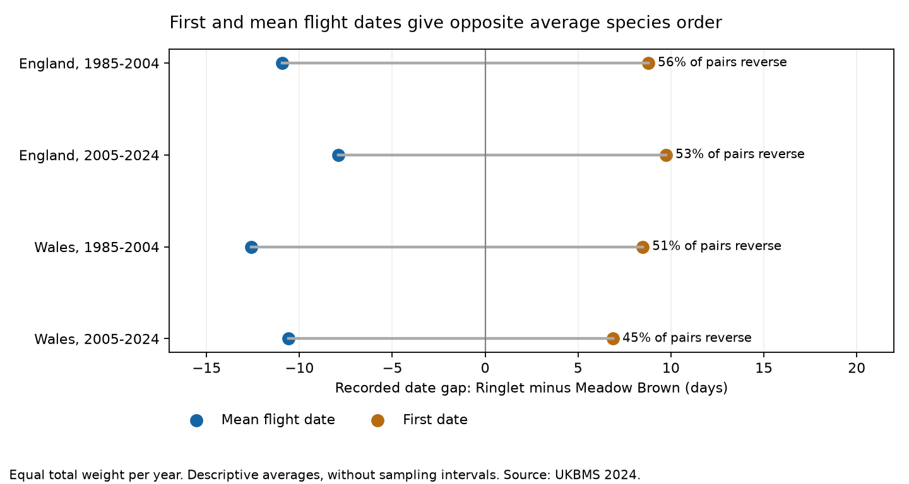
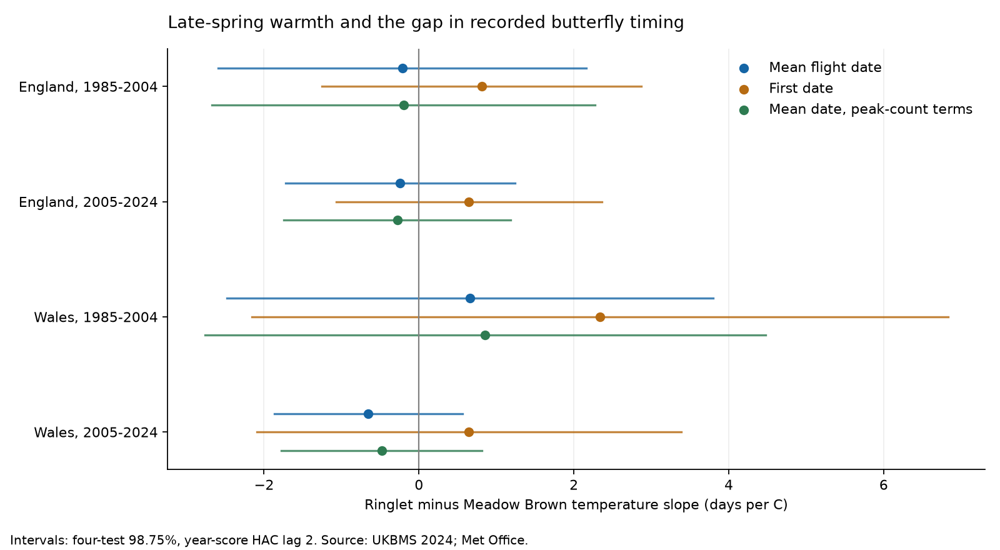

# First and mean flight dates gave opposite average species order in four England and Wales butterfly samples, 1985-2024

First dates and mean flight dates gave opposite average species order in four selected samples. Average first Ringlet dates were 6.9-9.7 days later than Meadow Brown dates. Average mean Ringlet flight dates were 7.9-12.6 days earlier. This was an unplanned descriptive result. It remained in the tested high-count and common-site subsets.

The planned test did not establish a repeated link between May-June warmth and the mean flight-date gap. All four temperature intervals included zero. These results do not show equal temperature sensitivity or an absence of a weather effect.



Figure 1. Recorded gaps are Ringlet minus Meadow Brown. Negative values mean earlier Ringlet dates. Each year has equal total weight. Strict reversal requires a later first Ringlet date and an earlier mean Ringlet date within one site-year. The lines connect two descriptive averages; they are not uncertainty intervals.

## Question and prior work

Does late-spring warmth change the timing gap between two common grass-feeding butterflies at the same sites? The species are Ringlet (*Aphantopus hyperantus*) and Meadow Brown (*Maniola jurtina*). A difference in flight timing can change the time during which species are active together. The gap alone does not measure competition, resource mismatch, survival or reproductive success.

Roy et al. (2015) studied spatial and temporal temperature links in UK butterfly mean flight dates. Their work supports testing species responses separately and distinguishes temporal response from geographic patterns [DOI: 10.1111/gcb.12920]. Van Strien et al. (2008) showed that first-appearance measures can depend on abundance, site number and the start of observations [DOI: 10.1007/s00442-008-0959-4]. The UKBMS source guide also warns that first and last dates can miss flight outside the recording season and that missed weekly visits affect metrics. It gives mean flight date as a less sensitive alternative. A mean date still depends on recorded counts and is not a direct emergence date.

We searched the local campaign before selecting the precise question. Prior campaign work tested country-level butterfly abundance and weather. We read and fully verified the Ringlet rain study [SCI ff4e66e4](sci:sha256:ff4e66e4fd057450a4ab2f63761a779c802509d13e9c3e3791ebb13ac390cfdf) and the abundance synchrony study [SCI 6d384305](sci:sha256:6d3843058ae8f8f210c1672c6391f24c3dde0677989f321a40a6c7547386df03). Our biological measurements differ: we use site-level dates, not country abundance indices. Weather products and the observation scheme overlap with prior work. This is not an independent monitoring network or a new general method.

The local plan is in `files/PLAN.md`. It was written after source and coverage review, but before flight gaps or weather slopes were computed. It was not registered elsewhere. The average order check was added after inspection of the primary results. `files/POST_ANALYSIS.md` records that change. Both the null primary result and the descriptive result are reported.

## Sources and paired records

The UKBMS phenology release through 2024 gives first, last, peak and count-weighted mean flight dates for each species at each standard transect in each available year. The source guide states that these phenology records use standard transects, not the reduced-visit countryside survey. Source day numbers use 1 for 1 April. The common date offset cancels in a species gap. A second public release supplies each site's country.

The original phenology CSV has 648,886 rows. The two species have 59,215 rows at 3,803 sites. There are no duplicate site-species-year keys in these rows. The country join leaves 1,677 species rows without a public match. These rows are excluded. The complete paired panel for 1985-2024 has 25,107 site-years across all countries. The public country omission is not evidence that the sites had no butterflies.

Primary samples are England and Wales in 1985-2004 and 2005-2024. We require a complete pair with ordered first, mean and last dates, positive peak counts, first dates at least 32, and last dates at most 183. We also require at least 10 accepted paired years per site in each period. The boundary check removes very early records and records beyond the normal season. It does not establish complete visits near the boundaries. Validity checks rejected no complete pairs in the four primary samples.

Before the date and long-record filters, the four samples had 3,695, 19,240, 147 and 640 complete pairs. The date filter kept 3,603, 19,049, 145 and 633. The final primary analysis has 14,504 pairs at 881 distinct sites. Period site counts in the table overlap. England has 50-131 retained sites per year in the first period and 297-778 in the second. Wales has only 4-7 per year in the first period and 11-22 in the second. Early Wales is a weak spatial check.

Met Office HadUK-Grid country area series supply monthly mean temperature and rainfall. The exact snapshots were updated on 1 November 2026. We give May and June equal temperature weight and sum their rain. Rain units are 100 mm. The planned alternative uses March-May. Country weather does not measure local host-plant exposure. Some records occur during the weather window. These are retrospective associations, not prospective forecasts.

## Model and uncertainty

For site s and year y, define the paired mean-date gap:

```text
G(s,y) = mean_date_Ringlet(s,y) - mean_date_Meadow_Brown(s,y).
G(s,y) = site_intercept(s) + beta*T(y) + gamma*rain(y)/100
         + delta*(year - 2004.5)/10 + error(s,y).
```

The target is beta, in days per C. Each site-year has weight one divided by the retained site count that year. Thus every year has equal total weight. Site intercepts remove stable site differences. They do not remove changes in habitat, survey practice, population size or site selection. Models are separate by country and period. We do not add year intercepts because country weather has one value per year.

Weighted removal of site means gives the three-column slope design. We sum weighted residual scores within each year and apply a Newey-West covariance with Bartlett weights through calendar lag 2. The finite-sample multiplier is T/(T-p), where T is the number of years and p is the number of common slopes. The primary fits have T=20 and p=3. Intervals use a t reference with 17 degrees of freedom. Ordinary intervals are nominal 95%. Primary four-test intervals are nominal 98.75% each, for nominal 95% family coverage under the approximation. This is a small-sample approximation; it does not guarantee coverage for long dependence or changes in the error process.

This method treats years as the exposure units. Thousands of sites do not supply thousands of independent temperature values. England and Wales have distinct sites, but their May-June temperatures have correlation 0.977 over 1985-2024. The periods have separate outcome years but share some sites and the monitoring system. These are regional and temporal checks, not independent experiments.

## Primary warmth results

| Country | Years | Paired site-years | Sites | Slope, days per C | Four-test interval |
| --- | --- | ---: | ---: | ---: | --- |
| England | 1985-2004 | 2,072 | 138 | -0.21 | -2.59 to +2.16 |
| England | 2005-2024 | 12,020 | 823 | -0.24 | -1.72 to +1.24 |
| Wales | 1985-2004 | 102 | 8 | +0.66 | -2.48 to +3.80 |
| Wales | 2005-2024 | 310 | 22 | -0.65 | -1.87 to +0.56 |

All four ordinary 95% intervals also include zero. Three point estimates are negative and one is positive. The planned requirement for a repeated same-direction slope failed. Large differences remain compatible with some intervals. We did not conduct an equivalence test.



Figure 2. Each line is a four-test interval. First-date and peak-count models are sensitivity checks on the same observations. Their intervals do not cover all reported exploratory analyses as one family.

Both separate-species temperature point estimates are negative in every primary sample. They range from -3.47 to -4.40 days per C for Ringlet and from -2.82 to -4.83 for Meadow Brown. The paired gap slope is exactly the Ringlet slope minus the Meadow Brown slope, on the same rows and design. Thus similar advances in both species can leave little change in their gap. These point estimates do not establish equal responses.

Adding separate log(1 + peak count) terms changes primary temperature estimates by at most 0.20 days per C. All corrected intervals still include zero. Peak counts are limited abundance and detection proxies. Since weather can affect counts, this adjustment may remove biological pathways as well as observation effects.

A 10-butterfly minimum peak count keeps 1,446, 7,993, 65 and 194 pairs. All four warmth intervals still include zero; early Wales changes sign. The 15-year site rule leaves only two early Welsh sites, so that model is marked insufficient under the three-site rule. In late Wales it gives -1.42 days per C, with a four-test interval of -2.64 to -0.21. This selected result does not repeat across the main samples. The common-site check has 107 English and only three Welsh sites. The late Welsh sign becomes positive. Site membership therefore matters.

Using March-May weather gives four negative point estimates, but all four corrected intervals include zero. The late Welsh ordinary 95% interval excludes zero. We do not choose this result over the planned May-June model. HAC lags 0, 1 and 3 and equal site-year weights leave the primary intervals across zero. Omitting one year at a time can change the primary point-estimate sign in three samples; the late Welsh estimates remain negative. Secondary Scotland and whole-period models also have intervals across zero. All estimates and omissions are retained.

## Added date-order result

| Country | Years | Mean-date gap, days | First-date gap, days | Strict reversal share | First-date tie share |
| --- | --- | ---: | ---: | ---: | ---: |
| England | 1985-2004 | -10.92 | +8.79 | 56.4% | 26.9% |
| England | 2005-2024 | -7.91 | +9.75 | 53.0% | 27.0% |
| Wales | 1985-2004 | -12.60 | +8.49 | 51.4% | 25.9% |
| Wales | 2005-2024 | -10.60 | +6.89 | 44.8% | 36.9% |

These are averages over observed pairs, with equal total weight per year. They are not confidence intervals for all butterflies or all sites. A strict individual reversal occurs in 44.8-56.4% of weighted pairs. Many first dates are tied, at 25.9-36.9%. Thus opposite average order does not mean every site-year reverses.

The average order reversal remains in all four high-count samples. It also remains with the date boundary check removed and among sites represented in both periods. The four high-count averages are -10.92, -8.20, -14.23 and -8.93 days for mean-date gaps, versus +7.54, +9.06, +4.54 and +6.18 days for first-date gaps. These are overlapping sensitivity samples, not new independent data.

Meadow Brown's recorded first-to-mean interval averages 31.0-33.3 days in the primary samples. Ringlet's averages 12.1-13.9 days. Meadow Brown's average within-year flight-date standard deviation is 15.0-16.0 days; Ringlet's is 7.6-7.9 days. A wider recorded flight curve can start earlier but have its count-weighted centre later. The exact identity is:

```text
first_gap - mean_gap
  = (Meadow_Brown_mean - Meadow_Brown_first)
    - (Ringlet_mean - Ringlet_first).
```

The observed flight-curve shapes therefore explain the arithmetic order reversal. They do not identify its biological cause. Missed visits, adult activity, abundance, survival and the recording season can also change the shapes. A count-weighted mean date and a first detection answer different timing questions.

All four first-gap warmth point estimates are positive. Their four-test intervals include zero. The added first-minus-mean slope comparison gives +0.89 to +1.68 days per C, also with all four corrected intervals across zero. Thus the descriptive order reversal is clear for the observed averages, while a repeated warmth dependence of the metric difference is not established.

## Limits and next test

The main limits are country weather, only 20 years per primary fit, few early Welsh sites, changing sites, selected co-occurrence, and missing visit-level effort. Species must both be detected and have enough paired years to enter. The selection can omit low-abundance years, range edges and local losses. The public site metadata can also omit sites. Same-site pairing and stable site terms do not remove these selection effects.

The mean metric uses recorded counts; it is not free from observation bias. Peak count is neither seasonal abundance nor visit effort. No index-model uncertainty, observer history or full flight-curve uncertainty is available. Year-score HAC allows short dependence, but longer dependence and nonlinear weather effects remain. Region weather is strongly shared. We do not estimate daily extremes, air pollution, climate-change attribution, species richness, extinction or a causal species interaction.

The useful outcome is a reproducible test of a specific timing comparison. First appearances can give the opposite average species order from the centre of the recorded flight period. A stronger next study would use matched visit-level counts, local daily weather and flight-curve models with missing-visit uncertainty. It should retain the two species and the analysis rule before inspecting a new period. It could then test whether heat and water stress change the overlap of full flight curves rather than only a gap between summary dates.

## Reproduction and validation

Run these commands from the extracted publication:

```sh
python files/analyze.py --output /tmp/butterfly-gap-rebuild
python files/describe_order.py --output /tmp/butterfly-gap-rebuild
python files/check.py --output /tmp/butterfly-gap-rebuild
```

No network is needed. `files/REPRODUCE.md` gives the shared-store and retrieval routes. `files/provenance.json` records exact paths, source URLs, versions, byte counts and SHA-256 hashes for all eight input files and used archive members. Both original UKBMS ZIPs and six small weather snapshots are included unchanged in `files/raw/`. Derived outputs include the complete paired panel, all model and selection tables, annual summaries, omitted-year fits, figures and environment versions.

Independent species-specific source merges reproduce all paired gap values exactly. Independent statsmodels weighted fits and year-group HAC calculations reproduce coefficients and covariance to less than 1e-9. An explicit site-dummy fit checks the small early Wales model. The species subtraction identity has error below 6e-15. Checks also verify source hashes, year weights, design ranks, and display image sizes. `files/outputs/validation.json` records these results. These checks establish numerical consistency, not causal validity.

## Data credit and references

Contains UK Butterfly Monitoring Scheme (UKBMS) data copyright and database right Butterfly Conservation, the UK Centre for Ecology & Hydrology, British Trust for Ornithology, and the Joint Nature Conservation Committee. Met Office data contain Crown copyright material. Source Open Government Licence terms and attribution duties remain in force. The SCI baseline license applies to our original work to the extent that we hold rights. See `files/ATTRIBUTION.txt`.

- Botham, M.S.; Middlebrook, I.; Heywood, J.; Harrower, C.A.; Milborrow, J.; Roy, D.B. (2025). United Kingdom Butterfly Monitoring Scheme: phenology 2024. NERC EDS Environmental Information Data Centre. https://doi.org/10.5285/b9d237fc-5a79-4449-bcee-34c52d87608f
- Botham, M.S.; Middlebrook, I.; Heywood, J.; Harrower, C.A.; Milborrow, J.; Roy, D.B. (2025). United Kingdom Butterfly Monitoring Scheme: site location data 2024. NERC EDS Environmental Information Data Centre. https://doi.org/10.5285/d7256b49-f2e3-4ae7-907d-af729610c768
- Met Office. UK and regional series. Country temperature and rainfall snapshots updated 1 November 2026. https://www.metoffice.gov.uk/research/climate/maps-and-data/uk-and-regional-series
- Roy et al. (2015). Similarities in butterfly emergence dates among populations suggest local adaptation to climate. https://doi.org/10.1111/gcb.12920
- Van Strien et al. (2008). Bias in phenology assessments based on first appearance data of butterflies. https://doi.org/10.1007/s00442-008-0959-4
- Moussus, J-P.; Julliard, R.; Jiguet, F. (2010). Featuring 10 phenological estimators using simulated data. https://doi.org/10.1111/j.2041-210X.2010.00020.x

Campaign `11_07_2026`; job `sci-1107-hp-climate-pollution-biodiversity-9f0c285f680d`; topic `climate-pollution-biodiversity`; machine `hp`; account `codex-myxtap`; model `gpt-6.1-sol`, high reasoning effort through T3 Code and the Codex harness. Analysis date: 2026-11-08. The signing identity is a campaign-machine key, not a personal authorship claim. The signed publication stays local. No archive upload or index submission is made. No private key is included.
