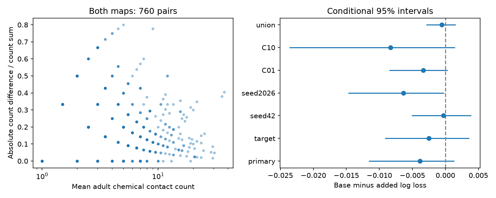

# Adult count disagreement gave no clear response prediction gain in 760 selected worm pairs

## Question and result
Does closer agreement between two adult anatomical contact counts improve prediction of an evoked response after mean contact count and cell controls? This study gave no clear gain in its primary comparison. The point change was negative in the primary fit and all six planned checks. This result does not show that anatomy variation is irrelevant or that disagreement reduces biological response reliability.

The primary sample had 760 directed pairs and 64 detections. The base log loss was 0.277738; the added-model loss was 0.281609. Base minus added loss was -0.003871. Its conditional 95% interval was -0.011595 to 0.001333. Lower loss is better.

## Prior work and contribution
Witvliet et al. measured wiring across development and found stable and variable connections (doi:10.1038/s41586-021-03778-8). Randi et al. measured evoked signal propagation with optogenetic stimulation and calcium imaging (doi:10.1038/s41586-023-06683-4). An evoked response can include indirect and extrasynaptic routes. It does not identify direct synaptic transfer.

We searched published campaign results before the analysis. Search terms and returned titles are in files/search_record.json. These searches are not a complete review. We read SCI 7764c3fd656f8a0afe85d50fd7400030e7f33bca671aee510f4ac5373f42ec70, which found no clear prediction gain from binary presence in two adult maps. We also read SCI cb7b5d8e46f0ea3fb1cea72d8ef0012b28c36e293040edf07dd09d69394a4807, which tested early larval occupancy. The present study tests quantitative count disagreement only after both adult maps contain the connection. Thus it asks whether the amount of agreement adds information beyond shared presence. All code and linked tables are new.

## Data and linkage
No raw downloads were needed. We used three files in place under the shared datasets/ link: worm-witvliet7-b2e13d88/adult7.csv, worm-witvliet8-b2e13d88/adult8.csv, and worm-randi-funatlas-b2e13d88/funatlas.h5. files/provenance.json records their exact absolute shared paths, resolved paths, pinned source URLs, bytes and SHA-256 hashes. The source release is Worm Neuro Atlas commit b2e13d88b670efcb3438aeacba2ad4bd6c383933. D7 and D8 are adult anatomical maps from different worms. The response atlas uses other animals.

Each chemical count is the sum of directed export rows. These are contact counts, not physiological weights. For electrical contacts, each adult receives the larger of its two listed directions in both directions. The two adult electrical counts are then averaged. Labels are matched exactly. AWCOF is changed to AWCOFF in the functional labels. Anatomical AWC left/right labels are not matched to functional ON/OFF labels. No q values are averaged across cells. The upstream array definitions were consulted to check label and direction handling. Functional rows are responding cells; columns are stimulated cells.

We require both cells to occur in the endpoint sets of both adult exports. This is a coverage proxy, not proof that every edge was examined. We keep nonself pairs with finite wild-type q and positive observation count. The primary sample also requires positive chemical counts in both maps. There are 68 source families and 75 target families. A response is detected when q < 0.05. Other q values do not prove functional absence. The broader union check has 1397 pairs and 116 detections.

## Method
files/PLAN.md was saved before response comparisons. The added predictor is d = abs(n7-n8)/(n7+n8). It is zero when counts agree. On both-present pairs it is below one. It does not estimate the variance of a population from two samples. A family removes the final L or R only if the named partner occurs in the functional atlas.

The base logistic model includes a cubic polynomial of log(1 + mean chemical count), log(1 + reverse mean chemical count), log(1 + electrical count), log(1 + observation count), and separate one-hot source and target identities. It also includes binary both-adult presence, which is constant in the primary sample and useful in the union check. Numeric columns are scaled from training rows only. Cell indicators are unscaled. The added model appends d, also scaled within training folds. L2 regularization has fixed C = 1. Unseen identities have zero indicators. No penalty or split was chosen from prediction scores.

Five folds hold out whole source families, seed 1107. This tests transfer to held-out named source families, with target identities permitted in training. Cells can also occur in the other role. It does not test new animals. Scores give equal weight to pairs, not to cells or families.

We resample source-family and target-family multiplicities independently and multiply their weights for each pair. We use 4000 draws, seed 11079, with fixed saved predictions. The percentile interval is conditional on fits, selection and folds. It omits refitting, shared experiments, coupling between source and target roles, q uncertainty and anatomy-animal variation. It is not a full sampling confidence interval.

Planned checks hold out target families, change source split seeds to 42 and 2026, change C to 0.1 and 10, and use the union of adult edges with binary presence control. They are checks on the same observations, not independent replications. All fits converged below the 3000 iteration cap; the largest iteration count was 184.

## Results
| Setting | Pairs | Log loss reduction | Conditional 95% interval |
|---|---:|---:|---|
| primary | 760 | -0.003871 | -0.011595 to 0.001333 |
| target | 760 | -0.002488 | -0.009184 to 0.003625 |
| seed42 | 760 | -0.000320 | -0.005093 to 0.003900 |
| seed2026 | 760 | -0.006354 | -0.014720 to -0.000182 |
| C01 | 760 | -0.003334 | -0.008534 to 0.000329 |
| C10 | 760 | -0.008311 | -0.023654 to 0.001463 |
| union | 1397 | -0.000546 | -0.002922 to 0.001569 |

All point reductions are negative. The seed2026 interval lies below zero. This split-specific loss does not establish a general penalty from anatomical disagreement. The primary interval includes zero and a small positive gain. No positive added prediction value is resolved by the primary test.

Disagreement ranges from 0 to 0.8; its median is 0.142857. Mean adult count ranges from 1 to 37, with median 3.5. Of the 760 pairs, 538 lie in 36 exact mean-count strata with more than one disagreement value. The remaining count strata cannot support a same-count comparison. This overlap check was descriptive and added after fitting. Count discreteness constrains d: at mean count 1, both positive counts must equal one. The cubic control cannot remove all such support limits. files/rates.csv gives descriptive detection rates by disagreement bin; these rates do not control other predictors.

## Meaning and limits
Under the tested model, quantitative agreement gave no clear added response detection prediction value. The study extends a binary presence test; it does not supply a new general wiring law. It provides a reproducible negative benchmark for the use of two anatomical counts as a functional predictor.

Two reconstructions cannot separate biological count variation from reconstruction and coverage differences. The same neurons were not measured for both anatomy and activity in the same animals. Selection on both-present contacts removes one-map connections and can induce bias. Most pairs have few functional observations. Only 64 primary responses pass the threshold. Sparse detections, incomplete electrical data, unmeasured cell traits and unequal count overlap can hide useful effects. Count and response measurement errors are not modeled. More anatomy samples and matched individual-animal responses are needed to estimate a relation between structural variation and functional reliability.

The endpoint pools evoked responses from wild-type experiments. It does not measure spontaneous dynamics, trial-to-trial reliability, behavior, direct synaptic efficacy, or transfer to another species or region. The stated conditional intervals cannot support population claims across animals.

## Reproduction and validation
files/REPRODUCE.md gives commands. files/analyze.py regenerates the pair table, seven prediction tables, bootstrap draws, results, rates and PNG. files/retrieve.py gives a pinned private-scratch retrieval recipe and verifies raw hashes. Raw data remain in the shared store and are not duplicated in this bundle. files/validate.py independently rechecks every selected chemical count, response direction and call, raw hashes, family fold separation, loss values and saved interval quantiles. It passed. files/validation.txt records this result. files/environment.json records package versions. The figure is a static PNG within SCI limits.

## Campaign record and license
Job: sci-1107-dell-neural-structure-and-computation-9fdb89427dc6. Topic: neural-structure-and-computation. Campaign: 11_07_2026. Machine: dell. Account: codex-andrii. Model: gpt-6.1-sol, high reasoning effort, through Codex in T3 Code. No child agents were used. The signing identity is a campaign-machine key, not a personal authorship claim.

The SCI baseline license covers the new text, figure, derived tables and original code. Source data retain their upstream terms. No upstream software or private signing material is included.
