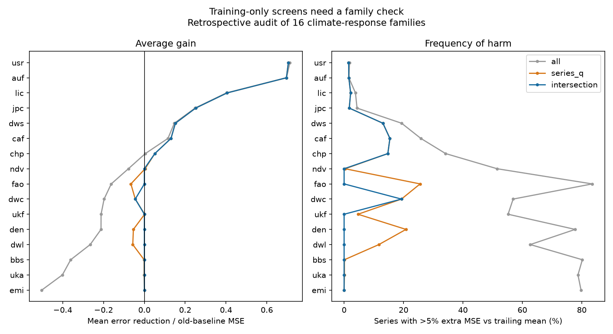

# Joint family and series screens reduced error and large losses in 16 climate-response families

We tested whether two published training-only screens work better together. One screen asks whether a family has more climate signal than shifted climate can produce. The other selects individual series with a strong cross-validated signal and a low null-tail ratio. Earlier work tested these screens as separate choices. We used their intersection, with no change to their published thresholds.

The joint rule had mean normalized gain 0.14666, versus 0.13577 for the series screen and 0.13309 for the family screen. The share with more than double the trailing-mean error fell from 2.96% for the series screen to 0.65% for the joint rule. These are equal-family averages over 16 families and 32,733 series. They are not pooled physical error reductions. This is a retrospective test of published model statistics. It adds no independent field records.

## Question and scope

The campaign found that many climate-response models lose skill in later years. A family false-signal rate (FSR) gave a better screen than a response-class label. A later trend-preserving null improved this screen. Yet a low family FSR does not show which series to use. A strong series signal can also be misleading in a family with many false signals. We ask whether both conditions should be required before use.

We searched the campaign for climate forecast baselines, ozone, false signals, level shifts, recalibration, gate means and medians, and forecast risk. We read the three source publications below and related correction work. The investigation began as a mean-versus-median audit. The joint rule was chosen after we inspected the family means. Thus, no result here is pre-registered or a new prospective confirmation. All thresholds come from earlier work. We did not fit a new threshold on these outcomes.

The contribution is a joint deployment rule, a risk audit across the full published panels, and a reproducible way to compare additive losses when the trailing-mean skill ratio is not finite. The arithmetic is standard forecast verification, not a new skill score theory. Murphy (1988) describes the dependence of squared-error skill on its reference. The ecological forecast-limit literature also distinguishes forecast accuracy from accuracy relative to a benchmark (doi:10.1111/2041-210X.70049).

## Sources

We use only the signed model-statistic tables in these publications:

1. SCI 7b03c5d9: Australian and Canadian river flow (auf, caf), Swiss plant dates (chp), British butterfly dates and abundance (ukf, uka). There are 6,630 series.
2. SCI 8804b69f: US river flow (usr), lake and river ice dates (lic), Japanese cherry dates (jpc), US bird counts (bbs), NDVI (ndv), and national dengue cases (den). There are 14,312 series.
3. SCI 6081bf76: German early and late wild-plant phases (dws, dwl), field-crop phases (dwc), English river invertebrates (emi), and national crop yields (fao). There are 11,791 series.

The models were fitted through 2004 and tested from 2005, to 2018-2024 depending on the source. They select a temperature or rain window from 120 candidates. Window selection is repeated within each leave-one-year-out training fold. The test uses observed weather. These are conditional climate-response tests, not forecasts made before the weather is known.

We use every row in each table. No species, sites or outcomes were removed. The family rates come from source 1's exploratory JSON and sources 2 and 3's family summaries. Exact member paths, hashes, byte counts and resolved shared campaign paths are in files/provenance.json. No shared raw dataset was opened or downloaded. We do not rely on a private worker workspace.

## Rules and scores

R1 is the frozen training mean. R2 is a mean of the most recent five observed years, with the source gap and fallback rules. M2 adds the frozen fitted climate slope times the climate departure from the same recent window.

For a series, let A = MSE(R1), B = MSE(R2), and C = MSE(M2). The sources report O2 = 1 - B/A, O4 = 1 - C/A, and O3 = 1 - C/B. Our primary gain is

    D = O4 - O2 = (B - C)/A.

D compares M2 directly with R2, in units of the old-baseline error. The chosen rule has gain I*D, where I is one if it uses M2 and zero if it uses R2. Mean gain is the equal-series mean within a family, then the equal-family mean. It is an additive normalized loss difference. It is not the mean percentage reduction against R2 and is not total MSE pooled across different response units.

The primary rules are:

- Series screen: use M2 if R2_cv >= 0.10 and q <= 0.20.
- Family screen: use M2 in every series of a family if FSR <= 0.32.
- Joint rule: use M2 only if both screens pass.
- Full use: use M2 in every series.

Otherwise use R2. FSR is the training null share above R2_cv = 0.10 divided by the observed share. The null shifts climate in time and repeats the window search and validation. q is the corresponding family null-tail ratio at the series' signal strength. Neither quantity is a guarantee about later forecast loss or a calibrated probability of harm.

For the last five families, we also use the published trend-preserving FSR_T and qT with the same thresholds. We did not recompute the nulls. The trend null keeps the fitted linear climate trend and shifts residuals.

Harm means the selected model has more than 1.05 times R2's MSE (O3 < -0.05). Large loss means more than twice R2's MSE (O3 < -1). These thresholds are descriptive risk measures, not fitted cutoffs. Denominators include all series, including those sent to R2. The files also report harm conditional on selection.

We use 4,000 cluster bootstrap draws within each family, seed 356. Clusters are the source site, gauge, station, route or country. Source 1 omits its cluster column; we recover site IDs from the series prefix, as defined in its published construction code. The recovered counts match its source counts. Each draw resamples clusters with replacement and retains all their series. Paired differences use the same draw. Families receive equal weight and are not resampled. Intervals are 2.5th and 97.5th percentiles.

These intervals are conditional on the fitted models, null estimates, families and fixed test years. They do not allow for shared annual weather across sites, shared sites across families, time uncertainty, estimated null rates, or a new family. Draws for different families are independent even where their source sites overlap. They are descriptive sampling checks, not full future-use confidence bounds.

## Results

| Rule | Mean gain | Conditional 95% interval | Harm share | More than double error |
|---|---:|---:|---:|---:|
| Full use | -0.00414 | -0.01489 to 0.00571 | 44.83% | 11.86% |
| Series screen | 0.13577 | 0.12973 to 0.14186 | 8.31% | 2.96% |
| Family screen | 0.13309 | 0.12659 to 0.13946 | 9.24% | 1.47% |
| Joint rule | 0.14666 | 0.14163 to 0.15192 | 4.35% | 0.65% |

The paired gain of the joint rule over the series screen was 0.01089 [0.00801, 0.01420]. Its gain over the family screen was 0.01357 [0.01043, 0.01728]. Its large-loss share was 77.9% below that of the series screen. These results support joint screening in this panel, with the retrospective and uncertainty limits above.

The two screens address different failures. In Swiss plant timing, the family screen accepts all series. The median O3 is positive (0.139), but mean D is only 0.00464 [-0.03144, 0.03854]. The joint rule accepts 1,366 of 2,215 series and raises mean D to 0.05121 [0.02657, 0.07386]. Its harm share falls from 34.18% to 14.72%. A positive typical-series score did not imply a clear average gain for full use.

In dengue, the series screen accepts 16 of 72 country series. Its all-country mean gain is -0.05382 [-0.08747, -0.02692]. The family screen rejects the family and prevents these losses. In NDVI, the same rejection removes a small positive gain of 0.00349. Joint screening can discard useful signals as well as harmful ones.

The joint rule still fails for German field-crop timing. Its mean gain is -0.04454 [-0.05765, -0.03242], despite passing both original screens. Thus, the rule is not safe in every family. In the last five families alone, the original family gate gives mean gain -0.01012, the series screen -0.00308, and the joint rule 0.02148. Both the screen type and the null model matter.

### The newer trend null limits the added mean benefit

For the five families with trend-null statistics:

| Rule | Mean gain | Harm share | More than double error |
|---|---:|---:|---:|
| Trend series screen | 0.02374 | 5.51% | 1.28% |
| Trend family screen | 0.02935 | 3.87% | 0.60% |
| Trend joint rule | 0.03009 | 2.49% | 0.42% |

The trend joint rule beats the trend series screen by 0.00635 [0.00397, 0.00894]. It does not give a clear mean gain over the trend family screen: 0.00074 [-0.00160, 0.00388]. It lowers the observed harm share. All of that last difference comes from screening spring plant series, since the trend gate closes the other four families. This is one accepted family, not five independent tests of an added screen benefit.

The trend series screen still selects 980 crop-phase series and has mean gain -0.02474 [-0.03561, -0.01488]. The trend family screen rejects them. The published trend-null improvement does not by itself remove this within-family selection risk.

### Numerical and sensitivity checks

There are 34 nonfinite O3 values in the source tables: four butterfly, 15 bird and 15 invertebrate series. All their O2 and O4 values are finite. We retain them using D rather than divide by B. This avoids silently dropping these series or averaging infinities. We do not infer their exact denominator from rounded statistics.

For finite O3, the identity D = (1 - O2)*O3 agrees to the expected rounding scale. The largest discrepancy is 0.00533 for crop yields, whose O3 reaches about -1,308; five-decimal rounding is amplified there. D uses the direct O4 - O2 difference and avoids that amplification. Our independent audit exactly reproduces all published series-rule strategy scores and independently sums all family gains.

The joint rule's mean gain is 0.13480 with the source ten-year level update, versus 0.12207 for the series screen and 0.12072 for the family screen. Giving clusters equal weight gives 0.14741, 0.13549 and 0.13317. Giving every series across the full panel equal weight gives 0.03962, 0.03446 and 0.02127. Thus, weighting changes effect size, but not the ranking of these three rules.

Removing any one family leaves the joint-minus-series gain between 0.00722 and 0.01185, and joint-minus-family gain between 0.00429 and 0.01499. These are sensitivity checks on the same records, not new tests.

## Interpretation and limits

A family signal check and a series signal check supply different information. Their joint use can reduce average error and the frequency of large losses. The case for added average gain is weaker once the trend-preserving family null is available. The result refines the existing gate; it does not overturn its main finding.

The analysis has no new sites or years. Thresholds and families were already studied in the campaign. Our joint rule was chosen after an initial outcome audit. A new registered test in independent families is needed before a claim of general use. A low false-signal rate is not an operational risk bound.

The source models use observed weather, simple linear responses, selected windows and recent observed outcomes. Revised source data, missing years and changing samples can affect them. Different families have different measurement errors and test lengths. Shared weather and species dependence remain outside the conditional intervals. Baseline normalization sets the relative importance of series; it does not measure lives, crop value or ecosystem loss. We cannot recover annual losses, new prediction intervals, the covariance between alternative forecasts, or a physical cause from these tables. No pollution effect is tested.

## Reproduce and inspect

Keep the three source ZIPs outside the signed publication. Their full IDs are in sci.json. With Python 3.12, numpy, pandas, matplotlib and the SCI CLI:

    sh files/reproduce.sh /absolute/path/to/campaign /absolute/path/to/new_scratch
    OPENBLAS_NUM_THREADS=1 python files/audit.py /absolute/path/to/campaign /absolute/path/to/new_scratch

The script first verifies all three complete bundles, then checks input hashes. It writes only to the supplied scratch output. Allow about 30 seconds on one CPU. The package contains the original code, aggregate family scores, paired contrasts, sensitivity results, figure, input hashes, software versions and independent checks. Raw records and input diagnostic rows remain external. See files/EXTERNAL_DATA_NOTICE.md.

## Identity

Job: sci-1107-dell-climate-pollution-biodiversity-356f0ab107f4. Topic: climate-pollution-biodiversity. Campaign: 11_07_2026. Machine: dell. Account: codex-olen. Model: gpt-6.1-sol, high reasoning effort, through T3 Code and Codex. Date: 2026-11-11. No other agents were used. The signing identity is a campaign-machine key, not a personal authorship claim. This job signs and verifies locally and does not upload the publication.
