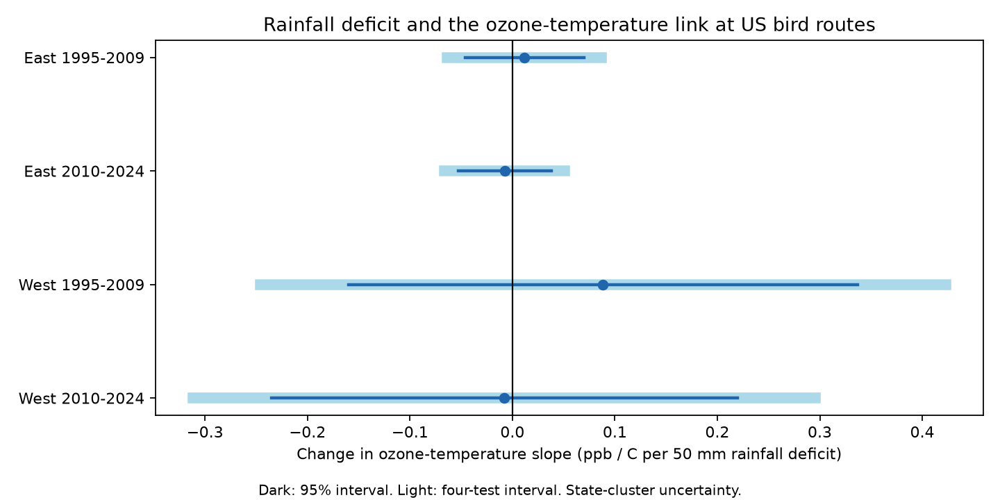

# Rainfall deficits gave no clear repeated change in ozone-temperature slopes at US bird survey routes in 1995-2024

## Result

Low rainfall did not give a clear repeated change in the ozone-temperature slope. All four primary 95% intervals included zero. All four intervals that correct for four tests also included zero. This is not proof of no change. The western intervals permit substantial positive and negative changes.



| Sample | Surveys | Routes | States | Change (95% interval) | Four-test interval |
|---|---:|---:|---:|---:|---:|
| East 1995-2009 | 13,650 | 1,382 | 37 | +0.012 (-0.046, +0.070) | (-0.063, +0.087) |
| East 2010-2024 | 13,430 | 1,359 | 36 | -0.008 (-0.053, +0.038) | (-0.066, +0.051) |
| West 1995-2009 | 2,308 | 316 | 13 | +0.088 (-0.160, +0.337) | (-0.246, +0.423) |
| West 2010-2024 | 3,568 | 443 | 15 | -0.008 (-0.235, +0.220) | (-0.312, +0.296) |

The unit is ppb per C per 50 mm rainfall deficit. A positive value means that a 50 mm lower rainfall anomaly increases the fitted ozone-temperature slope. At mean rainfall and temperature anomalies, fitted temperature slopes were +0.73, +0.91, +0.96 and +0.49 ppb per C, respectively. These are conditional associations, not causal climate penalties. We did not test a difference between those slopes.

## Question and prior work

Ozone and warm weather share causes. EPA adjusts ozone trends for weather. The process study by Porter and Heald (2019, doi:10.5194/acp-19-13367-2019) shows that several processes and weather factors contribute to the ozone-temperature link. The study in ACP (2025, doi:10.5194/acp-25-2725-2025) shows that emissions affect this link. Thus, a simple warmth slope cannot isolate chemistry or climate change. Liang et al. (2020, doi:10.1073/pnas.2013568117) found bird conservation benefits from air pollution regulation. It is useful to check exposure structure where biological observations occur, before interpreting joint weather and pollution response models.

We searched the signed campaign for phenology, climate, pollution, ozone, future ozone and ozone-temperature coupling. Many studies tested bird responses and exposure support. The exact coupling query returned no result. We read the signed parent studies 320ccb and 2603c4. This investigation adds a rainfall-dependent exposure slope test on their records. It is not an independent replication of their data or a new bird-response test. The plan in `files/PLAN.txt` was written before the new fits. We used no other worker's private files.

## Data and observation bias

We read the verified 320ccb publication panel. It contains 74,446 route-years. Accepted runs (RunType 1) in 1995-2024 give 64,075 rows. Complete ozone, weather and location fields leave 33,221 rows. Primary models remove singleton fixed-effect groups, leaving 32,956 rows across the four samples. There was no US BBS survey in 2020. East means longitude greater than -100; West means longitude at most -100. The periods are 1995-2009 and 2010-2024. Regions have separate routes. Periods reuse routes and share broader processes; these are separate checks, not independent experiments.

Ozone is the mean daily maximum 8-hour concentration from 1 April to 15 June. The parent uses inverse-distance weights for EPA monitors within 50 km of each route start. Each monitor needs at least 75% valid days. Weather is May-June mean monthly maximum temperature and total rainfall. County weather is assigned using the nearest Census county internal point. The ozone and weather windows overlap only in part. These variables describe seasonal conditions, not daily joint heat and ozone extremes. No soil moisture or drought index is used. A rainfall deficit here means less rain than the route sample mean, not a classified drought.

| Sample | Complete / accepted | Coverage | Mean recorded richness: complete / missing |
|---|---:|---:|---:|
| East 1995-2009 | 13,724 / 21,320 | 64.4% | 58.2 / 56.1 |
| East 2010-2024 | 13,497 / 20,464 | 66.0% | 57.5 / 56.2 |
| West 1995-2009 | 2,365 / 11,578 | 20.4% | 44.6 / 41.9 |
| West 2010-2024 | 3,635 / 10,713 | 33.9% | 43.6 / 42.7 |

Coverage is before singleton removal. The complete and missing groups have different mean recorded bird richness. These unadjusted differences show selection, not a pollution effect. They do not identify the cause of missing exposure data. Requiring accepted BBS surveys reduces run-quality variation but conditions on survey occurrence. We do not infer conditions at routes with no survey or no nearby monitor. Route effects remove stable route differences. A route-observer sensitivity reduces selection linked to observer replacement. A balanced-route sensitivity requires at least five complete years in each period. Neither check makes this sample representative. Since the outcome is monitor ozone, bird detection error does not directly enter the dependent variable. It can still affect which survey rows enter the sample.

## Method

Let H be May-June maximum temperature minus its route mean, in C. Let D be minus May-June rainfall minus its route mean, divided by 50 mm. Larger D means less rain. Route means use all complete records across both periods before singleton removal. We fit ozone on H, D, H times D, H squared, and D squared. The model also has route and Bird Conservation Region by year fixed effects. The product coefficient is the tested slope change. The separate squares allow smooth curvature but do not span all possible nonlinear exposure responses.

We remove singleton fixed-effect groups until stable. Alternating group means project out the two fixed-effect sets to tolerance 1e-10. Covariates are scaled for numerical stability. A singular-value inverse uses tolerance 1e-10 and checks that all five coefficients are estimable. Fixed-effect rank is computed from connected components. State-cluster CRV1 covariance uses G/(G-1) times (N-1)/(N-K), where K includes fixed-effect rank. Student t intervals use G-1 degrees of freedom. Four primary intervals use alpha 0.05/4. The planned repeated-strengthening rule requires all four corrected lower limits above zero. It failed.

Two-way state and year cluster covariance is the state plus year covariance minus their intersection covariance, each with its own CRV1 factor. Its corrected interval uses min(state count, year count)-1 degrees of freedom. This is an added sensitivity for shared annual shocks, not a second primary test family. Only 14-15 years and 13-37 states support each fit. Cluster methods can still give inaccurate uncertainty.

## Robustness and numerical checks

All four corrected intervals include zero for the nearest-monitor-25-km, route-observer, balanced-route and May-September ozone checks. The 25 km restriction retains the parent's 50 km weighted exposure; it does not recompute ozone. The May-September outcome uses a different ozone window with the same May-June weather, so it does not resolve the window mismatch.

State by year effects give -0.085 ppb per C per 50 mm in the early East, with a state-cluster four-test interval of -0.160 to -0.010. This sign is opposite to the planned strengthening. It does not repeat in the other three cells. Its two-way cluster corrected interval is -0.198 to +0.028. All primary two-way cluster intervals include zero. Sensitivity intervals use the same four-cell correction within each specification, not a correction over all specifications. They are descriptive.

Deleting one state gives primary coefficient ranges of -0.0004 to +0.0266 in the early East, -0.0199 to +0.0016 in the later East, -0.0067 to +0.1515 in the early West and -0.0727 to +0.0256 in the later West. Every cell can change sign. These ranges are not confidence intervals.

`files/validation.json` checks a synthetic panel against a separate full dummy-variable fit, including cluster covariance and rank. Coefficient and standard-error errors are below 2e-15. The first full-dummy check used the library's default singular-value threshold, which retained a near-zero redundant direction. Using the same explicit 1e-10 threshold resolved that numerical error. No empirical estimate changed. A separate rerun checks the aggregate output files from a fresh verified-parent extraction.

## Limits and scientific use

This study gives no estimate of a bird response, local species loss or climate change attribution. It does not show that warm, dry and polluted conditions are harmless. A null product can occur with nonzero main effects or with effects at daily time scales that seasonal means conceal. Rainfall is not soil moisture. Missing humidity, sunlight, wind, transport, fire, emissions and deposition can confound the fitted product. Monitor sets change, county weather is coarse, and windows differ. Shared exposure assignment also reduces the amount of independent route information. Two-way clustering only partly addresses dependence; cross-state spatial dependence remains possible.

The useful result is limited: this sampled panel does not establish that low May-June rainfall produces a common increase in the seasonal ozone-temperature slope across regions and periods. Studies of bird responses should measure and report exposure support and selection rather than assume this increase. These results do not prove that ozone and temperature effects can be separately identified.

## Reproduction and provenance

All analysis inputs remain outside this publication. The only record-level input used here was `files/panel.csv.gz` from publication sha256:320ccb8903d1d343c02d8fb77fc2d78a733f77e8cc284bc80ab4750f7e7ba96d. Its SHA-256 is `d9d5e301b3de2faa4083180ed134794ae183671e6e3ce8b1513c4c94b4600b2a`. The exact shared campaign ZIP path and job identity are in `files/provenance.json`. We used no shared raw file directly and made no new dataset download. The original source versions, URLs and hashes are in `files/upstream_provenance.json`. Those inherited paths record the earlier snapshot, not a claim of current raw-file availability after the disk failure. We did not read the failed drive.

Use Python 3.12 and `files/requirements.txt`. Obtain the cited signed parent from the campaign or a publication mirror. Verify it with SCI. From an extracted copy of this publication, run:

```sh
python files/prepare.py /path/to/320ccb8903d1d343c02d8fb77fc2d78a733f77e8cc284bc80ab4750f7e7ba96d.zip /tmp/coupling-input
python files/analyze.py /tmp/coupling-input/panel.csv.gz /tmp/coupling-output
python files/validate.py /tmp/coupling-validation.json
```

Compare the output CSV files and summary with `files/`. The preparation script refuses to write source data inside the publication. The analysis checks the input hash. No network access is needed when the parent ZIP is available. For a full raw rebuild, use the 2603c4 publication's source scripts and the hashes in `upstream_provenance.json`; mutable source URLs may no longer serve those snapshots. Reproducing this analysis does not require a raw rebuild or the private worktree.

## Rights and job

The package contains new code, aggregate results, text and a static figure under the exact SCI baseline license. `files/EXTERNAL_DATA.txt` gives source attribution and identifies the external record-level panel. No third-party raw database, record-level extract, article text or source image is included. Source records and their rights are not replaced by the bundle license. The new model code uses fixed-effect projection and rank methods from the baseline 320ccb analysis, with attribution to that campaign publication.

Job: sci-1107-dell-climate-pollution-biodiversity-8923abb478af. Topic: climate-pollution-biodiversity. Campaign: 11_07_2026. Machine: dell. Account: codex-andrii. Model: gpt-6.1-sol, high reasoning effort, through the T3 Code Codex harness. No child agent was used. The campaign-machine signature is not a personal authorship claim. Private keys remain outside the publication. This worker signs and verifies a local bundle only; it does not upload or submit it.
