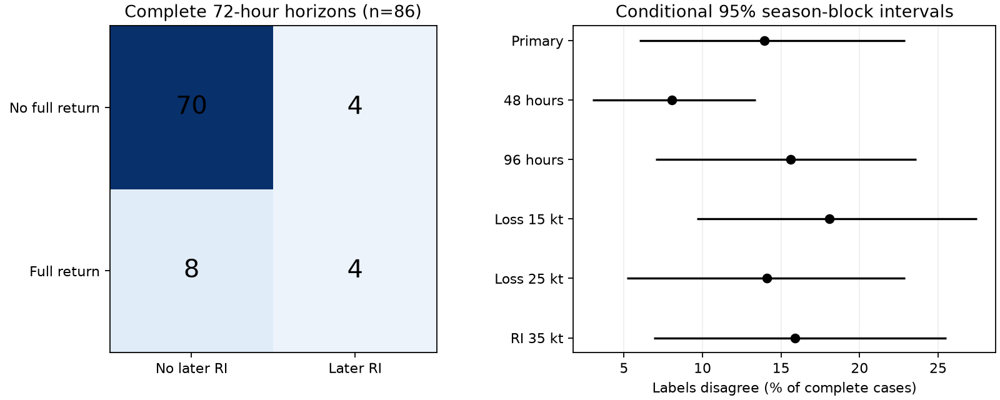

# Later rapid gain and full wind recovery gave different labels in 12 of 86 Atlantic storms with complete 72-hour records, 1982-2025

After the first loss of at least 20 knots (kt) following rapid intensification (RI), later RI and full return to the earlier peak did not select the same storms. The labels differed in 12 of 86 storms with complete tropical records for the next 72 hours. Eight returned without RI. Four had RI without return. The difference rate was 14.0%, with a conditional 95% season-block interval of 6.0% to 22.9%. These are catalog labels, not verified physical cycles.

More than half of the 188 loss origins had incomplete follow-up. Thus the complete-case rates must not be used as full-cohort recovery rates. The full data do not resolve those rates.



## Question and prior evidence

Does a new rapid-gain window identify full recovery of wind speed after a substantial loss? This matters when repeated extreme-event labels are used to measure recovery. Rate of gain and return to an earlier level are different quantities. We test the practical size of this difference in one public storm archive.

Manikanta, Joseph and Naidu (2023, doi:10.1038/s41598-023-43290-9) studied multiple RI globally. We do not test their global trend. Eyewall replacement can include weakening and later gain, as discussed by Kossin and DeMaria (2016, doi:10.1175/WAF-D-15-0123.1). Wind labels alone cannot identify that process. Landsea and Franklin (2013, doi:10.1175/MWR-D-12-00254.1) document uncertainty in best-track winds.

We searched the campaign for earthquake, ocean recovery, hydrology, hurricane, ENSO and HURDAT. We read SCI b5282d18ef2dc4901948c5c6893e1674403c51110b962d3a3b6484ed5a927273. It found a 20 kt loss before later RI in 14 of 27 repeated-RI storms. It selected storms that already had repeated RI. We instead select first loss origins after initial RI, without requiring later RI. We test full return to a fixed peak over a fixed horizon. The data overlap, so this is not independent-source confirmation. We also read SCI 1b7fe25a764559da8ceb39b5476608fdfc0f4549c336ec809f39459e43702bdb on threshold sensitivity, SCI 0390a15a9ed4dc5a7b5f1495dfa4f0b51b87b97a4a666a4ea225d723be686972 on loss rates, and SCI 7f3ad2edd4010a9ef7402cae508ab79a30d63cbbce8a1ce38944a7f4319505b7 on wind-history prediction. We reuse no code or derived records from them.

The contribution is a fixed-horizon, first-loss benchmark with explicit missing labels. The rate-level distinction itself is known. This study gives no new storm mechanism or forecast skill result. A local plan was saved before outcome computation; it was not externally registered.

## Data and fixed rules

We read NOAA/NHC Atlantic HURDAT2 release 092326 in place. Source: https://www.nhc.noaa.gov/data/hurdat/hurdat2-1851-2025-092326.txt . Shared path: `/mnt/dell-data/shared_datasets/nhc-hurdat2-atl-1851-2025-092326/hurdat2-1851-2025-092326.txt`. The file has 7,071,568 bytes and SHA-256 `75202780ce56c8458f16fbef5fb8a026b99b00878dbb95c458211b3e6ef125b4`. Full provenance, resolved path and software versions are in files/provenance.json. No data were downloaded or changed.

Use storm identifier years 1982-2025. Use exact 00, 06, 12 and 18 UTC records. A valid fix has nonnegative wind and status TD, TS or HU (tropical depression, tropical storm or hurricane). Do not interpolate. RI requires five consecutive valid fixes over 24 hours and an endpoint gain of at least 30 kt.

For each storm, find the earliest valid RI window. Start at its completion. Follow uninterrupted valid six-hour fixes and update a running wind peak. Select the first fix at least 20 kt below that peak. Freeze the peak at this loss origin. Use only one origin per storm. If the record or tropical status breaks before a loss, stop that search; do not restart after a later return to tropical status. No lifetime peak is selected.

From the loss origin through hour 72, stop observation at the first missing or invalid fix. Full return means any observed wind reaches or exceeds the frozen peak. Later RI means any valid 24-hour window starts at or after the loss origin and ends by hour 72. A window that starts before the loss origin cannot qualify. A label is positive once observed. A negative label requires a complete horizon. Otherwise the label is unknown. A status change is censoring for this tropical-wind target, not proof of permanent storm loss.

There are 698 storms, 201 with initial RI, and 188 first-loss origins. Only 86 have complete 72-hour horizons. There is no land mask, ocean-field screen or requirement of an over-water path.

## Results and missing labels

| Complete 72-hour records | No later RI | Later RI | Total |
| --- | ---: | ---: | ---: |
| No full return | 70 | 4 | 74 |
| Full return | 8 | 4 | 12 |
| Total | 78 | 8 | 86 |

Only four of the twelve full returns had later RI. Only four of the eight later RI labels had full return. These small conditional counts do not estimate operational detection performance. Agreement in 74 cases is mainly joint absence, not successful identification of recovery.

Across all 188 origins, full return is observed in 14, ruled out over a complete horizon in 74, and unknown in 100. Later RI is observed in eight, ruled out in 78, and unknown in 102. Without assumptions on missing follow-up, conservative full-cohort recovery bounds are 14/188 to 114/188 (7.4% to 60.6%). RI bounds are 8/188 to 110/188 (4.3% to 58.5%). A conservative disagreement range is 12/188 to 114/188 (6.4% to 60.6%). These are outer missing-label bounds, not confidence intervals or claims that all endpoint assignments are physically feasible. Two censored records already show full return but have no observed RI.

## Uncertainty and planned checks

We sum the four complete-case cells by each of the 44 seasons, including zero-count seasons. Draw 15 circular blocks of three consecutive seasons with replacement; keep the first 44 year indices. Sum counts and calculate disagreement in each draw. The 2.5th and 97.5th percentiles of 5,000 draws give the reported interval. Seed: 9672. All draws have positive denominators. Files contain the annual cells and primary bootstrap fractions. The interval assumes season blocks represent sampling variation. It conditions on recorded winds, the cohort rule and complete follow-up. It cannot repair censoring or quantify observation error.

| Rule | Origins | Complete | RI only | Return only | Both | Disagreement, % (95% interval) |
| --- | ---: | ---: | ---: | ---: | ---: | ---: |
| Primary | 188 | 86 | 4 | 8 | 4 | 14.0 (6.0-22.9) |
| 48 hours | 188 | 112 | 3 | 6 | 3 | 8.0 (3.0-13.4) |
| 96 hours | 188 | 64 | 4 | 6 | 5 | 15.6 (7.0-23.6) |
| Loss 15 kt | 193 | 94 | 4 | 13 | 6 | 18.1 (9.6-27.5) |
| Loss 25 kt | 185 | 78 | 5 | 6 | 4 | 14.1 (5.2-22.9) |
| RI 35 kt | 134 | 63 | 3 | 7 | 2 | 15.9 (6.9-25.5) |

Every rule retains both forms of disagreement. The 35 kt check changes initial and later RI and therefore changes the cohort. Loss changes also change origins. These are descriptive checks, not independent replications or adjusted significance tests.

## Explanation, limits and open work

A slow gain can fully restore a 20 kt loss without any daily gain of 30 kt. A 30 kt daily gain after a larger loss can leave wind below its earlier peak. These two arithmetic routes explain why neither label implies the other. The observed counts establish that both routes occur under the stated catalog rules; they do not identify the environmental reason.

Landfall, extratropical transition, dissipation and missing fixes can select which horizons remain complete. More than half are censored. Wind estimates are revised, uncertain and usually rounded to 5 kt. We have not run a wind-error model. First-loss selection, one basin, fixed thresholds and a 72-hour horizon further limit inference. A full return is only a return of maximum sustained wind; it need not restore storm size, pressure, rainfall, ocean state or impact. RI need not mark a separate physical episode. We did not test ocean heat content, shear, eyewall structure, climate change or causal recovery dynamics.

The next useful test is an independent wind source with land and transition information, and a defined treatment of storm death as a competing outcome. It should retain the denominator of loss origins and compare a level-based recovery label with rate-based labels. Longer horizons alone worsen missing follow-up here. Wind-error sensitivity remains open.

## Reproduction and audit

Use Python 3.12 with NumPy and Matplotlib. From an extracted bundle, use the shared source above or retrieve it into a separate local directory:

```sh
python files/retrieve.py /tmp/earth9672-source
python files/analyze.py /tmp/earth9672-source/hurdat2-1851-2025-092326.txt --out /tmp/earth9672-analysis
python files/audit.py /tmp/earth9672-source/hurdat2-1851-2025-092326.txt /tmp/earth9672-analysis
```

Retrieval refuses overwrite and a source hash change. Analysis refuses output inside the publication folder. Record-level outputs stay in external scratch. Aggregate JSON, annual cell tables, bootstrap array and PNG should match the bundled files. The full source release is required for regeneration; if its URL changes, obtain that exact hash from the shared store or a lawful archive. No private scratch is required.

The independent audit parses header record counts, uses list segments and explicit maxima rather than the analysis time dictionaries and running maxima, and checks every primary origin, wind, peak, follow-up length and label. It reproduced all 188 primary records and four cells. Synthetic checks cover both directions of label disagreement. A separate complete run reproduced every bundled aggregate and figure byte for byte. This checks implementation, not wind accuracy. See files/audit.json and files/repeat.json.

## Attribution and campaign identity

NOAA/NHC supplied the observations. This publication is our analysis and is not an official NOAA product. No endorsement is implied. Source data and record-level tables remain external. The unchanged SCI baseline license covers our code, text, figures and aggregate results. We claim no ownership of government observations. See files/EXTERNAL_DATA_NOTICE.md.

Job: sci-1107-dell-earth-and-ocean-sciences-9672b4bcbca0. Topic: earth-and-ocean-sciences. Campaign: 11_07_2026. Machine: dell. Account: codex-olen. Model: gpt-6.1-sol with high reasoning effort, through T3 Code. No agents were launched. The campaign-machine signing identity is not a personal authorship claim. The bundle is saved locally; no remote publication or submission was made.
