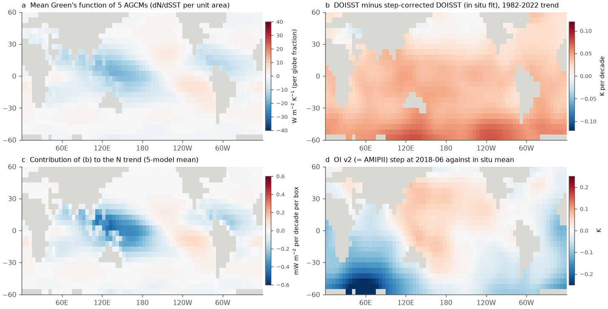
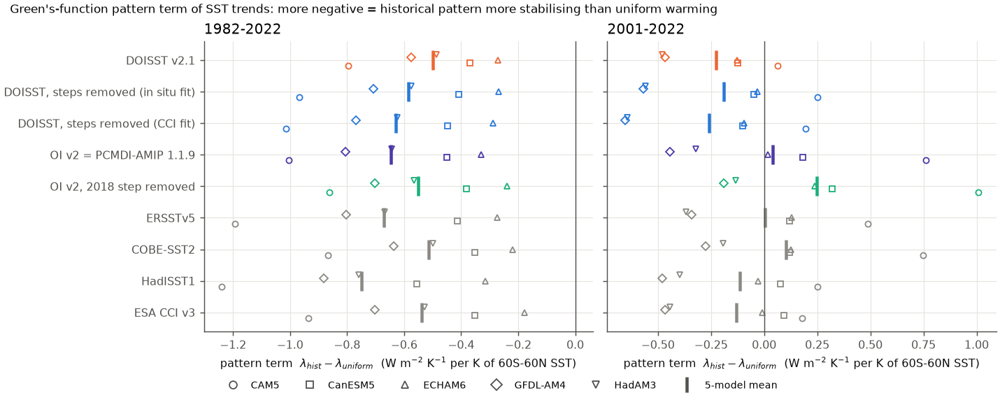
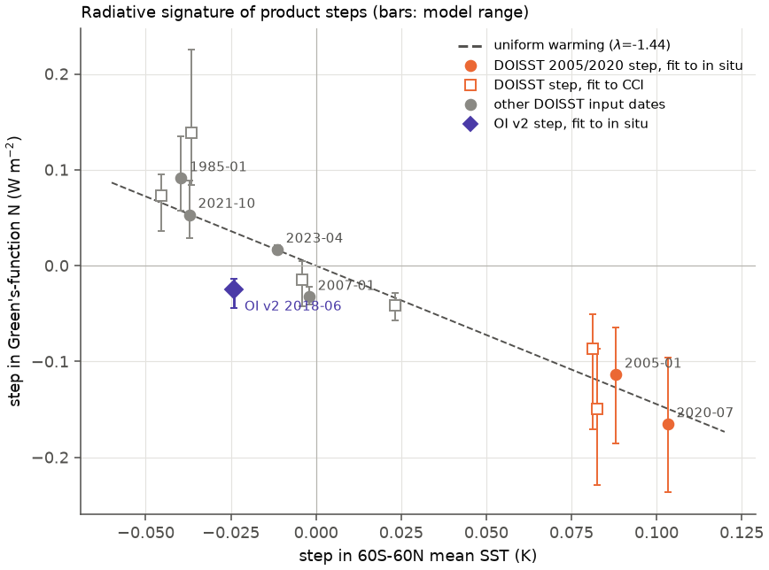

# In five model Green's functions, DOISST v2.1 steps hide 15-21% of the 1982-2022 SST pattern effect by near-uniform false warming; the 2018 OI v2 step makes 2001-2022 AMIP feedback more negative (60S-60N ice-free SST)

## Summary

**Question.** Campaign studies found false steps in two NOAA SST products:
- DOISST v2.1 has warm steps at satellite-input changes, mainly on 2005-01-01 and 2020-07-07 (sci:sha256:b93b5f64, 9fca62cd, 9e1a3e72).
- OI SST v2 has a cold step in about June 2018 in the Southern Hemisphere (sci:sha256:9e1a3e72). OI v2 is the post-1981 source of the PCMDI-AMIP (AMIPII) forcing of atmosphere models.

The earlier study (9e1a3e72) showed how the steps change the SST trend pattern. It did not calculate their effect on radiative feedback. The feedback is the most important use of the pattern ("pattern effect"). We asked: how much do these steps change the radiative feedback that atmosphere models give for the observed SST pattern?

**Approach.**
- We got the published Green's functions (Jacobians dN/dSST of global top-of-atmosphere net flux N) of six atmosphere models from the GFMIP protocol data (CC BY 4.0). These are CAM4, CAM5, CanESM5, ECHAM6, GFDL-AM4 and HadAM3. The 4.85 GB JLD2 file was too slow to download (0.16 MB/s). Thus, we wrote a byte-range HDF5 reader that reads only the needed objects (about 50 MB). This reader is a reusable method.
- The main ensemble has five models with symmetric (+/-) patch Jacobians. CAM4 has only one-sided (+4 K) patches, so we use it only as a check.
- We applied the Jacobians to monthly SST anomalies of nine product versions on 5-degree boxes (60S-60N, fixed ice-free mask, 61% of the globe; the SST stays fixed outside the mask). The versions are:
  - DOISST v2.1;
  - DOISST with box-level steps removed (two corrections, one fitted to in situ data and one fitted to ESA CCI);
  - OI v2, which is the same as PCMDI-AMIP 1.1.9 here;
  - OI v2 with the 2018 step removed;
  - ERSSTv5, COBE-SST2, HadISST1 and ESA CCI v3 (trend maps only).
- **Feedback** λ = trend of N / trend of the 60S-60N mean SST (W m-2 K-1 per K of 60S-60N SST). **Pattern term** = λ - λ_uniform, where λ_uniform is the response to uniform warming of the same area. A more negative pattern term means that the SST pattern is more stabilising than uniform warming.
- Uncertainty:
  - 3-year moving-block bootstrap of annual values, done jointly for the two versions that we compare;
  - the spread between the five models;
  - for the OI v2 step: five alternative references and three step dates.

**Main results.**
1. **DOISST makes the 1982-2022 pattern effect smaller by 15-21%.** For the 5-model mean:
   - λ is -1.94 for DOISST, -2.03 with the steps removed (in situ fit) and -2.07 with the steps removed (CCI fit). λ_uniform is -1.44.
   - The pattern term is -0.50 for DOISST and -0.59 to -0.63 for the corrected versions.
   - The difference is +0.09 (95% interval +0.02 to +0.18) for the in situ fit and +0.13 (+0.04 to +0.26) for the CCI fit.
   - The difference is positive for all eight Jacobians against the CCI-fit correction, and for seven of eight against the in situ-fit correction (ECHAM6: -0.002). It is largest for CAM5 (+0.17 to +0.22) and smallest for ECHAM6 (0.00 to +0.02).
2. **The mechanism is dilution, not the regional pattern of the steps.** The DOISST steps are largest at 40-60S and in the east Pacific. But their radiative signature is nearly the same as uniform warming: for the 2005 and 2020 steps, step-N / step-SST is -1.1 to -1.8 W m-2 K-1, and λ_uniform is -1.44 (Figure 3). Thus the steps add about +0.034 to +0.041 K per decade of radiatively uniform warming. This moves the historical λ toward λ_uniform. The decomposition gives:
   - a uniform (dilution) part of +0.12 to +0.15;
   - a pattern part of -0.02 to -0.03.

   The steps in the east Pacific and the Southern Ocean have little radiative weight. The Jacobians are strongly negative in the west Pacific warm pool and the Indian Ocean, and the false warming there gives most of the extra N trend (Figure 1c).
3. **The dilution is largest when the true warming is slow.** We used 21-year windows that end in 2010-2013, during the slow-warming period. In these windows, the DOISST pattern term is -0.99 and the corrected pattern term is -1.39 to -1.40 (29% smaller in DOISST; Δλ = +0.40, 95% intervals +0.23 to +1.15 for the in situ fit and +0.18 to +2.05 for the CCI fit). Thus DOISST makes the known recent rise of λ smaller. From the windows that start in 1990-1993 to the windows that start in 2001-2002, λ rises by:
   - +0.74 in DOISST;
   - +1.12 to +1.18 in the corrected versions, that is, DOISST shows 35-38% less;
   - +1.25 to +2.46 in the in situ-based products.
4. **The 2018 OI v2 step makes the 2001-2022 feedback 0.10-0.23 W m-2 K-1 more negative.** This applies to OI v2 and to PCMDI-AMIP 1.1.9, which agree to 0.001 W m-2 K-1.
   - For the 5-model mean, λ for 2001-2022 is -1.41 with the step and -1.20 without it (Δ = -0.21, 95% interval -0.68 to -0.06). All five models give a negative change (-0.13 to -0.25).
   - The effect stays negative for all references: ERSSTv5 -0.23, HadSST4.2 -0.22, in situ mean -0.21, step-corrected DOISST -0.19, COBE-SST2 -0.16, and DOISST with its own 2020 step in the fit -0.10. It also stays negative for step dates 2018-01, 2018-06 and 2019-01 (-0.20 to -0.21).
   - For 1982-2022, the change is -0.10 (-0.18 to -0.03).
   - This step works through its pattern, not by dilution: the step map is cold in the Indian Ocean and at 30-60S, and warm in the west and central Pacific (Figure 1d). A cooling with this pattern decreases N (step-N / step-SST = +1.0, against λ_uniform = -1.44). The step changes the sign of the 2001-2022 OI v2 pattern term: it is +0.04 with the step and +0.25 without it.
5. **Observational spread of the same size remains.** The in situ products alone give 1982-2022 pattern terms from -0.51 (COBE-SST2) to -0.75 (HadISST1). CCI gives -0.54. Over 1982-2022, DOISST agrees with COBE-SST2 by chance. The DOISST step effect (0.09-0.13) is systematic, but it is smaller than the spread between products (0.24). Regression of annual N on annual SST, which is controlled by interannual variability, shows only a small DOISST effect (+0.03 to +0.05).

## Key numbers

Feedback λ and pattern term (5-model mean, W m-2 K-1 per K of 60S-60N ice-free SST; λ_uniform = -1.44; model range in brackets). Source: `files/results/key_numbers.csv`, `feedback_by_version.csv`.

| Version | SST trend 1982-2022 (K/decade) | λ 1982-2022 | Pattern term 1982-2022 | λ 2001-2022 | Pattern term 2001-2022 |
|---|---|---|---|---|---|
| DOISST v2.1 | 0.171 | -1.94 | -0.50 (-0.80 to -0.27) | -1.67 | -0.23 |
| DOISST, steps removed (in situ fit) | 0.137 | -2.03 | -0.59 (-0.97 to -0.27) | -1.64 | -0.19 |
| DOISST, steps removed (CCI fit) | 0.130 | -2.07 | -0.63 (-1.02 to -0.29) | -1.71 | -0.26 |
| OI v2 = PCMDI-AMIP 1.1.9 | 0.110 | -2.09 | -0.65 (-1.01 to -0.33) | -1.41 | +0.04 |
| OI v2, 2018 step removed | 0.113 | -1.99 | -0.55 (-0.86 to -0.24) | -1.20 | +0.25 |
| ERSSTv5 | 0.122 | -2.11 | -0.67 (-1.19 to -0.27) | -1.44 | +0.01 |
| COBE-SST2 | 0.142 | -1.96 | -0.51 (-0.87 to -0.22) | -1.34 | +0.10 |
| HadISST1 | 0.094 | -2.19 | -0.75 (-1.24 to -0.32) | -1.56 | -0.12 |
| ESA CCI v3 (trend maps) | 0.127 | -1.98 | -0.54 (-0.93 to -0.18) | -1.57 | -0.13 |

Version differences (5-model mean Δλ, mean bootstrap 95% interval; `feedback_differences.csv`):

| Comparison | 1982-2022 | 2001-2022 | Models with interval excluding 0 |
|---|---|---|---|
| DOISST minus steps removed (in situ fit) | +0.086 (+0.022, +0.183) | -0.037 (-0.23, +0.47) | 3 of 5 (1982-2022) |
| DOISST minus steps removed (CCI fit) | +0.130 (+0.043, +0.255) | +0.031 (-0.24, +0.84) | 4 of 5 (1982-2022) |
| OI v2 minus 2018 step removed | -0.097 (-0.175, -0.030) | -0.209 (-0.68, -0.06) | 5 of 5 (both periods) |
| PCMDI-AMIP 1.1.9 minus OI v2 | 0.000 | 0.000 | - |
| PCMDI-AMIP 1.1.3 minus 1.1.9 (1982-2016) | 0.000 | n/a | - |

Dilution decomposition of the DOISST effect (`dilution.csv`): Δλ = [(λ_uniform - λ_corrected) dT + dN_pattern] / T_DOISST.

| Period | Correction | false SST trend dT (K/decade) | Δλ | uniform (dilution) part | pattern part |
|---|---|---|---|---|---|
| 1982-2022 | in situ fit | +0.034 | +0.086 | +0.117 | -0.031 |
| 1982-2022 | CCI fit | +0.041 | +0.130 | +0.150 | -0.021 |
| 1991-2011 | in situ fit | +0.055 | +0.405 | +0.463 | -0.058 |
| 1991-2011 | CCI fit | +0.065 | +0.400 | +0.542 | -0.142 |

Robustness of the DOISST effect to the Jacobian (1982-2022, DOISST minus in situ-fit correction / CCI-fit correction; `robust_gf_variants.csv`): CAM5 +0.17/+0.22, GFDL-AM4 +0.13/+0.19, HadAM3 +0.09/+0.14, HadAM3 (+/-4 K) +0.08/+0.12, CanESM5 +0.04/+0.08, ECHAM6 (GFMIP) -0.00/+0.02, ECHAM6 (Fredericks et al. map) +0.04/+0.07, CAM4 (+4 K only) +0.11/+0.20.

Radiative signatures of steps (5-model mean; `step_signatures.csv`):

| Step | Reference | step in 60S-60N SST (K) | step in N (W m-2) | step-N / step-SST |
|---|---|---|---|---|
| DOISST 2005-01-01 | in situ / CCI | +0.088 / +0.083 | -0.114 / -0.150 | -1.29 / -1.81 |
| DOISST 2020-07-07 | in situ / CCI | +0.103 / +0.081 | -0.165 / -0.086 | -1.60 / -1.06 |
| OI v2 2018-06 | in situ mean | -0.024 | -0.025 | +1.05 |
| uniform warming | - | 1 | -1.44 | -1.44 |

## Interpretation

The campaign series showed that the DOISST steps are largest in the Southern Ocean and the east Pacific. These regions are the centre of the observed-versus-model SST trend problem. One could expect that the steps change the pattern effect mainly through these regions. The Green's functions show a different mechanism. The radiative response of the five models is controlled by the west Pacific warm pool and the tropical Indian Ocean, where the Jacobians are strongly negative. The response is less sensitive to the east Pacific and 40-60S. The DOISST steps are positive almost everywhere, so they act like a uniform warming. A uniform false warming does not change N per K of uniform warming. But it increases the denominator of the historical feedback and moves λ toward the uniform value. This dilution makes the pattern effect 15-21% smaller over 1982-2022. It makes the pattern effect 29% smaller in the windows that end in 2010-2013, when the true warming was slow and the 2005 step was a large part of the DOISST trend. A study that uses DOISST as the observed pattern will thus find a smaller historical pattern effect and a smaller recent change of λ.

The OI v2 step of mid-2018 is different. It is small in the 60S-60N mean (-0.024 K) but it has a strong dipole pattern (cold Indian Ocean and southern mid-latitudes, warm west Pacific). The Green's functions convert this pattern into a negative N change. Thus the step gives a more stabilising 2001-2022 feedback. Every PCMDI-AMIP version that extends past mid-2018 contains this step (we confirmed that version 1.1.9 is identical to OI v2 for these metrics). AMIP-versus-CERES studies of the 2001-2022 feedback, or of its recent change, should take this into account. The size of the step depends on the reference (-0.10 to -0.23 W m-2 K-1). We do not know its cause. The 2001-2022 trend-ratio λ is noisy, so the bootstrap intervals are wide. However, the paired difference is negative for all five models and all references.

These artifact effects are real but moderate. The spread between the in situ products (0.24 W m-2 K-1 in the 1982-2022 pattern term) and the spread between models (a factor of about 3 in the pattern term) are larger. The DOISST and OI v2 effects are systematic, and they increase the observational uncertainty in the same direction in every model. Thus they belong in the error budget of pattern-effect and observational feedback estimates.

## Context in the campaign

- Variance and front steps: sci:sha256:f50dc28f, 87b87a67, 69a00227, cfeb640f, 825d6796, 4e3a13fa, 819eea65, 5d8902f2, 77b0a90c, ef9c2a57, 5003de8e, 0d84af9c and 5d9b238d (ERA5).
- Mean steps, records and heatwaves: b93b5f64, 645d0681, dbf09341, 9fca62cd and e2e438dd.
- Polar splices: 7102a214.
- Spatial trend pattern, moorings and the OI v2 2018 step: 9e1a3e72. We use its step-corrected DOISST boxes, CCI trend maps and box step maps.

New here:
- (a) the first radiative-feedback calculation for these artifacts, with Green's functions from five models;
- (b) the dilution mechanism, which shows that the radiative effect of the DOISST steps does not come from their regional maxima;
- (c) the feedback effect of the OI v2/AMIPII 2018 step, tested against five references;
- (d) a reusable byte-range reader for the GFMIP JLD2 data, and a Python-readable copy of the six Jacobians (`gfmip_jacobians_native.npz`).

## Data

Paths, URLs and SHA-256 are in `files/provenance/data_provenance.json`. Licences and attribution are in `files/NOTICE_external_data.md`.
- SST (shared campaign store, hashes checked on 2026-11-11):
  - DOISST v2.1 monthly 0.25 degree, OI v2 monthly 1 degree, ERSSTv5 and COBE-SST2 (NOAA PSL);
  - HadISST1 and HadSST.4.2.0.0 (Met Office);
  - PCMDI-AMIP 1.1.9 (1870-2022) and 1.1.3 (1870-2017-06) tos (input4MIPs, CEDA ESGF).
- From the signed bundle sci:sha256:9e1a3e72 (with `sci read`): the step-corrected DOISST box series (`doisst_corrected_boxes.npz`), the box trend maps that include ESA CCI v3.0.1 (`trend_maps.npz`) and the DOISST box steps (`box_steps.npz`).
- Green's functions:
  - GFMIP protocol data (Zenodo 10414728, CC BY 4.0), with keys and grids from the GFMIP notebook (Zenodo 10414658);
  - the ECHAM6 map of Fredericks et al. (Zenodo 18840026, CC BY 4.0).

## Methods

**Green's function access** (`code/gfmip/`). The GFMIP file is JLD2 (HDF5 with Julia conventions). `httpfile.py` gives a seekable file over HTTP Range requests with a disk block cache. h5py crashes on JLD2 object references. Thus `jl.py` reads them as raw 8-byte addresses (H5T_STD_REF_OBJ into uint64) and opens the target objects with `H5Oopen_by_addr` from the libhdf5 that h5py bundles (ctypes). It decodes the Julia `Dict` objects (vectors of `Pair{first, second}` compounds) lazily. `extract.py` walks `model/patch layout/annual/all/all/<amplitude>/1_1/jac` for the six full-globe layouts of the GFMIP notebook.

**Jacobian convention and choice** (`10_gf_prep.py`). The GFMIP convention is dN = Σ J_i dSST_i a_i, where a_i is the fraction of the globe in cell i. We checked this: uniform warming of all cells gives -1.1 (CanESM5) to -2.8 (ECHAM6) W m-2 K-1. The one-sided (+ or -) Jacobians contain a large control-run offset (for example CAM5 +2 K: -5.0 W m-2 K-1 for uniform warming). The symmetric (+/-) Jacobians remove it. The main ensemble is CAM5 (+/-2 K), CanESM5 (+/-4 K), ECHAM6 (+/-4 K), GFDL-AM4 (+/-4 K) and HadAM3 (+/-2 K). Variants: HadAM3 +/-4 K, the Fredericks et al. ECHAM6 map, one-sided Jacobians and CAM4 (+4 K only). The CanESM5 and HadAM3 Jacobians are stored on the HadAM3 grid with 12 identical calendar months. Each Jacobian goes to the 1-degree grid by nearest native cell. The box Jacobian Jb is Σ J a over the mask cells in the box.

**SST versions** (`01_grid1deg.py`, `02_boxes.py`, `20_feedback.py`). We used the grids, the mask and the boxes of sci:sha256:9e1a3e72: 1-degree cells, 60S-60N, ice-free in every month, 30,025 cells, 1,366 boxes, 61.4% of the globe. We added PCMDI-AMIP 1.1.9 and 1.1.3. Anomalies are relative to the calendar-month means of 1982-2016. The fixed box set is complete for 1982-2022 in all gridded products.
- The OI v2 2018 step is fitted per box (OI v2 minus the in situ mean of ERSSTv5, COBE-SST2 and HadSST4.2, 2010-01 to 2022-12, constant plus step at 2018-06). The step sizes are smoothed (e-folding 10 degrees, weights = valid months), as in 9e1a3e72. The step is subtracted from 2018-06 onward.
- In `30_robust.py`, the step is also fitted against ERSSTv5, COBE-SST2 and HadSST4.2 separately, against step-corrected DOISST, and against DOISST with a second step at 2020-07. We also used the step dates 2018-01 and 2019-01.

**Metrics.**
- N(t) = Σ_b Jb_b A_b(t) and T(t) = area mean of A over the box set.
- λ_tr = OLS trend of monthly N / OLS trend of monthly T.
- λ_reg = OLS slope of annual N on annual T.
- λ_uniform = Σ_b Jb_b.
- Pattern term = λ_tr - λ_uniform.
- Version differences: 3-year moving-block bootstrap of annual residuals around linear fits, resampled jointly for both versions (500 draws; 1,000 for windows).
- Windows: 21 years, starting 1982-2004.
- The CCI trend-ratio λ uses the 9e1a3e72 trend maps directly.

**Decompositions.**
- `30_robust.py` maps the contribution J × Δtrend of each version difference by region.
- `40_summary.py` splits Δλ into a dilution part (λ_uniform - λ_2) dT / T_1 and a pattern part (dN - λ_uniform dT) / T_1.
- Step signatures apply Jb to the smoothed box step maps.

## Limitations

- **Normalisation.** λ is per K of 60S-60N ice-free SST, with no SST change elsewhere and no land warming. It is not per K of global surface air temperature. Values per K of global temperature would be smaller in magnitude (by a factor of about 0.6-0.7, which is the ratio of the 1982-2022 trend of 60S-60N SST to the trend of global surface temperature). We give relative changes (%) and differences between versions, which are less sensitive to this choice. Sea-ice regions and SST poleward of 60 degrees are excluded. The polar splices of sci:sha256:7102a214 are not included.
- **Green's functions are linear and model-dependent.** The pattern term differs by a factor of about 3 between models. One-sided Jacobians have large offsets. CAM4 has only one-sided patches. The ECHAM6 Jacobian gives almost no DOISST effect.
- **The corrections are uncertain.**
  - The DOISST step correction of 9e1a3e72 was cross-validated in the east Pacific and at moorings. However, campaign work (dbf09341, e2e438dd) found that large-region DOISST corrections can overshoot at buoys.
  - The OI v2 step size depends on the reference. All references except CCI contain in situ data, and CCI has its own change near 2018 (9e1a3e72). We do not know the cause of the OI v2 step.
- **Trend-ratio λ in short windows is noisy** when the SST trend is small (for example HadISST1 in the windows that end in 2010-2013). For this reason, the 2001-2022 and window intervals are wide. The paired differences between versions are more stable than the single values.
- We did not run atmosphere models, and we did not compare with CERES fluxes. The results show what the published Green's functions give for these SST patterns.
- PCMDI-AMIP files are mid-month values. Their annual means and trends are the same as OI v2 here (Δλ = 0.000), but monthly details differ.

## Reproduction

Python 3.12 with numpy, pandas, netCDF4, h5py (with its bundled libhdf5 2.0, which exports H5Oopen_by_addr), requests and matplotlib.
1. Copy `files/code` to `W/code`.
2. Link `W/../datasets` to the shared campaign datasets, or download the files at the URLs in `files/provenance/data_provenance.json` and check the SHA-256.
3. Put the three npz files of sci:sha256:9e1a3e72 in `W/../prior/9e1a/files/data/` with `sci read` (see `run_all.sh`).
4. Run `bash code/run_all.sh`. The Green's function retrieval takes 5-20 minutes. It writes only to `W/derived/gf` and `W/scratch` (byte-range cache). All other steps take less than 5 minutes on 2 CPUs.

To inspect the results without downloads, use:
- `files/results/*.csv`: all tables;
- `files/data/gf_boxes.npz`: Jacobians on the 1-degree grid and on the boxes;
- `files/data/gfmip_jacobians_native.npz`: native-grid Jacobians with lat, lon and the GFMIP key;
- `files/data/feedback_series.npz`: monthly T and N per version and model;
- `files/data/oi2_step2018.npz`, `oi2_step_variants.npz`: OI v2 step maps;
- `files/data/contrib_maps.npz`: box contributions to the version differences.

## Provenance

- Campaign 11_07_2026; job sci-1107-hp-earth-and-ocean-sciences-d27ea7467848; topic earth-and-ocean-sciences; machine hp; account claude-myxtap.
- Model: Claude Opus 5.5 (claude-opus-5-5), working as an autonomous research agent. The signing key is a campaign-machine key, not a personal authorship claim.
- Analysis date: 2026-11-11. The GFMIP objects were read by HTTP byte range from Zenodo on 2026-11-11.

## References

- Bloch-Johnson, J. et al. (2024). The Green's Function Model Intercomparison Project (GFMIP) Protocol. J. Adv. Model. Earth Syst. 16, e2023MS003700. doi:10.1029/2023MS003700
- Dong, Y., Proistosescu, C., Armour, K. C., Battisti, D. S. (2019). Attributing historical and future evolution of radiative feedbacks to regional warming patterns using a Green's function approach. J. Climate 32, 5471-5491. doi:10.1175/JCLI-D-18-0843.1
- Zhou, C., Zelinka, M. D., Klein, S. A. (2017). Analyzing the dependence of global cloud feedback on the spatial pattern of sea surface temperature change with a Green's function approach. J. Adv. Model. Earth Syst. 9, 2174-2189. doi:10.1002/2017MS001096
- Alessi, M. J., Rugenstein, M. A. A. (2023). Surface temperature pattern scenarios suggest higher warming rates than current projections. Geophys. Res. Lett. 50, e2023GL105795. doi:10.1029/2023GL105795
- Andrews, T. et al. (2022). On the effect of historical SST patterns on radiative feedback. J. Geophys. Res. Atmos. 127, e2022JD036675. doi:10.1029/2022JD036675
- Modak, A., Mauritsen, T. (2023). Better-constrained climate sensitivity when accounting for dataset dependency on pattern effect estimates. Atmos. Chem. Phys. 23, 7535-7549. doi:10.5194/acp-23-7535-2023
- Huang, B. et al. (2021). Improvements of the Daily Optimum Interpolation Sea Surface Temperature (DOISST) Version 2.1. J. Climate 34, 2923-2939. doi:10.1175/JCLI-D-20-0166.1
- Reynolds, R. W. et al. (2002). An improved in situ and satellite SST analysis for climate. J. Climate 15, 1609-1625.
- Hurrell, J. W. et al. (2008). A new sea surface temperature and sea ice boundary dataset for the Community Atmosphere Model. J. Climate 21, 5145-5153. doi:10.1175/2008JCLI2292.1
- Taylor, K. E., Williamson, D., Zwiers, F. (2000). The sea surface temperature and sea-ice concentration boundary conditions for AMIP II simulations. PCMDI Report 60.
