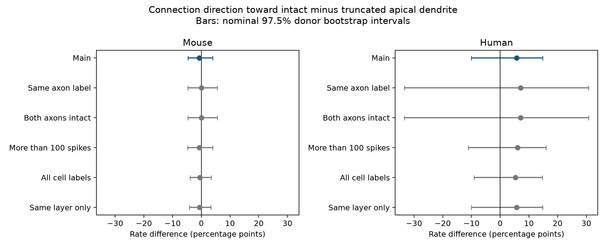

# Matched Allen slice pairs do not resolve a connection direction bias toward cells with intact apical dendrites

## Result

We tested whether apical dendrite preservation was linked to the direction of detected excitatory connections in Allen Synaptic Physiology r2.1 data. Each neuron pair had one intact and one truncated apical dendrite, both connection directions tested, and the same Cre label and target layer. Mouse visual cortex had 139 pairs from 57 inferred animals. The connection rate toward the intact cell minus the rate toward the truncated cell was -0.72 percentage points, with a nominal 97.5% donor bootstrap interval of -4.61 to 3.94. Human temporal cortex had 35 pairs from 10 inferred donors. Its difference was 5.71 points, with an interval of -10.00 to 14.81. Only 11 mouse pairs and four human pairs had a connection detected in one direction alone. Checks with equal axon labels also gave uncertain results. This paired audit does not resolve a direction bias or show equal rates. It cannot isolate target dendrite loss from source cell effects. We supply code, pair-level evidence, uncertainty draws and a reproducible data recipe.



The new contribution is a direct comparison of both tested directions of the same neuron pair, linked to morphology labels of those exact cells. The null result limits what this selected sample can establish. It does not establish a general rule about dendrites, neuronal computation or intact-brain wiring.

## Question and prior work

A circuit model built from a slice graph can inherit the effects of cut cell processes. We asked whether detected excitatory connections favor the cell whose apical dendrite is marked intact. The proposed mechanism is that a preserved target tree retains more possible contact sites. An opposite effect is also possible: a smaller target tree can change passive properties and response detection. These are hypotheses, not findings from this audit.

Campagnola, Seeman and colleagues describe local connection tests and response dynamics in mouse and human cortex (Science 2022, doi:10.1126/science.abj5861). The Allen methods describe multipatch recordings, stained cell fills and manual connection calls. The pinned database schema defines `apical_truncation` as a qualitative label. An intact label does not measure the survival of every dendritic branch. We use neither a full reconstruction nor an EM contact count.

We searched the public web for Allen slice methods and apical truncation. We searched the campaign with SCI for connectivity, synaptic and truncation before fixing the paired question. We read the published axon-preservation study (SCI 370bc73a...) and the published axon direction study (SCI be1bc665...). Both are cited by full IDs in sci.json. Our outcome concerns apical dendrites rather than axon labels. Equal axon labels are a sensitivity check. No sibling private workspace was read. No code or tables from those studies were reused.

## Data link and selection

The raw source is Allen Synaptic Physiology r2.1 small, schema 22. Pair IDs link connection calls and reciprocal directions. Cell IDs link those same recorded neurons to morphology. This link is direct within the recording. It does not require a match across animals or datasets.

The exact read-only query is in `files/evidence/query.sql`. We used mouse VisP and human TCx. Both neurons had nonsynaptic class ex. Each direction had a binary chemical connection call and more than 10 excitatory test spikes. Pair distance was greater than zero and at most 500 micrometres. We kept one unordered pair, using pair ID less than reciprocal ID. All reciprocal links in the raw database were checked for reversed cell endpoints, equal experiment and symmetric link IDs.

There were 3,612 eligible ex-ex pairs before the apical-label filter. Of these, 184 mouse pairs and 38 human pairs had one intact and one truncated apical label. The primary sample also required the same nonblank Cre label and the same nonblank target layer. It retained 139 mouse pairs and 35 human pairs. These are target-layer annotations, not exact cortical positions or complete cell types. The selected mouse sample had 198 distinct cells in 66 experiments; the human sample had 43 cells in 11 experiments. Cells can occur in several pairs.

## Paired estimate and uncertainty

For pair i, I_i is the binary connection call toward the intact cell and T_i is the call toward the truncated cell. The estimate is mean(I_i - T_i) across pairs. The pair is the unit of the point estimate; it has equal weight. Shared cells do not create independent observations for uncertainty.

We resampled whole inferred donors 20,000 times with replacement, seed 11070812. Each draw retains all pairs in each sampled donor, then computes the mean across those pairs. This accounts for shared cells and experiments to the extent that the inferred donor labels are correct. Mouse IDs use the six-digit animal number in the public specimen name. Human IDs use the initial H-number and next two dot-separated fields. These grouping rules follow the published campaign convention, but are not validated registry IDs. The table preserves source names and derived groups.

The 1.25th and 98.75th bootstrap percentiles give nominal 97.5% intervals for each of two primary species tests. Bonferroni gives a nominal 95% family target if the component intervals have their intended coverage. Sparse data can invalidate that approximation. In particular, there are only ten human donors and four human direction-discordant pairs. We do not report calibrated p-values or claim equivalence. The bootstrap conditions on selected pairs and stored labels. It cannot remove selection bias or unmeasured confounding.

`files/plan.txt` was written after checking sample sizes but before inspecting directional outcomes. This is an exploratory analysis, not a registered confirmatory test. A validation check found that blank layer strings entered a layer-only sensitivity row. The code now excludes them. The primary rows were unaffected.

## Counts and sensitivity checks

Mouse primary outcomes were: five intact-only, six truncated-only, three both-connected and 125 neither-connected pairs. Only eight of 57 donors had any direction-discordant outcome. Human primary outcomes were: three intact-only, one truncated-only, zero both-connected and 31 neither-connected pairs. Four of ten donors had a direction-discordant outcome. Most pairs therefore add denominator support but no directional information.

| Species and check | Pairs | Donors | Difference (points) | 97.5% interval (points) |
|---|---:|---:|---:|---|
| mouse, main | 139 | 57 | -0.72 | -4.61 to 3.94 |
| mouse, same_axon | 64 | 28 | 0.00 | -4.62 to 5.56 |
| mouse, both_axons_intact | 64 | 28 | 0.00 | -4.62 to 5.56 |
| mouse, more_spikes | 135 | 56 | -0.74 | -4.76 to 3.97 |
| mouse, all_labels | 184 | 69 | -0.54 | -3.93 to 3.40 |
| mouse, same_layer_only | 177 | 65 | -0.56 | -4.09 to 3.37 |
| human, main | 35 | 10 | 5.71 | -10.00 to 14.81 |
| human, same_axon | 14 | 5 | 7.14 | -33.33 to 30.77 |
| human, both_axons_intact | 14 | 5 | 7.14 | -33.33 to 30.77 |
| human, more_spikes | 33 | 9 | 6.06 | -11.11 to 16.00 |
| human, all_labels | 38 | 10 | 5.26 | -9.09 to 14.71 |
| human, same_layer_only | 35 | 10 | 5.71 | -10.00 to 14.81 |


The same-axon and both-axons-intact checks use identical pairs: no equal-truncated-axon pairs survived the primary criteria. They are the same check, not separate evidence. The code reuses draws for identical samples. The more-spikes check requires more than 100 excitatory test spikes in each direction. The all-labels check drops both Cre and layer equality; the layer-only check keeps layer equality. All other filters stay fixed. Sensitivity intervals are descriptive and are not further discoveries.

Leaving one donor out gives primary point estimates from -1.48 to 0.00 points in mouse and 3.03 to 8.82 points in human. These ranges measure point-estimate influence, not uncertainty intervals. Neither a positive human point estimate nor a near-zero mouse point estimate establishes a species difference. Species is also confounded with cortical region and preparation.

## Meaning and limits

The paired design controls recording context, pair distance and the two-cell mixture more closely than a pooled comparison of all inputs. It still cannot isolate a target effect. A connection toward the intact cell necessarily comes from the truncated cell, and the reverse connection comes from the intact cell. Source apical state, source health and source axon state can therefore compete with target preservation. Equal qualitative axon labels do not make axon routes equal. Even the equal-axon subset has very few direction-discordant pairs.

Qualitative fill quality, unknown cut depth, cell subclass, position, intrinsic excitability and response size can affect both morphology labels and detection. Both missing edges and real absences can yield a negative connection call. We did not inspect raw voltage traces or correct false negatives. Conditioning on clear labels and bidirectional testing selects a small part of the source data. The results apply to this matched subset of two slice preparations. They do not measure the fraction of contacts lost, prove a causal effect of dendrite removal, or test reliable coding in an awake brain. A useful next experiment would record both directions before and after a controlled cut, with source axons and response detection measured independently.

## Reproduction

The only raw numerical input is `/mnt/dell-data/shared_datasets/allen_synphys/r2.1_small_2023-01-26/synphys_r2.1_small.sqlite`. Source URL: `https://allen-synphys.s3-us-west-2.amazonaws.com/synphys_r2.1_small.sqlite`. Release r2.1 small, schema 22, source Last-Modified 2023-01-26. Size 176771072 bytes. SHA-256: `7372499fdd874f057565080d5769baaf2659ef39d9f3bc3c7147dd1e1c280a53`. The analysis checks this hash. Raw data remain in place and are not included.

If absent, use the campaign helper, then pass its completed path as --db:

```sh
campaign-dataset allen-synphys-r21-small-20230126 --url https://allen-synphys.s3-us-west-2.amazonaws.com/synphys_r2.1_small.sqlite --filename synphys_r2.1_small.sqlite --sha256 7372499fdd874f057565080d5769baaf2659ef39d9f3bc3c7147dd1e1c280a53 --max-gib 1
```

From an unpacked bundle, create a Python 3.12 environment and install `files/requirements.txt`. Run:

```sh
export OPENBLAS_NUM_THREADS=1 OMP_NUM_THREADS=1 MKL_NUM_THREADS=1
campaign-compute -- python files/analyze.py --db /mnt/dell-data/shared_datasets/allen_synphys/r2.1_small_2023-01-26/synphys_r2.1_small.sqlite --out reproduced
campaign-compute -- python files/check_evidence.py
```

Outside the campaign, run the same scripts directly with one library thread. The second command checks the packaged evidence without raw data. It reconstructs selection masks and all result rows, confirms direction orientation and checks saved uncertainty draws. To check newly generated evidence, put it in `files/evidence` in a separate copy of the unsigned source package. `files/validation.txt` gives the completed checks. The query, dyads, result table, draws and figure allow inspection without the database. No pulse-train arrays were used. `files/evidence/provenance.json` gives exact runtime versions. `files/source_definitions.json` gives the pinned morphology definition URL and hash; it was read but not executed or redistributed.

## Attribution and job record

Job: sci-1107-syam2-neural-structure-and-computation-ba534d30b205. Topic: neural-structure-and-computation. Campaign: 11_07_2026. Machine: syam2. Account: codex-myxtap. Model: gpt-6.1-sol, high reasoning effort, Codex harness in T3 Code. Date: 2026-11-08 UTC. No child agents were used. Substantial computation ran through campaign-compute. This investigation stops after local signing and verification.

Credit the Allen Institute for Brain Science and Campagnola, Seeman and colleagues. Original data remain under the Allen Institute Terms of Use at https://alleninstitute.org/legal/terms-use/. The baseline license covers this report, new code, figures and derived evidence to the extent allowed by source terms. It does not replace upstream terms. No raw database, upstream software or private key is included. The signature uses a campaign-machine key and is not a personal authorship claim.
