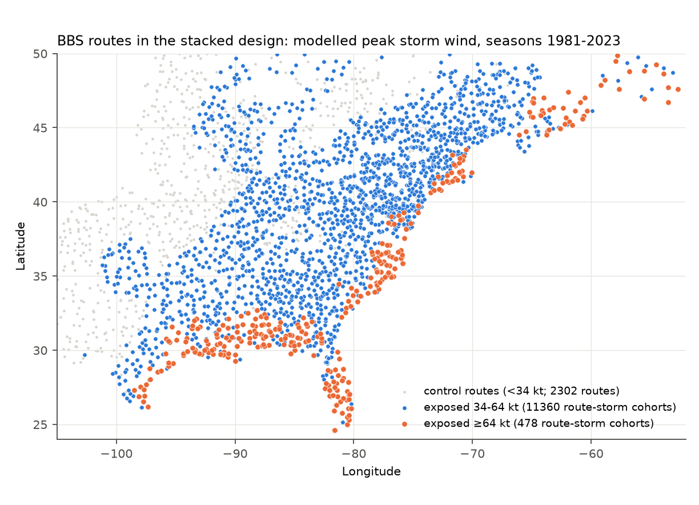
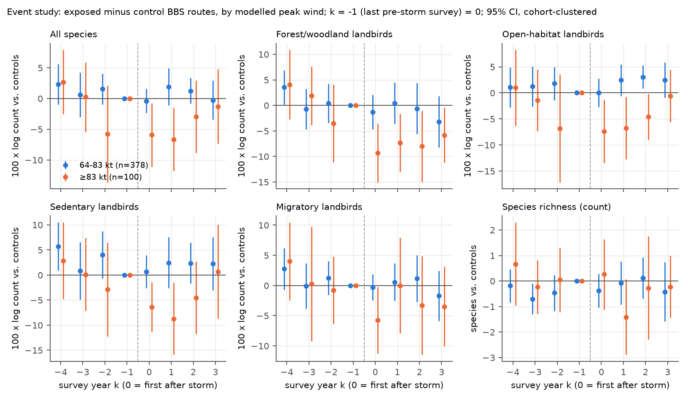
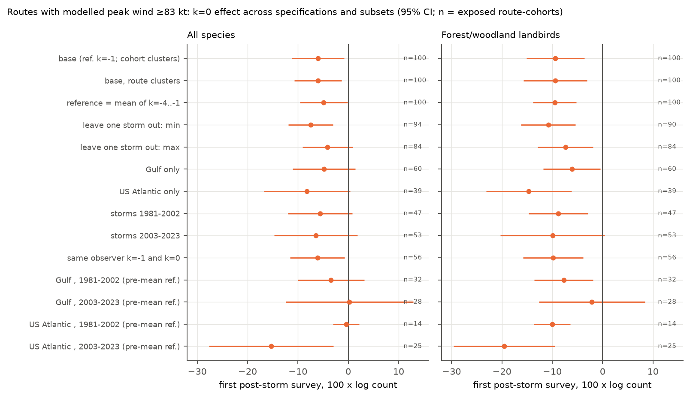

# Forest-bird counts fell about 9% on North American Breeding Bird Survey routes after modelled storm winds of 83 kt or more (1981-2023); winds of 34-83 kt gave no clear change

## Summary

We tested if Atlantic tropical cyclones change the bird counts on the next summer's North American Breeding Bird Survey (BBS) routes. We modelled the peak storm wind at each eastern BBS route for each hurricane season from 1981 to 2023. We used IBTrACS best tracks and a simple wind profile. Then we compared exposed routes with nearby routes that had no tropical-storm wind. We used a stacked event-study design with route-observer and cohort-year fixed effects (42 post-storm survey cohorts, 2,964 routes, 128,917 route-years).

Main results:

1. Most storm exposure gave no clear change. Routes with modelled peak wind of 34-50, 50-64 or 64-83 kt had first post-storm changes near zero (for 64-83 kt, all species -0.4%, 95% CI -2.4 to +1.5; forest and woodland landbirds -1.3%, CI -4.7 to +2.1; 378 route-storm cohorts).
2. The strongest exposure gave a decrease. On 100 route-storm cohorts with modelled peak wind of 83 kt or more (24 storms), forest and woodland landbirds were 9.4% lower (100 x log count; CI -15.1 to -3.6) in the first post-storm survey. Dense-habitat landbirds were 13.3% lower (CI -20.0 to -6.6, pre-period reference). The forest decrease stayed at about 7% in survey years 2-4 (CI -11.4 to -3.4).
3. The forest-bird decrease occurred in the Gulf (-6.1%, CI -11.8 to -0.5) and on the US Atlantic coast (-14.6%, CI -23.1 to -6.2). It occurred for storms in 1981-2002 (-8.8%, CI -14.7 to -3.0) and in 2003-2023 (-9.9%, CI -20.3 to +0.4). It stayed between -7.4% and -10.8% when we removed each storm cohort in turn. It stayed when the same observer did the last pre-storm and the first post-storm survey (-9.8%, CI -15.8 to -3.9).
4. The all-species decrease for 83 kt or more was smaller and less robust (-6.0%, CI -11.2 to -0.8). A pre-storm lead (k = -2) of -5.7% (CI -13.6 to +2.1) makes this all-species result uncertain.
5. Sedentary and migratory landbirds decreased by similar amounts (-6.5% and -5.8%). Thus the data do not show the expected larger loss of resident birds. Species richness did not change clearly.
6. Observation checks: exposure (64 kt or more) did not change the probability that a route was surveyed in the next year (+1.3 percentage points, CI -3.3 to +5.8) or the observer turnover. Post-storm surveys were 1.7 days earlier (CI -2.9 to -0.5).

These results agree with Rittenhouse et al. (2010), who found that hurricanes changed BBS community similarity with little loss of total abundance. Our results add a threshold: a clear count decrease occurred only at the highest modelled winds, and mostly in forest and dense-habitat birds.

## Question and hypotheses

Question: Do tropical cyclones change breeding bird counts on standardized survey routes, and does the change depend on wind strength, habitat guild, and migration class?

We stated these hypotheses before we fitted the models:

- H1: Total count and richness decrease in the first post-storm survey on routes with hurricane-force modelled wind (64 kt or more).
- H2: Sedentary species decrease more than migrants, because sedentary birds are present during the storm (August-October).
- H3: Forest and dense-habitat species decrease, and open-habitat species increase (canopy damage opens the habitat).
- H4: The effect increases with wind (dose-response), and it becomes smaller in survey years 2-4.

The exposure bins (34-50, 50-64, 64-83, 83 kt or more) were set in the stacking code before the first model. The first main model pooled 64-83 and 83+ kt (H1). The split of these two bins is the planned H4 dose test. We did it after we saw the pooled result. Thus, treat the 83+ kt result as a dose-response result, not as a separate pre-registered test.

## Data

All raw data come from the shared campaign datasets. We did not download new raw data.

| Data | Shared path | Source and version | SHA-256 of file used |
| --- | --- | --- | --- |
| BBS counts per state | `datasets/usgs-bbs-2025-release-states-zip/States.zip` | USGS BBS 2025 release (data to 2024), ScienceBase item 691cfb53d4be021d1d89b482 | cd0d638a70c30cb0506ff6504b1c17974a1cdb3d2e27165ae7ecff27180542e5 |
| BBS routes | `datasets/usgs-bbs-2025-routes/Routes.csv` | same release | baeee8510dc811d68891bc3fa14c47f8ea21565fe6f6c48e7029e4f4bff24556 |
| BBS survey conditions (observer, date, run type) | `datasets/usgs-bbs-2025-weather/Weather.csv` | same release | bd8ceccc2045089762aacf32c4e160cdf75feb9bb387621949fb349b97b8d8b7 |
| BBS species list | `datasets/usgs-bbs-2025-specieslist/SpeciesList.csv` | same release | e1ddbdfc0fd7b8688d5b02fc3f8484585f2163de390114459f6a11951ee5d144 |
| Storm tracks | `datasets/ibtracs-v04r01-since1980-csv-20261108/ibtracs.since1980.list.v04r01.csv` | NOAA NCEI IBTrACS v04r01, since-1980 list, downloaded 2026-11-08 | 1fefe59432d5d8e10487c12da2b69f775c7ea85e3bcf617d222808e6198ed581 |
| Species traits | `datasets/avonet-tobias2022-supplementary-dataset1/AVONET_Supplementary_dataset_1.xlsx` | AVONET (Tobias et al. 2022), figshare file 34480856, sheet AVONET2_eBird | eb645e83dddb40f1654a3e8d721998dbca76eff540231b7b809267c1e96f8d3e |

## Methods

### Storm wind exposure (`files/code/01_exposure.py`)

- We used North Atlantic IBTrACS fixes with USA agency position and maximum sustained wind (Vmax), seasons 1980-2024. We interpolated each track to 1-hour steps.
- Wind profile: modified Rankine vortex. V(r) = Vmax r/Rm inside the radius of maximum wind Rm, and V(r) = Vmax (Rm/r)^0.55 outside. Rm is the USA_RMW value if the track has it (most tracks after about 2004). If not, Rm comes from the Willoughby et al. (2006) relation with Vmax and latitude.
- We set the exponent 0.55 by comparison with the best-track wind radii (USA_R34 and USA_R64, 12,621 and 3,834 fixes). With 0.55, the modelled 34-kt radius is 5% too large (median), and the modelled 64-kt radius is 30% too large. The profile is symmetric and has no land-roughness reduction. Thus the wind values are an exposure index. They are not measured wind at the route. Bins of 64 kt and 83 kt correspond approximately to hurricane-force and Category-2 open-exposure winds near the storm core.
- For each route start point (routes south of 50 N and east of 105 W) and each storm, the exposure is the peak modelled wind. A storm from July of year E-1 to June of year E is assigned to survey year E. The route exposure for year E is the maximum over storms.

### Panel (`files/code/02_panel.py`)

- BBS counts with RPID 101 and RunType 1 (acceptable survey). One record per route and year.
- Guild sums use AVONET (eBird taxonomy) with 15 name fixes; 669 of 670 species list entries matched. Hybrids, unidentified taxa and forms were removed.
- Landbirds: all orders except waterfowl, grebes, loons, cormorants, pelicans and herons, shorebirds and gulls, rails and cranes, tubenoses, flamingos and storks.
- Forest/woodland: AVONET Habitat "Forest" or "Woodland". Open: "Grassland", "Shrubland" or "Human Modified". Dense: Habitat.Density 1. Sedentary/partial/migrant: AVONET Migration 1/2/3. All these guilds use landbirds only. Water: the non-landbird orders.
- Outcomes: log(count + 1) of all birds and of each guild; species richness.

### Stacked event study (`files/code/03_stack.py`, `fe.py`, `04_main.py`)

- One cohort for each post-storm survey year E (1982-2024; 42 cohorts with exposed routes).
- Exposed routes: modelled peak wind of 34 kt or more for year E, and less than 50 kt in the three earlier storm years.
- Control routes: less than 34 kt in all storm years E-3 to E+3, and within 400 km of an exposed route of the same cohort.
- Window: survey years E-4 to E+3. k = Year - E. k = -1 is the last survey before the storm (the reference). k = 0 is the first survey after the storm.
- Model (pyfixest 0.60, LSMR demeaner): outcome ~ sum over bins and k of (bin x event-time indicators) + novice-observer indicator | route x cohort x observer fixed effect + cohort x year fixed effect. The route x observer fixed effect means that comparisons are within the same observer on the same route.
- Standard errors: clustered by cohort (42 clusters). We also give route-clustered errors.
- 2020 had almost no BBS surveys (COVID-19). These rows are missing.

### Robustness, replication and observation-bias tests

- `05_robust.py` and `09_strong.py`: state x cohort x year fixed effects; controls within 200 km; stricter (less than 34 kt) and looser (less than 64 kt) earlier-exposure rules; Gulf (west of 84.5 W), US Atlantic and Atlantic Canada subsets; storm periods 1981-2002 and 2003-2023; routes with no later storm in the window; routes with the same observer at k = -1 and k = 0; leave-one-storm-cohort-out (removal of all 83+ kt routes of the cohort that contains each storm); route-clustered errors; a linear dose term per 10 kt above 34 kt.
- `10_prepool.py`: the reference is the mean of all pre-storm surveys (k = -4 to -1), not only k = -1. This decreases the effect of a single reference year. It also gives region x period cells.
- `06_obsbias.py`: among routes with an acceptable survey at k = -1, the effect of exposure on (a) any survey at k = 0, (b) an acceptable survey at k = 0, (c) observer change, (d) survey day-of-year change, (e) start-wind code change. Cohort fixed effects, cohort-clustered errors.
- `07_species.py`: one model per species for the 88 species found on at least 25% of exposed (64 kt or more) route-cohorts before the storm, with separate 64-83 and 83+ kt terms; Benjamini-Hochberg q-values; random-effects means by trait groups.

## Results

### Pooled hurricane-force exposure (H1)

For 478 route-storm cohorts with 64 kt or more (57 storms), the first post-storm survey effects were small and not clear: all species -1.6% (CI -3.7 to +0.5), richness -0.25 species (CI -0.82 to +0.32), forest and woodland landbirds -3.1% (CI -6.3 to +0.2), sedentary -0.9% (CI -3.8 to +2.1), migrants -1.5% (CI -3.7 to +0.7). These intervals exclude decreases larger than about 4% in total count. All robustness variants gave the same result (`files/results/robust_results.csv`).

### Dose-response (H4)

| Outcome (k = 0) | 64-83 kt (n = 378) | 83+ kt (n = 100), ref. k = -1 | 83+ kt, ref. mean of k = -4..-1 |
| --- | --- | --- | --- |
| All species | -0.4 (-2.4, +1.5) | -6.0 (-11.2, -0.8) | -4.9 (-9.6, -0.2) |
| Forest/woodland landbirds | -1.3 (-4.7, +2.1) | -9.4 (-15.1, -3.6) | -9.5 (-13.8, -5.2) |
| Dense-habitat landbirds | | | -13.3 (-20.0, -6.6) |
| Open-habitat landbirds | 0.0 (-2.7, +2.8) | -7.5 (-13.6, -1.4) | -5.4 (-9.9, -0.8) |
| Sedentary landbirds | +0.7 (-2.6, +3.9) | -6.5 (-11.4, -1.5) | -6.1 (-10.5, -1.7) |
| Migratory landbirds | -0.3 (-2.5, +1.9) | -5.8 (-11.3, -0.3) | -6.4 (-10.6, -2.1) |
| Water and shore birds | | | -1.2 (-30, +28) |
| Richness (species) | -0.39 (-1.05, +0.28) | +0.26 (-1.13, +1.64) | +0.18 (-0.90, +1.26) |

Values are 100 x log-count differences (approximately %), with 95% CIs, cohort-clustered. Survey years 2-4 (k = 1..3, pre-mean reference) for 83+ kt: forest -7.4 (-11.4, -3.4), dense -9.5 (-15.3, -3.6), all species -2.8 (-6.2, +0.5).

A linear dose term gave -1.0% forest birds per 10 kt above 34 kt (CI -1.8 to -0.3) at k = 0, with a pre-period dose term of -0.3% (CI -0.9 to +0.3).

Pre-storm leads: for 83+ kt, the forest-bird leads were +4.1, +1.9 and -3.5% at k = -4, -3, -2 (all CIs include 0). The all-species lead at k = -2 was -5.7% (CI -13.6 to +2.1). Thus the forest result has no clear pre-trend, but the all-species result can partly come from noise in the reference year.

### Replication across regions and periods

For forest and woodland landbirds at 83+ kt, the effect was negative in all 24 leave-one-storm-cohort-out fits (-7.4 to -10.8%, all CIs exclude 0). In region x period cells (pre-mean reference), the effect was -7.7% (CI -13.5 to -1.9) in the Gulf 1981-2002, -2.1% (CI -12.6 to +8.4) in the Gulf 2003-2023, -10.0% (CI -13.7 to -6.4) on the US Atlantic coast 1981-2002 (only 14 route-cohorts), and -19.5% (CI -29.6 to -9.5) on the US Atlantic coast 2003-2023. The all-species effect was not clear in 4 of 24 leave-one-out fits (when Georges 1998, Ivan/Jeanne 2004 or Ian 2022 were removed) and in 3 of 4 region x period cells.

Atlantic Canada had 62 exposed route-cohorts at 64 kt or more but only 1 at 83 kt or more. There, the 64+ kt effects were not clear (all species -1.1%, CI -8.5 to +6.4).

### Habitat and migration (H2, H3)

- H3 was partly supported: forest and dense-habitat birds decreased at 83+ kt. But open-habitat birds did not increase; they also decreased (-5.4 to -7.5%). The forest-minus-open contrast was not clear (-1.9%, CI -8.5 to +4.8).
- H2 was not supported: sedentary and migratory landbirds decreased by similar amounts. Migrants were mostly absent or leaving during the storms. Thus a direct storm-mortality effect cannot explain their decrease. Habitat change, or a change in detection, are possible explanations.

### Species

Of 88 common species, 45 (51%) had negative 83+ kt estimates. Only the Red-bellied Woodpecker passed a 10% false-discovery rate (-24%, q = 0.046). The random-effects mean over species was -2.0% (CI -3.4 to -0.5); for 15 sedentary forest/woodland species it was -5.8% (CI -11.3 to -0.2). The species with the largest decreases were mostly resident forest or woodland birds (Red-bellied Woodpecker, Carolina Chickadee, Tufted Titmouse, Northern Cardinal). Species estimates use the same routes, so these means and intervals are not independent tests.

### Observation process

| Check (exposed 64+ kt vs control, k = 0) | Effect | Control mean |
| --- | --- | --- |
| Any survey done | +0.4 pp (-4.0, +4.9) | 89.7% |
| Acceptable survey done | +1.3 pp (-3.3, +5.8) | 86.6% |
| Observer changed | -0.9 pp (-3.3, +1.6) | 6.5% |
| Survey day-of-year change | -1.7 days (-2.9, -0.5) | +0.4 days |
| Start-wind code change | 0.00 (-0.16, +0.16) | +0.02 |

Storms did not make surveys or observers drop out. Surveys after strong storms were about 2 days earlier. Within route-observer, counts fall with later survey dates: -0.07% per day for all species and -0.21% per day for forest birds (`11_doy_check.py`). Thus surveys 1.7 days earlier predict about +0.1% and +0.4% higher counts. The date shift cannot explain the decrease; it goes in the opposite direction. The route x observer fixed effects and the same-observer subset remove observer differences.

## Interpretation

Most tropical-cyclone exposure on BBS routes gave no measurable change in the next breeding-season count. Only the strongest modelled exposure (83 kt or more, less than 1% of exposed route-cohorts) gave a decrease. This decrease was largest and most consistent in forest and dense-habitat landbirds and lasted at least 4 survey years. A decrease of migrants and open-habitat birds of similar size suggests a general habitat or detection change, not only direct mortality of resident birds.

## Limitations

- The wind model is simple: symmetric, no forward-speed asymmetry, no land-roughness reduction, and a route is a single start point (routes are 39.4 km long). The modelled 64-kt radius is about 30% larger than the best-track radius. Exposure errors move effects toward zero and blur the bins. The 83 kt threshold is a model value, not a measured route wind.
- Only 100 route-storm cohorts (24 storms in 18 cohorts, at 83 kt or more) carry the main result. Storm cohorts are few, so cluster-robust intervals can be too narrow. Georges 1998 and the 2004 storms contribute much of the all-species effect.
- The 64-83 / 83+ split was a planned dose test, but we did it after we saw the pooled null result.
- Counts include detection. Canopy loss, debris, noise from cleanup or road changes can change detection. We cannot separate a detection change from a change in abundance.
- We did not use land-cover or forest-damage maps. Thus we cannot show that the decrease follows canopy damage.
- The same route can have later storms in years k = 1..3. A subset without later storms had only 15 route-cohorts at 83+ kt.
- AVONET habitat and migration classes are global species-level classes; some are coarse for North American populations.
- Atlantic Canada had too few strong exposures for a separate test.

## Reproduction

1. Make a work directory W. Make `W/../datasets` point to the shared datasets (paths above). Unzip `States.zip` into `W/data/bbs/` (this gives `W/data/bbs/States/*.csv`).
2. Copy `files/code/` to `W/code/`. Use Python 3.12 with pandas 3.x, numpy, matplotlib, openpyxl, pyarrow and pyfixest 0.60.0 (`uv venv --python 3.12 --system-site-packages; uv pip install pyfixest pyarrow`).
3. Run `bash code/run_all.sh` from W. Total run time was about 1.5 hours on a heavily loaded 24-core host.
4. `files/derived/` has the exposure table (`route_storm_exposure.csv`), the radius check, the route-year panel, the main stacked dataset (`stack.parquet`), the species traits and the observation-check units. `files/results/` has all coefficient tables. You can check all figures and tables from these files without the raw data.

## Provenance

- Campaign 11_07_2026; job sci-1107-dell-climate-pollution-biodiversity-7b5f589bc93c; topic climate-pollution-biodiversity; machine dell; account claude-andrii; model Claude Opus 5.5 (claude-opus-5-5), working through the Claude Code harness.
- The signing key is a campaign-machine key. It is not a personal authorship claim.
- Work date: 2026-11-08.

## References

- Rittenhouse, C. D., et al. (2010). Avifauna response to hurricanes: regional changes in community similarity. Global Change Biology 16: 905-917.
- Willoughby, H. E., Darling, R. W. R., Rahn, M. E. (2006). Parametric representation of the primary hurricane vortex. Part II. Monthly Weather Review 134: 1102-1120.
- Knapp, K. R., et al. (2010). The International Best Track Archive for Climate Stewardship (IBTrACS). BAMS 91: 363-376.
- Tobias, J. A., et al. (2022). AVONET: morphological, ecological and geographical data for all birds. Ecology Letters 25: 581-597.
- Ziolkowski, D. J., Lutmerding, M., et al. North American Breeding Bird Survey Dataset 1966-2024 (2025 release). USGS ScienceBase.
- Campaign publications on BBS and climate: sci:sha256:979b781f (winter temperature and residents), sci:sha256:c0a3a9aa (community temperature index), sci:sha256:df6fa3a0 (IBTrACS shared dataset use).
