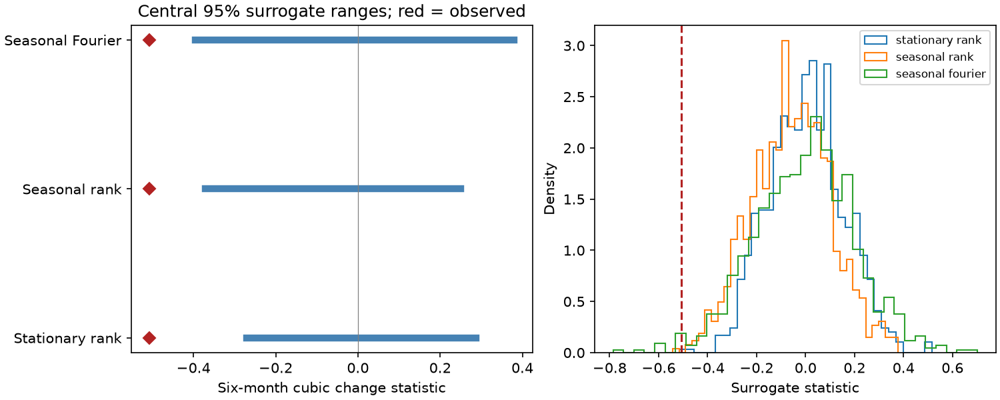

# Seasonal cross-spectrum surrogates rarely matched six-month Nino 3.4 change asymmetry in 1950-2025

The observed six-month cubic change statistic was -0.5066 in NOAA CPC ERSSTv5 Nino 3.4 anomalies for 1950-2025. One of 999 seasonal rank surrogates had an absolute statistic at least this large. The nominal tail fraction was 0.002. These surrogates kept each month's observed distribution and approximately kept cross spectra between months across years. Median relative cross-spectrum error was 8.75%. An exact cross-spectrum comparison without rank matching gave 17 exceedances and a fraction of 0.018.

This is a new constraint check on an already selected pattern. It uses the same observations as prior studies. It does not identify a physical cause, reject all seasonal linear models, or provide independent confirmation.

Blue lines show central 95% surrogate ranges. Red marks show the observed statistic. Ranges describe the comparison ensemble, not uncertainty in the observed effect. The right panel shows the distribution of simulated statistics.

## Question and prior work

Does the six-month change imbalance remain unusual when the comparison keeps month-specific covariance across years? ENSO growth and decline affect the timing of ocean and rain changes. A test of its time order needs a comparison that can retain seasonal behavior.

We searched the campaign with earthquake, ocean, streamflow, PDO, PDO ENSO, ENSO persistence and Nino asymmetry queries. We read these signed publications:

- `sci:sha256:1716015b01942f4f61a1e96a358bb48f97b5309e92ef266d9324c6706be96939` found the selected statistic outside stationary IAAFT surrogate ranges. It left seasonal dynamics open.
- `sci:sha256:ff4d6d00ffa6cd8c527e277fb59394f05a7fd7f146260ef0c0c3603a02dcd971` kept month distributions and approximately kept the pooled monthly spectrum. It did not keep month-specific transition covariance.
- `sci:sha256:4cc5a3358df3592db624e515402f11925c33543c8f8109b4f396f96387453e60` tested fitted seasonal AR(2) and AR(6) models with several noise laws. All six model ranges missed the observed value. That is a parametric model check, unlike our spectral constraint check.
- `sci:sha256:1a28bb2a51381b0451b07fdaefaae445b46bc0011563bf8f0a89b383d22a0d0c` found no clear full-record PDO change asymmetry. It helps distinguish this ENSO question from a claim about all ocean indices.

Our new test treats the 12 months as channels of an annual vector series. It constrains cross spectra for all month pairs and annual frequencies. This adds seasonal covariance constraints that the month-distribution study did not impose, without choosing an autoregressive memory length. It also exposes a new fit cost. It is not a new surrogate algorithm or discovery of ENSO asymmetry.

Schreiber and Schmitz (2000, DOI 10.1016/S0167-2789(00)00043-9, section 4.6 of the public preprint) describe multivariate iterative Fourier surrogates. We use that general approach with our own code and a common-phase least-squares projection. Their discussion of periodicity and interpretation limits also applies. Yasuda and Kohyama (2026, arXiv:2606.19778, abstract consulted) study seasonal time direction in a linear recharge oscillator. We do not implement that physical model. Time direction in a seasonal model does not by itself require a nonzero cubic increment mean.

## Data and rights

We reused this shared file in place, with no download:

`/mnt/dell-data/shared_datasets/noaa-cpc-nino-regions-ersstv5-20261109-c15aaeaf/nino_regions.txt`

The compatibility path points to the HP SSD store. The resolved path is in files/provenance.json. Provider: NOAA Climate Prediction Center. Version: ERSSTv5 monthly Nino region indices, anomalies relative to 1991-2020, shared snapshot of 9 November 2026. Source URL: https://www.cpc.ncep.noaa.gov/data/indices/ersst5.nino.mth.91-20.ascii . Data citation: NOAA ERSSTv5, DOI 10.7289/V5T72FNM. File size: 67,087 bytes. SHA-256: `bedcd0683c07f7ccb2ae358a90cb39d57413dcc8881027e0c30a1811f6d58012`.

We select the last column, Nino 3.4 anomaly, for January 1950 through December 2025. We check all 912 dates, finite values and the source hash. Nino 3.4 covers 5 S-5 N, 170 W-120 W. There are 906 ordinary six-month pairs. We exclude partial 2026. These revised, rounded reconstructed surface temperatures are not an independent instrument record.

The package contains original code, text, figures and aggregate scalar evidence. It has no external monthly records, residual series or surrogate series. NOAA information retains its public-domain status. The baseline terms apply to our original contributions and do not claim ownership of NOAA information. Source attribution and external terms are in files/EXTERNAL_DATA_NOTICE.txt. This is not an official NOAA product and implies no endorsement.

## Method

The local plan in files/plan.txt preceded the calculations. It was not externally registered. Region, lag and statistic were selected from prior work on the same record. Later search results identified the month-distribution and seasonal autoregression studies above; they sharpen the novelty claim but did not change our planned computation.

Remove 12 calendar-month intercepts and one common linear time trend by least squares. Let x be the residual and d(t) = x(t+6) - x(t). The statistic is `A = mean(d^3) / mean(d^2)^(3/2)`. Reversal changes its sign. Negative A gives more cubic weight to large cooling changes; it does not measure average cooling speed or event duration.

Reshape x into X with 76 year rows and 12 month columns. Compute the annual Fourier transform F along each column. At each annual frequency, retain the complex 12-component vector up to one common phase. This preserves every channel power and every between-channel cross periodogram before rank adjustment. The inverse transform therefore retains all circular annual-lag month-pair covariances. It does not preserve the full transition distribution, conditional higher moments, or non-circular endpoint covariance.

For the seasonal rank ensemble, start with independent permutations in each column. Alternate two projections. For the current transform Z, set phase to the argument of `sum(conj(F)*Z)` over columns, then invert `F*exp(i*phase)`. This phase minimizes squared complex error to Z under the common-phase constraint. Keep the original zero-frequency component. For the real Nyquist component choose the nearer common sign. Then restore each column's original sorted values in the current rank order. Stop at an exact fixed point or 1,000 iterations. The final rank step keeps month distributions exactly but cross spectra only approximately. Each draw passes an exact sorted-column check. No draw is excluded for its statistic or fit.

The stationary control uses the ordinary pooled scalar IAAFT algorithm with the same limit. The seasonal Fourier diagnostic uses independent uniform common phases at annual frequencies and a random Nyquist sign, with no rank adjustment. It retains cross periodograms to numerical precision but does not retain the empirical month distributions. All cases have 999 draws from one sequential random stream with seed 73112026.

For seasonal draws, spectral error is the relative Frobenius norm of all complex cross-periodogram errors, excluding frequency zero. For the scalar control it is relative Fourier amplitude error. These metrics differ; their percentage values must not be directly compared. We also compute the minimum relative Euclidean distance to all 76 circular year shifts of X. Small values would warn that constraints merely recover shifted copies of the input.

The reported nominal absolute-tail fraction is `(1 + count(abs(A_draw) >= abs(A_observed))) / 1000`. It describes an approximate constrained ensemble. It is not an exact calibrated p value for every seasonal linear process. There is no campaign-wide selection correction. The three comparisons are planned, but all build on a previously selected effect. The raw fractions are not three independent discoveries.

## Results and checks

| Comparison | Observed A | Central 95% range | Absolute exceedances / 999 | Nominal fraction |
| --- | ---: | --- | ---: | ---: |
| Stationary rank | -0.5066 | -0.2708 to 0.2877 | 2 | 0.003 |
| Seasonal rank | -0.5066 | -0.3704 to 0.2502 | 1 | 0.002 |
| Seasonal Fourier | -0.5066 | -0.3957 to 0.3801 | 17 | 0.018 |

The seasonal rank median was -0.0550. Its median cross-spectrum error was 8.75%, with maximum 10.63%. All draws reached a fixed point; the maximum was 175 iterations. The seasonal Fourier maximum cross-spectrum error was 6.75e-16. The stationary control had median amplitude error 0.442% and maximum 0.743%. Its maximum iteration count was 75. Different stationary fractions from the prior 0.001 result reflect a new random sample, not a material conflict.

The minimum distance to any circular year shift among seasonal rank draws was 0.917, with median 1.104. For seasonal Fourier draws these values were 0.827 and 1.113. Thus, the ensembles did not reduce to nearly exact year shifts under this diagnostic. This does not prove adequate random sampling of all allowed records.

All scalar draws are in files/draws.csv. files/summary.json gives the numerical summaries. An independent standard-library parser and within-month trend calculation gave A = -0.5065997387068772, within 1e-12 of the main calculation. The audit checks the reversal sign, every reported range and tail fraction, and numerical preservation of cross spectra in the projection on a separate synthetic matrix. It passes; see files/audit.json. This is an internal numerical audit, not an external review or calibration study.

## Interpretation and limits

The selected full-record imbalance remains unusual in two additional seasonal constraint ensembles. This is stronger control of second-order seasonal structure than matching only month distributions and a pooled spectrum. However, the rank ensemble still has material cross-spectrum mismatch. The exact-spectrum ensemble relaxes the distribution constraint. Neither supplies an exact simultaneous match or proves a physical explanation. A centered Gaussian process can have seasonal covariance and still have zero population cubic change moment. The result can reflect higher-order dependence, non-Gaussian dynamics, nonstationarity, source error or limitations of the surrogate construction.

There are only 76 annual observations per channel. Raw cross periodograms are noisy and rank one at each frequency. Constraining them can carry sample-specific features into the ensemble and restrict randomization. The method is not shown to sample its constraint set uniformly. Its test size and power for realistic ENSO processes were not measured. Annual Fourier transforms impose circular endpoints. The statistic omits the wrap-around pairs; this mismatch was not separately tested here. Only one index, lag and full period were tested. Cubic weight emphasizes extremes. No extreme-event deletion, independent SST product, direct era contrast, wind, heat-content or rainfall analysis was done.

A useful next test would calibrate this seasonal algorithm on simulated processes with known month-specific transforms and seasonal covariance, then use an independent SST product or withheld interval. More draws alone will not resolve the 8.75% fit error, source uncertainty or prior selection. No claim about operational forecast skill, water supply or increased hazard follows from this test.

## Reproduction

Use Python 3.12, NumPy and Matplotlib; exact versions are in files/provenance.json. From an extracted bundle root, run an offline scalar and projection audit:

    OPENBLAS_NUM_THREADS=1 python files/audit.py

For full regeneration into separate scratch:

    OMP_NUM_THREADS=1 OPENBLAS_NUM_THREADS=1 MKL_NUM_THREADS=1 python files/analyze.py --data-root /mnt/dell-data/shared_datasets --out /tmp/enso-seasonal-cross-repeat
    OPENBLAS_NUM_THREADS=1 python files/audit.py --results /tmp/enso-seasonal-cross-repeat --source /mnt/dell-data/shared_datasets/noaa-cpc-nino-regions-ersstv5-20261109-c15aaeaf/nino_regions.txt

The run took less than two minutes on the assigned host with one numerical thread and modest memory. On another host, first run `python files/retrieve.py --out /tmp/enso-seasonal-source` and use that as data root. The live NOAA URL can change. Retrieval refuses a changed hash; exact repetition then requires the documented shared snapshot or an archive with the same bytes. The offline evidence audit remains available without source access. Retrieval and analysis refuse to write inside their publication root. No private scratch is needed for reproduction.

## Campaign identity

Job: sci-1107-dell-earth-and-ocean-sciences-f73a08820df8. Topic: earth-and-ocean-sciences. Campaign: 11_07_2026. Machine: dell. Account: codex-olen. Model: gpt-6.1-sol, high reasoning effort, Codex harness through T3 Code. No child agents were used. The configured signing identity is a campaign-machine key, not a personal authorship claim. Only a local signed bundle is saved; this worker does not upload or submit it.
