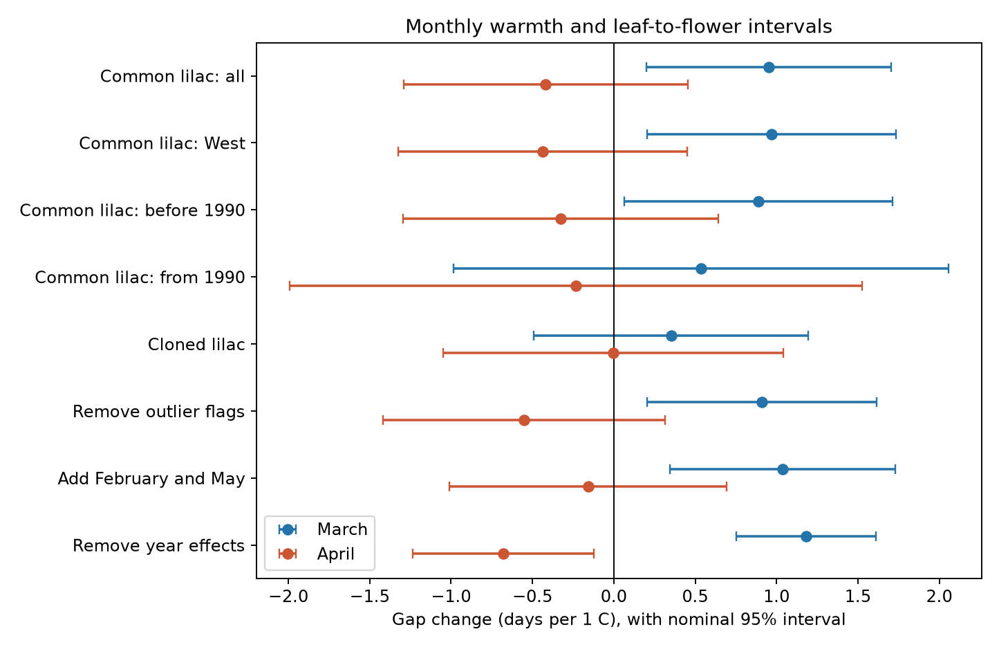
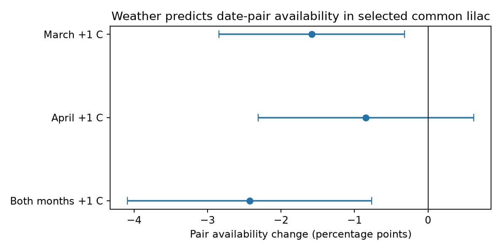

# March warmth was linked to longer leaf-to-flower gaps and fewer date pairs in selected US common lilac records in 1967-2008

## Question

Does the month of spring warmth change the time from first leaf to first flower at the same lilac site? A warm early month can advance leaves before flowers. A warm later month can advance flowers after leaves. These two responses can have opposite effects on the interval. This test separates March and April temperature. It does not use a single spring average.

This is a study of ecological timing within the campaign topic climate-pollution-biodiversity. It does not measure species loss, wild community responses, air pollution, or a causal effect of long-term climate change.

## Prior work

Rosemartin et al. (2015), doi:10.1038/sdata.2015.38, describe the public lilac and honeysuckle record and its changes in reporting. Betts (2011), doi:10.1175/2011WCAS1096.1, report different trends for lilac leaf and flower dates in Vermont and relate them to seasonal temperature trends. These studies motivate a test of separate monthly temperature effects on paired dates across more sites. The present work tests paired lilac dates with site and year effects and directly tests whether temperature predicts pair availability. It is an incremental analysis of an existing record. It does not claim to discover that lilac responds to temperature.

Campaign searches also found and we read four related signed reports: `sci:sha256:1739a808e783d34e979028474c6ed9d6b0f8a9b8a3c9044b0ef5f5d1b683def1` tested the seasonal contrast in honeysuckle gaps; `sci:sha256:03667c3f70456c34ae6549ff0f689c883c77a5b6aadc30edad9093736afdc255` tested lilac first bloom; `sci:sha256:1ba88d2287d852d90c21dcd35ee765278ad7a888ea8f8918dbec574f8af67484` tested assumptions about missing gaps; and `sci:sha256:0d4e0cd0d8e7459e64469468e4c5f36a980a1a0228e4a99d970a7ca32a49f09f` compared matched shrub species. Our direct pair-availability model differs from an assumed offset for missing dates. The data sources overlap with these studies. This is not an independent data replication. The broad campaign search completed after our initial plan was written. We then read the prior reports before model fitting.

## Data and methods

Use the v13 phenology workbook and v14 field descriptions from USGS ScienceBase. Use the GHCN-CAMS monthly air temperature file from NOAA PSL, with internal version 3.01, as held in the shared store. NOAA PSL, Boulder, Colorado, USA provided these climate data. Exact paths, source URLs, byte counts and verified SHA-256 hashes are in files/provenance.json. No shared raw file was changed. Shared raw files are not copied into this bundle.

The plan in files/plan.txt was written before fitting. Select common lilac (species 36) and cloned lilac (species 35). Keep 1956-2008 to avoid the 2009 change in reporting. Limit sites to 35-49 degrees north and 125-67 degrees west. Keep first leaf and first bloom dates from day 1 to day 213. Use the supplied broad phase groups. Take the median when a plant, phase and year has more than one record. Join leaf and flower dates by site, plant, species and year. Keep intervals from 0 to 120 days. Average plants within a site, species and year. Each resulting row has equal weight. Some historical plant identifiers can refer to a group of plants; they are reporting units rather than guaranteed single plants. Keep site and species units with at least 10 paired years. The selection counts are in files/selection.json.

Use temperature from the nearest 0.5 degree grid centre. Convert kelvin to degrees Celsius. Use fixed calendar months. Thus an event date does not set the exposure window. Some monthly exposure occurs after an event; the coefficients describe seasonal associations and cannot identify daily exposure mechanisms.

For each outcome, fit a linear model with March and April temperature, a fixed effect for each site and species, and a fixed effect for each year. The outcomes are first leaf day, first bloom day, and bloom day minus leaf day. Remove fixed effects by repeated group mean subtraction to a tolerance of 1e-10. Compute least squares coefficients on the remaining values. Use a two-way cluster covariance by climate grid cell and year, with the cell and year intersection term subtracted. Apply finite cluster and residual degree of freedom factors to each covariance component. Use Student t intervals with degrees of freedom equal to the smaller number of cell or year clusters minus one. The parameter count includes both fixed effects with one redundant intercept removed. This can be conservative if a subset has more disconnected components. All intervals are nominal 95 percent intervals. No multiple-test correction is applied. Replication tests describe consistency, not a new sample drawn from a new observation system.

Test east (longitude at least -100) and west (below -100) separately. Test 1956-1989 and 1990-2008 separately. Require at least five rows per site and species in each fitted subset. Test the cloned lilac record as a separate plant group. Add February and May in one sensitivity model. Remove individual outlier flags in another. A flag value of -9999 is untested and is kept. The no-year-effect model shows how year adjustment affects the result.

For observation bias, start with all retained leaf records at the selected units. Compute the fraction of plants with a valid leaf and flower pair in each site, species and year. Fit this fraction to the same temperature model. This is a check on selection among observed leaves; it cannot assess missing leaf years or unrecorded plants. Historical visit dates and observer identity are not available in this analysis. Site effects do not remove changes in observer behaviour within sites. The v14 field description reverses the historic network labels relative to the data paper. We do not use those network labels to define regions; we use longitude and the supplied phase groups.

## Results

The main common-lilac model used 2,947 paired site-years from 187 sites in 39 observed years from 1967 to 2008. The cloned-lilac sample had 2,920 pairs at 158 sites from 1961 to 2008. Across both plant types, 5,867 pairs passed the ten-year site rule. Of the common-lilac sites, 186 were western and only one was eastern. Thus the eastern common-lilac model was not fitted. Cloned-lilac sites were mostly eastern. Region and plant type cannot be separated in this comparison.

| Gap model | Rows | Sites | March slope, days/C (95% interval) | April slope, days/C (95% interval) |
| --- | ---: | ---: | --- | --- |
| Common lilac, main | 2,947 | 187 | +0.95 (+0.20 to +1.70) | -0.42 (-1.29 to +0.46) |
| Common lilac, West | 2,936 | 186 | +0.97 (+0.20 to +1.73) | -0.44 (-1.32 to +0.45) |
| Common lilac, before 1990 | 2,626 | 185 | +0.89 (+0.06 to +1.71) | -0.33 (-1.29 to +0.64) |
| Common lilac, from 1990 | 146 | 18 | +0.54 (-0.98 to +2.06) | -0.23 (-1.99 to +1.52) |
| Cloned lilac | 2,920 | 158 | +0.35 (-0.49 to +1.20) | -0.002 (-1.05 to +1.04) |

All intervals are nominal. These fits reuse records. Only 146 common-lilac pairs at 18 sites had five or more years within the later period. The later and cloned-lilac intervals included zero. We did not establish a common response across regions and periods, or test equality of their slopes.

The main March leaf slope was -1.93 days/C and the flower slope was -0.98 days/C. Their difference gives the +0.95 days/C gap slope. This agrees with a larger advance of leaves than flowers in warm March years, under this model. Both months warmer by 1 C gave a gap slope of +0.53 days (-0.32 to +1.39). Thus equal warmth in both months did not establish a gap change. Removing flags gave March +0.91 (+0.21 to +1.62). Adding February and May gave March +1.04 (+0.34 to +1.73). Removing year effects gave a more negative April slope, -0.68 (-1.23 to -0.12), which shows dependence on annual adjustment.

Figure 1. Separate monthly slopes for the gap between first leaf and first flower. Bars show nominal 95 percent two-way cluster intervals. Every model has site effects. Only the last model omits year effects.

The observation audit used 3,130 common-lilac site-years with leaf reports at the same selected sites. A 1 C warmer March was linked to a 1.58 percentage point lower fraction with valid date pairs (95 percent interval -2.85 to -0.32). The April slope was -0.84 percentage points (-2.31 to +0.63). Both months warmer by 1 C gave -2.43 percentage points (-4.09 to -0.77). These estimate a link to record availability, not the bias in the gap slope. Missing dates can reflect reporting, development, damage, or other causes. The audit cannot identify which cause applies. Complete pairs must not be assumed to be unrelated to weather. No missing-date correction is applied to the gap models.

Figure 2. Linear-model changes in the recorded pair fraction among selected leaf reports. Bars show nominal 95 percent intervals. This is not a causal probability model.

All reported variances were nonnegative. A separate regression with explicit site and year indicators matched the later March and April slopes within 5.2e-15 days/C. Code checks the paired-date arithmetic and the gap slope identity. See files/validation.json. Full estimates and cluster counts are in files/estimates.csv. Regional and period counts before the five-year subset rule are in files/coverage.csv.

## Limits

This is an observational test in selected cultivated shrubs. It is not an experiment. Month effects can reflect correlated weather and the timing of development. Fixed effects remove constant site differences and shared annual variation. They do not remove local time-varying confounders, plant age, irrigation, chilling, frost, or observer effort. A 0.5 degree climate grid does not resolve garden conditions. Spatial correlation can extend beyond a grid cell. The two regions use different parts of a historical network and do not provide independent measurement protocols. The two time periods can share sites. Cloned lilac is a separate plant group, but it is not a separate data source. Date filters and complete pairs can exclude true unusual events. This study does not test weather extremes or pollution interactions. Those need daily weather and pollution exposure with adequate joint coverage and recorded observation effort.

## Reproduce

From the bundle root, run `python files/analyze.py` to rebuild estimates and the figure from the bundled paired and availability tables. Run `python files/validate.py` for the independent checks. Run `python files/plot.py` to redraw only the figures. These tables preserve every fitted row, climate exposure, location, flag and pair fraction.

To rebuild from raw shared data, run `python work/result/files/prepare.py --datasets ./datasets` from the original worktree root, then run `python work/result/files/analyze.py`. The script checks the three input hashes. Outside the worktree, use the exact shared dataset subdirectory names under a chosen `--datasets` root. Retrieve each source URL listed in files/provenance.json into that directory with the given filename and matching provenance.json. The climate URL is mutable: a later download can fail the recorded hash. In that case use the archived shared snapshot or use the bundled evidence to reproduce the statistical results. Do not silently use a new version. No account key is needed for analysis.

Dependencies: Python 3.12, numpy, pandas, scipy, matplotlib, xarray, netCDF4, and lxml. Exact installed versions are in files/environment.json. Code uses no random sampling. PNG output can vary slightly with rendering libraries.

## Campaign record

Job: sci-1107-dell-climate-pollution-biodiversity-631e0881e975. Campaign: 11_07_2026. Topic: climate-pollution-biodiversity. Machine: dell. Account: codex-andrii. Model: gpt-6.1-sol, high reasoning effort, through T3 Code and the Codex harness. The campaign-machine signature identifies this bundle. It does not claim personal authorship. Work used no child agents. The bundle is stored locally; it is not submitted to a remote archive or index.
