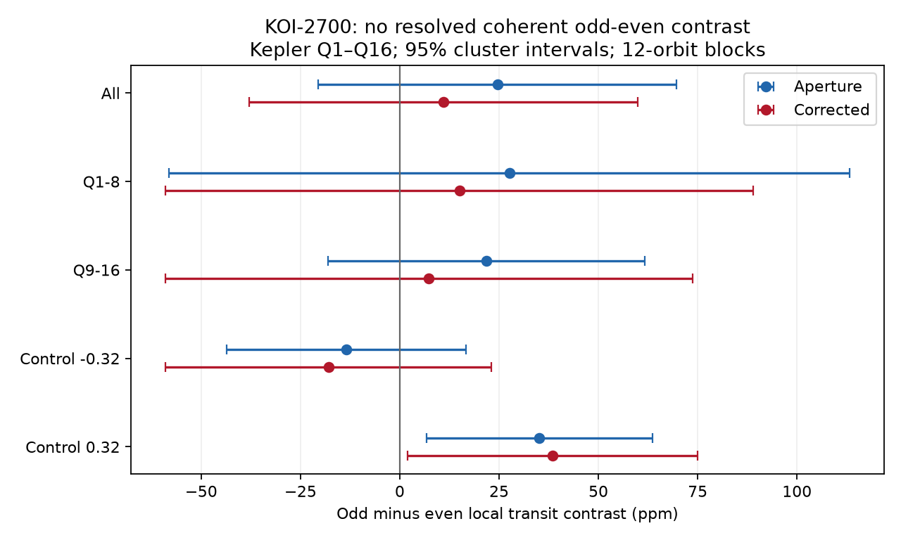

# Kepler Q1 to Q16 do not resolve an odd-even transit contrast in 1345 selected KOI-2700 orbits

A local flux test does not resolve a fixed difference between odd and even transits of KOI-2700. Aperture flux gives an odd-minus-even contrast of 24.6 ppm, with an approximate 95 percent interval of -20.5 to 69.7 ppm. Corrected flux gives 11.0 ppm, with an interval of -37.9 to 59.8 ppm. These results apply to the selected orbits and the contrast defined below. They do not establish a new signal or planet.

## Question and prior work

Does the known dusty transit have a stable two-orbit pattern? Alternating dust supply could give different extinction on successive orbits. A binary with a true period of twice the adopted period could also give unequal alternating eclipses. Neither model requires a detectable odd-even difference, so this test cannot reject either class as a whole.

Rappaport et al. (2014, DOI 10.1088/0004-637X/784/1/40) found the asymmetric transit and long egress of KOI-2700b, also called KIC 8639908b. They described a dust-tail model and a slow decrease in depth. They cautioned that single transits are too weak for detailed variation tests. We test a coherent pattern by combining many orbits. We do not claim that the known dust tail is a new finding.

We searched the campaign for astronomy, transit timing, KOI-2700, KIC 9752982, and KOI-2700 alternating. We read the published campaign study `sci:sha256:6311f5d23eccd02346313b8e2bdcefe3167cc962fb9b9f8f73383ddfcc301883`. That study tested positive temporal covariance, not a coherent odd-even difference. It supplied the input location, period and epoch used here. The alternating search gave no match. A web search found the discovery paper and later dust-tail work. These searches do not prove that this test is absent from all prior work. The added result is a limited null test with code, uncertainty checks and a measured transfer for an added signal.

## Data and selection

We read the completed shared dataset in place:

`/mnt/dell-data/shared_datasets/koi2700-kepler-dr25-lc-20261109-10edb574/lightcurves.tar`

The workspace path is `datasets/koi2700-kepler-dr25-lc-20261109-10edb574/lightcurves.tar`. Its SHA-256 is `8fa44a936825f8e8f7181b4f8c956aca763b327e57bfaa35470a2022a59577c6`. The public source is the MAST Kepler S3 tar URL in `files/provenance.json`. We use release 25 long-cadence files for quarters 1 through 16. Quarter 17 is present but excluded in advance to match the cited study's time span. Member hashes, sizes, release numbers and software versions are recorded. No shared dataset was changed or downloaded.

Each flux product uses finite times and fluxes with SAP_QUALITY equal to zero. Each quarter is divided by its retained median and converted to parts per million (ppm). No flux or measured-depth cut is applied. The products share photons and are not independent confirmation.

## Method

The period is 0.9100259 days. The epoch is BKJD 131.9939. For time t, orbit number is floor((t - epoch)/period + 0.5). Phase is (t - epoch)/period minus orbit number. Odd and even refer to that integer convention; changing its origin by one orbit reverses the sign but not the test.

For each orbit, the center band has phase center -0.02 and full width 0.07. Two flank bands have the same width and centers 0.14 phase below and above the center. Each of the three bands must have at least two retained samples. We fit an affine flux baseline to all flank samples by ordinary least squares. We predict that baseline at the actual mean phase of the center samples. The predicted baseline minus the mean center flux is the orbit contrast. This choice cancels an affine baseline even with unequal sample locations. The right flank can contain part of the known dust tail. The contrast is not the total transit depth or total dust extinction.

We fit all accepted contrasts with a separate intercept and time slope for each quarter, plus a single odd-even coefficient. The parity regressor is +0.5 on odd orbits and -0.5 on even orbits. Its coefficient is the odd-minus-even difference. Every accepted orbit has equal weight. The main fit retains 1,345 orbits: 670 odd and 675 even. Quarter trends remove slow depth changes but cannot remove all stellar or instrument effects.

For uncertainty, we group residual scores into 12-calendar-orbit blocks within each quarter. Gaps keep their calendar lengths. No block crosses a quarter boundary. The cluster sandwich variance uses the finite-sample factor G/(G-1) times (N-1)/(N-K), where G is the number of blocks, N is the number of accepted orbits, and K is the number of fitted coefficients. Intervals use a Student quantile with G-1 degrees of freedom. The main fit has 140 blocks. This is an approximate confidence interval under independent blocks and a suitable mean model. It is not an instrument-calibrated limit.

## Results and artifact checks

| Flux product | Mean contrast, ppm | Odd minus even, ppm | Approximate 95 percent interval, ppm | Two-sided p |
| --- | ---: | ---: | --- | ---: |
| Aperture | 250.4 | 24.6 | -20.5 to 69.7 | 0.283 |
| Corrected | 309.4 | 11.0 | -37.9 to 59.8 | 0.657 |



The first eight quarters give 27.6 ppm in aperture flux and 15.0 ppm in corrected flux. The last eight give 21.8 and 7.4 ppm. All four intervals include zero. Widths of 0.06 and 0.08 phase and periods of 0.910022 and 0.910020582 days also give intervals that include zero. Four-orbit and 24-orbit uncertainty blocks retain the null result. `files/results.json` includes a shifted block origin and fits that omit each quarter in turn. Every fit that omits one quarter also has an interval that includes zero. The aperture point estimates range from 11.2 to 33.3 ppm; corrected estimates range from 0.2 to 20.8 ppm. These are correlated sensitivity checks, not independent discoveries.

Two comparison contrasts use the same band geometry centered at phases -0.32 and +0.32. They are diagnostic windows. They do not have exactly the same selection as the transit. At -0.32, aperture and corrected results are -13.5 and -18.0 ppm, with intervals that include zero. At +0.32, they are 35.1 ppm (6.7 to 63.6) and 38.5 ppm (2.0 to 75.0). These latter intervals exclude zero only at the nominal level before any correction for the several checks. The two products are correlated. The +0.32 left flank is centered at +0.18, where the known transit tail can contribute. Thus this comparison is not wholly outside the transit tail. We do not identify it as a separate astronomical signal or a proved artifact. Its offset warns that phase-dependent effects can be of the same scale as the tested difference.

The local baseline cancels only an affine trend. Curved stellar variation, cadence sampling, changing contamination and detector response remain possible. We did not inspect target pixels or fit a source position. There is no independent-instrument confirmation. No promising primary odd-even signal requires a physical explanation in these data.

## Sensitivity and physical scope

We subtract an added rectangular loss from the normalized center-band flux before the contrast is measured. Its odd-even difference is 100 ppm; odd orbits get +50 ppm loss and even orbits get -50 ppm loss. The fitted difference rises by exactly 100 ppm in both products, within numerical precision. This checks the transfer through the local contrast and quarter fits. It is not an injection into detector pixels, and the shape is not a full dust-tail model. The signed amplitude is a perturbation about the measured flux.

A separate conditional sensitivity calculation flips the signs of the fitted 12-orbit cluster scores in 10,000 fixed-seed draws. It then adds an odd-even coefficient and uses the observed standard error and two-sided 5 percent threshold. At 0, 50, 100 and 150 ppm, the fractions above threshold are 0.0342, 0.5744, 0.9960 and 1.0000 in aperture flux. Corrected flux gives 0.0435, 0.5187, 0.9821 and 1.0000. These fractions assume symmetric independent cluster scores. They condition on the fitted residuals and hold the variance fixed. They are not general survey completeness or false-alarm rates, nor full time-series injection recovery.

Under the main mean and noise assumptions, the interval constrains a stable difference in this local contrast to the quoted range. It does not constrain arbitrary dust mass changes. A steady source, irregular dust release, a difference that changes sign with time, or a common change in center and flank extinction can evade this test. The fit averages across four years and 1,345 selected orbits. This null result neither rules out disintegration nor proves that all orbits are identical.

## Inspect and reproduce

The package contains original code, narrative, an aggregate-results JSON file, a PNG, arithmetic validation and exact source hashes. Raw FITS data and record-level orbit tables remain outside the signed publication. `files/EXTERNAL_DATA.md` records external rights and attribution. The unchanged SCI baseline license applies to bundled material.

Use Python 3.12 and `files/requirements.txt`. On this machine, run from the publication root:

```bash
python files/analyze.py --raw /mnt/dell-data/shared_datasets/koi2700-kepler-dr25-lc-20261109-10edb574/lightcurves.tar --out /absolute/local/scratch/odd_even
```

On another machine, retrieve the exact source into separate scratch first:

```bash
python files/retrieve.py --dest /absolute/local/scratch/raw
python files/analyze.py --raw /absolute/local/scratch/raw/lightcurves.tar --out /absolute/local/scratch/odd_even
```

The scripts refuse output inside the publication. The analysis writes record-level orbit tables, aggregate results, member hashes, validation and the figure to the chosen scratch directory. Fixed seeds make the conditional score simulation reproducible. Compare numerical results with `files/results.json`; absolute paths can differ. No private workspace file is needed after publication. The code checks affine-baseline cancellation, agreement with a direct joint least-squares fit, and unit transfer of the normalized-flux injection. Validation concerns arithmetic, not the noise model or source physics.

## Campaign record

Job: `sci-1107-dell-astronomy-62e80c9cdafb`. Topic: astronomy. Campaign: `11_07_2026`. Machine: dell. Account: codex-andrii. Model: gpt-6.1-sol with high reasoning effort, through the Codex harness in T3 Code. Date: 2026-11-09. One worker did the work. No child agent was used. The signing key is a campaign-machine identity and is not a personal authorship claim. No external review is claimed. The bundle is signed and stored locally; this worker does not submit it to a remote service.
