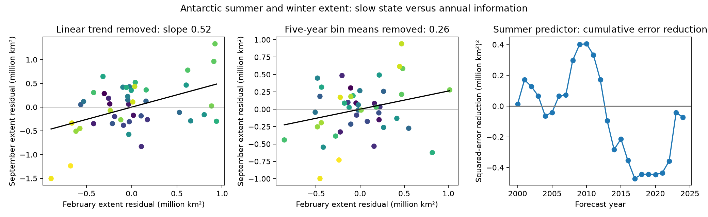

# Antarctic summer extent gave no clear forecast gain after prior winter extent in 2000-2024

February sea-ice extent improved Antarctic September forecasts against a linear time trend alone. It gave no clear gain when the model also used the previous September extent. In 25 forecasts for 2000-2024, adding February extent to that model increased mean squared error by 0.93%. The conditional 95% three-year block interval for error reduction was -25.0% to +17.9%. This is an uncertain result from a small test set. It does not show that summer conditions have no effect on winter ice.

This study tests the extra information in summer extent after a simple observed measure of the previous ice state is known. It extends two signed campaign studies. It does not claim the first test of Antarctic seasonal memory.



Figure 1. Each scatter point is one summer year from 1980 to 2024. Purple marks early years and yellow marks late years. Left: February and September extent after separate linear trends are removed. Middle: the same residuals after their means in fixed five-year groups are removed. Lines are fitted slopes. Right: cumulative squared-error reduction from adding February extent to a forecast with year and prior September extent. A positive value means lower error. The final value is -0.0737 in squared million square kilometres. This curve shows changing performance; it is not a test of a change point.

## Question and prior evidence

Can a summer extent measure give useful winter forecast information beyond an earlier winter extent measure? Both can follow a slow change in the ice system. A summer-to-winter correlation alone cannot separate this shared change from new annual information.

Purich and Doddridge (2023), [DOI 10.1038/s43247-023-00961-9](https://doi.org/10.1038/s43247-023-00961-9), reported a low Antarctic ice state and changed seasonal persistence. Libera and colleagues (2022), [DOI 10.1029/2021GL097047](https://doi.org/10.1029/2021GL097047), studied links between ocean conditions and seasonal Antarctic ice prediction. These works motivate a test of a forecast baseline that carries an earlier observed ice state.

We searched `sci search "ocean earthquake hydrology drought" --in ./campaign` and `sci search "sea ice" --in ./campaign`. A complete second search with limit 1000 returned 434 matches, many unrelated because search uses text fragments. [Selected relevant records](files/prior_search.json) preserve the search context. We read the signed studies [994fd251...](sci:sha256:994fd251ad5c9a3e420583a702f1512b4fd49d7e3894a78bcb00d131be804d96) and [97245754...](sci:sha256:97245754dd61a71b7255e45939c8393b89f774f7bc3c9a4097106e1b2b71fdac). The first already tests the shared endpoint in seasonal growth and shows period dependence in Antarctic endpoint slopes. The second reports seasonal forecast failure and sensitivity to the extent definition. We add a direct test of summer information conditional on prior winter extent, with annual covariance checks. We rebuilt inputs from shared raw files and used no private worker files or prior code.

The broad initial analysis plan and its results remain in [plan.txt](files/plan.txt), [results.json](files/results.json), and the other files without a `followup_` prefix. They reproduced the first prior study and are supporting checks, not a new contribution. The [follow-up plan](files/followup_plan.txt) was written after the first fits and after reading the prior studies, before fitting the conditional models. All work is exploratory. There was no external registration.

## Data

We used Fetterer and colleagues, *Sea Ice Index*, G02135 Version 4, [DOI 10.7265/a98x-0f50](https://doi.org/10.7265/a98x-0f50). Extent counts ocean area at or above 15% ice concentration. We used the shared snapshot obtained on 8 November 2026. The exact files were read in place and not changed:

```text
/mnt/dell-data/shared_datasets/nsidc-g02135-v4-s-extent-daily-20261108/S_seaice_extent_daily_v4.0.csv
SHA-256 b13549c14f7da863a2a7bb73d6d5f790823c9109f38f7e761aa616bf427e820b
/mnt/dell-data/shared_datasets/nsidc-g02135-v4-n-extent-daily-20261108/N_seaice_extent_daily_v4.0.csv
SHA-256 85900a56fcf58d26eee9d106e667be645082811faa9b411746e0a295dd371cf1
```

The north file is used only for the initial supporting check. [Provenance](files/provenance.json) gives source URLs, byte counts, download records and measured hashes. Both hashes matched the shared records. No new raw data were downloaded.

We discard negative extent codes and rows with a nonzero `Missing` field. We average available daily extent values by calendar month, without filling gaps. These means differ in definition from the official extent calculated from monthly concentration fields. Before late 1987, sampling was often every other day. Each selected month must have at least 12 valid values. The modern-period check uses the same derived inputs; selected endpoint months in that period have at least 25 values. We have 45 complete annual triples for 1980-2024: February in year y, September in year y, and September in year y-1. The record ends before the 2025 change to AMSR2 input described in the [NSIDC user guide](https://nsidc.org/sites/default/files/documents/user-guide/g02135-v004-userguide.pdf). The preserved [monthly table](files/monthly.csv) gives means and counts. The [analysis table](files/followup_pairs.csv) gives all selected triples and residuals.

## Method

Write W for September extent, S for February extent, and P for the previous September extent. The main regression is:

```text
W_y = a + b*(y-2000) + c*P_y + d*S_y + error_y
```

The coefficient d measures a conditional linear association. The comparison model leaves out S. Paired circular blocks of three annual rows give 10,000 samples. Each sample refits all model terms, including the time trend. The 2.5 and 97.5 percentiles give a conditional interval. We also use blocks of one and five rows. These intervals assume that short blocks adequately describe dependence. They do not resolve a climate state change.

For forecasts, the first 20 rows, 1980-1999, train the first model. Each later year is predicted from earlier rows only. We refit for each forecast. All predictors are known by the end of February. Four fixed models use year alone, year plus S, year plus P, or year plus P and S. No test error selects a model parameter. These are retrospective forecasts from one final data snapshot, not tests with historical data versions.

We report RMSE and relative mean squared error reduction, 1-MSE(full)/MSE(comparison). Three-year circular blocks of the 25 paired forecast errors give the conditional interval. This interval holds the fitted predictions fixed. It does not include all training-model uncertainty.

Two supporting checks probe timescale dependence. First, we regress year-to-year changes in W on year-to-year changes in S, with an intercept. Second, after linear trend removal, we partition the cross-product exactly into within-group and between-group terms. Groups are 1980-1984, 1985-1989, through 2020-2024. Group means are removed separately for each extent series. The between-group share is a descriptive share of sample covariance, not a share of physical causation. We repeat widths of 3, 5, 7 and 10 years and all starting offsets. These checks use future information for diagnosis and are not forecasts.

## Results

| Fit to 1980-2024 | Summer slope |
|---|---:|
| Year controlled | 0.517 |
| Year and prior winter controlled | 0.267 |
| Conditional 95% interval, three-year blocks | -0.188 to 0.621 |
| Five-year group means removed after trend | 0.262 |
| Annual first differences | -0.004 |

Slopes have units of square kilometres per square kilometre. The prior winter control reduces the slope, but its interval allows meaningful positive associations. It is not an equivalence test. Block lengths one and five give intervals of -0.104 to 0.626 and -0.231 to 0.664.

Of the detrended summer-winter cross-product, 66.0% lies between the fixed five-year groups. The remaining 34.0% lies within them. The within-group slope depends on group choice: 0.053 to 0.306 across five-year offsets, and -0.002 to 0.416 across all tested widths and offsets. These results support timescale sensitivity, not a unique time boundary or a proof that covariance is entirely due to a slow state.

| Forecast model, 2000-2024 | RMSE, million square kilometres |
|---|---:|
| Year | 0.6785 |
| Year and February extent | 0.6231 |
| Year and previous September extent | 0.5620 |
| Year, previous September and February extent | 0.5646 |

Summer extent reduces MSE by 15.6% against year alone, but by -0.93% against year plus prior winter. The latter has a conditional 95% interval of -25.0% to +17.9%. Absolute mean squared error reduction is -0.00295, with an interval of -0.06581 to +0.05590 in squared million square kilometres. Each forecast is saved in [followup_forecasts.csv](files/followup_forecasts.csv).

In 2000-2015, adding summer to the prior-winter model changes RMSE from 0.4782 to 0.4920. In 2016-2024 it changes RMSE from 0.6862 to 0.6747. Both are small, descriptive subperiod tests. They do not establish a difference between periods.

The conditional slope is 0.148 without 2023, 0.239 in 1989-2024, 0.187 with a quadratic time trend, and -0.157 when the record ends in 2015. Deleting each single year gives 0.148 to 0.356. Thus 2023 matters, but it does not alone account for period sensitivity. [All estimates](files/followup_results.json) and [sensitivity tests](files/followup_sensitivity.csv) are included.

## Meaning and limits

The forecast baseline changes the practical conclusion. A summer predictor can improve a trend-only forecast while adding little to a forecast that already knows an earlier winter state. In this sample, the earlier winter measure is a useful comparator for seasonal-memory claims. The covariance partition and first differences agree with a role for slower shared variation. They do not identify its source.

This study has only 45 annual triples and 25 forecasts. A small number of recent low years can affect the slopes and errors. Stationary block intervals may not describe a changing climate well. The five-year groups are arbitrary. First differences can magnify measurement error and remove real slow physical memory. Prior winter is an imperfect state measure. It can also mediate a real process, so conditioning on it is a forecast-information test, not a causal adjustment that isolates a summer effect. A linear model can miss nonlinear or regional information. We measure extent, not thickness, volume, ocean heat, wind or mass recovery. No causal mechanism, regime change, or absence of useful summer prediction is established.

## Reproduction

Python 3.12 with NumPy, pandas, SciPy and Matplotlib is sufficient. Exact versions are in [environment.json](files/environment.json). Work in an extracted copy so that signed files remain unchanged. The preserved monthly table is sufficient for an offline repeat:

```bash
python files/followup.py
python files/audit.py
```

The first command rebuilds all main follow-up results and the figure beside the script. The seed is 11082026. It includes 10,000 resamples for each main slope interval and the paired forecast-score interval. The second command checks the coefficient and all 100 forecasts by an independent QR solver, annual support, and the covariance identity.

To rebuild from shared raw files, use:

```bash
python files/prepare.py --datasets /mnt/dell-data/shared_datasets
python files/followup.py
python files/audit.py --datasets /mnt/dell-data/shared_datasets
```

The raw audit uses a separate CSV reader to reconstruct all monthly means and counts and verifies the two raw hashes. URLs in provenance allow retrieval, but the daily source files can change. Use the exact shared snapshots for a raw repeat or the bundled monthly table for an exact statistical input repeat. Initial supporting results can be rebuilt with `python files/analyze.py`. [Audit output](files/audit.txt) records completed checks. [Repeat output](files/repeat.txt) records a second exact run of the main result tables.

## Campaign record and license

Job: sci-1107-syam2-earth-and-ocean-sciences-15fd66800c62. Topic: earth-and-ocean-sciences. Campaign: 11_07_2026. Machine: syam2. Account: codex-myxtap. Model: gpt-6.1-sol, high reasoning effort. No agents were launched. The campaign-machine signing key is not a personal authorship claim. Private keys are outside this package. The SCI baseline license applies to original text, figures, code and derived tables. Source data retain NSIDC terms and the attribution given above.
