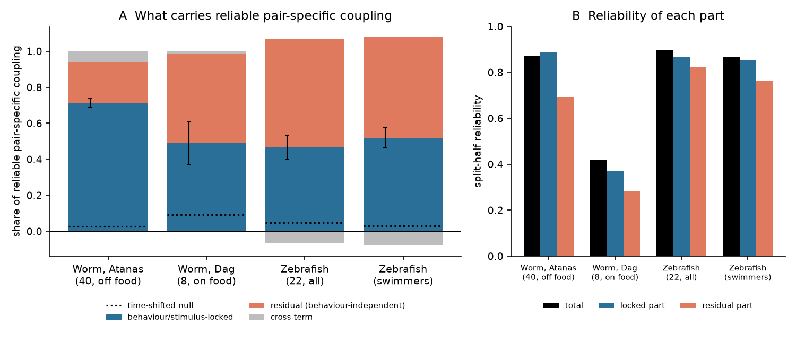
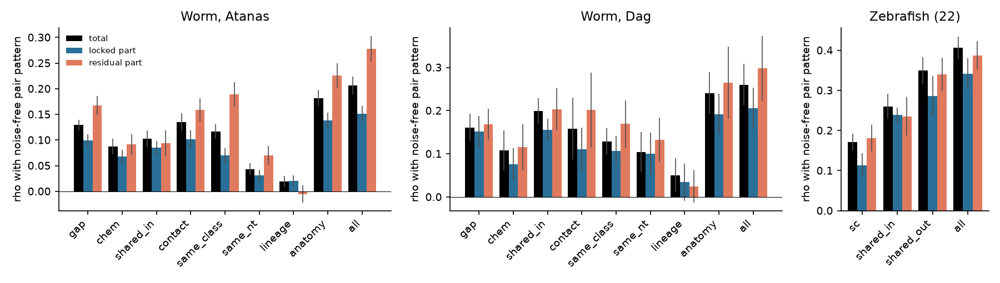
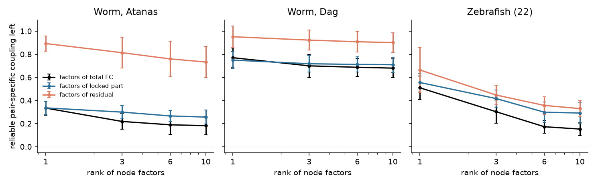

# Behaviour-locked covariance carried 71% of reliable pair-specific coactivity in 40 moving C. elegans and 47-52% in 22 larval zebrafish; wiring explained under 8% of the remainder

Job: sci-1107-dell-neural-structure-and-computation-63dc723e7611. Topic: neural-structure-and-computation.
Campaign: 11_07_2026. Machine: dell. Model: Claude Opus 5.5 (claude-opus-5-5), account claude-olen.
The signing key is a campaign-machine key. It is not a personal authorship claim.
Data provenance: `files/PROVENANCE.md`. External data terms: `files/NOTICE_EXTERNAL_DATA.md`.

## Summary

**Question.** Earlier campaign work found that the pair-specific part of functional connectivity (FC) is highly
reliable across animals, but wiring explains only about 5% (worm) to 24% (fly) of it after node and distance
effects (sci:sha256:2d23aeb7..., sci:sha256:8c65c10b...). Rank-3 node factors captured 62-78% of it. The open
question was: what sets this large, reliable, non-wiring part? We tested one specific candidate: covariance that
is locked to measured behaviour or stimuli. A shared behavioural drive gives each neuron a tuning, and two
neurons with similar tuning are coactive, also with no synapse between them.

**Method.** In each animal we predicted each neuron (or region) from behaviour with a cross-validated ridge model.
Worm: velocity, reversal state, head angle, angular velocity, body curvature and pumping, with causal and
anti-causal filters (56 features; 5 contiguous folds). Zebrafish: swim events and the dark-flash stimulus
(5 interleaved folds of 30 volumes). The Pearson correlation of z-scored traces then splits exactly into three
parts: r_total = r_locked + r_residual + r_cross. Here r_locked is the covariance of the predicted traces and
r_residual is the covariance of the prediction errors. For each part we removed node fixed effects, a distance
function and the bilateral-homolog flag (worm) from the group mean. We then used random split halves of the
animals. The **share** of a part is its split-half cross-covariance with the total, divided by the reliable
covariance of the total. The three shares add to 1. The **rho** of a predictor is its correlation with the
noise-free pair pattern of a part (half-sample correlation divided by the square root of the split-half
reliability). Nulls: the same model with the behaviour circularly shifted in time; node-label permutation (QAP);
a simulation with known truth. Intervals are leave-one-animal-out jackknife 95% intervals.

**Main results.**

1. **Worm (40 freely moving animals, off food; 107 neurons, 4,293 pairs).** The behaviour-locked part carried
   **0.712 (0.688-0.736)** of the reliable pair-specific coactivity. The time-shifted behaviour gave 0.027
   (0.021-0.034). The residual part carried 0.229 (0.203-0.255) and the cross term 0.059. A model with only
   locomotion (velocity and reversal) carried 0.708; head bending alone 0.412; pumping alone 0.090.
2. **The behaviour-locked part is the low-rank node structure.** Rank-3 node factors, fit on the locked part of an
   independent third of the animals, removed 70% of the reliable total pattern. Factors of the total removed 78%.
   Factors of the residual part removed only 19%.
3. **Wiring is weak in the locked part and stronger in the residual part.** The rho of all anatomical predictors
   together (gap junctions, chemical synapses, shared input, shared output, neurite contact; cross-fitted) was
   0.138 (0.123-0.154) for the locked part (1.9% of its reliable variance) and 0.226 (0.202-0.250) for the residual
   part (5.1%). With neuron class, type, transmitter and lineage also added, the residual rho was 0.278
   (0.253-0.303), that is 7.7%. Gap junctions: 0.100 locked, 0.167 residual. Lineage similarity predicted nothing.
4. **The residual part is reliable but mostly unexplained.** Its split-half reliability was 0.695. Its own rank-3
   factors removed about half of it, but the factors of the locked part removed only 8%. It agreed better between
   the two worm cohorts (calibrated r = 0.70) than the locked part (0.58).
5. **Replication in 8 on-food worms (Dag 2023, 800 frames each).** Reliability was low (0.42). The locked share was
   0.490 (0.372-0.608), null 0.092. Pumping carried more here (0.275 alone) than off food (0.090). Anatomy rho was
   0.192 locked and 0.265 residual.
6. **Zebrafish (22 larvae, 65 regions, 2,080 pairs).** The swim- and flash-locked part carried 0.466
   (0.397-0.535) of the reliable pair-specific coupling (stimulus alone 0.244; null 0.048). In the 16 fish with
   at least 8 swims it carried 0.520 (0.462-0.578), swims alone 0.331. Unlike the worm, the locked and residual
   patterns had nearly the same shape (calibrated r = 0.72 vs 0.35 in the worm), and anatomy explained them
   about equally (rho 0.34 and 0.39).
7. **Calibration.** In simulated worms with known truth, the share estimate was conservative (0.75 for a true
   0.88; 0.22 for a true 0.24). With no behaviour coupling it stayed at the null level (0.081 vs 0.068). The rho
   estimates matched the truth within 0.01.

**Conclusion.** In the freely moving worm, most of the reliable non-wiring pair-specific coactivity is a shared
locomotor drive: neurons that encode velocity and reversal in the same way are coactive. This drive is low-rank
and only weakly related to the pairwise wiring. Wiring explains a larger fraction of the behaviour-independent
remainder, but still less than 8% of it. In the larval zebrafish, about half of the reliable coupling is locked
to swims and flashes, and the remainder has the same spatial pattern.

**Main limitations.** "Behaviour-locked" means "linearly predictable from the measured behaviour with these
filters". Neural activity that drives or follows behaviour cannot be separated by this model. The model misses
non-linear and unmeasured behaviour, so the locked share is a lower bound; but any internal state that correlates
with behaviour goes into it. Connectomes and activity come from different animals. The Dag cohort is small and
has short recordings. Zebrafish data are region averages at about 1 volume/s, and the swim and stimulus model is
simple. All analyses were designed in this job after reading the earlier campaign results; there was no
pre-registration.

## 1. Background

The campaign has many studies of structure-function coupling. Shared input predicted FC beyond direct wiring in
worm, fly and mouse (sci:sha256:e7136a69...). Surrogate wiring with matched strengths and distances reproduced
48-100% of indirect-path gains (sci:sha256:08231ec2...). After node effects and distance, the wiring link is
pair-specific but small (sci:sha256:8c65c10b..., sci:sha256:2d23aeb7...). A node-similarity term absorbs almost
all wiring gain (sci:sha256:68f4f3d6...). Gap junctions keep a small link after three population modes are
removed (sci:sha256:00ff0bdd...). Predicted neuropeptide routes did not add a positive link
(sci:sha256:bcd56cbb...). In zebrafish, the projectome predicted trial-residual but not stimulus-locked coupling
(sci:sha256:b1adc602...). The NSM serotonergic state did not change the wiring coupling (sci:sha256:03107666...).

These results leave one question. Most reliable pair-specific FC is node structure that is not additive, and
wiring does not explain it. We asked if this structure is the covariance that the animal's behaviour (or the
stimulus) imposes on all neurons with a shared tuning.

## 2. Data

| Data set | Animals | Nodes / pairs | Frames | Behaviour or stimulus | Structure |
|---|---|---|---|---|---|
| C. elegans, Atanas, Kim et al. 2023, NeuroPAL, freely moving, off food | 40 | 107 neurons recorded in at least 15 animals; 4,293 pairs recorded in at least 15 animals | 1,600 at 0.6 s (800 before the heat stimulus in 19 animals) | velocity, reversal, head angle, angular velocity, body curvature, pumping | Cook 2019 gap junctions and chemical synapses, shared input and output, Witvliet adult-8 contact, class, type, transmitter (Wang 2024), lineage |
| C. elegans, Dag et al. 2023, on food | 8 | 100 neurons in at least 4 animals; 4,281 pairs | 800 | as above | as above |
| Larval zebrafish, Légaré et al. 2025, two-photon | 22 (16 with at least 8 swims) | 65 regions; 2,080 pairs | 892 at about 1 s | swim events; 12 dark flashes | mapZebrain SC (terminals), shared input and output |

Neurons with label confidence of at least 3 were used. Soma distance comes from OpenWorm atlas positions.

## 3. Methods

**Per-animal decomposition** (`01_worm_decompose.py`, `03_zf_decompose.py`). Traces and features were detrended
(linear and quadratic) and z-scored. Each neuron had its own ridge penalty, selected by inner CV on the training
folds. With prediction Yhat and error E = Y - Yhat (T frames), R_locked = Yhat'Yhat/T, R_residual = E'E/T,
R_cross = (Yhat'E + E'Yhat)/T. These add exactly to the correlation matrix of Y. The null shifts the whole
feature matrix circularly by 20-80% of T (3 shifts) and repeats the fit. The worm residual was also split into a
slow band (periods > 60 s) and a fast band. Behaviour-family models used only locomotion, head or pumping
features.

**Group budget** (`02_worm_budget.py`, `04_zf_budget.py`). For each part we averaged the animals of a half and
took the residual on the pair design (node dummies, cubic log distance, linear distance, homolog flag). We used
60 splits (Dag) or 20 splits (others) per jackknife replicate. Composite predictors were fit by least squares on
one half and tested on the other. The wiring-covariance split divides cov(wiring, total) into the three parts.
QAP used 500 node-label permutations of each predictor.

**Low-rank factors.** The animals were split into thirds. The top-r eigenvectors (by absolute eigenvalue) of the
pair-specific matrix of one third gave columns U_ik U_jk. We removed these columns from the other two thirds and
measured the reliable covariance that was left.

**Simulation** (`08_simulation.py`). Synthetic worms on the 107 real nodes: a velocity-like signal with tuning
on 60% of neurons, an independent slow latent state, graph-structured noise from the gap-junction matrix, 80%
of nodes observed per animal, 40 animals, the same model and metrics.

## 4. Results

### 4.1 Budget

| Data set | Reliability of total | Share locked | Share residual | Share cross | Share of time-shifted null | Reliability locked / residual | Calibrated r of locked and residual patterns |
|---|---|---|---|---|---|---|---|
| Worm, Atanas (40) | 0.872 | 0.712 (0.688-0.736) | 0.229 (0.203-0.255) | 0.059 | 0.027 (0.021-0.034) | 0.889 / 0.695 | 0.354 (0.297-0.410) |
| Worm, Dag (8) | 0.418 | 0.490 (0.372-0.608) | 0.498 (0.270-0.726) | 0.012 | 0.092 (0.005-0.179) | 0.370 / 0.283 | 0.719 (0.423-1.014) |
| Zebrafish, all (22) | 0.896 | 0.466 (0.397-0.535) | 0.601 (0.520-0.681) | -0.067 | 0.048 (0.024-0.071) | 0.865 / 0.824 | 0.721 (0.655-0.787) |
| Zebrafish, swimmers (16) | 0.865 | 0.520 (0.462-0.578) | 0.560 (0.481-0.638) | -0.080 | 0.030 (0.023-0.038) | 0.853 / 0.765 | 0.722 (0.628-0.815) |

In zebrafish the stimulus-only model carried 0.244 (all fish) and the swim-only model 0.331 (swimmers). The
cross term is negative there, so the locked and residual shares add to more than 1.

| Features | Atanas share | Atanas median CV R2 | Dag share | Dag median CV R2 |
|---|---|---|---|---|
| all | 0.712 | 0.152 | 0.490 | 0.097 |
| locomotion | 0.708 | 0.087 | 0.382 | 0.000 |
| head bending | 0.412 | 0.038 | 0.232 | -0.020 |
| pumping | 0.090 | -0.020 | 0.275 | -0.021 |

The behaviour model explains a small part of each neuron's variance (median CV R2 0.15), but it carries most of
the reliable pair pattern. The reason is that the locked covariance is shared over many neurons in the same way
in every animal.

### 4.2 Wiring and node identity in each part

| Predictor (worm, Atanas) | rho total | rho locked | rho residual |
|---|---|---|---|
| gap junctions | 0.129 (0.119-0.140) | 0.100 (0.088-0.112) | 0.167 (0.149-0.186) |
| chemical synapses | 0.088 | 0.068 | 0.091 |
| shared input | 0.103 | 0.085 | 0.094 |
| shared output | 0.114 | 0.084 | 0.137 |
| neurite contact | 0.135 | 0.101 | 0.158 |
| same class (not L/R homolog) | 0.117 | 0.070 | 0.189 (0.166-0.212) |
| same transmitter | 0.044 | 0.031 | 0.070 |
| lineage similarity | 0.019 | 0.020 | -0.005 (-0.022-0.011) |
| anatomy composite | 0.182 (0.166-0.198) | 0.138 (0.123-0.154) | 0.226 (0.202-0.250) |
| all predictors | 0.207 (0.190-0.224) | 0.152 (0.136-0.167) | 0.278 (0.253-0.303) |

QAP p was 0.002 (the minimum for 500 permutations) for gap, chemical, shared input, contact and class in both
parts; lineage was not significant (p = 0.70 residual, 0.17 locked; `results/worm/atanas_qap.csv`). Of the
covariance between gap junctions and total coactivity, 58% sits in the locked part and 48% in the residual part
(cross term -6%). The residual part holds only 23% of the reliable total, so wiring is over-represented in it.
In the residual part, the slow band was less reliable (0.45) than the fast band (0.76); gap junctions gave rho
0.19 (slow) and 0.13 (fast).

Dag: anatomy rho 0.241 total, 0.192 locked, 0.265 residual. Zebrafish (22): anatomy rho 0.406 total (16% of the
reliable variance), 0.342 locked, 0.388 residual; shared output was the strongest single predictor (0.35).

### 4.3 Low-rank structure

| Factors fit on an independent third | Reliable total left, rank 1 / 3 / 10 (Atanas) | Zebrafish rank 3 |
|---|---|---|
| total | 0.335 / 0.219 (0.153-0.286) / 0.183 | 0.303 |
| locked part | 0.337 / 0.300 (0.243-0.357) / 0.257 | 0.417 |
| residual part | 0.893 / 0.814 (0.681-0.947) / 0.734 | 0.448 |

In the worm, the residual part has its own low-rank part: its own rank-3 factors left 0.492 (0.397-0.587) of it,
while factors of the locked part left 0.925. After rank-3 factors were removed from the residual part, gap
junctions still gave rho 0.156 (0.098-0.214) and same class 0.149. With 8 Dag animals the thirds are too small
for a precise factor fit (rank-3 factors of the total left 0.70).

### 4.4 Agreement between worm cohorts

On 94 shared neurons and 3,369 pairs, the calibrated correlation between the Atanas and Dag pair patterns was
0.57 (total), 0.58 (locked part) and 0.70 (residual part); `results/worm/cross_cohort.csv`. These values have no
interval. The two cohorts differ in food state, length and data set, so these numbers mix all three.

### 4.5 Simulation check

| Scenario | True share locked | Estimated | Null | True / estimated rho of gap with residual |
|---|---|---|---|---|
| behaviour-dominated | 0.880 | 0.752 | 0.089 | 0.190 / 0.192 |
| latent state only, no behaviour | 0.000 | 0.081 | 0.068 | 0.040 / 0.039 |
| mixed | 0.236 | 0.224 | 0.079 | 0.064 / 0.065 |

## 5. Discussion

**What sets the reliable non-wiring coupling in the worm.** The earlier finding was that three node factors hold
most of the reliable pair-specific FC. Here, the factors are mostly a behaviour-locked locomotor axis. A
behaviour model with only velocity and reversal carried 71% of the reliable pair pattern; a time-shifted model
carried 3%. This axis orders the neurons from one coactive group to an anticorrelated group (Fig. 5). Many such neurons have no
direct synapse, so the axis is a node property in the sense of the question, but it is not additive. It agrees
with the known broadcast of locomotor state across the worm brain (Atanas et al. 2023; Kato et al. 2015).

**Wiring and the remainder.** Wiring is relatively more related to the behaviour-independent residual. This is
the same direction as the zebrafish trial-residual result (sci:sha256:b1adc602...). But even there, all tested
anatomy and node identity explained at most 8% of the reliable residual pattern. The residual also has its own
low-rank part that is not the behaviour axis, and it agrees between cohorts. Candidates for it are unmeasured
behaviour (e.g. egg laying, defecation, posture details), internal states, extrasynaptic signalling not in the
tested peptide model, and optical crosstalk between neighbouring somas that the distance terms do not remove.

**Zebrafish.** In the larva, about half of the reliable coupling is locked to swims and flashes, but the locked
and residual patterns are nearly the same. Thus the same network modes appear with and without the behaviour or
stimulus drive. Anatomy relates to both parts equally. A low-dimensional set of region modes, partly set by the
projectome, seems to carry coupling, and swims and stimuli move activity along these modes.

**Consequences for coupling studies.** A state contrast or a behaviour regression changes the share of the
locked part. For example, in the worm, pumping carried more of the pattern on food than off food. Studies of
structure-function coupling should report how much of the pair pattern is locked to behaviour, and test wiring on
the behaviour-independent part. Standard behaviour regression (correlation of residual traces) keeps the
residual pattern: its anatomy rho was 0.245 in the Atanas worms.

## 6. Limitations

- The behaviour model is linear with fixed filters. Non-linear or unmeasured behaviour stays in the residual.
  Neural activity that causes behaviour and activity that follows it both enter the locked part.
- The time-shifted null removes the alignment, but slow features can still fit slow drifts; the simulation
  shows a null floor of about 0.07-0.09 and a downward bias of the share when behaviour dominates.
- Shares refer to the population-mean pattern of the sampled animals. Animal-specific coactivity counts as noise.
- Connectomes, positions and activity come from different animals. Connectome error is not corrected, so rho is
  a lower bound for an error-free connectome.
- Worm analyses use Pearson r, not Fisher z, so that the parts add exactly. Earlier campaign work used Fisher z.
- In 19 Atanas animals only the 800 frames before the heat stimulus were used.
- The Dag cohort has 8 animals with 800 frames; its estimates have wide intervals and the low-rank test is weak.
- Zebrafish data are region averages at about 1 volume/s; folds are interleaved 30-volume blocks, which can give
  small leakage through calcium dynamics; no tail-angle kinematics were used.
- Fly and mouse were not tested, because the per-individual fly light-field data and the mouse data are not in
  the restored shared store.
- All tests were chosen in this job after earlier campaign results; jackknife intervals are not corrected for the
  number of tests.

## 7. Reproduction

1. Get the inputs into a scratch folder (never into this bundle):
   `bash files/code/get_data.sh SCRATCH [DATASETS_DIR] [CAMPAIGN_DIR]`.
   It needs the signed bundle sci:sha256:a250df14... for three small reference tables.
2. Run everything: `bash files/code/run_all.sh SCRATCH OUT [DATASETS_DIR] [CAMPAIGN_DIR]`
   (about 1.5 h on a loaded 24-CPU host, single-threaded BLAS).
3. Compare `OUT/worm/*_budget_jk.csv`, `OUT/zf/*`, `OUT/sim/*` with `files/results`. The random seeds are fixed.

Files: `files/code` (all code), `files/results` (all aggregate tables and logs), `files/figures` (PNG figures),
`files/PROVENANCE.md` (inputs, hashes, versions), `files/NOTICE_EXTERNAL_DATA.md` (third-party terms).
Table keys: `share|R_beh` = locked share, `share|R_res` = residual share, `rel|...` = split-half reliability,
`rho|<part>|<predictor>`, `left|<target>|<factor source>|r<rank>`, `rhoLR3|...` = rho after rank-3 removal.
