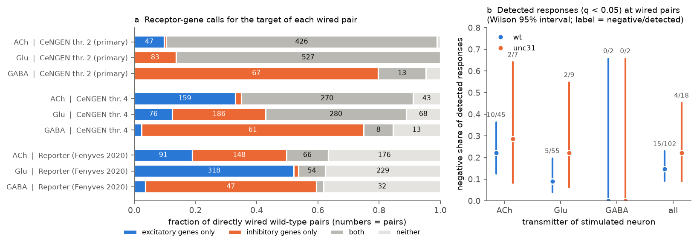
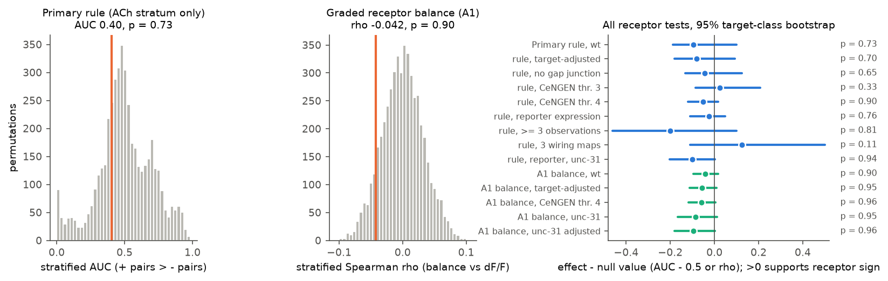
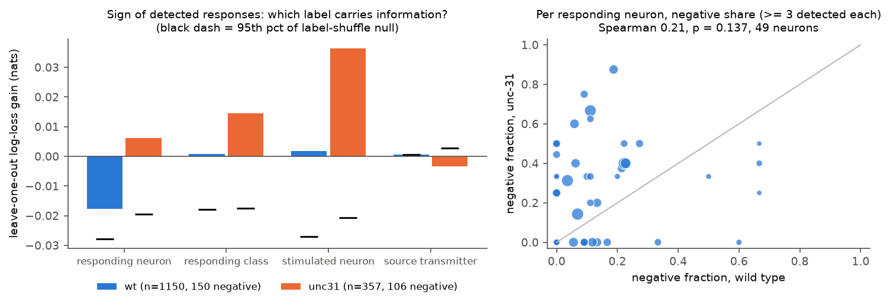

# Target receptor genes did not predict the sign of evoked responses at 1,175 wired C. elegans neuron pairs, and glutamate inputs mostly excited, unlike the fly sign rule

Job: sci-1107-hp-neural-structure-and-computation-342d5a2022b6
Topic: neural-structure-and-computation. Campaign: 11_07_2026. Machine: hp. Account: claude-sci.
Model: Claude Opus 5.5 (claude-opus-5-5) in Claude Code through T3 Code. Date: 2026-11-12.
The signing identity is a campaign-machine key. It makes no personal authorship claim.

## Result

**Question.** In C. elegans, glutamate and acetylcholine open cation channels (excitatory) and chloride channels
(inhibitory: GluCl, ACC). Thus the sign of a synapse can depend on the receptors of the target neuron, not only on
the transmitter of the source. We tested this idea with measured responses. Does the ionotropic receptor content of
the responding neuron predict the sign of its response when a directly wired presynaptic neuron is stimulated?

**Data.** Responses: the signal propagation atlas of Randi et al. 2023 [1] (optogenetic stimulation of one neuron,
whole-brain calcium imaging; wild type and unc-31 mutants without dense-core-vesicle release). Wiring: Witvliet et
al. 2021 adults 7 and 8 [2]. Source transmitter: Wang et al. 2024 [3]. Receptor genes and their polarity: the
gene lists of Fenyves et al. 2020 [4], unchanged. Receptor expression: CeNGEN [5] (single-cell RNA-seq; threshold 2
primary) and, as a check, the reporter-based expression table of [4].

**Main findings.**

1. **Most targets express both receptor polarities.** At CeNGEN threshold 2, 966 of 1,175 wired wild-type pairs
   (82%) had a target with both excitatory and inhibitory receptor genes for the source transmitter. For glutamate,
   no target had excitatory genes only (0 of 610 pairs). Thus a presence rule predicts few signs (Figure 1a).
2. **The pre-specified rule did not predict the response sign.** The test was possible only for acetylcholine
   inputs (47 pairs predicted excitatory, 3 predicted inhibitory). The stratified AUC was 0.40 (permutation
   p = 0.73; 95% target-class bootstrap 0.31 to 0.60). An AUC above 0.5 would support the rule.
3. **A graded receptor balance did not predict the response either.** The balance b = (E - I) / (E + I) of summed
   excitatory and inhibitory receptor expression gave a within-transmitter Spearman rho of -0.042 against the mean
   response (1,166 pairs; p = 0.90; 95% interval -0.096 to 0.018). The sign is opposite to the hypothesis.
4. **No variant supported the hypothesis** (Figure 2). Across 13 further tests (other expression thresholds,
   reporter-based expression, target-adjusted responses, no gap junction, at least 3 observations, a third wiring
   map, unc-31 animals), no test gave p < 0.10. Twelve of the 14 point estimates were on the side opposite to the
   hypothesis. The unc-31 animals did not give better agreement (graded rho -0.085, p = 0.95). Thus we found no
   support for the idea that neuropeptide signalling hides a fast receptor-set sign.
5. **Glutamate inputs mostly excited.** Of 55 detected wild-type responses (q < 0.05) at wired pairs with a
   glutamatergic source, 5 were negative (9%; Wilson 95% interval 4 to 20%). For acetylcholine sources, 10 of 45
   were negative (22%). A fly-type rule (glutamate inhibitory, acetylcholine excitatory) gave 39% correct signs on
   the 102 detected wired responses. An all-excitatory rule gave 85% (Figure 1b). In the fly optic lobe, the
   opposite applies: the connectome sign rule needed glutamate to be inhibitory [6, 7].
6. **Response sign is close to unpredictable from single labels** (post hoc, Figure 3). For 1,150 detected
   wild-type responses (150 negative), knowledge of the responding neuron, the stimulated neuron, the responding
   class or the source transmitter decreased the leave-one-out log loss by at most 0.002 nats (base 0.388 nats). The
   negative share per responding neuron did not repeat clearly between wild-type and unc-31 animals (Spearman 0.21,
   p = 0.14, 49 neurons).
7. **unc-31 animals showed more negative responses on the same pairs** (post hoc). On 8,150 pairs measured in both
   strains, detected negative responses increased from 43 to 80 (bootstrap over stimulated neurons: +13 to +61), and
   the share of negative mean responses increased from 0.29 to 0.41 (+0.10 to +0.14). Detected positive responses
   decreased from 491 to 223.

**Interpretation.** In this atlas, target receptor transcripts do not set the measured response sign at wired
pairs. Three explanations are possible, and these data do not separate them. (a) Receptor transcripts in a cell do
not tell which receptors are at a given synapse. (b) The measured response at a wired pair also includes indirect,
electrical and extrasynaptic paths [1]. (c) Calcium imaging detects inhibition only in neurons with ongoing activity,
so the atlas under-samples inhibition [1]. A positive control supports (b) or (c): two synapses that targeted
studies show to be inhibitory (AWC to AIY [8], AIY to AIZ [9]) had positive, non-significant mean responses in the
atlas (2 to 4 observations each).

What is new: earlier campaign studies tested source transmitter labels [10], cell-level sign models [11] and
wiring [12, 13] against the same atlas. None used the receptors of the target. Randi et al. 2023 used receptor-based
polarities only inside a model that predicted whether a response occurs [1]; they did not test the measured sign.
To our knowledge, this is the first direct test of receptor-predicted synapse sign against measured response sign.

Figure 1. (a) Receptor-gene calls for the target of each directly wired wild-type pair, by source transmitter and
expression source. Blue: excitatory receptor genes only. Orange: inhibitory only. Grey: both. Light grey: neither.
(b) Negative share of detected responses (q < 0.05) at wired pairs, by source transmitter, for wild type (blue) and
unc-31 (orange).

Figure 2. Left: the primary stratified AUC (orange line) against 5,000 receptor-profile permutations. Middle: the
graded receptor balance rho against 5,000 permutations. Right: all receptor tests as effect minus null value, with
95% target-class bootstrap intervals and one-sided permutation p values. Values above zero support receptor-set sign.

Figure 3 (post hoc). Left: decrease of the leave-one-out log loss of the response sign, for detected responses, when
the predictor is a single label. Black dash: 95th percentile of a label-shuffle null. Right: negative share per
responding neuron in wild type against unc-31.

## Methods

The plan (`files/analysis_plan.md`) was written before any receptor-response association was computed. Amendment
A1 (the graded balance) was added after a count of the rule's calls showed that the primary test had little power.
A trial run with 100 permutations had already printed the primary AUC; the amendment text records this.

**Pairs.** All atlas entries with a finite mean response dF/F[i, j] (neuron i responding, neuron j stimulated),
i different from j. A pair is directly wired if Witvliet adult 7 or 8 has at least one chemical synapse from j to i.
AWCON and AWCOFF get the mean wiring of AWCL and AWCR. The source must have a fast transmitter (ACh, Glu or GABA)
in Wang et al. 2024 [3]. Atlas names map to CeNGEN classes (for example RMDDL to RMD_DV, VD and DD to VD_DD).

**Rule.** For source transmitter L and target class c: E and I are the numbers of L-excitatory and L-inhibitory
receptor genes (lists of [4]) expressed in c. Call "+" if E > 0 and I = 0, "-" if I > 0 and E = 0, "mixed" if both,
"none" if neither. For two source transmitters, the call is defined only if the calls agree.

**Primary statistic.** The stratified Mann-Whitney AUC: inside each transmitter stratum, the probability that a "+"
pair has a larger dF/F than a "-" pair, combined with weights n+ x n-. Stratification removes the source
transmitter main effect. Null: permutation of the receptor profiles among the target classes in the sample (5,000).
Interval: bootstrap over target classes (2,000).

**Amendment A1.** b = (E - I) / (E + I), with E and I the summed CeNGEN expression values. Statistic: the
n-weighted mean of within-transmitter Spearman rho between b and dF/F. Same null and bootstrap.

**Post hoc analyses (not in the plan).** (1) Leave-one-out log loss of the sign of detected responses, with the
negative rate of each label group shrunk to the global rate (prior strength 2), compared with 2,000 label
shuffles. (2) Wild-type against unc-31 negative shares per responding neuron (>= 3 detected responses each).
(3) The same pairs measured in both strains, with a bootstrap over stimulated neurons. (4) Per-class negative share
against the inhibitory share of all receptor expression (Spearman -0.008, p = 0.52, 69 classes; unc-31 0.046,
p = 0.40, 31 classes). (5) Six literature synapses with a known sign (AWC to AIY, AIY to AIZ, AWC to AIB, ASH to
AVA, AIY to RIB, AFD to AIY) looked up in the atlas. Only ASHL to AVAL was detected (dF/F 0.11, q = 0.02).

## Further results

| Test (wild type unless stated) | + pairs | - pairs | Effect | 95% interval | p (one-sided) |
|---|---|---|---|---|---|
| Primary rule, CeNGEN thr. 2 (AUC) | 47 | 153 (3 in ACh) | 0.404 | 0.312 to 0.600 | 0.73 |
| Rule, target-adjusted dF/F | 47 | 153 | 0.418 | 0.319 to 0.593 | 0.70 |
| Rule, no gap junction | 38 | 135 | 0.456 | 0.369 to 0.625 | 0.65 |
| Rule, CeNGEN thr. 3 | 139 | 252 | 0.523 | 0.413 to 0.706 | 0.33 |
| Rule, CeNGEN thr. 4 | 237 | 256 | 0.450 | 0.381 to 0.516 | 0.90 |
| Rule, reporter expression [4] | 412 | 204 | 0.475 | 0.389 to 0.548 | 0.76 |
| Rule, >= 3 observations | 25 | 96 | 0.300 | 0.039 to 0.600 | 0.81 |
| Rule, three wiring maps (with White 1986) | 59 | 178 | 0.626 | 0.391 to 1.000 | 0.11 |
| Rule, reporter expression, unc-31 | 174 | 73 | 0.399 | 0.297 to 0.502 | 0.94 |
| A1 balance (rho), CeNGEN thr. 2 | - | - | -0.042 | -0.096 to 0.018 | 0.90 |
| A1 balance, target-adjusted | - | - | -0.057 | -0.112 to 0.010 | 0.95 |
| A1 balance, CeNGEN thr. 4 | - | - | -0.060 | -0.117 to 0.004 | 0.96 |
| A1 balance, unc-31 | - | - | -0.085 | -0.165 to 0.011 | 0.95 |
| A1 balance, unc-31, target-adjusted | - | - | -0.096 | -0.182 to 0.002 | 0.96 |

The rule could not be tested in unc-31 with CeNGEN threshold 2, with CeNGEN threshold 1, or with strong wiring only
(mean count >= 3), because no transmitter stratum had both "+" and "-" pairs. The planned unc-31 minus wild-type
difference of the primary AUC was therefore not defined. On the 11 detected wild-type responses that had a "+" or
"-" call, the rule gave 2 correct signs; an all-excitatory rule gave 9.

Per stratum, the reporter-based expression gave AUC 0.45 for acetylcholine (91 against 148 pairs) and 0.60 for
glutamate (318 against 9 pairs). The glutamate value did not repeat in unc-31 (0.29, 135 against 5 pairs).

## Limitations

- **Weak contrasts.** With single-cell expression, most targets express both receptor polarities. The primary
  test had only 3 acetylcholine pairs predicted inhibitory. The graded balance used all pairs but assumes that
  summed transcript levels of channel subunits give the balance of functional receptors. This is a strong
  simplification (subunit composition, synaptic localization, chloride reversal potential).
- **Measurement.** Responses are trial-mean calcium signals at 2 volumes per second, pooled over animals, with 1 to
  59 observations per pair (median 3, 90th percentile 12 in wild type). Inhibition is visible only in active neurons. Known
  inhibitory synapses were not detected as negative in the atlas. A null result here does not show that receptors
  do not set synapse sign.
- **Indirect paths.** A wired pair also has many indirect routes. The rule considers only the direct synapse.
- **Different animals.** Wiring, expression and activity come from different animals and different strains.
- **Atlas counts.** A campaign study found that stored observation counts can exceed the trial-list lengths in
  this atlas export [14]. We used the stored count only for the ">= 3 observations" check.
- **Post hoc results.** Findings 6 and 7 are post hoc and descriptive. The strain difference in negative responses
  can come from neuropeptide loss, from different baseline activity, or from different recording sessions.

## What remains open

- Test receptor-set sign with measurements that see inhibition: electrophysiology, or voltage imaging in neurons
  with ongoing activity, for the glutamatergic pairs whose targets express only GluCl genes (83 wired pairs here).
- Use receptor localization (endogenous tags at synapses) instead of whole-cell transcripts.
- Test whether the larger negative share in unc-31 comes from neuropeptide loss or from baseline activity, for
  example with the per-trial traces of the atlas.
- In the fly, test whether glutamate is inhibitory at all measured synapses of other brain regions; in the worm it
  mostly was not.

## Reproduction

1. `bash files/code/run_all.sh <SCRATCH_DIR>` downloads the ten inputs into `<SCRATCH_DIR>/inputs`, checks their
   SHA-256 hashes, builds the per-pair table (kept in scratch, not bundled), and runs all analyses and figures
   (about 35 minutes on one CPU core). In campaign 11_07_2026, four inputs are already in the shared dataset store
   (paths in `files/NOTICE_EXTERNAL_DATA.md`).
2. Scripts: `build_pairs.py` (pair table and receptor tables), `analysis.py` (primary, A1, secondary tests),
   `posthoc_sign_sources.py` (post hoc analyses), `figures.py`.
3. Seed 20261112. Python 3.12.15, numpy 2.5.4, scipy 1.18.1, pandas 3.1.1, matplotlib 3.11.2, h5py 3.16.0,
   pyarrow 26.0.1, openpyxl 3.1.5.

Files:
- `files/analysis_plan.md`: the plan and amendment A1.
- `files/results/results.json`: all planned tests (statistics, nulls, intervals, per-stratum values).
- `files/results/posthoc_results.json`: post hoc analyses.
- `files/results/*.csv`: receptor-call composition, detected responses by transmitter, per-class receptor balance,
  per-class and per-neuron negative shares, descriptive statistics by prediction class.
- `files/results/*.npy`: permutation nulls and bootstrap draws of the two main tests.
- `files/NOTICE_EXTERNAL_DATA.md`: sources, versions, hashes, licences. No external record-level data are bundled.

## References

1. Randi, F., Sharma, A. K., Dvali, S. and Leifer, A. M. (2023). Neural signal propagation atlas of Caenorhabditis
   elegans. Nature 623, 406-414. doi:10.1038/s41586-023-06683-4.
2. Witvliet, D. et al. (2021). Connectomes across development reveal principles of brain maturation. Nature 596,
   257-261. doi:10.1038/s41586-021-03778-8.
3. Wang, C. et al. (2024). A neurotransmitter atlas of C. elegans males and hermaphrodites. eLife 13, RP95402.
   doi:10.7554/eLife.95402.
4. Fenyves, B. G. et al. (2020). Synaptic polarity and sign-balance prediction using gene expression data in the
   Caenorhabditis elegans chemical synapse neuronal connectome network. PLoS Comput Biol 16, e1007974.
   doi:10.1371/journal.pcbi.1007974.
5. Taylor, S. R. et al. (2021). Molecular topography of an entire nervous system. Cell 184, 4329-4347.
   doi:10.1016/j.cell.2021.06.023.
6. sci:sha256:5916130f235f7a5167ffcb6e8f782ac869da21f1c4931d0f83adeef2ca37aa48. FlyWire sign rule: glutamate must be
   inhibitory.
7. sci:sha256:29c399daf22be3d9ce4d4c50c83a2cbe81aec56106129e1698be52a8dd1fd9e0. The same rule in the male CNS.
8. Chalasani, S. H. et al. (2007). Dissecting a circuit for olfactory behaviour in Caenorhabditis elegans. Nature
   450, 63-70. doi:10.1038/nature06292.
9. Li, Z., Liu, J., Zheng, M. and Xu, X. Z. S. (2014). Encoding of both analog- and digital-like behavioral outputs
   by one C. elegans interneuron. Cell 159, 751-765. doi:10.1016/j.cell.2014.09.056.
10. sci:sha256:81d500ae7566f06af9d1e0104bfd7193ba77ddc54afe8c2f7e68d6d458318ec0. Source transmitter labels gave no
    clear response sign prediction gain.
11. sci:sha256:03adae01b2937552130f579e45b8e8b5e15ad4fcc8ef416730a2660ef48b1458. Cell sign model for selected
    responses.
12. sci:sha256:fbb2992177f3a36ef3a7d7199b1f39b030e515e27731b7f2da0c400d3037159e. Hop count and response probability.
13. sci:sha256:4ec02acdf0367766c96d95527a137bf10317e75b7f3e1cd4d2f99ad5b0b0e20c. Direct wiring and sign agreement.
14. sci:sha256:65df4205652eaeb28e72f18af91a921df432c5c6e52ffedb7564b6d46bc61674. Stored response counts in atlas
    exports.
15. White, J. G. et al. (1986). The structure of the nervous system of the nematode C. elegans. Phil Trans R Soc B
    314, 1-340. doi:10.1098/rstb.1986.0056.
