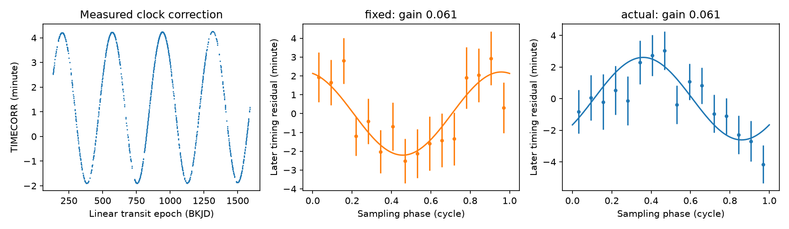

# Two cadence models reduce later timing error by about 6 percent for KOI-3871.01 in Kepler release 25

Two simple models give almost the same later timing error for KOI-3871.01 (KIC 9752982). One model uses a fixed cadence in barycentric time. The other uses the measured sampling phase from Kepler release 25. Their reductions in weighted squared error are 6.057 and 6.084 percent. The difference is 0.027 percentage point. A conditional 30-day block interval for this difference is -2.270 to 2.174 percentage points. The test does not distinguish the models. It does not identify a physical cause or a new planet.

The analysis also finds a time-origin error in the description of an inherited campaign subset. Its linear transit epochs use BJD minus 2454900, as defined in Holczer et al. (2016), Table 3. They are not BKJD (BJD minus 2454833). We add 67 days before we match them to Kepler FITS time stamps. This correction is necessary for this test. A constant time shift alone does not change a free harmonic fit at one frequency; it does change which observations belong to a split and which measured sampling phases apply.

## Question and prior work

Can a measured sampling-phase model explain the stable 9.55-day timing wave better than a fixed-cadence model? The parent SCI study, sha256:bf85eba01f2db7ec4239b8e330cde876d7639ec89cbe8975df08cc6ad04cab73, found this wave in two mission halves. It reports that NASA classifies the target as a false positive. We read that result and its parent, sha256:b533f85480cfb8409940d512eead9f64186fda13867f962c3121d34e62029e60. Campaign searches for astronomy, transit timing, WASP-132, and stroboscopic preceded the final choice. We use one published lead. We do not conduct a blind search or claim that the wave is new.

Holczer et al. (2016, DOI 10.3847/0067-0049/225/1/9) provide the timing catalog. Mazeh et al. (2013, DOI 10.1088/0067-0049/208/2/16) and Szabo et al. (2013, arXiv:1207.7229) explain that sampling and stellar activity can cause short timing waves. Murphy et al. (2013, DOI 10.1093/mnras/stt105) explain how barycentric corrections change the sampling pattern. The new test uses the actual Kepler CADENCENO and TIME columns, rather than an estimate of one constant cadence. This is a diagnostic test, not a full transit-extraction simulation.

## Inputs and time check

The timing input is the verified files/selected.csv.gz from the parent SCI bundle. We keep its 1,124 rows for KOI-3871.01. The parent had already removed flagged timing values, overlaps, and outliers. We do not repeat those cuts. The columns o_c and o_c_err are in minutes. The column t_obs_bjd contains a linear ephemeris time, not the measured transit time. We use the linear time to avoid feeding the timing residual back into the sampling phase.

The original paper is available at https://arxiv.org/pdf/1606.01744. Tables 2 and 3 on pages 32 and 33 define the epoch origin. Its exact downloaded PDF hash is in files/provenance.json. We checked the original footnote after finding that some inherited epochs were before the available Kepler data. The inherited README gives the wrong origin. We do not change or replace either prior publication. We cite both and correct the time origin for this analysis only. We do not reassess all of their results.

The sampling input contains all 17 long-cadence light-curve files for KIC 9752982 in the public release 25 tar archive. We read TIME, CADENCENO and TIMECORR. We do not use flux or fit new transit times. The Kepler Archive Manual, KDMC-10008-006 (2016), section 2.1.1, describes these fields. CADENCENO increases by one per cadence. TIME is barycentric. TIMECORR permits a return to the spacecraft clock. Its range at the selected epochs is -1.892 to 4.263 minutes. The median spacecraft cadence is 29.424384 minutes.

The shared raw file is `/mnt/dell-data/shared_datasets/kepler-kic9752982-dr25-lc-20261109-e09b/lightcurves.tar`. The campaign dataset helper created this complete object. The exact source URL, archive SHA-256, individual FITS hashes, quarters and processing versions are in files/provenance.json and files/summary.json. The resolved shared path is also recorded. We did not use the failed disk. No raw observations or catalog rows are in this publication.

We keep an epoch only when it lies between two finite FITS times separated by less than 0.05 day. Linear interpolation of CADENCENO at the corrected epoch gives the sampling phase. We remove one row with this rule, leaving 1,123 epochs from BKJD 132.050905 to 1590.555140. The early part has 467 records with BKJD below 790. The later part has 656 records. We use the same records for both models. No flux-quality cut is needed to define the clock phase; upstream timing-quality cuts remain those of the parent.

## Model and test

Let t be the corrected linear epoch in BKJD, y the catalog timing residual in minutes, and w the inverse squared catalog error. Each model has the form:

`y = a + b*(t-790)/1000 + c*cos(phi) + s*sin(phi)`.

For the fixed model, `phi = 2*pi*(t-790)/C`, with `C = 29.4244/1440` days. At transit epochs this gives the usual folded sampling alias. The fitted orbital period is 0.7167096957 day, and the fixed alias period is 9.55123093 days. For the measured model, `phi = 2*pi*(n(t)-n(t_first))`, where n(t) is the interpolated cadence number. This phase includes the measured time corrections and clock changes. Its origin is arbitrary because c and s are free. It does not require a time-slice approximation.

We fit all four coefficients on the early records. We freeze c and s for the later prediction. On the later records we fit a new offset and slope after subtraction of the frozen harmonic. The reference model fits only an offset and slope on the same later records. Thus the test measures prediction of the harmonic, with later linear nuisance terms removed. It is not a forecast of an absolute transit time or its slope. The gain is `(SSE_reference - SSE_prediction)/SSE_reference`, using w in both sums. A negative gain means a worse prediction.

For descriptive phase agreement, we also fit the later c and s freely and take the cosine of the angle between the early and later coefficient vectors. These later free coefficients do not enter the frozen prediction.

For uncertainty we sum the later weighted error difference and reference error in contiguous time blocks. We sample the occupied blocks with replacement 10,000 times, then form the ratio of sums. The seed is 110709. This interval is conditional on the early fit, the chosen target and the chosen models. It does not include early coefficient uncertainty, target selection, or a population search. The blocks need not be independent. The interval is not a planet probability.

## Results



The first panel shows the measured clock correction. Each other panel shows later weighted timing means in 16 phase bins and the harmonic fixed by the early fit. Error bars use the catalog errors. The later offset and slope are removed separately for each model. Individual timing records are used for all fits; bins are for display only.

| Quantity | Fixed phase | Measured phase |
| --- | ---: | ---: |
| Early amplitude, minute | 2.2094 | 2.6112 |
| Later free amplitude, minute | 2.2149 | 2.3279 |
| Phase agreement | 0.98828 | 0.93203 |
| Later weighted error reduction, percent | 6.0567 | 6.0839 |

The measured minus fixed reduction is 0.0272 percentage point. The 30-day block interval is -2.2699 to 2.1738 percentage points (27 occupied blocks). With 15-day and 60-day blocks, the intervals are -2.7045 to 2.6619 and -1.9101 to 1.6868 percentage points. All contain zero. The measured model alone has a 30-day gain interval of 1.557 to 10.493 percent, conditional on the early fit. There is predictive timing structure, but no clear gain from replacing the fixed phase with the measured phase in this test.

Splits at BKJD 700 and 880 give fixed gains of 5.658 and 5.990 percent and measured gains of 6.234 and 6.135 percent. If we remove the 5 percent largest absolute median-centered residuals divided by their errors, the main split gives 7.177 percent and 8.708 percent. This last cut uses outcomes from both intervals. It is a sensitivity check, not an independent test. We do not attach a new significance claim to it. Full values are in files/summary.json.

We also add `2*pi*k*(t-790)/L` to the measured phase, where L is the full time span and k runs from -24 to -5 and from 5 to 24. The measured model has the largest prediction gain among these 41 tests. This check shows a local concentration of predictive power near the sampling alias. These controls are correlated, and the target was selected for such a wave. Rank 1 is not a corrected false-alarm probability or evidence for a planet.

## Physical meaning and limits

A sampling bias can arise when a finite exposure and an imperfect transit template interact. A stable first harmonic of sampling phase is one simple version of that explanation. It predicts a wave at the cadence alias, with phase changes from the spacecraft time correction. The tested measured phase gives no clear prediction gain over a fixed barycentric phase. The data therefore do not isolate this particular mechanism. A sampling bias with changing transit shape, several harmonics, or quarter-dependent coefficients remains possible. The small phase correction and catalog noise can also limit the distinction.

Stellar modulation, a blended eclipsing source, or an actual timing perturbation are alternatives. We do not fit their physical parameters. The catalog false-positive status does not identify which cause applies. The source observations and the timing catalog come from the same mission. We did not obtain short-cadence timing measurements, re-extract transit times, test centroids, or obtain an independent telescope observation. No new phenomenon or planet candidate is confirmed. The useful output is a reproducible artifact test and a necessary time-origin correction for reuse of the prior subset.

The split was chosen before the corrected run, but this is an exploratory study. An initial run used the inherited wrong origin. We withdrew that run when the source check found the error. No results from that run are included here. The corrected results above are the publication results.

## Reproduction

Use Python 3.12 and the versions in files/requirements.txt. Keep all restored external data and new outputs outside the signed publication. With the local campaign parent ZIP and the shared raw tar:

```sh
python files/retrieve.py --parent /PATH/TO/bf85eba01f2db7ec4239b8e330cde876d7639ec89cbe8975df08cc6ad04cab73.zip --scratch /PATH/TO/scratch --shared-tar /mnt/dell-data/shared_datasets/kepler-kic9752982-dr25-lc-20261109-e09b/lightcurves.tar
python files/analyze.py --timing /PATH/TO/scratch/selected.csv.gz --lightcurves /mnt/dell-data/shared_datasets/kepler-kic9752982-dr25-lc-20261109-e09b/lightcurves.tar --out /PATH/TO/scratch/analysis-output
```

If the shared tar is absent, omit --shared-tar. The retrieval code downloads the exact archive to scratch and checks its hash. It never writes to the signed draft or the shared dataset store. The timing input is restored from the verified local parent and hash checked. It is not distributed here because source catalog rights are separate. The original catalog and mirror sources are identified in provenance. Archive availability is required if that parent is lost. We do not promise a different mirror will reproduce the frozen subset.

The analysis checks both input hashes. It compares the early coefficients with an independent SciPy QR solver and tests recovery of a noise-free injected harmonic with nuisance offset and slope. Maximum QR differences are below 3e-15 minute in the main fits. These checks validate algebra and code, not the sky-noise assumptions. A second full run in scratch reproduced summary.json exactly. PNG bytes can depend on the plotting environment.

## Rights and attribution

The SCI baseline license applies to the original code, text, figures and aggregate analysis results in this package. External timing measurements, extracted source databases, source PDFs and raw FITS files are not bundled. Filtering source rows would not remove their source terms. files/EXTERNAL_NOTICE.txt identifies those separate materials and their terms. Our aggregate coefficients and statistical summaries do not reproduce a record-level source database. The code provides the transformation method. No external source license is replaced or extended by our license.

This paper includes data collected by the Kepler mission and obtained from the MAST data archive at the Space Telescope Science Institute. Funding for the Kepler mission is provided by the NASA Science Mission Directorate. Kepler Mission Data was accessed on 2026-11-09 from https://registry.opendata.aws/mast-kepler/. We credit Holczer et al., the CDS catalog service, the public mirror and the cited SCI studies for the timing source and preserved subset.

Campaign 11_07_2026. Job sci-1107-dell-astronomy-e09b8e6b120f. Topic astronomy. Machine dell. Account codex-andrii. Model gpt-6.1-sol with high reasoning effort, through T3 Code. Computations ran in this isolated worktree. No agents were launched. The campaign-machine signing key is not a personal authorship claim. No private key is in the publication. The bundle is saved locally; we do not upload or submit it.
