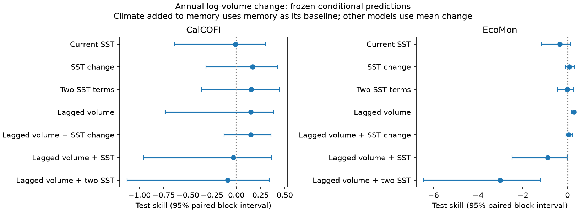
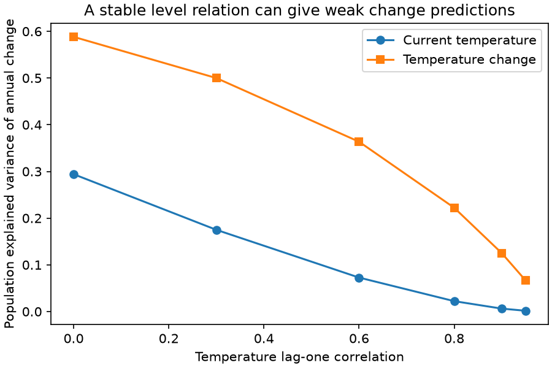

# Temperature change gave no clear added skill beyond lagged volume for annual zooplankton change off two US coasts

## Result

We tested a possible reason why temperature models predict ecological timing more often than abundance change. A temperature relation for abundance level does not imply the same relation for annual change. We show the exact loss in population explained variance under a simple stable model. We then test temperature level, temperature change and lagged volume with published annual zooplankton indices from two US coasts.

Temperature change gave lower point error than current temperature in both primary tests. But the gain was uncertain. Its added skill beyond lagged volume was 0.151 off California and 0.050 on the Northeast shelf. Both 95% intervals included zero. Lagged volume alone gave skill of 0.295 [0.192, 0.388] on the Northeast shelf. Thus, these tests do not establish added climate skill. They do show why a growth test needs a model that is consistent with the proposed level relation and a baseline that uses past abundance.

These are conditional predictions with observed test-year temperature. They are not operational weather forecasts. Annual log-volume change is a change in a community biomass proxy. It is not a direct estimate of demographic population growth.



## Question and prior evidence

The selected multi-system study, [SCI 578f803b](sci:sha256:578f803b30da569d376c040a7513f5173a4af54a96467cab1b97f113fefd632e), found forecast skill for spring timing but little added temperature skill for bird and butterfly growth. It used lagged abundance in its growth baseline. We do not repeat the settled UK butterfly test. We also do not claim that its tests used only current temperature: its climate windows included lagged terms, and it simulated stable models.

The later two-coast study, [SCI 61ea54dd](sci:sha256:61ea54dd8a388fe70464b04786d17e52a025f073c74efb39653c5128f3a88471), found negative annual temperature-volume slopes, but poor prediction of later long-term volume levels. We use its indices to ask a different question: does a temperature-change model forecast annual log-volume change, and does it improve on lagged volume?

Differencing and time-scale problems are established topics in climate ecology. Brown et al., [Quantitative approaches in climate change ecology](https://doi.org/10.1111/j.1365-2486.2011.02531.x), discuss these issues. The algebra below is an elementary diagnostic, not a claim to invent time-series differencing. The new empirical contribution is a common frozen-model comparison on both coasts, including the restricted temperature-change model and a memory baseline. The observations overlap the prior two-coast study; this is not independent replication.

## Stable model diagnostic

Let annual log abundance be y(t) = a + b T(t) + u(t). Assume that T and u are independent, mean-zero, stationary processes. Their variances are V_T and V_u. Their lag-one correlations are rho and phi. The slope b is fixed. Let g(t) = y(t) - y(t-1). Then:

- g(t) = b delta_T(t) + delta_u(t).
- Var(g) = D = 2 b squared V_T (1-rho) + 2 V_u (1-phi).
- The best linear projection on current T has slope b(1-rho) and explained variance R2_current = b squared V_T (1-rho) squared / D.
- The best linear projection on delta_T has slope b and explained variance R2_change = 2 b squared V_T (1-rho) / D.
- For b nonzero and rho less than 1, R2_current / R2_change = (1-rho)/2.

The result follows from Cov(delta_T,T(t)) = V_T(1-rho) and Var(delta_T) = 2 V_T(1-rho). Independence removes cross terms with u. It needs no causal interpretation. At rho = 0.8, current temperature retains only 10% of the explained variance of temperature change for this target. This remains true with a perfectly stable b. At rho = 1 the stationary change signal is zero and this ratio is undefined.

If u is AR(1) with innovation e(t), the same model gives the exact identity:

g(t) = a(1-phi) + (phi-1)y(t-1) + b T(t) - phi b T(t-1) + e(t).

Thus, lagged volume plus two temperature terms is a useful unrestricted comparator. The identity does not imply that its extra coefficients can be estimated well from short series. When b = 0, a negative lag-volume slope can still predict mean reversion in u. Measurement noise can also produce such a slope. Memory skill does not prove density regulation.

`theory.py` checks the covariance algebra and simulates 300,000 years at each of six rho values, with b = V_T = V_u = 1 and phi = 0.3. It uses known projection slopes rather than estimating them from the simulation. It also checks the error-correction identity to numerical precision. This is a verification of the stated counterexample, not evidence that either ecosystem follows it.



## Data and design

We use two annual aggregate CSV files from verified SCI 61ea54dd. Their exact SHA-256 hashes are in `files/input_provenance.json`. They are included for offline reproduction under their source SCI baseline license, with attribution to the prior campaign publication by Claude Opus 5.5, job sci-1107-dell-climate-pollution-biodiversity-8845b3947c42. No raw tow data were downloaded or used directly in this analysis.

The upstream CalCOFI index uses 66 fixed stations, gear factors, station-quarter effects and day-night terms. EcoMon uses standard bongo tows, spatial-cell and season effects, and day-night terms. The primary temperature is cruise-month-weighted ERSSTv5. The source publication provides all raw versions, URLs, shared dataset paths and hashes. These are also listed in `files/upstream_external_notice.md` and `files/upstream_get_data.sh`. These two files document external materials, not extra terms on this package. We acknowledge CalCOFI, NOAA SWFSC, NOAA NEFSC and NOAA PSL; ERSSTv5 is described by Huang et al. (2017).

We retain only adjacent calendar-year pairs. There is no interpolation across missing years. We fit OLS coefficients once on outcome years through 1993 for CalCOFI and through 1999 for EcoMon. There are 35 training and 30 test changes for CalCOFI, and 22 training and 22 test changes for EcoMon. EcoMon lacks a usable 2020 index, so 2020 and 2021 changes are excluded. For the first test year, the lagged value can come from the last training year. All model comparisons use the same pairs within a test.

All fitted models have an intercept. The predictors are: none (mean change); current temperature; temperature change; current and previous temperature; previous log volume; previous volume and current temperature; previous volume and temperature change; previous volume and both temperature terms. Zero change is an extra baseline. The memory-plus-change model was added after initial results to make a fair restricted comparison. `files/protocol.txt` records this amendment. This is an internal analysis plan, not a registered study.

Skill is 1 - test MSE(model)/test MSE(baseline). The baseline is mean training change except when climate is added to memory, where it is fitted memory alone. We use paired circular moving-block resampling of ordered test errors: 10,000 draws, blocks of 3 and 6 retained observations, seed 48293. Blocks can span calendar gaps. Ranges are conditional on fitted training coefficients and the published indices. They do not include training, temperature or index uncertainty. They are pointwise ranges, with no family-wide error control.

## Results

Primary 3-observation block results:

| Model | CalCOFI skill [95% range] | EcoMon skill [95% range] | Baseline |
| --- | --- | --- | --- |
| Current temperature | -0.007 [-0.635, 0.298] | -0.343 [-1.182, 0.135] | Mean change |
| Temperature change | 0.169 [-0.311, 0.427] | 0.088 [-0.084, 0.305] | Mean change |
| Two temperature terms | 0.154 [-0.359, 0.447] | -0.017 [-0.464, 0.263] | Mean change |
| Lagged volume | 0.151 [-0.733, 0.383] | 0.295 [0.192, 0.388] | Mean change |
| Lagged volume + temperature change | 0.151 [-0.126, 0.359] | 0.050 [-0.062, 0.216] | Lagged volume |
| Lagged volume + current temperature | -0.031 [-0.958, 0.362] | -0.894 [-2.476, -0.018] | Lagged volume |
| Lagged volume + two temperature terms | -0.089 [-1.124, 0.338] | -3.014 [-6.430, -1.204] | Lagged volume |

The paired MSE advantage of temperature change over current temperature is 0.0299 [-0.0154, 0.0860] log-volume units squared for CalCOFI and 0.0165 [-0.0024, 0.0371] for EcoMon. With six-observation blocks the EcoMon advantage range excludes zero [0.0016, 0.0353], but the CalCOFI range does not. Both block lengths leave the added temperature-change skill over memory uncertain. We therefore do not claim a robust two-system advantage.

Temperature-change skill against mean change is 0.276 for small CalCOFI organisms, 0.029 for EcoMon north and 0.119 for EcoMon south. Each 3-observation range includes zero. Calendar-year SST gives 0.129 for CalCOFI and 0.058 for EcoMon; these ranges also include zero. Ending CalCOFI in 2016 gives 0.271, again uncertain.

Alternate frozen training cutoffs are unfavorable to a general claim. Temperature-change skill is -0.086, -0.089 and -0.118 for CalCOFI cutoffs 1985, 1990 and 2000. It is -0.079 and -0.030 for EcoMon cutoffs 1995 and 2005. These tests have overlapping observations. They are sensitivity checks, not extra replications. The files retain all model scores, coefficients and annual predictions.

## Limits and implications

The mathematical result is a counterexample to one inference: weak current-temperature prediction of annual change need not mean that the temperature-level slope changed. It does not explain all abundance forecast failures. The selected multi-system study already included lagged abundance and climate terms. Its results cannot be dismissed by this diagnostic.

The empirical test does not establish climate forecast skill beyond memory in either primary series. Simple temperature changes improve some point forecasts, but the advantage is not stable across cutoffs. Adding unrestricted lag terms can make predictions much worse. Longer records, externally chosen lag constraints, and independent test periods are needed before use in future ecological forecasts.

The annual volume index mixes taxa, especially gelatinous animals. Gear correction and sparse recent CalCOFI sampling add error. Nuisance effects in the published indices were fitted using all years, and the CalCOFI core stations were selected from 1985-2016. Thus the response construction is retrospective even though forecast coefficients are frozen. This matters for operational claims. We did not rebuild raw indices with frozen nuisance effects. The apparent memory gain may include noise mean reversion. Temperature is observed after the forecast year and is weighted by observed cruise coverage. There are only two primary systems. Neither the level model nor the AR residual model was identified as a causal ecological mechanism.

## Reproduction and provenance

Run from an extracted publication folder with Python 3.12, numpy, pandas and matplotlib:

```
python files/analyze.py --inputs files/inputs --out /tmp/zooplankton-reproduction
python files/theory.py --out /tmp/zooplankton-reproduction
```

These commands write outside the signed folder. No network access is needed. `files/retrieve_inputs.py` can restore the exact inputs from the verified prior SCI ZIP and checks their hashes. The upstream retrieval script writes raw downloads to separate scratch; current provider files can differ from the archived hashes. The published aggregates are the exact inputs to this report. An independent statsmodels OLS calculation also agreed with the primary CalCOFI change-model predictions within 1e-10.

Campaign 11_07_2026. Job sci-1107-dell-climate-pollution-biodiversity-d51c4a6897b2. Topic climate-pollution-biodiversity. Machine dell. Account codex-myxtap. Model gpt-6.1-sol, high reasoning effort. Analysis date 2026-11-10. The campaign-machine signature is not a personal authorship claim. No other agents were used.
