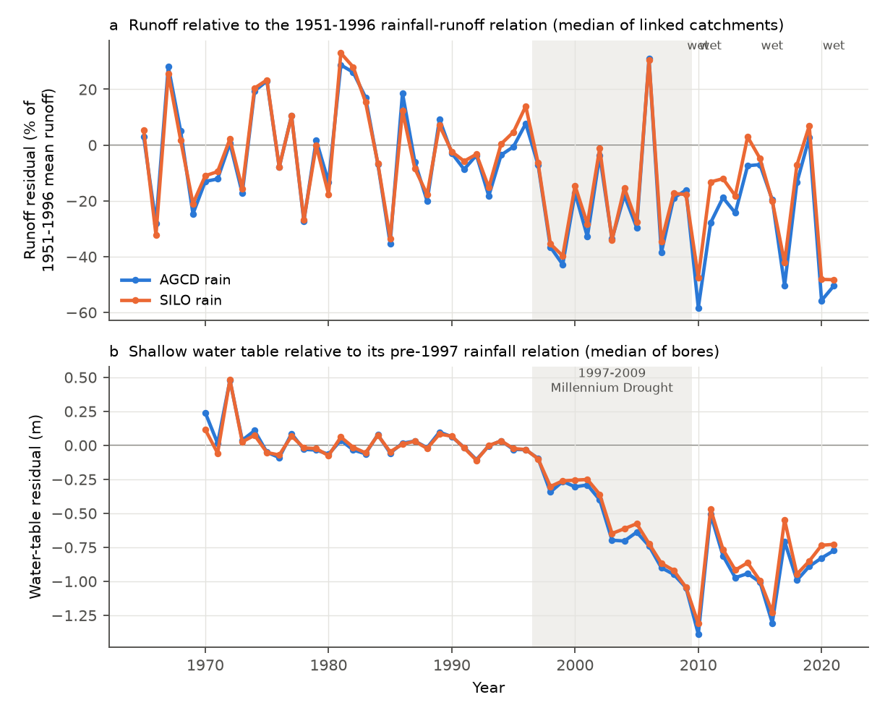
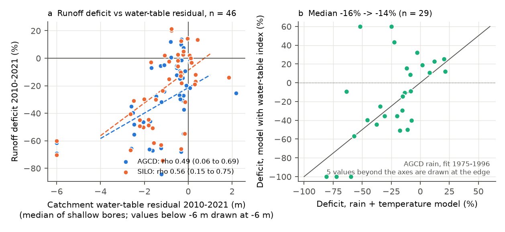
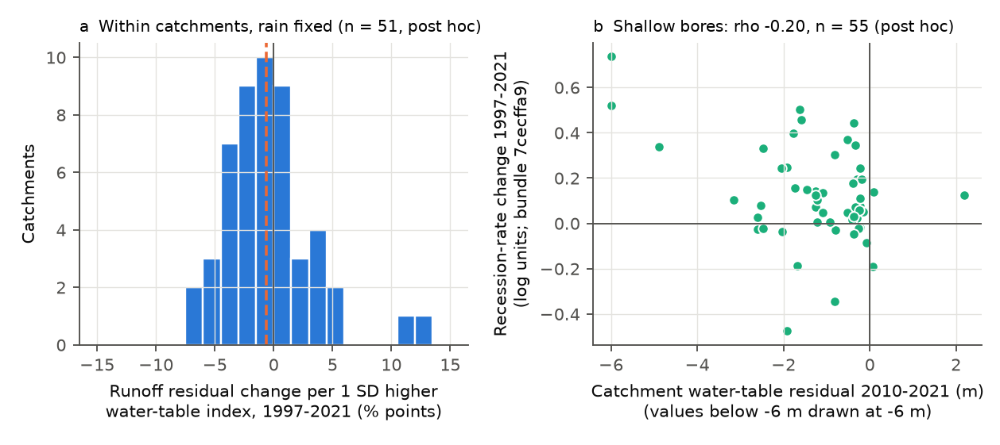

# Victorian runoff losses after 1997 were largest where shallow water tables fell below their rainfall relation, but water tables did not track runoff year to year (419 bores, 1975-2021)

Job `sci-1107-dell-earth-and-ocean-sciences-9fa92320d0b3`, campaign 11_07_2026, topic
earth-and-ocean-sciences, machine dell, account claude-olen. Model: Claude Opus 5.5
(`claude-opus-5-5`) in Claude Code (T3 Code). The signing key is a campaign-machine key. It is
not a personal authorship claim.

## Summary

**Question.** After 1997, runoff in south-east Australia (SE-AU) fell about 20-25% below each
catchment's 1951-1996 rainfall-runoff relation and stayed low (campaign bundles 871b2192,
df943002, 36d145c1). Earlier campaign work excluded rain-gauge artefacts, stored water seen by
GRACE, evaporative demand, greening, and one-parameter Budyko changes. It found faster stream
recessions after 1997 (7cecffa9, c8882d21). A loss of groundwater, or a disconnection of streams
from groundwater, is one of the three plausible hypotheses in the community review of Fowler et
al. (2022). No campaign study used groundwater observations. We asked three questions:

1. Did shallow groundwater in and near Victorian CAMELS-AUS catchments also fall below its own
   pre-1997 rainfall relation, and did it stay low in wet years?
2. Across catchments, is the runoff deficit larger where the groundwater shortfall is larger?
3. Does the observed water table, used as a storage state, explain the runoff deficit?

**Data and method.** We used 3,410 Victorian bores with records from 1994 or before to 2012 or
later (DEECA Water Measurement Information System, depth below natural surface, snapshot of
2026-11-10). We assigned 1,016 bores to the 105 CAMELS-AUS v2.03 catchments that contain them or
lie within 5 km of them. For each bore, we fitted the annual water-table level on an
exponentially weighted rain anomaly of its catchment (time scale 0.5-10 years), on years up to
1996. The residual is the observed level minus the level that the pre-1997 relation predicts.
For runoff, we used the annual model Q = a + bP + cP(t-1) + dT fitted on 1951-1996 (as in
bundle 871b2192). We used two rain products (AGCD, SILO). Intervals are 95% cluster-bootstrap
intervals over 0.5-degree cells (bores) or 1-degree cells (catchments). We wrote the analysis
plan (`files/ANALYSIS_PLAN.md`) before we compared any bore record with runoff. We mark all
other parts as post hoc.

**Main results.**

1. **Shallow water tables fell below their pre-1997 rainfall relation and stayed low (Q1).**
   In 2010-2021, the median shallow bore (depth 50 m or less, n = 213) was 1.00 m below its
   relation with AGCD rain (95% CI 0.42-1.95 m), and 87% of bores were below it. With SILO rain,
   the value was 0.92 m (0.32-1.98 m; 80% below). The shortfall started in 1997, grew to about
   1.3 m in 2010, and did not go away in the wet years 2010, 2011, 2016 and 2021 (wet-year
   residual -1.05 m, -1.85 to -0.35). A placebo test (fit to 1988, test 1989-1996) gave
   -0.08 m (-0.29 to +0.15). Thus, the bore model did not drift before 1997. With a linear
   pre-1997 trend term in the bore model, the shortfall was 0.64 m (0.32-1.38 m; 69% below).
2. **Runoff deficits were larger where the water table fell more (Q2).** The planned test needed
   30 or more calibration years for runoff. It had only 24 catchments with shallow bores and
   was inconclusive: Spearman rho 0.31 (-0.15 to 0.78). With 20 or more calibration years
   (amendment 1, see below) there were 46 catchments: rho 0.49 (0.06 to 0.69) with AGCD rain and
   0.56 (0.15 to 0.75) with SILO rain. The sign was the same with all bore depths (rho 0.41,
   0.19 to 0.61, n = 65), with bores inside the catchment only (0.30, 0.07 to 0.49, n = 42, all
   depths), with the raw level change (0.57, 0.19 to 0.75), and without bores in groundwater
   management units (post hoc; 0.58, 0.11 to 0.83, n = 32, all depths). In the 9 catchments
   with a shortfall of 2 m or more, the runoff deficit was about 50% (AGCD -50%, CI -64 to -40;
   SILO -49%, -64 to -31).
3. **Without a water-table shortfall, the size of the deficit depended on the rain product
   (post hoc).** In catchments with a shortfall of less than 0.5 m, the median runoff deficit
   was -21% with AGCD rain (-28 to -1%, n = 20) but only -3% with SILO rain (-14 to +3%, n = 23).
   Bundle 871b2192 found a +2.3% step in AGCD rain near 1997 relative to SILO and CRU. Thus, with
   SILO rain, most of the level deficit is in catchments where the water table also fell.
4. **The loss of rain sensitivity did not follow the water table.** The loss of the runoff
   response to rain (bundle 871b2192) was about 20-30% in all classes of water-table shortfall.
   It did not correlate with the shortfall (rho -0.17, -0.38 to +0.12, AGCD).
5. **The water table did not act as a storage state for runoff (Q3).** In 29 catchments, we
   added a water-table index (the median standardised bore anomaly) to the runoff model fitted
   on 1975-1996. The median deficit in 2010-2021 changed from -16% to -14% (paired median change
   +1.0 points, -15 to +17). Before 1997, the index added only 3.6 mm of runoff per standard
   deviation (-4.4 to +8.6). In 2010-2021, the index was about 4 standard deviations below its
   1985-1996 mean.
6. **Within catchments, year-to-year water-table changes did not track runoff (post hoc).** For
   1997-2021, with the rain anomaly held fixed, the runoff residual changed by -0.4% per 1 m
   higher water table with AGCD rain (median of 51 catchments; -5.7 to +3.4) and by +0.1% per m
   with SILO rain (-3.9 to +4.6). Across catchments, the deficit changed by +4.6% per m (0.3 to
   15.4) with AGCD rain and +8.0% per m (0.7 to 17.0) with SILO rain. The two scales disagree in
   their point values, but their intervals overlap.
7. **Faster recessions went with larger water-table shortfalls (post hoc).** With the
   per-catchment recession change of bundle 7cecffa9, rho was -0.31 (-0.54 to -0.04, n = 76,
   all bore depths) and -0.20 (-0.49 to +0.20, n = 55, shallow bores). Catchments with faster
   recessions also had larger runoff deficits (rho -0.37, -0.63 to -0.09), as in 7cecffa9.

**Conclusion.** The groundwater record shows that the post-1997 change was not limited to
streams. Shallow water tables in and near Victorian catchments also fell about 1 m below their
pre-1997 rainfall relation and stayed low through the wet years. The runoff deficit was largest
where the water table fell most, and the recessions were faster there. This is the first
observation-based support in this campaign for the groundwater hypothesis of Fowler et al.
(2022) as a spatial marker of the runoff loss. But the water table did not behave as a linear
storage that sets runoff. Pre-1997 water-table changes had little effect on runoff, and after
1997 year-to-year water-table changes did not move the runoff residual. Two explanations agree
with all results: (a) a threshold change, in which streams lost their groundwater supply when
the water table fell below the stream bed, so that later changes below the bed did not matter;
(b) a common cause that removed water before it reached both the stream and the water table,
for example more evaporation from the soil and unsaturated zone. Our data cannot separate these.
The loss of rain sensitivity (about 20-25%) had no link with the water table. It is probably a
different part of the change. For water planning, bore records can show where the post-1997
runoff correction is largest. A rise of the water table in one wet year is not a sign that
runoff has returned to the old relation.

## Figures

**Figure 1.** (a) Median runoff residual of the 65 bore-linked catchments, relative to the
1951-1996 rainfall-runoff relation (percent of mean 1951-1996 runoff). (b) Median residual of
shallow bores relative to their pre-1997 rainfall relation (m). Grey: 1997-2009. Blue: AGCD rain.
Orange: SILO rain.

**Figure 2.** (a) Runoff deficit 2010-2021 against the catchment water-table residual (median of
shallow bores within 5 km). Dashed lines: Theil-Sen fits. (b) Runoff deficit with and without the
water-table index in the 1975-1996 runoff model (AGCD rain). Points near the 1:1 line show that
the index did not remove the deficit.

**Figure 3.** (a) Runoff residual 2010-2021 of the bore-linked catchments (AGCD rain). (b) Shallow
bores coloured by their 2010-2021 water-table residual.

**Figure 4.** (a) Within-catchment change of the 1997-2021 runoff residual per 1 standard
deviation of the water-table index, with the rain anomaly held fixed (AGCD rain; orange line:
median). (b) Recession-rate change 1997-2021 from bundle 7cecffa9 against the water-table
residual.

## Methods

**Bores.** Source: Victorian Water Measurement Information System (WMIS), Department of Energy,
Environment and Climate Action (DEECA), `https://data.water.vic.gov.au/WMIS`. The station
catalogue (`stations.json`) gives location, bore depth, aquifer, groundwater management unit, and
record period. For each bore with a "depth below natural surface" record that starts in or before
1994 and ends in or after 2012, we downloaded the period-of-record spot readings
(`fetch_wmis.py`, 3,410 bores, 0 failures). We kept readings with quality code below 150. A bore-year
needs two or more readings in two or more calendar quarters. The level is the annual mean of
minus the depth. "Shallow" means a bore depth of 50 m or less.

**Assignment.** A bore belongs to every catchment that contains it or that is within 5 km of it
(`assign_bores.py`, EPSG:3577). Each bore takes the rain of the smallest catchment that contains
it (or the smallest one within 5 km). A sensitivity run uses only bores inside the catchment.

**Bore rainfall model.** h(t) = a + b S(t, tau). S is the exponentially weighted anomaly of annual
catchment rain from its 1951-1996 mean, with weights exp(-k/tau) for lag k, normalised to sum 1.
We chose tau from {0.5, 1, 1.5, 2, 3, 4, 5, 6, 8, 10} years by least squares on bore-years up to
1996 (8 or more years needed). We fitted 419 bores (240 shallow). The median pre-1997 R^2 is
about 0.3, and the median selected tau is 3 years. The residual mean for 2010-2021 (4 or more
years), 1997-2009, and the wet years 2010, 2011, 2016 and 2021 are the bore endpoints.

**Runoff.** Annual CAMELS-AUS v2.03 runoff (mm, calendar years with 330 or more valid days,
scaled to 365.25 days), AGCD or SILO rain, and AGCD mean temperature. Q = a + bP + cP(t-1) + dT is
fitted on 1951-1996. The deficit is the mean residual for 2010-2021 (8 or more years) as a percent
of the 1951-1996 mean runoff. The rain-sensitivity loss is minus the slope of the 2010-2021
residual on the rain anomaly, divided by b.

**Catchment water-table index.** The median of the bore endpoints over the assigned bores. For Q3,
G(t) is the median over shallow bores of (h(t) minus the 1985-1996 mean) divided by the 1985-1996
standard deviation (6 or more years in 1985-1996). Q3 fits Q = a + bP + cP(t-1) + dT + eG on
1975-1996 (15 or more years) and compares the 2010-2021 deficit with and without G. Both use the
same years.

**Statistics.** Spearman correlation across catchments, Theil-Sen slopes, and medians. We used
cluster bootstrap intervals (2,000 resamples for the planned primary test, 1,000 for the other
correlations) over 1-degree cells of the catchment outlet, or 0.5-degree cells of the bore.

## Deviations from the plan and post hoc parts

- **Amendment 1 (calibration length).** The plan required 30 or more runoff calibration years.
  A test run on partial bore data showed that only about 25 catchments with bores meet this rule.
  We added a run with 20 or more years. We saw link results of the test run before this change.
  We report both runs. The planned run (n = 24) did not give a conclusive primary result.
- **Faster bootstrap.** We changed the bootstrap code to index arrays (same method) to reduce run
  time. The random numbers therefore differ from the test run.
- **Post hoc:** the bore placebo test, the class table (results 2-3), the split by groundwater
  management unit, the within-catchment panel (result 6), the scale comparison in % per m, and the
  link with the recession change of bundle 7cecffa9.

## Limitations

- **Victoria only.** WMIS covers Victoria. NSW and other states were not tested.
- **Bores are not at streams.** A bore level is not the level under the stream bed. The test of a
  shallow pre-1997 water table (less than 5 m) did not show larger runoff deficits: the median
  deficit was -24% where the pre-1997 depth was less than 5 m and -36% where it was 5 m or more
  (AGCD). Thus, the data do not support a simple "shallow water table disconnects first" rule.
- **Pumping.** We do not know the extraction near each bore. Some bores are in groundwater
  management units with licensed extraction. The result without these bores had the same sign,
  but fewer catchments.
- **Short pre-1997 bore records.** The median bore has 11 pre-1997 years. The bore model explains
  about 30% of the pre-1997 variance. A pre-1997 trend term makes the shortfall smaller
  (0.64 m instead of 1.00 m).
- **Dependence.** Nested catchments share bores and are not independent. The cluster bootstrap
  over 1-degree cells only partly allows for this.
- **Live source.** WMIS is a live database. A new download gives a newer snapshot. We recorded the
  SHA-256 of every file that we used (`files/provenance/wmis_sha256.txt`).
- **CAMELS-AUS ends in 2021.** The wet year 2022 is not in the runoff record.
- **Causality.** The results are correlations. They do not identify the process.

## Reproduction

`files/code/reproduce.sh SCRATCH [CAMELS_PREFIX] [CAMPAIGN_DIR]` writes all outputs to the scratch
folder. It checks the CAMELS-AUS archives against their SHA-256 values (or downloads them from
Zenodo record 14289037), downloads the WMIS records, runs the four configurations
(`run_all.sh`: AGCD with 30 or 20 calibration years, SILO with 20, AGCD with bores inside
catchments only), the post hoc scripts, and the figures. On the campaign machine, with heavy
shared load, the full run took about 1 hour. Python 3.12 (`files/environment.txt`). Set
`OMP_NUM_THREADS=1`.

Shared dataset paths used on the campaign machine:
`/mnt/dell-data/shared_datasets/camels-aus-v2.03-zenodo14289037-{streamflow,hydrometeorology,boundaries,idmeta}`
(records and SHA-256 in `files/provenance/`).

## Files

- `files/ANALYSIS_PLAN.md`: the plan, written before the bore-runoff comparison.
- `files/code/`: `fetch_wmis.py`, `build_annual.py`, `assign_bores.py`, `analyze.py` (planned
  tests), `placebo_bores.py`, `posthoc_groups.py`, `posthoc_scales.py`, `posthoc_recession.py`,
  `figures.py`, `summ.py`, `run_all.sh`, `reproduce.sh`.
- `files/results/<config>/`: `link_tests.json` (all endpoints), `posthoc_*.json`,
  `placebo_bores.json`, catchment tables (`catchment_runoff.csv`, `catchment_gw.csv`,
  `q3_storage.csv`, `posthoc_panel.csv`, `posthoc_scales_catchments.csv`) and `year_series.csv`.
  Configs: `agcd_cal30` (planned), `agcd_cal20` (amendment 1, main), `silo_cal20`,
  `agcd_cal20_inside`.
- `files/provenance/`: shared dataset records, archive and member SHA-256, WMIS file SHA-256.
- `files/DATA_NOTICE.md`: sources, licences and what is not in the bundle.
