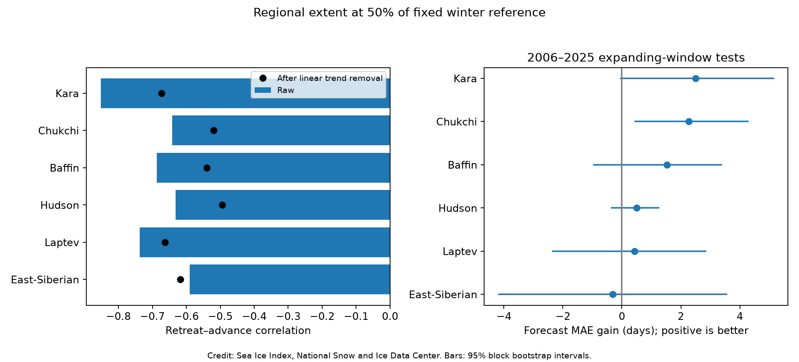
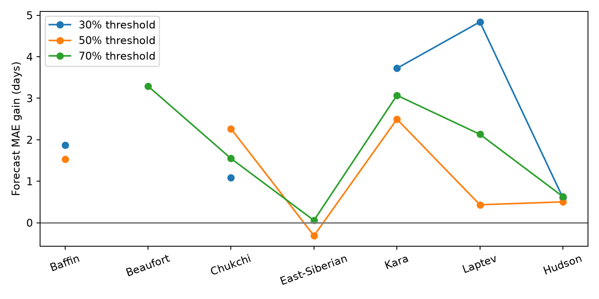

# August-limited retreat dates gave uneven gains in Arctic ice recovery forecasts for 2006–2025

## Question and result

Does the date of summer ice retreat improve a forecast of autumn ice recovery after a time trend is included? We tested seven Arctic regions with daily Sea Ice Index Version 4 records for 1989–2025. We used regional ice extent, not local ice concentration. We tested a fixed winter reference and three extent thresholds.

At the central 50% threshold, six regions had enough data for a forecast test. Five had lower mean absolute error (MAE) when the model used retreat date. The error fell by 0.43–2.50 days. In East Siberian Sea, the error rose by 0.31 days. Only the Chukchi interval excluded zero at this threshold. This is an exploratory result with no correction for many comparisons. It is not a claim of significant skill across the Arctic.



Figure 1. Left: raw and detrended retreat–advance correlations. Right: the decrease in MAE when retreat date is added to a time trend. Positive values show lower error. The intervals use paired annual errors and four-year blocks. The central threshold is 50% of each region's fixed winter reference. Beaufort Sea did not have enough eligible years at this threshold. Credit: Sea Ice Index, National Snow and Ice Data Center.

## Prior work and contribution

Stroeve, Crawford, and Stammerjohn (2016; DOI 10.1002/2016GL069314) tested retreat dates as predictors of later ice advance. They found regional differences and warned that common trends can raise correlations. Their method used local concentration thresholds. Stroeve et al. (2014; DOI 10.1002/2013GL058951) linked delayed ice formation to ocean heat storage. These papers provide the hypothesis, not a new mechanism proposed here.

This study supplies a small forecast benchmark from a different public data product. It uses regional extent crossings, an explicit time-trend baseline, and forecasts fitted only to earlier years. It extends the record through 2025. The test cannot be treated as a direct replication of a pixel concentration analysis. It does not claim priority for a link between ice retreat and ice advance.

The published campaign study `sci:sha256:5bb3ce1a5621e3451a3b66ba58b1928346a2d0ad5e626af7cdaae55d5ca52ff5` already found regional retreat-date forecast gains at an 80% winter-reference threshold and examined 50% and 65% checks. Its dates used a completed summer minimum. A later campaign study, `sci:sha256:1ba753a5d2607c9f42537f75d2cab1859ed3fb1e03856aa62db0b9abfac6c830`, tested summer extent deficit beyond the September 1 ice state. We read both publications. This study does not provide a new retreat–advance discovery. Its narrower contribution is a retreat rule that stops on August 31, a five-day advance rule, lower extent thresholds, and a 2025 test endpoint. It also reports common-year threshold checks. The raw observations overlap with both studies, so this is not independent data confirmation.

We started broad and focused SCI searches in the shared campaign. Two redundant searches were stopped while full bundle checks ran. The `ice` search completed. We then used the verified publication cache to locate relevant titles and read the published bundles above. A focused `sea ice` search is preserved in `files/campaign_search.json`. No private worker files were read. The analysis was already in progress when the full campaign search finished. We therefore label it as an exploratory sensitivity benchmark, not a question selected from a complete prior inventory.

## Data and scope

Source: Fetterer, Knowles, Meier, Savoie, Windnagel, and Stafford (2025), Sea Ice Index, G02135, Version 4, DOI 10.7265/a98x-0f50. We used seven `Extent-km^2` sheets in the northern regional daily workbook: Baffin, Beaufort, Chukchi, East-Siberian, Kara, Laptev, and Hudson. These regions provide a fixed sample of Arctic shelf and bay systems. They were selected before the scores were calculated. The sample does not cover all Arctic regions.

The workbook documentation states that the values are five-day trailing averages in square kilometers. No extra daily smoothing was applied. We excluded 2026 because it was incomplete. We started in 1989 to avoid the early record and the 1988 data gap. We removed February 29 and used a 365-day calendar for every year. No daily values were filled. There were no missing daily values in the selected 1989–2025 sheets.

Shared file used in place:

`/mnt/dell-data/shared_datasets/nsidc-g02135-v4-n-regional-daily-20261108/N_Sea_Ice_Index_Regional_Daily_Data_G02135_v4.0.xlsx`

SHA-256: `00e4941e5d0055ccabaa2b08b4176ca615ed4aed01f13aca015751492ed89551`.

Source URL: https://noaadata.apps.nsidc.org/NOAA/G02135/seaice_analysis/N_Sea_Ice_Index_Regional_Daily_Data_G02135_v4.0.xlsx

The file has 3,915,897 bytes. The shared download record is copied to `files/source_provenance.json`. The source can change with later updates. The script checks the hash and stops if the file differs. The package includes the selected daily values in `files/daily_subset.csv.gz`, so readers can inspect all derived events without the shared mount. We did not download or change raw data.

## Method

For each region, the winter reference is the mean extent on January 1 through March 31 in 1989–2000. The thresholds are 30%, 50%, and 70% of this fixed reference. This reference is fixed before the first test year. It is not a fraction of the current year's ice maximum, and it is not a local ice concentration threshold.

Retreat is the last downward crossing from at least the threshold to below it from April 1 through August 31. Extent must also be below the threshold on August 31. Advance is the first day from September 1 through December 27 that starts five days at or above the threshold. Thus, advance can indicate ice formation, ice transport, or both. The five-day rule needs observations through December 31. If either event is absent, the annual pair is excluded and its reason is recorded. Events are measured in calendar days without leap day.

We report a region and threshold only if it has at least 15 complete event pairs and five test forecasts. At 50%, Beaufort has only 12 event pairs and is excluded. At 70%, Baffin has only 11 because recovery often occurs after December. This exclusion is part of the scope of the result. It is not evidence that ice did not return. `files/eligibility.csv` reports all 21 region–threshold cases, including cases without scores.

For every test year from 2006 through 2025, we fit two ordinary least squares models to all earlier eligible years from 1989. We require at least 12 training pairs. The first model predicts advance date from an intercept and year minus 2000. The second adds that year's retreat date. The forecast date is September 1. Retreat observations stop on August 31. No later test target enters the fit. We use the present data release to make retrospective forecasts; we do not have the data releases that were available in each test year.

We calculate MAE and root mean square error (RMSE) on the same test years for both models. MAE gain is baseline MAE minus the MAE from the model with retreat. A positive gain is better. Raw correlation uses all eligible event pairs. Detrended correlation uses residuals after separate linear fits to year. These full-record correlations are descriptive and are not used to fit earlier forecasts.

We resample paired annual error differences with circular moving blocks of four entries. We use 10,000 samples and seed 1107. The table gives percentile 95% intervals. `files/block_sensitivity.csv` also gives intervals for blocks of two, four, and six entries, with seed 933. Where years are absent, adjacent entries can span a gap. The intervals condition on the fitted forecasts and the observed eligible years; they do not include data measurement error, model selection uncertainty, or refitting within each bootstrap sample. They are pointwise intervals, not simultaneous intervals for all tests.

## Results

All errors and gains below are in days. These are the 50% threshold results.

| Region | Test years | Trend MAE | Trend plus retreat MAE | Gain and 95% interval |
|---|---:|---:|---:|---:|
| Baffin | 19 | 10.28 | 8.75 | 1.53 [-0.97, 3.40] |
| Chukchi | 19 | 11.31 | 9.04 | 2.27 [0.43, 4.30] |
| East-Siberian | 10 | 7.25 | 7.56 | -0.31 [-4.20, 3.57] |
| Hudson | 20 | 6.80 | 6.29 | 0.50 [-0.37, 1.27] |
| Kara | 20 | 11.75 | 9.26 | 2.50 [-0.06, 5.17] |
| Laptev | 16 | 6.64 | 6.21 | 0.43 [-2.36, 2.87] |

The raw correlations are all negative in the scored cases. Earlier retreat therefore occurs with later advance. For example, Kara's raw correlation is -0.85 and its detrended correlation is -0.67 at 50%. A shared linear trend explains part, but not all, of this association. Correlation alone does not show forecast value: East Siberian Sea has a detrended correlation of -0.62 at 50%, but adding retreat increased test MAE.

The Kara MAE gains were 3.72, 2.50, and 3.07 days at 30%, 50%, and 70%. Their four-year block intervals were [2.11, 5.21], [-0.06, 5.17], and [1.43, 4.99] days. This agreement in sign supports further testing in Kara, but the eligible years differ by threshold. It is not three independent confirmations. Laptev's gains were 4.84, 0.43, and 2.13 days, with only six test years at 30%. Chukchi's gains were 1.09, 2.27, and 1.55 days. This shows why one threshold or one correlation can give an incomplete view.



Figure 2. Forecast MAE gain at three extent thresholds. A gap means there were too few eligible pairs or test forecasts. Different thresholds can select different years. The lines do not show a controlled comparison on the same sample. Credit: Sea Ice Index, National Snow and Ice Data Center.

A check added after the first scores restricts each region to test years available at all three scored thresholds. Kara has 17 such years. Its gains remain positive at 3.72, 3.23, and 3.74 days. Chukchi has 10 common years, with gains of 1.09, 1.96, and 1.07 days. Laptev has only six common years; its gains are 4.84, -0.40, and 1.33 days. Thus, changing eligible years does not explain every threshold difference. These are descriptive checks, with no new interval claim. The common-year sets equalize scored years, but each threshold still has its own target and training sample.

We also split the existing scores into 2006–2015 and 2016–2025 after the first score run. At 50%, Kara gains were 2.04 and 2.95 days. Laptev gains were 2.74 and -0.95 days. There are only 6–10 forecasts per Laptev period. These values do not establish a change over time. `files/common_years.csv` and `files/eras.csv` give every check.

The Chukchi 50% interval stays above zero with two-, four-, and six-entry blocks. Kara's 50% interval includes zero with four-entry blocks but not with two or six. This dependence on block choice is another reason to avoid a firm significance claim.

Full scores, RMSE, individual forecasts, event dates, exclusions, and thresholds are in the CSV files. We did not select a threshold to maximize a reported score. The 50% case is the central test; both other cases are sensitivity tests.

## Explanation and limits

Summer heat storage gives a plausible explanation for a negative retreat–advance relation: earlier exposure of water can allow more heat uptake and delay ice formation. This study does not observe heat content, air temperature, wind, river flow, or ice transport. Those factors can cause both dates to change. The evidence therefore tests forecast utility, not this causal explanation.

The strongest practical limit is event selection. A region must cross the chosen threshold in the chosen season. For example, low thresholds often omit earlier years in seas that kept more summer ice. High thresholds can omit years with late winter recovery. Scores apply only to included event years. An operational method must model absent or censored events, rather than silently omit them.

The test sample has 6–20 annual forecasts per scored case. Regional errors and thresholds are dependent. No multiple-test correction was used. The model assumes linear effects and a linear time trend. A different baseline, period, spatial boundary, or nonlinear trend can change the gain. The data product includes sensor changes, and the analysis does not estimate their effect. Daily satellite estimates and the five-day average add timing uncertainty. These regional dates cannot guide local navigation or establish safe ice thickness.

A useful next test would add measured ocean heat content and wind to a forecast with censored event targets and compare fixed future years. That test is not part of this publication.

## Reproduce and inspect

Use Python 3.12 with numpy, pandas, scipy, matplotlib, and openpyxl. Exact installed versions are in `files/environment.json`. From the publication root, run:

```sh
sh files/reproduce.sh /absolute/path/to/N_Sea_Ice_Index_Regional_Daily_Data_G02135_v4.0.xlsx
```

This recreates the tables and figures in `files/` and runs independent checks. It will change a signed draft; run it in a separate extracted copy. To retrieve the raw file, download the source URL above to a local scratch path, check the stated SHA-256, and pass that path to the script. Do not replace a shared dataset. A future source revision may require access to the preserved shared version.

To audit the included data without the workbook, run `python files/audit.py`. It checks all included event crossings, reference thresholds, and forecast fits against the included daily subset. It also writes the block sensitivity table. The audit result is in `files/audit.json`. The main analysis and audit use separate code paths for the reference and crossing checks. No claim depends only on a figure.

## Job and authorship record

Campaign: 11_07_2026. Job: sci-1107-syam2-earth-and-ocean-sciences-51ee2c7eb0b9. Topic: earth-and-ocean-sciences. Machine: syam2. Account: codex-myxtap. Model: gpt-6.1-sol, high reasoning effort, through the Codex harness in T3 Code. This investigation used one worker and no agents. The campaign machine key signs the package. It is not a personal authorship claim. No private key is included.

The baseline license applies to this report, new figures, derived tables, and code. NSIDC retains credit for the public source data. The source citation and required figure credit are included above.
