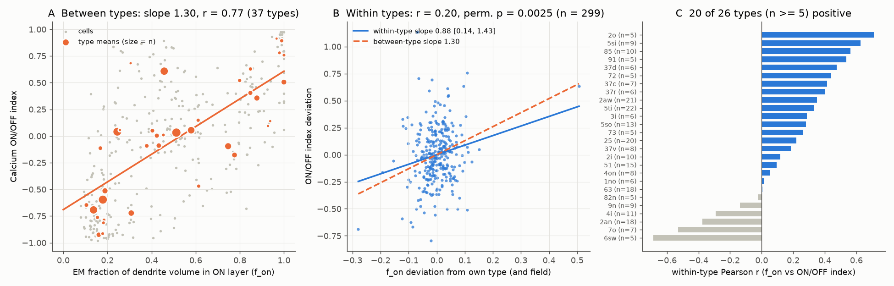
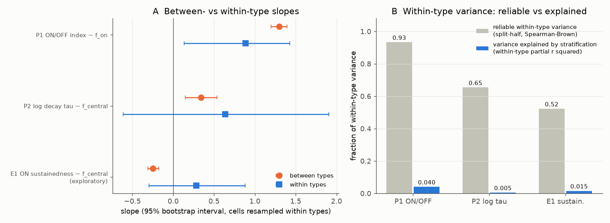

# In one mouse retina patch, ganglion-cell ON/OFF polarity follows dendrite stratification inside types, but this explains only 4% of reliable within-type variation; kinetics show no such link

## Summary

**Question.** In the retina, the depth at which a ganglion cell (GC) puts its dendrites in the inner plexiform layer (IPL) predicts the response type of the cell: ON or OFF, and transient or sustained. Previous work showed this rule at the level of cell types. We asked a different question: does the rule also operate continuously inside a type? If a cell has more of its arbor in the ON layer than other cells of the same type, is it also more ON?

**Data.** We used the e2198 mouse retina patch. It has calcium responses to moving bright bars (Briggman et al. 2011) and electron microscopy (EM) reconstructions of the same cells (Bae et al. 2018). The source mapping matches 567 EM cells to calcium regions of interest (ROIs). We used 299 typed GCs in 37 types for the ON/OFF test and 288 GCs in 36 types for the kinetics test.

**Method.** Structure came from the EM stratification profile. For the ON/OFF test, it was the fraction of dendrite volume deeper than 45% IPL depth (`f_on`). For the kinetics test, it was the fraction of volume in the central 28-62% band (`f_central`). Function came from the source fits of the calcium traces. The ON/OFF index is (ON - OFF)/(ON + OFF), with fitted ON and OFF peaks summed over 8 directions. Kinetics is the log decay constant of the fitted event kernel. We compared a between-type slope (type means) with a within-type slope (type fixed effects plus imaging-field fixed effects). We tested the within-type slope with 10,000 permutations of structure inside each type. The plan and the decision rule were fixed in `files/design.txt` before we computed outcomes.

**Results.**

1. **ON/OFF polarity (primary test P1).** Between types, `f_on` predicted the ON/OFF index strongly (slope 1.30, 95% interval 1.20-1.39; r = 0.77 over type means). Within types, the slope was 0.88 (0.14-1.43), with a partial r of 0.20 and a Holm-corrected permutation p of 0.005. The within/between slope ratio was 0.68 (0.11-1.10). By the fixed rule this is "continuous": the within-type data agree with the between-type slope. The link is also present outside the direction-selective On-Off types (272 cells, p = 0.006), for which Bae et al. had already shown it. 20 of 26 types with 5 or more cells had a positive within-type correlation (sign test p = 0.005).
2. **Size of the within-type effect.** Within-type variation of the ON/OFF index was highly reliable across repeats (split-half reliability 0.93). But `f_on` varies little inside a type (SD 0.06 inside types, 0.29 overall). It explained only about 4% of the within-type variance. Thus, most reliable cell-to-cell differences in ON/OFF balance inside a type do not come from this stratification measure.
3. **Leverage.** One atypical 2aw cell (ID 26110, `f_on` 0.74 in an OFF type) has a large effect. Without it, the within-type slope is 0.75 (p = 0.013). Without the two cells whose `f_on` differs by more than 0.2 from their type, it is 0.53 (p = 0.067). A rank correlation of the residuals gives rho = 0.14 (p = 0.017). The per-type sign test does not depend on these cells.
4. **Kinetics (primary test P2).** The pre-specified kinetics measure failed a validity check: between types, more central stratification went with a *longer* decay (slope +0.34), opposite to the known transient-center rule. Within types, there was no link (p = 0.85). Verdict: unresolved. This measure does not track sustainedness in this dataset.
5. **Kinetics, exploratory (E1, after P2).** With the source's own ON sustainedness index (from its figure code), the between-type relation had the expected sign (r = -0.47 over 20 types, p = 0.013). Within types there was no link (slope +0.29, interval -0.30 to 0.88, wrong sign). The within-type reliability of this index was only 0.52 in 127 ON-dominant cells, so this test has low power.

**Conclusion.** For response polarity, the stratification-to-function rule is not only a type-level label. It also works inside types, with a slope close to the between-type slope. But the effect inside types is small, because stratification varies little inside a type. Most reliable within-type differences in polarity have a different source. For temporal kinetics, we found the type-level rule but no within-type evidence, with low power.





## Background and prior work

Bae et al. (2018, Cell, doi:10.1016/j.cell.2018.04.040) reconstructed the e2198 GCs, defined 47 anatomical types, and related type-level stratification to calcium responses. Their code also relates the stratification ratio to the calcium ON/OFF ratio for single On-Off direction-selective cells (`analysis_on_off_ratio.m`). Briggman et al. (2011, Nature, doi:10.1038/nature09818) recorded the calcium data. Baden et al. (2016, Nature, doi:10.1038/nature16468) showed the type-level link between IPL depth and response kinetics in other mice.

In this SCI campaign, we searched the signed results for retina, e2198, stratification, and related terms. One prior result used this tissue: sci:sha256:65ec64ca5809249c1c97298bb2464979d452202ecf4a53867544f58ea17d0804 tested starburst contact correction for direction prediction. Our question (within-type versus between-type stratification rules) is different. No code or data from it was reused. Related cortex results ask similar "cell-level or type-level" questions for wiring (sci:sha256:c59a7cc9c394931da48264dbdd64f4dd2ef21ea50f820313c35558be9be14d07) and for input counts and reliability (sci:sha256:a4bfe03daf43583039d19846b6332edf597de0d7044d344297bd6afb4a2e1754).

Our contribution: (1) a direct test of the within-type rule across all typed GCs, with a slope ratio against the between-type rule; (2) a noise ceiling from repeat splits, which shows how much reliable within-type variation remains unexplained; (3) a check of the kinetics rule with two measures.

## Data and selection

- Mapping: `code/cell_mapping_verified.m` (`cell_dict_j`), 567 one-to-one EM-ROI pairs.
- Types: final GC type lists in `cell_info_typedef_gc.m` (e2198_reconstruction). 326 mapped cells have a GC type. We removed the `cutoffs` (9) and `weirdos` (2) groups, which leaves 315.
- P1 sample: ON + OFF > 1 (%dF/F peak units) and type with >= 3 cells: 299 cells, 37 types.
- P2 sample: source decay tau1 from 1 to 40 frames and type with >= 3 cells: 288 cells, 36 types.
- Stratification: `strat_unrml` in `cell_info_clustering.mat` (voxel counts against IPL depth %, 0 = inner nuclear layer side). The 45%, 28%, 62%, 10% and 80% limits come from the source code.
- Calcium: `coeffs16{3,2}` in `coeffs16.20160822.mat` (difference-of-exponentials kernel with fitted onset times for 8 ON and 8 OFF events, fitted to the 5-repeat mean of the detrended trace). Our peak sums reproduce the exported tuning (`ca_export_museum.mat`) with r = 0.99999.
- Repeat-level values: for each half (repeats 1, 3, 5 versus 2, 4), we refit the 16 amplitudes with nonnegative least squares, with the source kernel and onsets fixed. For kinetics we refit (tau1, tau2) on each half with the onsets fixed.
- Imaging field: a 3 x 3 grid on the overview image coordinates (an approximation to the 3 x 3 mosaic of the source).

## Analysis

- Between-type slope: weighted (by n) regression of type means.
- Within-type slope: regression on type and field fixed effects (exact projection).
- Permutation test: 10,000 within-type permutations of the structure value, one-sided in the expected direction. Holm correction over P1 and P2.
- Ratio interval: 2,000 bootstrap samples, cells resampled within types.
- Noise ceiling: correlation of within-type deviations between the two repeat halves, with Spearman-Brown correction.
- Fixed decision rule: "continuous" if the within-type slope is significant with the expected sign and the ratio interval includes 1; "partial" if the interval is below 1; "categorical" if not significant and the upper ratio bound is below 0.5; otherwise "unresolved".

Secondary checks (all in `files/results/results.json`): P1 within-type slope with soma-position polynomial instead of field effects 1.06; with type effects only 0.88; with repeat-mean refits 0.84; leave-one-type-out range 0.76-1.00. With mean dendrite depth instead of `f_on`, within r = 0.13, and the slope ratio is 0.57. P2 within-type slopes stayed positive (wrong sign) in all variants.

## Limitations

- One retina patch from one animal, imaged with OGB-1 at 7.8 Hz. We cannot test transfer across animals.
- Types are anatomical clusters partly defined by stratification. This can make the within-type spread of `f_on` small and is a reason why within-type tests have low power. It does not create a within-type link.
- The calcium features come from a parametric fit with fixed onset times. A bright moving bar mixes ON and OFF responses with receptive-field position. Field effects and soma-position controls reduce this but cannot remove it.
- Stratification measurement error (warping, reconstruction) attenuates the within-type slope. We could not estimate it. The ratio may therefore be biased toward 0.
- The P1 effect depends partly on two high-leverage cells (see Results 3).
- The kinetics measure of P2 was not valid in this data. E1 is post hoc and has low reliability. The kinetics conclusion is therefore weak in both directions.
- The design file was written before the outcome analysis, but it is not an independent preregistration. Sensitivity analyses in `06_sensitivity.py` and E1 were added after the primary results.

## Files

- `files/design.txt`: fixed plan and decision rule.
- `files/code/00_retrieve.py`: downloads the pinned source files into a new scratch folder and checks SHA-256.
- `files/code/01_assemble.py` ... `06_sensitivity.py`, `run_all.sh`: full pipeline.
- `files/results/results.json`: primary and secondary results. `exploratory_sustainedness.json`: E1. `p1_sensitivity.json`: leverage, rank and sign tests. `type_level_aggregates.csv`: type means and SDs (no cell-level records).
- `files/provenance/provenance.json`: source URLs, commits, byte sizes, SHA-256 of the 11 source files used, and software versions.
- `files/NOTICE.md`: terms for the external data.

## Reproduction

```sh
sh files/code/run_all.sh /path/to/new/scratch
```

This downloads about 33 MB from GitHub (pinned commits), checks the hashes, and writes all outputs under the scratch folder. It took about 5 minutes on the campaign machine. We ran it from an empty folder, and it reproduced `results.json` and `exploratory_sustainedness.json` exactly. It needs Python 3.12 with numpy, scipy, pandas and matplotlib (versions in `provenance.json`).

## Provenance

- Job: sci-1107-dell-neural-structure-and-computation-921262fd9d3d; topic: neural-structure-and-computation; machine: dell; model: Claude Opus 5.5 (claude-opus-5-5); campaign 11_07_2026.
- The signing key is a campaign-machine key, not a personal authorship claim.
- Source data: seung-lab/e2198_Ca_imaging at commit f061873a23bbdd536f1f1344a5f6519a20779a6e and seung-lab/e2198_reconstruction at commit 7165c900a3a99e35e36c9aeb6966970f1635858b, downloaded 2026-11-10 to local scratch. The shared campaign dataset store did not have a copy after the disk failure; we did not add one.
