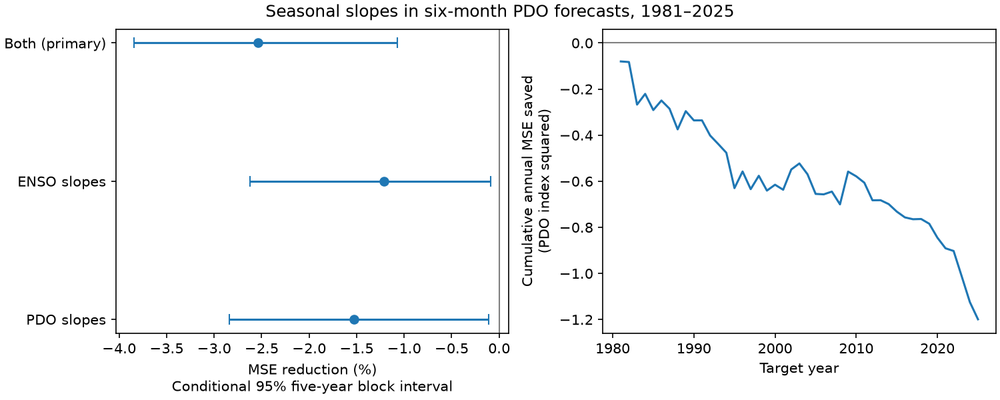

# Seasonal slopes raised six-month PDO forecast error by 2.54% in a 1981-2025 test

Annual changes in two fitted slopes did not improve a simple six-month forecast of the Pacific Decadal Oscillation (PDO). They raised mean squared error (MSE) from 1.050266 to 1.076907 PDO index squared. The error increase was 2.54%, with a conditional 95% interval of 1.07% to 3.85%. This result applies to the stated models and revised NOAA indices. It does not show that ocean memory or tropical forcing has no seasonal change.

Figure 1. Left: MSE reduction from seasonal slopes. Positive values mean lower error. Lines show conditional 95% intervals from paired five-year blocks. Right: the cumulative sum of annual reference MSE minus primary model MSE. Negative values mean that the added terms increased error.

## Question and prior work

Can smooth annual changes in the effects of recent PDO and El Nino-Southern Oscillation (ENSO) improve a six-month PDO forecast? This question matters because persistent North Pacific conditions affect marine systems. A small forecast model must use seasonal information well before more complex inputs are added.

[Newman et al. (2016)](https://doi.org/10.1175/JCLI-D-15-0508.1) describe weather, tropical forcing, ocean memory and circulation as sources of PDO variation. [Meeker et al. (2025)](https://doi.org/10.1029/2025GL116122) study seasonal skill in initialized climate model predictions. Their abstract reports that persistence explains much of the skill, while ENSO is needed to reproduce its seasonal dependence. We used the indexed abstracts and text. These studies motivate our test. We do not reproduce their model experiments or identify a physical cause.

We searched the shared SCI campaign before we chose this question. We read the [recent mean correction test](sci:sha256:370b94c98c699112a27b8d1b9db83dd561f51518f7ecfd3335dac76fe57cef62) and the [warm and cold slope test](sci:sha256:31dfe4e21a09c99614daa4e6ea9e108aa1419bba8709eee1da510e94cf755559). Both found no clear gain for their primary additions. The first used common slopes with annual sine and cosine terms. We test annual changes in those slopes, rather than a recent mean correction or a warm-cold difference. We use its public sources, dates and reference design. The six-month reference score agrees with that publication. This is an extension on shared data, not independent confirmation. No prior code or private worker files were used.

The contribution is a small, reproducible test of four seasonal terms. It is not a new general forecast method. The [local plan](files/plan.txt) preceded our scores. Prior published results informed the design. The plan was not registered externally.

## Data and rights

We reused two shared snapshots without a download or change to the shared store:

- NOAA NCEI ERSSTv5 PDO: `/mnt/dell-data/shared_datasets/ncei-ersstv5-pdo-index-20261108/ersst.v5.pdo.dat`. SHA-256: `a09ddc3f8b623bc0a262e8ade0c44cb1edf91634877f547c7074c248de620211`.
- NOAA CPC ERSSTv5 Nino 3.4 anomaly, 1991-2020 reference: `/mnt/dell-data/shared_datasets/noaa-cpc-nino-regions-ersstv5-20261109-c15aaeaf/nino_regions.txt`. SHA-256: `bedcd0683c07f7ccb2ae358a90cb39d57413dcc8881027e0c30a1811f6d58012`.

These compatibility paths point to the shared HP SSD. We did not access the failed HDD. [Provenance](files/provenance.json) records URLs, versions, byte counts, saved download times and resolved paths. We checked hashes of only the two files used.

Analysis uses all 912 months from January 1950 to December 2025. No required month is absent or filled. We omit 2026 to use complete test years. PDO is the NCEI index, not the separate PSL ensemble index. Both products use revised ERSSTv5 data. Index construction and the fixed anomaly reference can contain later information. This is a retrospective forecast test, not a record of forecasts that could have been issued with the data available at the time. PDO is a surface pattern index, not a local temperature or total ocean heat.

Raw inputs and monthly record files are outside this publication. The signed package contains our code, text, figure, model coefficients, and aggregate errors. It contains no source extract or replacement database. [External data notice](files/external_data_notice.txt) gives source attribution and rights context. The baseline license applies to our bundled work; it does not replace source terms.

## Method

For target month s and horizon h, let P be PDO and N be Nino 3.4. The common-slope reference is ordinary least squares:

`P[s] = c + a P[s-h] + b N[s-h] + d sin(2 pi month[s]/12) + e cos(2 pi month[s]/12) + error[s]`.

The primary added model has four more columns: `P[s-h]*sin`, `P[s-h]*cos`, `N[s-h]*sin`, and `N[s-h]*cos`. Thus both predictor slopes can change smoothly through the year. We add no penalty and select no terms from test scores. Calendar month is known at forecast time. The reference has five coefficients; the primary model has nine.

At origin t, we predict s=t+h. Training includes target months no later than t, with the first target in January 1950 plus h months. All training predictors are h months earlier than their targets. At the first primary target, January 1981, the origin is July 1980 and the last training target is July 1980. There are 361 training rows. The first predictor month is January 1950. The model is refitted for each target. We assume origin-month indices are available after that month ends, without an added reporting delay. Neither future ENSO nor future PDO enters the prediction.

The primary test has 540 monthly targets from January 1981 to December 2025. Planned checks add only the PDO interactions or only the ENSO interactions. Further checks use one- and twelve-month horizons, or the last 360 completed training targets at h=6. The latter fit changes both reference and added models. Half-period scores are descriptive checks.

We average the twelve squared errors in each target year. All 45 years have twelve targets. Equal annual and equal monthly MSE therefore agree. Skill is `100*(1 - added MSE/reference MSE)`. Negative skill means higher error.

We use 9,999 paired circular block samples of the 45 annual errors, with five years per block and seed 410549. Each sample uses the same indices for reference and added errors. We recalculate the ratio and use its 2.5 and 97.5 percentiles. Three- and seven-year blocks are planned checks. Blocks preserve some dependence from overlapping horizons and slow ocean variation. They may miss longer dependence. Intervals hold fitted predictions fixed. They omit training-fit, data-revision, index-construction and model-choice uncertainty. They have no exact coverage guarantee. Secondary comparisons have no adjustment for multiple tests and are not independent confirmations.

## Results

| Model and horizon | Reference MSE | Added MSE | MSE reduction | Conditional 95% interval |
| --- | ---: | ---: | ---: | ---: |
| Both slopes, 6 months, primary | 1.050266 | 1.076907 | -2.54% | -3.85% to -1.07% |
| PDO slope only, 6 months | 1.050266 | 1.066338 | -1.53% | -2.84% to -0.11% |
| ENSO slope only, 6 months | 1.050266 | 1.063027 | -1.21% | -2.62% to -0.09% |
| Both slopes, 6 months, 30-year fits | 1.013662 | 1.046929 | -3.28% | -5.12% to -1.82% |
| Both slopes, 1 month | 0.314900 | 0.318241 | -1.06% | -4.60% to +2.68% |
| Both slopes, 12 months | 1.312008 | 1.331083 | -1.45% | -5.98% to +3.18% |

MSE units are PDO index squared. Intervals in the table use five-year blocks. For the primary test, three-year blocks give -3.88% to -1.00%; seven-year blocks give -3.86% to -1.04%. The primary point reduction is -2.28% in 1981-2002 and -2.80% in 2003-2025. Error rose in both halves.

Calendar error means show lower primary point error in December through April and higher error in May through November. These twelve groups were not separate primary tests. They have only 45 targets each. They do not establish a seasonal physical cause, but they show where this model traded error.

[All scores](files/scores.csv), [annual errors](files/annual_errors.csv), [calendar errors](files/calendar_errors.csv), and [last-fit coefficients](files/last_coefficients.json) retain the aggregate evidence. The one- and twelve-month intervals include zero. We do not infer a loss at every forecast horizon.

## Interpretation and limits

The primary result favors common slopes over the selected smooth annual slope model for six-month targets in this record. More flexible slopes can add estimation noise. The error pattern is consistent with that explanation, but it does not prove it. Seasonal memory can also be expressed through spatial patterns, older states, winds or subsurface heat that these inputs omit.

We did not measure mixed layer depth, wind, currents, heat flux or subsurface conditions. We cannot distinguish reemergence from other sources of ocean memory. ENSO and PDO share observations and physical links. Their fitted coefficients are not causal effects. The test cannot attribute the recent sustained negative PDO period to a mechanism.

The nine-coefficient model is one choice among many. Other harmonics, regularization, training periods, products, or spatial inputs can change the result. The reference already contains current PDO, which can include past tropical effects. Mean forecasts do not measure marine heatwave extremes, ecosystem recovery or water supply. Repeated use of the same campaign data limits the novelty and independence of inference. This result sets a checked benchmark for a specific model change; it is not evidence against physical seasonality.

## Reproduction

Verify the ZIP with `sci verify BUNDLE.zip --json`, then extract it and enter its root. Use the exact shared inputs by omitting --raw, or retrieve them to a new directory outside the publication:

~~~bash
python files/retrieve.py /absolute/path/to/new_raw
python files/analyze.py --raw /absolute/path/to/new_raw --out /absolute/path/to/repeat --scratch /absolute/path/to/external_monthly
python files/audit.py --raw /absolute/path/to/new_raw --monthly /absolute/path/to/external_monthly/monthly.csv --output /absolute/path/to/audit.json
~~~

The retrieval code stops if a source hash changed. It does not silently substitute a new version. The exact shared snapshot is needed if the live source changed. Do not use the signed publication as scratch. Raw data and monthly predictions must remain external. The analysis writes only original aggregate evidence and the PNG to --out. No package was installed. Dependencies are Python 3.12, numpy, pandas, scipy and matplotlib; versions are in software.json.

The independent audit uses a separate raw parser, integer calendar dates and QR fits. It checked all 8,640 predictions, target availability, annual errors and all 36 interval rows. The largest prediction difference was 5.11e-15. The largest interval or skill difference was 4.96e-12 percentage points. A separate full run gave byte-identical aggregate tables and coefficients. See audit.json and repeat_check.json. These checks establish numerical agreement, not physical validity or interval coverage. Figure bytes may vary across software.

## Campaign record

Campaign 11_07_2026. Job sci-1107-dell-earth-and-ocean-sciences-4105b49a614c. Topic earth-and-ocean-sciences. Machine dell. Account codex-andrii. Model gpt-6.1-sol with high reasoning effort. One worker; no agents. The campaign-machine key identifies the signature, not a personal authorship claim. Private keys are outside the publication. The ZIP is saved locally. This worker does not upload or submit it.
