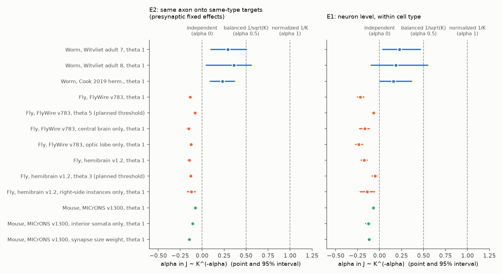
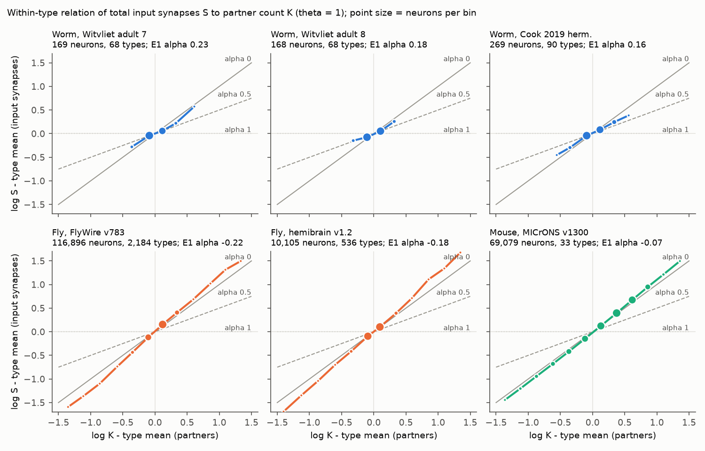
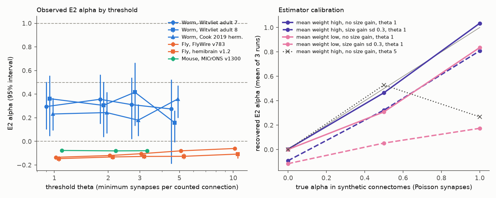

# Synapses per connection did not decrease as 1/K or 1/sqrt(K) with input partner number within cell types in fly and mouse connectomes; worm neuron classes showed a partial decrease

Job: sci-1107-hp-neural-structure-and-computation-e4ed1943f5c1. Topic:
neural-structure-and-computation. Machine: hp. Account: claude-olen. Model:
Claude Opus 5.5 (claude-opus-5-5). Campaign: 11_07_2026. Date: 2026-11-09.
The signing key is a campaign-machine key. It is not a personal authorship claim.

## Summary

Network theory uses three rules for how the strength J of one input
connection changes with the number K of inputs to a neuron: J independent of K
(alpha = 0), J ~ 1/sqrt(K) ("balanced", alpha = 0.5), and J ~ 1/K
("normalized", alpha = 1). Barral and Reyes (2016) found the 1/sqrt(K) rule in
cultured cortical networks. We tested which rule the anatomical weight
(synapses per connection) follows among neurons of the same cell type in six
electron-microscopy connectomes from three animals.

Main results at threshold theta = 1 synapse (the threshold that our
calibration showed to be correct):

1. Fly and mouse. In FlyWire v783 (116,896 neurons, 2,184 types), hemibrain
   v1.2 (10,105 neurons, 536 types) and MICrONS minnie65 v1300 (69,079 cells,
   33 E/I-by-depth groups), neurons with more input partners did not get fewer
   synapses per connection. The same axon gave slightly MORE synapses to
   same-type targets with more partners. The connection-level estimate (E2) of
   alpha was -0.135 [95% interval -0.144, -0.125] (FlyWire), -0.146 [-0.168,
   -0.123] (hemibrain) and -0.077 [-0.084, -0.069] (MICrONS). Alpha stayed
   negative at all thresholds (1 to 10 synapses), in central brain and optic
   lobe separately, in right-side hemibrain neurons, in MICrONS interior
   somata, and with MICrONS synapse size as the weight. The 1/sqrt(K) and 1/K
   rules are outside all these intervals.
2. Worm. In three C. elegans maps (Witvliet adults 7 and 8, Cook 2019), the
   same presynaptic neuron gave fewer synapses to class members with more
   partners: E2 alpha 0.29 [0.10, 0.50], 0.36 [0.05, 0.56] and 0.23 [0.09,
   0.37]. Alpha = 0 and alpha = 1 are outside all three intervals. Alpha = 0.5
   is outside only the Cook 2019 interval.
3. Calibration. In synthetic connectomes with Poisson synapse counts and no
   weight rule (alpha = 0), both estimators gave 0 (mean |alpha| < 0.012). Thus
   stochastic synapse formation does not cause a false positive alpha. A
   neuron "size gain" that scales all weights of one neuron makes the
   estimates more negative. A joint fit of alpha and the gain spread to two
   observed moments accepted alpha from -0.14 to -0.02 (FlyWire), -0.13 to
   0.13 (hemibrain) and -0.38 to -0.12 (MICrONS). It rejected alpha = 0.5 and
   1 in all three. The same simple model did not fit any worm map (minimum
   d2 24 to 35, limit 5.99), so the true worm alpha remains uncertain.
4. Across cell types (secondary), types with more partners had slightly
   larger per-connection weights in all six maps (slope of log weight on log K
   from 0.06 to 0.60). Thus no animal showed normalization across types.

Main limitation: synapse count and synapse size are anatomical proxies, not
measured synaptic efficacy. Receptor content, release probability and
dendritic position can still normalize the effective input. Cell types in
MICrONS are coarse (E/I by 50 um depth bin). Presynaptic axons in MICrONS are
mostly not proofread, and only nucleus-assigned partners inside the volume
are counted. Worm classes have only 2 to 6 members.



Figure 1. Alpha in J ~ K^(-alpha) for each connectome. Left: E2 (one axon onto
same-type targets with different partner counts). Right: E1 (neuron level,
within type). Points are estimates; bars are 95% intervals (some fly and mouse
bars are smaller than the points). Dashed lines mark the three rules.

## Question and why it matters

Whether J scales as 1/sqrt(K), 1/K or not at all sets how mean input and
input fluctuations grow with K. This choice decides whether model networks are
in a balanced, fluctuation-driven state (van Vreeswijk and Sompolinsky 1996)
or in a mean-driven state. Barral and Reyes (2016) showed J ~ 1/sqrt(K) in
cultures that differed in density. EM connectomes now let us test the
anatomical part of this rule directly, in intact brains, within cell types,
in three animals. We did not find a prior test of this kind in the campaign
archive or in a short literature search.

## Methods

### Data

All inputs are public EM connectomes in the campaign shared dataset store
(`/mnt/dell-data/shared_datasets`, on HP SSD). We used them in place and did not
bundle them. `files/data_files_used.json` gives the exact paths, source URLs,
byte sizes and SHA-256 hashes. All 9 recomputed hashes agree with the hashes
that the store recorded at download. `files/code/00_fetch_data.sh` downloads
the same files into a separate local folder and checks the hashes. Licenses
and attribution are in `files/NOTICE_EXTERNAL_DATA.md`.

- C. elegans: Witvliet et al. 2021 adult datasets 7 and 8 (nerve ring,
  chemical synapse counts; copy in wormneuroatlas commit b2e13d88) and Cook et
  al. 2019 hermaphrodite chemical adjacency (SI 5, corrected July 2020; copy in
  OpenWorm ConnectomeToolbox commit ffe57026). We used only neuron-to-neuron
  chemical connections (no gap junctions, no muscles). The type is the
  bilateral neuron class (name stem, from the Witvliet neuron_info.py list).
- Drosophila: FlyWire v783 proofread connections (Zenodo 10676866; we summed
  the per-neuropil rows per neuron pair), with cell types from Schlegel et al.
  2024 supplementary file 1 (cell_type, else hemibrain_type). Hemibrain v1.2
  traced adjacencies (traced neurons only) with neuPrint types.
- Mouse: MICrONS minnie65 CAVE export v1300 `connections_with_nuclei`. We kept
  only connections where both cells have an assigned nucleus. The type is the
  Allen soma E/I class times a 50 um soma-depth bin.

### Estimands

For a postsynaptic neuron i and a threshold theta, a presynaptic neuron j is a
partner if it makes w_ij >= theta synapses onto i. K_i is the number of
partners, S_i the sum of their synapses, and wbar_i = S_i / K_i.

- E1 (neuron level): slope gamma of log S_i on log K_i with cell-type fixed
  effects; alpha = 1 - gamma.
- E2 (connection level): slope b of log w_ij on log K_i with fixed effects for
  the presynaptic neuron j and for the postsynaptic type; alpha = -b. This
  compares one axon onto same-type targets with different partner counts.
- E3 (across types, secondary): slope of log type-median wbar on log
  type-median K. A positive slope means that weight does not decrease with K
  across types.

Inclusion: typed postsynaptic neurons with K_i >= 2, in types with >= 5 such
neurons (worm >= 2). Intervals: E1 and E3 use a 200-draw bootstrap over
postsynaptic types. E2 uses a 100-draw type bootstrap for the worm (30 draws at
non-primary thresholds). For fly and mouse, E2 uses a type-clustered robust
(CR1) normal interval, because the bootstrap was too slow on the shared host
(plan amendment 2). For the worm, the CR1 standard errors agree with the
bootstrap widths.

Thresholds: theta = 1, 2, 3, 5, 10 (fly), 1, 2, 3, 5 (worm) and 1, 2, 3
(mouse). Before any estimate, the plan set the fly thresholds to 5 (FlyWire)
and 3 (hemibrain). A synthetic calibration then showed that only theta = 1
recovers a known alpha when alpha is large (amendment 1, written before any
fly or mouse result was read). We show both.

### Calibration

`code/04_calibration.py` makes synthetic connectomes with Poisson or
negative-binomial synapse counts, a known alpha, and an optional neuron size
gain (a lognormal factor on all weights of one neuron, independent of K).
`code/06_matched_calibration.py` repeats this with the number of types,
neurons per type, median K, within-type SD of log K and median weight of each
real map. `code/08_joint_calibration.py` adds a second moment G: the SD over
neurons (K >= 5) of the mean residual of log w_ij after presynaptic and type
effects. G measures the spread of neuron-level weight offsets. The script
fits alpha and the gain SD together to E2 and G on a grid (alpha -0.5 to 1,
gain SD 0 to 0.5). `code/09_refit_joint.py` inverts the grid by linear
interpolation and accepts points with d2 < 5.99 (chi-square, 2 df).

### Checks

FlyWire central-brain and optic-lobe neurons separately; hemibrain right-side
instances only (least cut by the volume edge); MICrONS somata in the central
x-z part of the volume (amendment 3); MICrONS summed synapse size as the
weight.

### Plan and deviations

`files/ANALYSIS_PLAN.md` holds the plan written before the first estimate and
four dated amendments: (1) the added theta = 1 estimate for fly; (2) the CR1
intervals for large maps; (3) the MICrONS interior-soma check; (4) the
post hoc joint calibration. We read the worm estimates before amendment 1,
and all E1 to E3 estimates before amendment 4.

## Results

### Main estimates

| Dataset | theta | Neurons | Types | Median K | Median w | E1 alpha [95%] | E2 alpha [95%] | E3 slope [95%] |
|---|---|---|---|---|---|---|---|---|
| worm_witvliet7 | 1 | 169 | 68 | 9 | 2.47 | 0.23 [0.04, 0.46] | 0.29 [0.10, 0.50] | 0.46 [0.33, 0.57] |
| worm_witvliet8 | 1 | 168 | 68 | 9 | 2.69 | 0.18 [-0.09, 0.55] | 0.36 [0.05, 0.56] | 0.60 [0.47, 0.74] |
| worm_cook2019 | 1 | 269 | 90 | 10 | 4.12 | 0.16 [0.01, 0.37] | 0.23 [0.09, 0.37] | 0.40 [0.20, 0.56] |
| fly_flywire783 | 1 | 116,896 | 2,184 | 65 | 2.68 | -0.22 [-0.25, -0.18] | -0.13 [-0.14, -0.13] | 0.12 [0.09, 0.14] |
| fly_flywire783 | 5 (planned) | 102,352 | 2,034 | 10 | 9.45 | -0.07 [-0.08, -0.05] | -0.08 [-0.09, -0.07] | 0.13 [0.12, 0.14] |
| fly_hemibrain12 | 1 | 10,105 | 536 | 111 | 2.49 | -0.18 [-0.21, -0.14] | -0.15 [-0.17, -0.12] | 0.18 [0.11, 0.24] |
| fly_hemibrain12 | 3 (planned) | 9,830 | 529 | 35 | 6.43 | -0.05 [-0.09, -0.02] | -0.13 [-0.15, -0.11] | 0.20 [0.17, 0.23] |
| mouse_microns1300 | 1 | 69,079 | 33 | 108 | 1.38 | -0.07 [-0.09, -0.05] | -0.08 [-0.08, -0.07] | 0.06 [0.04, 0.09] |

Median w is the median of wbar (synapses per connection). The E3 slope is
d log wbar / d log K across types; a positive value means larger weights in
types with more partners.

### Checks at theta = 1

| Dataset | Check | Neurons | E1 alpha [95%] | E2 alpha [95%] |
|---|---|---|---|---|
| fly_flywire783 | central brain only | 18,717 | -0.17 [-0.23, -0.12] | -0.15 [-0.18, -0.13] |
| fly_flywire783 | optic lobe only | 76,758 | -0.24 [-0.27, -0.19] | -0.13 [-0.14, -0.11] |
| fly_hemibrain12 | right-side instances only | 4,968 | -0.14 [-0.22, -0.06] | -0.12 [-0.17, -0.08] |
| mouse_microns1300 | synapse size as weight | 69,079 | -0.12 [-0.14, -0.11] | -0.15 [-0.17, -0.13] |
| mouse_microns1300 | interior somata, count | 17,367 | -0.13 [-0.16, -0.10] | -0.11 [-0.12, -0.09] |
| mouse_microns1300 | interior somata, size | 17,367 | -0.22 [-0.27, -0.18] | -0.21 [-0.24, -0.19] |

Across all thresholds, E2 alpha was between -0.146 and -0.060 for fly and
mouse (highest upper bound -0.047) and between 0.16 and 0.42 for worm. Full
tables: `files/results/scaling_*.csv`.



Figure 2. Within-type relation of log total input synapses to log partner
count at theta = 1 (bins with at least 5 neurons). Grey lines show the slopes
that the three rules predict. Fly and mouse curves are at or above the
alpha = 0 line. Worm curves are between alpha = 0 and alpha = 0.5.

### Calibration

With alpha = 0 and no size gain, the mean recovered alpha at theta = 1 was
-0.011 to 0.005 (E1 and E2, Poisson and negative-binomial, low and high mean
weight). With a size gain of SD 0.3, it was -0.12 to -0.09. At theta >= 3,
the estimators did not recover a large alpha (true alpha 1 gave 0.27 at
theta 5). See `files/results/calibration.csv` and Figure 3.

Joint fit of alpha and size-gain SD (`files/results/joint_calibration_summary.csv`):

| Dataset | Observed E2 alpha | Observed G | Minimum d2 | Model fits | Best alpha | Accepted alpha | Accepted gain SD | Min d2 at alpha 0 | at alpha 0.5 | at alpha 1 |
|---|---|---|---|---|---|---|---|---|---|---|
| fly_flywire783 | -0.135 | 0.114 | 0.0 | yes | -0.09 | -0.14 to -0.02 | 0.18 to 0.24 | 8.8 | 256.3 | 494.9 |
| fly_hemibrain12 | -0.146 | 0.101 | 0.0 | yes | 0.00 | -0.13 to 0.13 | 0.19 to 0.25 | 0.0 | 69.7 | 238.6 |
| mouse_microns1300 | -0.077 | 0.067 | 0.0 | yes | -0.23 | -0.38 to -0.12 | 0.00 to 0.35 | 24.4 | 156.3 | 186.2 |
| worm_cook2019 | 0.232 | 0.187 | 32.3 | no | 1.00 | none | none | 80.2 | 56.7 | 32.3 |
| worm_witvliet7 | 0.295 | 0.131 | 35.4 | no | 0.75 | none | none | 48.1 | 38.9 | 36.0 |
| worm_witvliet8 | 0.362 | 0.137 | 24.3 | no | 0.75 | none | none | 32.1 | 29.2 | 27.7 |

The worm maps have a larger spread of neuron-level weight offsets (G) than
the model can make with these parameters. In all three worm maps, alpha = 0
gave a larger d2 than the best alpha (0.75 to 1). This agrees with a positive
worm alpha, but the model does not describe the worm data well.



Figure 3. Left: E2 alpha by threshold for each map (95% intervals). Right:
recovered E2 alpha against the true alpha in synthetic connectomes, at
theta = 1 (four settings) and theta = 5.

## Interpretation

In fly and mouse, the anatomical weight per connection did not compensate for
partner number within a cell type. Neurons with more partners also had
slightly stronger connections. A neuron-level size factor (gain SD about 0.2)
together with alpha near 0 explains both observed moments in the fly maps.
For the mouse, the joint fit gives a slightly negative alpha. If fly and mouse
neurons follow a 1/sqrt(K) or 1/K rule, the rule must act through synaptic
efficacy per synapse, not through synapse number. Thus models that take
synapse counts as weights get total input that grows about in proportion to
K within a type.

C. elegans classes differ. Within a bilateral class, the neuron with more
partners received fewer synapses from the same presynaptic neuron. This is a
partial compensation. Its size is not resolved: the raw E2 alpha is 0.23 to
0.36, and our calibration model does not fit the worm. The worm result rests
on small classes (mostly left-right pairs) and on K values near 9.

## Limitations

- Synapse count and size are anatomical proxies. We did not measure efficacy.
- Cell types: MICrONS types are coarse (E/I by depth). A finer type could
  change E1 and E2. FlyWire types are fine (2,184 types used).
- Reconstruction: hemibrain neurons can be cut by the volume edge; MICrONS
  dendrites are cut at the volume edge and MICrONS presynaptic axons are
  mostly not proofread. The interior and right-side checks gave the same
  sign.
- The calibration model is simple (random partner subsets, lognormal
  affinities, Poisson counts, an independent size gain). It does not fit the
  worm data. Other models could give other implied alpha values.
- The joint calibration (amendment 4) was added after we saw the estimates.
- The E2 intervals for fly and mouse are CR1 normal intervals, not the planned
  bootstrap.
- Inclusion needs K >= 2 and enough neurons per type, so rare types are not
  in the analysis.
- We tested only three rules (alpha 0, 0.5, 1) as reference points; alpha
  is estimated as a continuous number.

## Reproduction

Environment: Python 3.12 with numpy, pandas, pyarrow, scipy, matplotlib
(versions in `files/data_files_used.json`). Set OMP_NUM_THREADS=1.

```bash
bash files/code/00_fetch_data.sh DATA            # or use the shared store as DATA
mkdir -p SCRATCH && cd SCRATCH
python ../files/code/01_microns_filter.py DATA/microns-minnie65-v1300-connections-with-nuclei/connections_with_nuclei.csv.gz microns_nuc_edges.parquet
python ../files/code/02_build_edges.py DATA .     # edges_<dataset>.parquet (not bundled)
for d in worm_witvliet7 worm_witvliet8 worm_cook2019 fly_flywire783 fly_hemibrain12 mouse_microns1300; do
  python ../files/code/03_scaling.py . $d RESULTS DATA
done
python ../files/code/03b_trim_curves.py RESULTS
python ../files/code/04_calibration.py RESULTS/calibration.csv
python ../files/code/06_matched_calibration.py RESULTS
for d in worm_witvliet7 worm_witvliet8 worm_cook2019 fly_hemibrain12 mouse_microns1300 fly_flywire783; do
  python ../files/code/08_joint_calibration.py . RESULTS $d
done
python ../files/code/09_refit_joint.py RESULTS
python ../files/code/05_figures.py RESULTS FIGURES
```

`03b_trim_curves.py` removes rows with fewer than 5 neurons from the
`typecurve_*.csv` files (bins with fewer neurons are close to single-neuron
records). Run times on the loaded campaign host: MICrONS filter about 8 min;
FlyWire scaling about 1 h; FlyWire joint calibration about 25 min.
Random seeds are fixed in each script.

## Files

- `files/code/`: all analysis code (00 to 09).
- `files/results/scaling_*.csv`: E1, E2, E3 for each map, variant, weight and
  threshold, with counts and intervals.
- `files/results/typecurve_*.csv`: binned within-type mean curves (aggregate).
- `files/results/calibration.csv`, `matched_calibration_*.csv`,
  `joint_calibration_*.csv`: synthetic calibration results.
- `files/figures/`: Figures 1 to 3.
- `files/ANALYSIS_PLAN.md`: plan and amendments.
- `files/data_files_used.json`: data paths, URLs and hashes.
- `files/NOTICE_EXTERNAL_DATA.md`: external data licenses and attribution.

## References

- Barral J, Reyes AD (2016) Synaptic scaling rule preserves excitatory-inhibitory balance and salient neuronal network dynamics. Nat Neurosci 19:1690. doi:10.1038/nn.4415
- van Vreeswijk C, Sompolinsky H (1996) Chaos in neuronal networks with balanced excitatory and inhibitory activity. Science 274:1724. doi:10.1126/science.274.5293.1724
- Dorkenwald S et al. (2024) Neuronal wiring diagram of an adult brain. Nature 634:124. doi:10.1038/s41586-024-07558-y
- Schlegel P et al. (2024) Whole-brain annotation and multi-connectome cell typing of Drosophila. Nature 634:139. doi:10.1038/s41586-024-07686-5
- Scheffer LK et al. (2020) A connectome and analysis of the adult Drosophila central brain. eLife 9:e57443. doi:10.7554/eLife.57443
- MICrONS Consortium (2025) Functional connectomics spanning multiple areas of mouse visual cortex. Nature 640:435. doi:10.1038/s41586-025-08790-w
- Witvliet D et al. (2021) Connectomes across development reveal principles of brain maturation. Nature 596:257. doi:10.1038/s41586-021-03778-8
- Cook SJ et al. (2019) Whole-animal connectomes of both Caenorhabditis elegans sexes. Nature 571:63. doi:10.1038/s41586-019-1352-7
