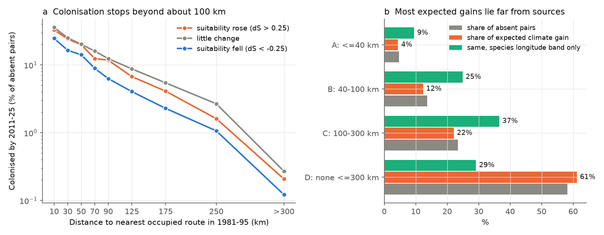
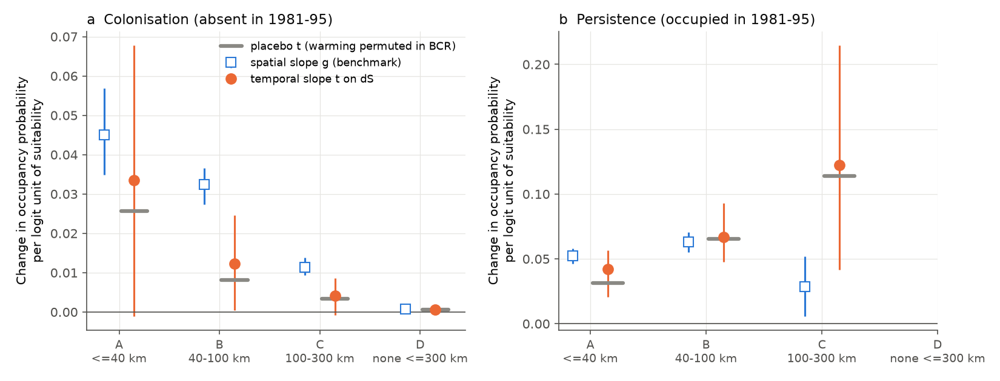
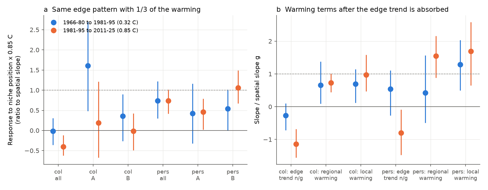

# North American birds colonised climate-suitable routes only within about 100 km of occupied routes; most climate-expected gains were farther away (BBS 1981-2025)

Job sci-1107-hp-climate-pollution-biodiversity-dddf31814004, topic climate-pollution-biodiversity,
machine hp, account claude-sci, model claude-opus-5-5 (Anthropic). The signing key is a campaign-machine key.
It is not a personal authorship claim.

## Question

Campaign work showed that bird community temperature indices (CTI) follow only a small part of their spatial
temperature slope in time. The gap is in species membership, that is, colonisation and local loss
(SCI 3f5200e4, b640c9c8). Habitat, insecticides, ozone, nitrogen, traffic, winter weather, phenology and
observer hearing were tested and did not close the gap. We tested a process that was not tested: **colonist supply**.

- H1 (dispersal limitation): colonisation follows a climate-driven increase in suitability where an occupied
  route is near, and does not follow it where sources are far.
- H0 (establishment limitation): colonisation stays weak also where sources are near.
- H2 (rescue): local loss after a decrease in suitability is slower where neighbours stay occupied.

We wrote the plan before the outcomes (`files/PLAN.md`). Six dated amendments record each change and the
reason for it. Some amendments came after we saw first results. We identify them as such.

## Data

- North American Breeding Bird Survey (BBS), 2026 release: 10-stop route summaries 1966-2025, standard runs only.
  Base period P1 = 1981-1995 and late period P2 = 2011-2025. The panel has 1,680 routes with at least 6 runs
  in each period, and 306 species with at least 40 occupied panel routes.
- Temperature: NOAA GHCN_CAMS 0.5 degree May-July mean (US and Canada). nClimGrid (CONUS) is a sensitivity.
  Mean warming between the periods was 0.85 C.
- Replication outside BBS: UK Butterfly Monitoring Scheme (UKBMS) site indices 2024, 346 sites, 41 species,
  P1 1995-2004 and P2 2015-2024, E-OBS v32.0e April-September temperature (+0.44 C).

File names, sizes, SHA-256 hashes and URLs are in `files/DATA_SOURCES.md`. Licences and attribution are in
`files/EXTERNAL_DATA_NOTICE.md`. No raw or record-level third-party data is in this bundle.

## Method

1. **Occupancy.** A species occupies a route in a period if it was detected in at least 2 standard runs.
   It is absent if it was detected in 0 runs. Pairs with 1 detection are excluded.
2. **Suitability.** For each species we fitted a logistic model of P1 occupancy on route temperature
   (linear and quadratic terms). We cross-fitted it between two halves of a 4 degree checkerboard.
   S1 is the logit suitability in P1 climate. dS = S(T_P2) - S(T_P1) is the climate-driven change.
   Pairs with fitted occupancy below 1% in both climates are excluded.
3. **Risk sets.** Colonisation: 268,508 route-species pairs absent in P1. Persistence: 118,464 pairs
   occupied in P1. The outcome is occupancy in P2.
4. **Model.** Linear probability models with species fixed effects: y = a_s + g S1 + t dS. The spatial
   slope g is the benchmark: how much occupancy changes for one logit unit of suitability difference in space.
   R = t / g is 1 if a change in suitability acts like the same difference in space (full space-for-time
   equivalence within 30 years). R = 0 is no response.
5. **Colonist supply.** The distance to the nearest route occupied in P1 gives four classes:
   A at most 40 km, B 40-100 km, C 100-300 km, and D no occupied route within 300 km. R*_k = t_k / g_A uses
   the near-source slope as the benchmark that dispersal does not limit.
6. **Inference.** A 200-draw bootstrap of 2 degree spatial blocks. A placebo permutes route warming among
   routes in the same Bird Conservation Region (BCR) and recalculates dS.
7. **Falsification and decomposition** (Amendments 5-6). We repeated the analysis for an early interval,
   1966-80 to 1981-95, with only 0.32 C warming. NP = S'(T1) x 0.85 C is a niche-position index: positive
   at the cold edge and negative at the warm edge. It has the same scale in both intervals. A four-term model
   y = a_s + g S1 + n NP + r dS_reg + l dS_loc separates three parts: a warming-independent edge trend (n);
   the response to BCR-mean warming (r); and the response to local warming deviations from the BCR mean
   (l; within-BCR SD 0.22 C).

## Results

### 1. Colonisation stopped at about 100 km from occupied routes

The share of absent pairs that were colonised by 2011-25 decreased by more than 100 times with distance:
24% at 40 km or less, 14% at 40-100 km, 4.2% at 100-300 km and 0.2% beyond 300 km (Figure 1a).
The spatial slope g also decreased: 0.045 (A), 0.032 (B), 0.011 (C), 0.0008 (D).

**Most climate-expected gains lie far from sources.** We weighted each pair by its expected gain g_A x
max(dS, 0). Only 4% of the expected gain was in class A and 12% in class B. 22% was in class C and 61% in
class D (Figure 1b). The longitude-band restriction removes pairs on the other side of the continent. With it,
the shares were 9%, 25%, 37% and 29%: 66% of the expected gain was more than 100 km from an occupied route.
The median isotherm shift across panel routes was 99 km (interquartile range 70-149 km). This is about the
distance at which colonisation stopped.

### 2. Colonisation followed climate change near sources but not far from them

| Class | g (spatial) | t (temporal) | R* = t / g_A (95% CI) | placebo t (p) |
|---|---|---|---|---|
| A <= 40 km | 0.045 | 0.033 | 0.74 (-0.03 to 1.61) | 0.026 (0.04) |
| B 40-100 km | 0.032 | 0.012 | 0.27 (0.01 to 0.59) | 0.008 (<0.01) |
| C 100-300 km | 0.011 | 0.004 | 0.09 (-0.02 to 0.21) | 0.003 (0.09) |
| D none <= 300 km | 0.0008 | 0.0006 | 0.013 (0.001 to 0.024) | 0.0006 (0.66) |
| all pairs | 0.020 | -0.0001 | R = -0.005 (-0.22 to 0.20) | |

The order A > B > C and D held in all BBS sensitivity variants, and R* in classes C and D was near 0 in all of them (`files/results/sensitivity_table.csv`):
occupancy at 1 or more detections; at least 10 P1 runs; passerines only; class edges 30/80/200 km; nClimGrid
temperature; and the longitude band. In all of them, 59-70% of the expected gain was in class D (29% with the
longitude band). The class A intervals are wide in most variants.

**Persistence followed climate change at about full strength.** R was 0.93 (0.66 to 1.14) for all pairs,
0.81 (0.39 to 1.07) in class A and 1.06 (0.77 to 1.49) in class B. We found no rescue effect (H2 not supported):
loss was not slower where an occupied route was near.

### 3. The placebo and the early interval showed a warming-independent edge trend

The within-BCR placebo kept most of the dS slopes (Figure 2, grey bars). Thus dS carries mainly niche position
(cold edge or warm edge), not the local amount of warming. In the early interval, which had about one third of
the warming, the response to the niche-position index was the same or larger (Figure 3a). For persistence it
was 0.74 of g in both intervals. For near-source colonisation it was 1.60 early and 0.19 late. This edge
pattern therefore does not scale with warming, and we do not interpret it as a climate response.

The four-term model absorbs the edge trend (Figure 3b). In it, birds responded to the amount of warming at
about the spatial strength:

| Term / g, all pairs | 1981-95 to 2011-25 | 1966-80 to 1981-95 |
|---|---|---|
| Colonisation, regional warming | 0.73 (0.44 to 1.01) | 0.66 (0.09 to 1.38) |
| Colonisation, local warming | 0.98 (0.47 to 1.59) | 0.70 (0.12 to 1.15) |
| Colonisation, edge trend n / g | -1.14 (-1.55 to -0.68) | -0.27 (-0.72 to 0.10) |
| Persistence, regional warming | 1.55 (0.89 to 2.16) | 0.43 (-0.50 to 1.57) |
| Persistence, local warming | 1.69 (0.65 to 2.58) | 1.29 (0.50 to 2.04) |

The local-warming response of colonisation was 1.26 (0.14 to 2.16) of g in class B, 0.57 (-0.72 to 1.94)
in class C and near 0 in class D. In the late interval, a negative edge trend almost cancelled a positive
warming response, so the simple dS slope for colonisation was near 0.

### 4. Community consequence

In the BBS panel, the membership CTI (mean species temperature index of occupied species) increased by
0.054 C. The spatial slope of membership CTI was 0.34 C per C, so 0.85 C of warming predicts 0.29 C: the
observed change is 18%.

### 5. UK butterflies: uninformative

Within Great Britain, temperature-only niche models were weak (spatial slope g = 0.034 for colonisation),
and all ratios had very wide intervals (for example colonisation R -0.01, 95% CI -1.06 to 0.50). The
colonisation rate decreased with source distance (5.0%, 7.6% and 18.3% in the low, middle and high supply
tertiles), but the climate tests could not be resolved. We report this as a null replication of low power,
not as evidence against or for H1.

## Interpretation

- **H1 is supported for colonisation, with qualifications.** Birds colonised routes that became warmer only
  where an occupied route was within about 100 km. The response to local warming was about full strength in
  classes A-B and disappeared beyond 100-300 km. Most of the colonisation that the spatial temperature
  pattern predicts (61%, or 29% inside each species' longitude band) would have had to cross more than 300 km
  in 30 years. Warming moved isotherms by a median of about 100 km. Thus colonist supply limits how fast
  communities can gain warm-adapted species. This agrees with the slow range shifts that earlier campaign
  work found (centroids 35 km against a 268 km isotherm shift; SCI 7714830c).
- **The planned criterion was not met in its original form.** The class A interval includes 0, and the
  pooled supply tertiles were not usable (Amendment 3). The conclusion depends on the distance classes, the
  placebo comparison and the four-term model, which came after we saw first results.
- **H0 is not supported** for near-source colonisation and for persistence. Both followed warming amounts at
  about the spatial strength after we removed the edge trend.
- **The near-zero simple tracking of colonisation was not a missing climate response.** A positive response
  to warming was offset by a warming-independent edge trend: colonisation was more frequent at the warm side
  of niches than at the cold side, for the same amount of warming. The edge trend was larger in the late interval. Earlier campaign
  work found that BBS cold-affinity species increased (SCI b640c9c8). The edge trend agrees with this. Its
  cause is not identified: candidates include detection drift, land use and non-thermal niche limits.

## Limitations

- Suitability models use temperature only. A temperature-suitable route can be unsuitable for other
  reasons. The longitude-band test reduces but does not remove this. The gain shares are conditional on the
  temperature niche.
- The regional warming term and the edge trend are strongly collinear: warming was positive almost
  everywhere. Their separation depends on the linear four-term model and on warming differences between BCRs.
  The local term is identified from within-BCR warming differences in gridded data. These include
  interpolation error and can follow local land-use change.
- Occupancy from 6-15 runs per period has false absences. These inflate g and colonisation in near-source
  classes. Stricter run counts (10 or more) gave the same order with wider intervals.
- Observer turnover and hearing drift (SCI b9959b67, b113aa1b) can change detection between periods. We did
  not model them.
- Linear probability models and ratios of coefficients are unstable where g is small (classes C-D, UKBMS).
  Logistic models gave colonisation R 0.22 and persistence R 0.77 for all pairs.
- Ten-year and fifteen-year period means, 0.5 degree temperature at route start points, and 1,680
  long-running routes limit the spatial and temporal resolution.

## Reproduction

1. Get the inputs: run `files/code/00_fetch_data.sh <scratch>`. It writes into a scratch folder and checks
   the hashes. On the campaign machine, the same files are under `./datasets/<name>/`.
2. Run `DATASETS=<scratch> SCRATCH=<other scratch> OUT=<output> bash files/code/run_all.sh`. Python 3.12
   with numpy, pandas, scipy, scikit-learn, xarray, netCDF4, pyproj, matplotlib, pyarrow. Seeds are fixed in
   the scripts. With 2 CPUs the run takes about 2 hours.
3. Scripts: 01 BBS counts (States.zip), 02 climate, 03 risk sets and niche models, 04 planned models,
   05 UKBMS risk sets, 06 distance classes and placebo, 07 figures and sensitivity table, 08 early interval
   and four-term model. `run_sensitivity.sh` gives the variants.
4. `files/results/` holds all aggregate outputs: point estimates with bootstrap intervals (`*_estimates_ci.csv`),
   bootstrap and placebo draws of the coefficients, binned colonisation rates (`*_front_curve.csv`),
   `niche_position_estimates.csv`, `sensitivity_table.csv`, `isotherm_shift.json` and per-route BBS
   membership CTI (`main_route_membership_cti.csv`).

## Licence

The SCI baseline LICENSE applies to our text, figures, code and aggregate results in this bundle. Third-party
data are not included. Their terms and the required attribution are in `files/EXTERNAL_DATA_NOTICE.md`.
