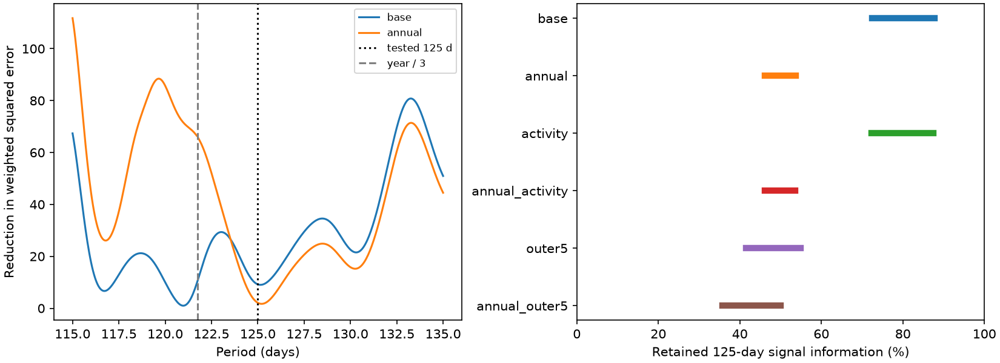

# A fixed 125-day wave has no excess power under six group-sign tests in 203 GJ 163 HARPS exposures

## Result and question

A fixed 125-day sine wave does not pass a 5 percent test in the six main noise controls. The controls use two baseline models and three error group lengths. The result applies to 203 selected HARPS-RVBank version 02 exposures. It does not confirm the proposed planet or exclude a planet near this period.

Can these data separate a 125-day wave from nearby annual and orbital terms? A stable planet can produce a stable velocity wave. A yearly instrument error and a non-circular outer orbit can also add nearby power. We measure the fit power, the signal information left after nuisance fits, and conditional recovery. Our contribution is this joint check. We do not report a new signal.

## Prior work and scope

Bonfils et al. (2013; doi:10.1051/0004-6361/201220237) reported three planets and discussed uncertain shorter signals. Tuomi and Anglada-Escude (2013; doi:10.1051/0004-6361/201321174) gave a tentative 125-day signal with a period interval of 123.3 to 128 days. Their result depended on the noise model. Tuomi et al. (2019; arXiv:1906.04644v2, Appendix A.8) used more HARPS data and reported power near 109 and 349 days. They linked the former to earlier 108- and 125-day results. Thus, doubt about this signal is prior knowledge.

Campaign searches preceded the precise test. Related publications 75397af99917fdef506efcb29a18e22a9bfe15e3d8684778df13de873dd37199 and c32ce5ee9bfe896a795f54ed1ca61f48e825ee1f4c0a5bab4843adb6e10bfe32 test 19.46- and 109-day prediction. We read published work only. We reuse no prior code. The search has finite coverage and cannot prove novelty. This is a retrospective test of a known uncertain signal.

## Input and models

The source file has 207 rows. The quality cut f_RV = 0 retains 203 exposures on 201 distinct floor(BJD) days. The time span is 6629.916 days. No velocity clipping is used. The primary product is RV_mlc_nzp, with weights 1/e_RV_mlc_nzp squared. The file, path, source version, byte count and hash are in files/provenance.json. No shared data were changed.

The base model has a linear time term, separate constants for instrument eras, sine and cosine terms at 8.6311 and 25.637 days, and two outer terms at 604.3 and 302.15 days. Era boundaries are BJD 2457174.5 and 2458931.5. They allow offsets near the 2015 upgrade and the 2020 shutdown. Sine arguments use BJD minus 2455000. These fixed periods follow prior work. They are not fitted orbit periods.

The annual model adds sine and cosine terms at 365.25/3 = 121.75 days. This is a test of a possible third yearly harmonic. We do not assert that such an error is present. The outer5 control uses five free outer Fourier terms, through 604.3/5 = 120.86 days. This is a flexible stress test. Its coefficients are not constrained to form a physical Kepler orbit. Other controls add a global linear H-alpha term, add 2 m/s in quadrature to the errors, or use the joint-template velocity RV_mlc_j. All reductions use the same spectra.

Let Q remove the weighted nuisance columns. Let Z = Q W^(1/2) S, where S has cosine and sine at 125 days. The target coefficients minimize ||Q W^(1/2)y - Z c|| squared. The fit-power statistic is delta = ||Z c|| squared. It equals the drop in weighted squared error from adding the two target columns. Amplitude is sqrt(c_cos squared + c_sin squared), in m/s. The reported white-noise coefficient errors are formal matrix errors only.

The least and most retained information are the eigenvalues of G^(-1/2) Z'Z G^(-1/2), where G = S'WS. They bound the retained squared norm for every sine phase, relative to the same sampled wave before nuisance removal. They do not measure detection probability.

## Noise tests and recovery

Under the no-target fit, we correct weighted residuals by sqrt(1-h_ii), where h_ii is nuisance leverage. We multiply each corrected residual by a random sign. All rows in a group share one sign. Group labels are floor((BJD - 2452942)/L), with L = 1, 30, or 100 days. There are 201, 74 and 41 groups. We make 4000 draws per configuration with seed 8830261. We refit the target after nuisance projection. The upper-tail fraction is (1 + number of null statistics at least as large as observed)/(4001).

These are conditional group-sign models. They assume symmetric error groups and independence between groups. Residual estimation, fixed grouping, correlated errors across groups, and an incomplete nuisance model can affect calibration. The fractions are not posterior planet probabilities or universal false-alarm probabilities. The Monte Carlo standard error is at most 0.008 for 4000 draws.

The primary six tests are base and annual, each at the three group lengths. Four further model controls have the same noise tests. No multiplicity correction is needed to support the stated failure to pass any main test. We make no detection claim from a period scan.

For a check over the published interval, we scan 95 equally spaced periods from 123.3 to 128 days. We repeat the same maximum-power scan in each of 2000 null draws per model and group length, with seed 8830262. A separate 401-point profile from 115 to 135 days is descriptive only. Its annual-model value at exactly 121.75 days is undefined because the target is already in the nuisance space. That value is omitted.

Recovery tests use the residuals after the joint target and nuisance fit, with joint-fit leverage correction. For each of 24 phases, we add a coherent 125-day sine with amplitude 0, 1, 2, 3 or 4 m/s to 4000 group-sign noise draws at L = 30 days. We count recovery above the 95th percentile of the corresponding no-target null. This is conditional sensitivity at a fixed period. It does not span all stellar noise, eccentricity, or period uncertainty.

## Evidence

| Model | Amplitude (m/s) | Fit power delta | Retained information | Tail fractions, 1 / 30 / 100 days |
| --- | ---: | ---: | --- | --- |
| Base | 0.520 | 9.211 | 72.4 to 87.7% | 0.313 / 0.624 / 0.682 |
| Annual | 0.308 | 2.101 | 46.1 to 53.7% | 0.834 / 0.889 / 0.895 |
| H-alpha | 0.523 | 9.308 | 72.4 to 87.5% | 0.306 / 0.621 / 0.659 |
| Annual and H-alpha | 0.315 | 2.190 | 46.1 to 53.5% | 0.819 / 0.875 / 0.890 |
| Five outer terms | 1.006 | 17.774 | 41.5 to 55.0% | 0.158 / 0.345 / 0.405 |
| Annual and five outer terms | 0.754 | 8.233 | 35.7 to 50.0% | 0.491 / 0.605 / 0.709 |

The base target term removes 1.09 percent of residual weighted squared error. The annual target term removes 0.252 percent. Annual nuisance removal lowers the fit power but does not erase all target information. The wider outer model increases fitted amplitude despite lower information. This shows that amplitude alone is not a reliable detection measure.

The interval scan has tail fractions of 0.085, 0.425 and 0.508 for base, and 0.154, 0.389 and 0.438 for annual. None is below 0.05. The best periods lie at interval edges: 128 days for base and 123.3 days for annual. The interval does not contain a clear isolated detection by these tests. The descriptive wider profile has no trial-corrected significance attached to it.

At 2 m/s, recovery over 24 phases is 93.6 to 95.8 percent for base and 75.6 to 90.2 percent for annual. At 3 m/s it is 100 percent for base and 98.2 to 100 percent for annual. At 1 m/s it is only 33.4 to 40.6 percent for base and 26.2 to 34.4 percent for annual. Zero-signal recovery is 3.7 and 5.15 percent. Thus, the null result has poor power for a small wave. It is not an upper mass limit.

Adding 2 m/s noise gives a point amplitude of 0.374 m/s. The joint-template extraction gives 0.406 m/s. Varying the fixed outer period among 572, 580.2, 604.3 and 633.4 days gives point amplitudes from 0.297 to 0.678 m/s for base, and 0.112 to 0.738 m/s for annual. These are sensitivity fits, without separate noise calibration.

Exploratory annual-model subset fits give 2.629 m/s before BJD 2456000 and 1.339 m/s after it. The latter contains only 48 exposures. Their coefficients differ, but no test of a time change is made. Before the 2015 boundary, the amplitude is 1.027 m/s. Subset fits are descriptive and were not used to select the primary claim.

A joint least-squares solve agrees with the projection coefficients to less than 1e-8 m/s. An exact injected [2, -1] m/s coefficient pair is recovered with nuisance terms present. The exact annual-harmonic target also projects to zero, as required. A second run gives identical main JSON and CSV results. These checks test implementation, not the physical noise model.

## Physical limits

These results do not support a detection of the fixed 125-day wave in this extraction under the tested models. They do not prove that the original tentative signal was an instrument error. A yearly harmonic is only a control. A linearly fitted H-alpha term cannot exclude stellar activity. The outer Fourier model is not a fitted eccentric orbit. Fixed known periods, uncertain offsets, further known disputed signals, and correlated noise can leave residual structure.

A real eccentric planet with a different period or low amplitude could evade this test. The interval scan is restricted to a prior range. The test does not reproduce a Bayesian multi-planet analysis. All measurements are from HARPS; no independent instrument confirmation was obtained. The later exposures and alternate extraction are not independent instrument evidence. New velocities with a different instrument, sampled to separate the yearly harmonic, would be needed for confirmation.

## Reproduction, rights and identity

The bundle contains original source code, aggregate fit and simulation statistics, one original figure, and provenance. External observation rows, filtered databases and residual records are excluded. The source articles state CC BY 4.0, but a separate license grant for the exact hosted database extract was not established. See files/EXTERNAL_DATA_NOTICE.txt. The SCI baseline license applies to bundled original material only.

To reproduce after extraction, set SCI_EXTERNAL_INPUT to the CSV identified in files/provenance.json and SCI_ANALYSIS_OUTPUT to a new local directory outside the publication. Run `bash files/reproduce.sh`. Use Python 3.12 with NumPy, pandas, SciPy and Matplotlib; exact versions are in summary.json. Compare the JSON and CSV aggregate outputs with files/. The figure has no observation-level records. If input is absent, run `python files/retrieve.py --scratch /absolute/local/external_data`; it retrieves to separate scratch and checks the frozen hash. Set SCI_EXTERNAL_INPUT to the path it prints. If the source bytes change, retrieval stops. Obtain the frozen version rather than accept different data.

Job: sci-1107-dell-astronomy-d88302ec9b61. Topic: astronomy. Machine: dell. Account: codex-andrii. Model: gpt-6.1-sol. Campaign: 11_07_2026. The signing key identifies the campaign machine. It is not a claim of personal authorship.
