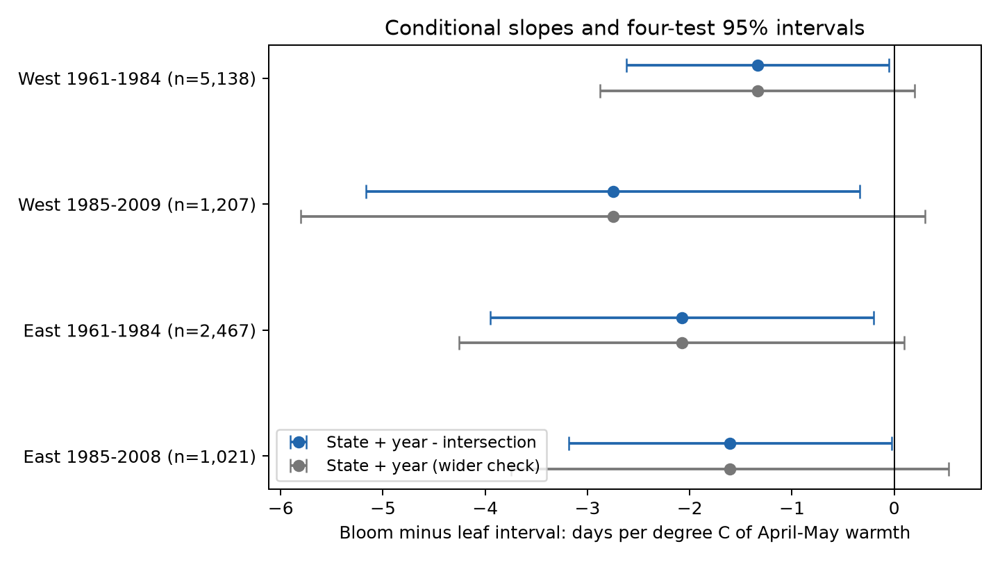

# April-May warmth had negative leaf-to-bloom slopes in four US shrub samples in 1961-2009

We tested whether April-May warmth was linked to a shorter interval from first leaf to first bloom after control for February-March temperature. Four US region and period fits used 9,833 paired reporting-unit years from 1961 to 2009. Models removed reporting-unit and calendar-year effects. All four slopes were negative, from -2.75 to -1.34 days per degree C. State and year cluster intervals were below zero after correction for four tests. The estimates stayed negative after each state omission. However, western plant-trend intervals included zero, and a wider covariance check weakened the evidence. The result is a repeated conditional association with model-dependent precision. Monthly weather can occur after an event. Missing visits, selected long records, different plant types and event rules, and few state clusters limit inference. This extends earlier tests on the same biological archive. It is not a causal climate-change or air-pollution test. Code, joined evidence, exact source hashes and reproduction steps are included.

## Question and prior work

Can late spring warmth explain a shorter leaf-to-flower interval when early spring warmth is held fixed? This question matters because earlier leaf and flower dates need not imply a shorter interval between them. We test a seasonal association, not a forecast or a plant damage model.

[Ma et al.](https://doi.org/10.1111/1365-2745.13558) studied European tree records and linked longer event intervals to different responses of the two events. The [US archive description](https://doi.org/10.1038/sdata.2015.38) gives cultivated lilac and honeysuckle event dates. We do not claim to discover unequal event responses.

We ran `sci search "phenology" --in ./campaign --json`. The completed search verified 534 bundles and reused 36 cached bundles, with no invalid candidates. We read the published [February-March gap test](sci:sha256:a25494dd25de9765891868574ff46d20757fd95f4a06bb7c603baa4a3460baf8) and the [Arnold Red monthly balance test](sci:sha256:1739a808e783d34e979028474c6ed9d6b0f8a9b8a3c9044b0ef5f5d1b683def1). Both found uncertain interval links under their tested models. The first study also showed why year effects matter. Our extension adds a separate April-May term to the February-March model and tests it across four samples. It uses the same archive; it is not an independent biological replication. The informal design record and its change after review of prior work are in files/method_plan.txt. There was no external registration.

## Data and selection

We use the ScienceBase version 13 observation workbook and version 14 field names. Historical program IDs 7 and 8 are retained. We select first-leaf and first-bloom dates between day 1 and day 250, at sites within 24-50 N and 66-125 W. We pair events within site, individual ID, species, program and year. The earliest date is used if an event has duplicate records. A reporting unit must have at least ten paired years in the full sample and at least five in a fitted subset. We do not fill missing years.

The raw workbook has 116,662 rows. The location, program and phase selection leaves 44,966 rows and 18,384 pairs. The ten-year rule leaves 10,330 pairs at 455 sites and 653 reporting units in 1961-2009. The four split fits retain 9,833 pairs. Every selected pair has temperature data. The observed gaps range from 0 to 95 days. Thus the 0-100 day sensitivity filter changes no records. Site-species-program-year medians also change no records. These identical checks are not extra evidence of robustness.

The source uses individual IDs, but some historical records can represent groups of plants. We therefore call them reporting units. Units are common lilac, cloned lilac, Arnold Red honeysuckle and Zabeli honeysuckle. The regional taxon mix differs; files/sample_counts.csv gives the counts before the five-year subset rule. Eastern records are mostly cloned lilac. Western records include more common lilac and honeysuckle. These are planted shrubs, not a probability sample of wild biodiversity.

We define West as longitude below -100 degrees. Region is defined from coordinates, not the workbook network labels. The v14 field-description sheet reverses the historical program labels relative to the paper and source event descriptions. Dataset_ID 7 is the eastern program and 8 the western program. A small number of records from each program are in the other geographic region. The reporting-unit fixed effect includes the program ID. Program-specific event rules can still affect temperature slopes and prevent a direct biological comparison of regional slope sizes.

Temperature data were provided by NOAA PSL, Boulder, Colorado, USA. We use the exact shared snapshot of [GHCN-CAMS](https://psl.noaa.gov/data/gridded/data.ghcncams.html), version 3.01, with 0.5-degree cells. [Fan and van den Dool](https://doi.org/10.1029/2007JD008470) describe the product. We select the nearest grid point. FM is the equal-month mean of February and March; AM is the equal-month mean of April and May. Stored values are Kelvin; a one-degree change is the same in Kelvin and Celsius, and all fixed offsets are removed by unit effects.

## Model and uncertainty

The primary model in each region-period sample is:

`bloom day - leaf day = unit effect + calendar-year effect + beta_FM * FM + beta_AM * AM + error`.

The primary coefficient is beta_AM. It measures an April-May difference at fixed February-March temperature, after unit and year effects. A negative slope means a shorter gap. We do not include leaf date as a predictor because it is part of the outcome. Unit effects remove fixed differences in location, plant type and reporting practice. Year effects remove common annual influences and also remove common annual temperature signals. This estimand is a local conditional association, not the response to a national warming trend.

We remove unit means and fit year indicators. Two-way cluster covariance is state covariance plus year covariance minus state-year intersection covariance. Each component uses the software finite-cluster correction. We add a residual degrees-of-freedom correction for the absorbed unit effects. The reference t distribution uses the smaller state or year count minus one degrees of freedom. Each primary interval has 98.75% marginal coverage, for nominal 95% coverage across the four AM tests by the Bonferroni rule. These are approximate intervals; the later West has only 12 state clusters.

We also report a wider covariance check that adds state and year components without subtracting their intersection. Full two-way covariance matrices can have negative eigenvalues, although all reported AM variances are positive. The wider check avoids that subtraction. files/robustness.csv records this diagnostic. It is not an exact small-sample confidence procedure.

The temporal split is at 1984. The code retains nominal labels 1956-1984 and 1985-2014; the table gives actual coverage. Early fits start in 1961. Later western data have gaps in calendar years. Geographic samples have separate sites, but can share broad weather systems. Some reporting units occur in both time samples. These checks are not independent experiments.

## Results

| Region | Actual years | Records | Sites | States | Slope, days per C | Four-test interval |
| --- | --- | ---: | ---: | ---: | ---: | --- |
| West | 1961-1984 | 5,138 | 265 | 14 | -1.337 | -2.621 to -0.054 |
| West | 1985-2009 | 1,207 | 110 | 12 | -2.751 | -5.164 to -0.338 |
| East | 1961-1984 | 2,467 | 152 | 24 | -2.079 | -3.953 to -0.204 |
| East | 1985-2008 | 1,021 | 58 | 15 | -1.607 | -3.185 to -0.028 |

All four point estimates are negative. All four main adjusted intervals are below zero under the specified covariance calculation. The early West and later East upper bounds are close to zero. A difference in significance does not show that the regional or period slopes differ.

Figure 1. Conditional AM coefficients in four samples. Blue intervals subtract the state-year intersection covariance. Grey intervals retain the sum of state and year components. Both use the four-test rule. All four grey intervals include zero. The difference shows that the strength of the evidence depends on the uncertainty calculation.

The descriptive model with a linear year term instead of year indicators gives a pooled AM slope of -1.568 days per C and an FM slope of +1.026. With calendar-year effects, pooled slopes are -1.501 and +0.625. This is consistent with distinct early and late seasonal associations, but does not identify separate biological forcing mechanisms. The FM coefficients are secondary, not four additional primary discoveries.

Each state omission keeps the AM point estimate negative in every sample. However, some state omissions make adjusted intervals include zero in each of the four samples. January adjustment keeps all slopes negative but makes the later eastern interval include zero. Plant trends keep all slopes negative but make both western intervals include zero. Eastern plant-trend intervals remain below zero with the intersection-subtracted calculation. These checks were added after the initial fits. They support the repeated sign more than a precise or model-independent effect size. Full results, including the wider covariance check, are preserved.

The interval coefficients equal bloom coefficients minus leaf coefficients on the same records to within 5.55e-15 days per C in the descriptive fits. An independent sparse regression with explicit unit and year indicators matches the later eastern primary slopes to within 3.73e-9. These checks verify numerical implementation, not causal assumptions.

## Limits and next test

Visit schedules and observer identity are absent. Pairing and fixed effects cannot remove delayed detection, observer changes, plant replacement, garden management or weather-dependent missing reports. Selecting long, complete records can change the population studied. Climate-based outlier flags are retained because filtering on flags that use weather could bias a weather test.

The fixed exposure windows can follow events. About 84-92% of selected leaf dates occur before May 1, and 87-96% of bloom dates occur before June 1. Thus AM is not solely temperature before an event or between the two events. Its coefficient can reflect seasonal weather structure. Monthly grid means cannot measure daily frost, heat waves, chilling hours or plant microclimate. Spatial error can cross state boundaries and persist across years. The models assume linear slopes and the cluster intervals remain approximate.

We do not infer air pollution effects, species loss, range shifts, pollinator mismatch, frost damage or causal effects of human-caused warming. The negative sign is a reproducible conditional pattern in selected cultivated shrub records. Daily weather, stable event rules and recorded visits at matched taxa in new regions would provide a stronger test of the proposed early-versus-late forcing explanation.

## Reproduction and provenance

See files/REPRODUCE.md. The package includes the paired dates and temperature join, all model tables, source code, source URLs, exact input SHA-256 hashes, selection counts and the main figure. Shared raw data are not copied into the bundle. files/provenance.json records the exact paths under /mnt/dell-data/shared_datasets, source snapshots and software versions. The mutable NOAA source can change; the preserved join supports offline analysis if that snapshot is no longer available.

Campaign: 11_07_2026. Job: sci-1107-dell-climate-pollution-biodiversity-9c4a070265b4. Topic: climate-pollution-biodiversity. Machine: dell. Account: codex-andrii. Model: gpt-6.1-sol, high reasoning effort, through T3 Code and the Codex harness. The campaign-machine signature is not a personal authorship claim. No private key is included. The SCI baseline license covers this publication's text, figures, code and derived evidence. Source data retain their source terms. This publication is stored locally and is not submitted to a remote index or archive.
